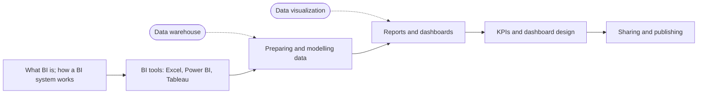

## Why this subject matters

Every Monday morning, the regional manager of Sahyadri Mart, a chain of 12 stores across Maharashtra, waits for one email. An office assistant downloads last week's billing data from each store, pastes it into Excel, fixes the mismatched columns, builds a few tables and sends them by Wednesday. By then the week is half over, and the numbers are already old.

Last Diwali, the Nagpur store ran out of dry fruits on the second day of the festival week. The data that showed the shortage coming was in the system all along. Nobody saw it in time.

**Business intelligence (BI)** fixes this. The data flows automatically from billing systems into one place, and a **dashboard** shows every store's sales, stock and targets on one screen, updated every few minutes. The manager opens it on her phone, sees Nagpur's dry-fruit stock falling fast, and moves stock from Amravati before it runs out. Same data, decision made days earlier.

## A short story

In 1958, Hans Peter Luhn, a researcher at IBM, published a paper titled "A Business Intelligence System". His idea was simple and ahead of its time: a machine should collect a company's documents and facts automatically and send each person only the information relevant to their work.

Computers of the 1950s could not deliver this. For the next three decades, managers got thick printed reports that arrived weeks late.

In 1989, Howard Dresner, later an analyst at the research firm Gartner, popularised "business intelligence" as an umbrella term for methods that improve decisions using fact-based computer systems. Data warehouses arrived in the 1990s, and self-service tools such as Tableau and Power BI arrived in the 2000s and 2010s. Luhn's dream finally became an ordinary office tool: today a store manager can build a dashboard herself, without waiting for the IT department.

## Where it is used today

- **Retail and e-commerce:** daily sales, stock levels and targets per store, city and product.
- **Banking and UPI payments:** transaction volumes, failed payments and fraud alerts, watched live.
- **Food delivery and ride apps:** orders, delivery times and driver availability by area, minute by minute.
- **Manufacturing:** machine output, downtime and defect rates on the factory floor.
- **Healthcare:** bed occupancy, patient waiting times and medicine stock in hospitals.
- **Government:** public dashboards for vaccination, crop prices, rainfall and scheme progress.
- **Education:** admissions, attendance and results across departments of a college.

## What you will be able to do

- Explain what business intelligence is and how data travels from source systems to a dashboard.
- Name the common BI tools (Excel, Power BI, Tableau, Looker Studio and others) and say what each is good for.
- Tell a dashboard from a report, and choose the right one for a manager's need.
- Choose KPIs (key performance indicators) that match a business goal.
- Choose the right chart for each question on a dashboard.
- Build a simple interactive dashboard from a sales dataset, with filters and drill-down.

## Careers that use it

- **Data Analyst and Business Analyst:** reports and dashboards are a daily output of the job.
- **BI Developer and BI Analyst:** build data models, reports and dashboards in Power BI or Tableau; one of the most common entry-level data jobs in India.
- **Data Engineer:** builds the pipelines and warehouses that feed BI tools.
- **Data Scientist:** uses dashboards to monitor models and share results with business teams.
- **Managers in any field:** read dashboards every day to run their teams.

## Map of the subject

## Sources

- Ramesh Sharda, Dursun Delen & Efraim Turban, *Business Intelligence, Analytics, and Data Science: A Managerial Perspective*, 4th ed., Pearson, 2018, Ch. 1 (verify)
- H. P. Luhn, "A Business Intelligence System", *IBM Journal of Research and Development*, 2(4), 1958, pp. 314–319 (verify)
- James R. Evans, *Business Analytics*, 3rd ed., Pearson, 2021, Ch. 1 (verify)
- Microsoft Power BI documentation, learn.microsoft.com/power-bi (verify)
