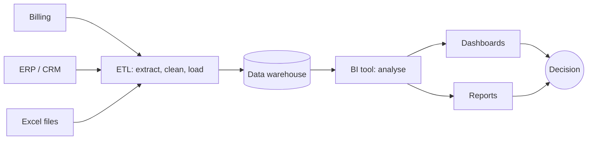

## Why should you care?

Sahyadri Mart has 12 stores across Maharashtra. Every store's billing software records each sale, so the company has millions of rows of data. Yet when the CEO asks "Which region missed its target last week, and why?", it takes the office two days to answer.

The data is not the problem. The problem is that nobody can *see* it quickly. Business intelligence tools pull the data together, keep it updated, and show it as reports and dashboards, so that the CEO's question is answered in one click, on a phone, during the meeting itself.

## In one line

Business intelligence (BI) is the set of tools and processes that collect business data into one place and present it as reports, dashboards and charts, so that people can monitor performance and make decisions quickly.

## Explained

### Q1. What is business intelligence?

==Business intelligence (BI) is the use of tools and processes to collect, store, analyse and present business data for better decisions.==

BI mainly answers **"What happened?"** and **"What is happening now?"**, which is descriptive analytics (see [[business-analytics]]).

A BI system has four parts:
- ==**Data sources:**== billing, ERP, CRM, Excel files, websites.
- ==**Data storage:**== a data warehouse or a BI tool's own data model.
- ==**Analysis:**== summaries, filters, drill-down, comparisons.
- ==**Presentation:**== reports, dashboards and charts for users.

### Q2. How does a BI system work?

Data passes through five stages:

1. ==**Collect:**== data comes from source systems such as store billing.
2. ==**Extract, transform, load (ETL):**== data is copied out, cleaned and made consistent (same date format, same store codes).
3. ==**Store:**== clean data sits in a [[data-warehouse]], organised for analysis rather than daily transactions.
4. ==**Analyse:**== the BI tool totals, groups, filters and compares the data.
5. ==**Present and act:**== users see reports and dashboards, then make decisions.

==The process repeats on a schedule== (hourly or daily), so the numbers stay current without manual work.

### Q3. What are BI tools? Name some common ones.

==BI tools are software that connect to data, prepare it and turn it into interactive reports and dashboards.==

| Tool | Maker | Good for |
|---|---|---|
| ==Excel== (pivot tables, Power Query) | Microsoft | Small data, quick analysis; already on every office PC |
| ==Power BI== | Microsoft | Company dashboards; low cost; links well with Excel |
| ==Tableau== | Salesforce | Rich, flexible visual exploration |
| ==Looker Studio== | Google | Free dashboards from Google Sheets and Analytics |
| Qlik Sense | Qlik | Fast exploration across linked tables |
| Metabase, Apache Superset | Open source | Free, self-hosted dashboards |

Common features: ==connect to many sources, drag-and-drop charts, filters and drill-down==, scheduled refresh, sharing on web and phone.

### Q4. What is a dashboard?

==A dashboard is a single screen that shows the most important measures of performance at a glance, usually updated automatically.==

Its building blocks are **KPIs**. ==A key performance indicator (KPI) is a number that shows progress towards a business goal==, such as revenue against target or average delivery time.

==Three types of dashboard:==
- ==**Strategic:**== for top management; long-term KPIs, monthly or quarterly (yearly revenue growth by region).
- ==**Tactical (analytical):**== for middle managers and analysts; trends and drill-down to find causes (why Vidarbha sales fell).
- ==**Operational:**== for staff running daily work; live or hourly (today's billing queue, stock-outs).

### Q5. What is a reporting system? What are the types of reports?

==A reporting system produces structured documents that present business data in a fixed format for a set audience.== Reports are usually detailed, tabular and printable.

==Types of reports:==
- ==**Scheduled (standard) reports:**== produced automatically at fixed times, such as the monthly sales report.
- ==**Ad hoc reports:**== built once to answer a new question ("sales of umbrellas in Konkan stores in June").
- ==**Exception reports:**== show only items outside normal limits, such as stores 10% below target.
- ==**Drill-down reports:**== start with totals and let the user click into detail (region → city → store → product).

### Q6. How is a dashboard different from a report?

==A dashboard is for monitoring at a glance; a report is for detailed reading and record.==

| Basis | Dashboard | Report |
|---|---|---|
| Purpose | ==Monitor performance quickly== | ==Give full detail== |
| Content | A few KPIs and charts | Many rows, tables, notes |
| Length | One screen | Many pages |
| Update | Live or frequent | Fixed period (daily, monthly) |
| Interaction | ==Filters, clicks, drill-down== | Mostly static, often printed or PDF |
| Typical user | Manager making quick decisions | Analyst, auditor, accounts team |

In practice, a dashboard often links to the report behind each number.

### Q7. How is data visualization used in BI?

==Data visualization is the presentation of data as charts and graphs so that patterns are seen quickly.== It is the "face" of every BI tool (see [[data-viz-intro]]).

Choose the chart by the question asked ([[choosing-a-chart]]):

| Question | Chart |
|---|---|
| ==Compare categories== (sales by store) | Bar chart |
| ==Trend over time== (daily revenue) | Line chart |
| ==Distribution== (bill amounts) | Histogram, box plot ([[distribution-plots]]) |
| ==Relationship== (ad spend vs revenue) | Scatter plot ([[scatter-plot]]) |
| ==Part of a whole== (share of each region) | Stacked bar; pie only for 2–4 parts |
| Single KPI | Big number card, gauge or bullet chart |

### Q8. What are the advantages and limitations of BI?

**Advantages**
- ==**Faster decisions:**== answers in minutes, not days.
- ==**One version of the truth:**== every department sees the same numbers.
- ==**Less manual work:**== no copy-pasting into Excel each week.
- ==**Early warning:**== alerts and exception reports show problems as they start.

**Limitations**
- ==**Garbage in, garbage out:**== dirty data gives wrong dashboards.
- ==**Mostly looks backward:**== BI describes the past; prediction needs further analytics.
- Cost and skill: licences, setup, and trained people are needed.

## Analogy and real-life example

A BI system is like a car's dashboard and the car's service record.

The **dashboard** in front of the driver shows only a few numbers (speed, fuel, engine warning), updated every second, so the driver can act immediately. The **service report** from the garage is long and detailed, read once every few months, and kept as a record. Nobody wants the full service report while driving, and nobody wants just a speedometer when buying a used car.

A real example: food-delivery companies run live operational dashboards showing orders, delivery times and available riders in each area. When rain slows deliveries in one area, the operations team sees it on the dashboard within minutes and moves riders there. At month end, the finance team reads a detailed scheduled report of the same data.

## Diagram

## Worked example

**Problem.** Sahyadri Mart's management wants a BI setup. Five people have five needs. For each, choose a **dashboard type** or **report type**, and one chart or format.

1. The CEO wants to see, each month, whether each of the five regions is meeting its yearly revenue target.
2. A store manager wants to watch today's footfall and number of bills, updated every hour.
3. The accounts team needs every store's daily revenue for March, to file GST.
4. The operations head wants to be told only about stores whose revenue fell more than 15% below last week.
5. An analyst wants to find out why Marathwada sales dropped in July.

**Solution.**

| Need | Choice | Chart or format | Reason |
|---|---|---|---|
| 1 | Strategic dashboard | Bullet chart per region (actual vs target) | Long-term goal, top management |
| 2 | Operational dashboard | KPI cards and an hourly line chart | Live monitoring of daily work |
| 3 | Scheduled report | Detailed table, exported as PDF or Excel | Full detail, kept as a record |
| 4 | Exception report | Short table of flagged stores, sent by email | Only items outside limits |
| 5 | Tactical dashboard with drill-down | Line chart by week, drill to city, store and product | Finding a cause needs detail |

## Try it

A college wants BI for its admissions office. Two needs are solved for you.

1. The principal wants a one-screen view of admissions this year against each department's target. **Strategic dashboard; bullet chart per department.**
2. The university asks for a list of every admitted student with category and fees paid. **Scheduled (standard) report; detailed table.**
3. The admission desk wants to see, during admission week, how many forms were filled in the last hour.
4. The office wants a list of only those departments where fewer than 50% of seats are filled.

Classify needs 3 and 4.

> [!answer]- Answer
> - **3: Operational dashboard.** Live or hourly monitoring of daily work; a KPI card and an hourly line or bar chart.
> - **4: Exception report.** It shows only items outside a limit (below 50%).

## Key facts and formulas

> [!important] Key facts
> - BI = tools and processes that collect, store, analyse and present data for decisions; mainly descriptive.
> - Four parts: data sources, data storage, analysis, presentation.
> - Flow: collect → ETL → data warehouse → analyse → present (reports, dashboards) → decide.
> - ETL = extract, transform, load.
> - Common tools: Excel, Power BI, Tableau, Looker Studio, Qlik Sense; open source: Metabase, Superset.
> - Dashboard = one screen of KPIs, updated automatically, for monitoring.
> - KPI = a number showing progress towards a business goal.
> - Dashboard types: strategic (top management), tactical/analytical (managers, analysts), operational (daily staff).
> - Report types: scheduled, ad hoc, exception, drill-down.
> - Dashboard = monitor at a glance; report = detail and record.
> - Chart by question: compare → bar; trend → line; distribution → histogram/box plot; relationship → scatter; part of whole → stacked bar.

## Common mistakes

> [!warning] Common mistake
> Thinking BI is the same as a BI tool. Installing Power BI does not create BI. Without clean, connected data and clear KPIs, the tool only draws attractive wrong charts.

> [!warning] Common mistake
> Filling a dashboard with 20 charts. A dashboard is for a quick glance. If a manager needs more than a few seconds to find the key number, it has become a cluttered report.

> [!warning] Common mistake
> Calling every number a KPI. "Total bills printed" is a measure; it becomes a KPI only when it is tied to a goal, such as "bills per hour against a target of 60".

> [!warning] Common mistake
> Using pie charts for many categories. Twelve stores in one pie give twelve thin slices that cannot be compared. A sorted bar chart shows the same data clearly.

## Think deeper

- **Measures change behaviour.** If a store manager is judged only on a "number of bills" KPI, what might they do that hurts the business? How would you choose KPIs that cannot be gamed easily?
- **Live or daily?** A live dashboard sounds better, but it costs more and can make managers react to random hourly ups and downs. For which decisions is a daily update enough?
- **Self-service BI.** If every manager builds their own dashboard, two dashboards may show different "revenue" for the same week. How would a company keep one version of the truth?
- **Beyond describing.** BI says what happened. What would you add to Sahyadri Mart's dashboard to show what is likely to happen next week?

## Self-check

> [!quiz] Q1. Which type of dashboard would a supermarket floor supervisor use to watch billing queues during the day?
> (A) Strategic
> (B) Tactical
> (C) Operational
> (D) Exception
>
> > [!answer]- Answer: C
> > Operational dashboards support day-to-day work with live or frequent updates. "Exception" is a type of report, not a dashboard.

> [!quiz] Q2. In a BI system, what does the ETL step do?
> (A) Draws charts for the dashboard
> (B) Copies data out of source systems, cleans it and loads it into the warehouse
> (C) Predicts next month's sales
> (D) Prints scheduled reports
>
> > [!answer]- Answer: B
> > ETL stands for extract, transform, load. It moves data from sources into the warehouse and makes it consistent.

> [!quiz] Q3. A bank wants a list of only those branches whose loan defaults rose above 5% this month. Which report type is this?
> (A) Scheduled report
> (B) Ad hoc report
> (C) Exception report
> (D) Drill-down report
>
> > [!answer]- Answer: C
> > An exception report shows only items outside normal limits, so managers see problems without reading every branch's figures.

> [!quiz] Q4. A manager wants to show how the share of revenue from each of 12 stores has changed over three years, on a dashboard. Which is the weakest choice?
> (A) A stacked bar chart, one bar per year
> (B) Three pie charts, one per year, with 12 slices each
> (C) A line chart with one line per store
> (D) A table of shares with the largest changes highlighted
>
> > [!answer]- Answer: B
> > Twelve thin slices cannot be compared within one pie, and comparing slices across three pies is harder still. The other options let the eye compare lengths or positions.

## Flashcards

What is business intelligence? :: The use of tools and processes to collect, store, analyse and present business data for better decisions
Which question does BI mainly answer? :: What happened, and what is happening now (descriptive analytics)
Name the four parts of a BI system. :: Data sources, data storage, analysis, presentation
What does ETL stand for? :: Extract, transform, load
Name four common BI tools. :: Any four of: Excel, Power BI, Tableau, Looker Studio, Qlik Sense, Metabase, Superset
What is a dashboard? :: A single screen showing the most important performance measures at a glance, updated automatically
What is a KPI? :: Key performance indicator: a number that shows progress towards a business goal
Name the three types of dashboard. :: Strategic, tactical (analytical), operational
Name four types of report. :: Scheduled, ad hoc, exception, drill-down
What does an exception report show? :: Only items outside normal limits
Dashboard vs report in one line? :: Dashboard: monitor at a glance; report: full detail and record
Which chart shows a trend over time? :: Line chart

## Sources

- Ramesh Sharda, Dursun Delen & Efraim Turban, *Business Intelligence, Analytics, and Data Science: A Managerial Perspective*, 4th ed., Pearson, 2018, Ch. 1 and 3 (verify)
- James R. Evans, *Business Analytics*, 3rd ed., Pearson, 2021, Ch. 1 and 3 (verify)
- Stephen Few, *Information Dashboard Design*, 2nd ed., Analytics Press, 2013, Ch. 1–2 (verify)
- Microsoft Power BI documentation, learn.microsoft.com/power-bi (verify)
- Tableau documentation, help.tableau.com (verify)
