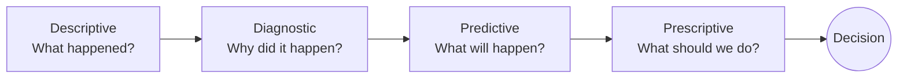

## Why should you care?

A chain of 20 medical stores in Nashik keeps running out of cough syrup every winter, while boxes of other medicines expire on the shelves. The owner orders stock "by experience": roughly what was ordered last month, plus a little extra.

The billing software already knows exactly what sold, where and when, for the last three years. Used properly, that data could tell the owner which stores need more syrup in November, which medicines are close to expiry, and how much to order next week. That is business analytics: using the data a business already has to make better decisions than gut feeling alone.

## In one line

Business analytics is the use of data, statistical and quantitative methods, and computer tools to understand business performance and to make better, fact-based decisions.

## Explained

### Q1. What is business analytics?

==Business analytics (BA) is the use of data, statistical methods and computer tools to support business decisions.==

It turns raw records into action in four steps:

**Data** (sales bills) → **information** (sales per store per month) → **insight** (syrup sales double in winter in two stores) → **decision** (send extra stock to those stores in October).

Four ingredients are always involved:
- ==**Data:** sales, customers, stock, finance==, web clicks.
- ==**Methods:** statistics, forecasting, optimization==, simulation.
- ==**Tools:** Excel, Python, Power BI==, Tableau.
- ==**People:** analysts who ask the right question== and managers who act on the answer.

### Q2. Why is business analytics important?

- ==**Better decisions:** choices rest on evidence==, not only opinion or habit.
- ==**Lower cost:** less waste==, less unsold stock, fewer wrong hires.
- ==**More revenue:** right price, right product==, right customer.
- ==**Speed:** problems are spotted early==, from data, instead of after losses.
- ==**Risk control:** fraud, defaults and supply shortages== are flagged in advance.
- ==**Competitive advantage:**== companies such as Amazon, Flipkart and Swiggy compete largely on how well they use data.

Data is now cheap and plentiful; the advantage lies in using it well.

### Q3. What is the scope of business analytics? (Types of analytics)

The scope is usually described by the **question** being answered.

==The four types of analytics are descriptive, diagnostic, predictive and prescriptive.==

| Type | Question | Example (medical store chain) | Typical methods |
|---|---|---|---|
| Descriptive | ==What happened?== | Syrup sales by month and store | Averages, totals, charts, dashboards |
| Diagnostic | ==Why did it happen?== | Sales rose with a flu outbreak | Drill-down, comparison, correlation |
| Predictive | ==What will happen?== | Expected sales next November | Regression, time-series forecasting |
| Prescriptive | ==What should we do?== | Best order quantity per store | Optimization, simulation |

==Value and difficulty both rise as you move down the table.== Some textbooks (including Evans) list only three types and treat diagnostic as part of descriptive.

### Q4. Where is business analytics applied?

| Area | Typical use |
|---|---|
| ==Marketing== | Customer segments, campaign performance, who will respond to an offer |
| ==Sales and retail== | Demand forecasting, stock levels, store comparison |
| ==Finance and banking== | Credit scoring, UPI fraud detection, budgeting |
| ==Operations and supply chain== | Delivery routes, inventory, warehouse location |
| ==Human resources== | Hiring, predicting which employees may leave |
| ==Healthcare== | Bed planning, patient follow-up, medicine stock |
| Pricing | Dynamic fares (airlines, ride apps), discounts |
| Sports | Player selection, auction strategy |
| Government | Crop and price monitoring, scheme targeting |

### Q5. What role does analytics play in decision making?

A decision normally follows these steps, and analytics supports each one:

1. ==**Recognise the problem:**== descriptive reports show that something is off (stock-outs every winter).
2. ==**Understand the cause:**== diagnostic analysis finds why.
3. ==**Generate options:**== order more, move stock between stores, change suppliers.
4. ==**Evaluate options:**== predictive models estimate what each option would lead to.
5. ==**Choose:**== prescriptive methods find the best option within limits (budget, shelf space).
6. ==**Act and monitor:**== dashboards check whether the decision worked.

==Analytics supports decisions; managers still make them.== Judgment, ethics and context remain human jobs.

### Q6. How is business analytics different from BI and data science?

- ==**Business intelligence (BI)**== mainly ==reports and visualises what has happened==: dashboards and reports (descriptive). You will study BI tools in Unit 2.
- ==**Business analytics** covers BI and goes further==, into why, what next and what to do.
- ==**Data science** is broader still==: it includes programming, machine learning and new kinds of data (text, images), and is not limited to business problems.

The boundaries overlap in practice; job titles vary between companies.

## Analogy and real-life example

Business analytics works like a doctor treating a patient:

- **Descriptive:** the thermometer says 102°F. *What is happening?*
- **Diagnostic:** blood tests show a viral infection. *Why?*
- **Predictive:** "the fever should go in three days." *What will happen?*
- **Prescriptive:** "take this medicine twice a day and rest." *What should you do?*

A real example is a food-delivery app at dinner time. It reports orders per area (descriptive), finds that rain caused a spike (diagnostic), forecasts orders for the next hour (predictive), and decides how many delivery partners to move to each area and what surge fee to show (prescriptive).

## Diagram

## Worked example

**Problem.** "Chai Junction" runs 8 tea outlets in Mumbai. The owner asks five questions. Classify each by type of analytics and name a suitable method.

1. What were the total sales of each outlet last month?
2. Why did the Andheri outlet's sales fall in July?
3. How many cups will the Dadar outlet sell next Monday?
4. How many litres of milk should each outlet order daily to keep waste low without running out?
5. Do outlets near railway stations sell more than outlets near colleges?

**Solution.**

| Q | Type | Reason | Method |
|---|---|---|---|
| 1 | Descriptive | Summarises the past | Totals, bar chart |
| 2 | Diagnostic | Looks for a cause | Compare by week, check rain or road work |
| 3 | Predictive | Estimates the future | Time-series forecast |
| 4 | Prescriptive | Recommends an action under limits | Optimization or simulation |
| 5 | Descriptive (comparison) | Compares past sales of two groups | Group averages; a hypothesis test checks if the gap is real |

Note Q5: comparing groups is still about the past. It becomes diagnostic only when you ask *why* the gap exists.

## Try it

An online clothing store asks four questions. Two are classified for you.

1. How many orders were returned last quarter? **Descriptive**
2. Which customers are likely to stop buying in the next three months? **Predictive**
3. Why did returns double for one brand?
4. What discount should be offered to each customer group to maximise profit?

Classify questions 3 and 4.

> [!answer]- Answer
> - **Q3: Diagnostic.** It looks for the cause of something that already happened (perhaps a sizing problem or a bad batch).
> - **Q4: Prescriptive.** It recommends the best action (a discount level) to reach a goal (maximum profit), usually with optimization.

## Key facts and formulas

> [!important] Key facts
> - Business analytics = data + statistical/quantitative methods + tools, used to make better decisions.
> - Chain: data → information → insight → decision.
> - Four types: descriptive (what happened), diagnostic (why), predictive (what will happen), prescriptive (what should we do).
> - Value and difficulty increase from descriptive to prescriptive.
> - Importance: better decisions, lower cost, more revenue, speed, risk control, competitive advantage.
> - Applications: marketing, retail, finance, operations, HR, healthcare, pricing, sports, government.
> - Decision steps: recognise problem → find cause → generate options → evaluate → choose → act and monitor.
> - BI reports the past; BA also explains, predicts and recommends.

## Common mistakes

> [!warning] Common mistake
> Thinking business analytics means making dashboards. Dashboards are only the descriptive part. Explaining causes, forecasting and recommending actions are equally part of BA.

> [!warning] Common mistake
> Believing that more data automatically gives better decisions. Wrong, dirty or irrelevant data gives confident wrong answers. A clear question and clean data matter more than volume.

> [!warning] Common mistake
> Treating a prediction as a certainty. "Expected sales next Monday: 950 cups" is an estimate with uncertainty, not a promise. Good analysts report a range.

> [!warning] Common mistake
> Confusing correlation with cause in diagnostic analysis. Ice-cream sales and drowning cases both rise in summer; one does not cause the other (see [[correlation]]).

## Think deeper

- **When should a manager overrule the data?** A model says close a loss-making rural branch of a bank. What might the model not see (social goals, future growth, customer loyalty)?
- **Prescriptive analytics changes behaviour.** If every store in a chain follows the same "optimal" stocking rule, could that create new problems, such as all stores running short on the same day?
- **Ethics.** A lender's model rejects more applicants from certain pin codes. The data is real, so is the decision fair? What should the analyst check?
- **Cost of analysis.** For a single tea stall, is a forecasting model worth building? At what size does analytics start to pay for itself?

## Self-check

> [!quiz] Q1. "Which products will be in highest demand during Diwali next year?" Which type of analytics answers this?
> (A) Descriptive
> (B) Diagnostic
> (C) Predictive
> (D) Prescriptive
>
> > [!answer]- Answer: C
> > The question asks about the future, so it needs predictive analytics such as forecasting.

> [!quiz] Q2. Which type of analytics recommends the best action, usually using optimization?
> (A) Descriptive
> (B) Diagnostic
> (C) Predictive
> (D) Prescriptive
>
> > [!answer]- Answer: D
> > Prescriptive analytics answers "what should we do?" and uses optimization and simulation to find the best option within constraints.

> [!quiz] Q3. A monthly dashboard shows sales by region. What is it mainly an example of?
> (A) Descriptive analytics
> (B) Predictive analytics
> (C) Prescriptive analytics
> (D) Machine learning
>
> > [!answer]- Answer: A
> > It summarises what has already happened. This is descriptive analytics, the main job of BI tools.

> [!quiz] Q4. A hospital uses analytics to decide the number of nurses per shift. A senior doctor says the analysis should "replace the hospital manager". What is the best response?
> (A) Agree: models are always more accurate than people
> (B) Disagree: analytics supports the decision, but people must weigh context, ethics and factors the data does not capture
> (C) Agree, but only for predictive analytics
> (D) Disagree: analytics is only for retail businesses
>
> > [!answer]- Answer: B
> > Analytics improves decisions with evidence. Managers remain responsible for judgment, for context the data misses (such as a local outbreak), and for ethical choices.

## Flashcards

What is business analytics? :: The use of data, statistical methods and tools to support business decisions
What is the chain from data to decision? :: Data → information → insight → decision
Name the four types of analytics. :: Descriptive, diagnostic, predictive, prescriptive
Which question does descriptive analytics answer? :: What happened?
Which question does diagnostic analytics answer? :: Why did it happen?
Which question does predictive analytics answer? :: What will happen?
Which question does prescriptive analytics answer? :: What should we do?
Which type of analytics has the highest value and difficulty? :: Prescriptive
Give three applications of business analytics. :: Any three of: marketing, retail, finance, operations, HR, healthcare, pricing, sports, government
How does BI differ from business analytics? :: BI mainly reports the past; business analytics also explains, predicts and recommends

## Sources

- James R. Evans, *Business Analytics*, 3rd ed., Pearson, 2021, Ch. 1: Introduction to Business Analytics
- S. C. Albright & W. L. Winston, *Business Analytics: Data Analysis and Decision Making*, 7th ed., Cengage, 2020, Ch. 1: Introduction to Business Analytics
- T. H. Davenport & J. G. Harris, *Competing on Analytics*, Harvard Business School Press, 2007, Ch. 1: The Nature of Analytical Competition
