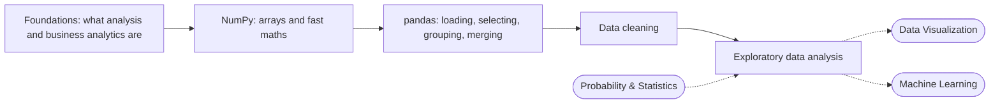

## Why this subject matters

A Pune bakery sells 400 items a day. Every evening the owner throws away unsold bread and, on some mornings, runs out of pav before 9 a.m. The billing machine has recorded every sale for two years. The answer to "how much should I bake on a Saturday in June?" is sitting in that data. Nobody has looked.

That is the situation in almost every organisation: data is collected automatically, but very little of it is turned into decisions. **Data analysis** is the skill of loading that data, cleaning it, summarising it and finding the patterns that answer a real question. It is the first thing every data analyst, data scientist and ML engineer does on every project, before any model is built.

## A short story

In 2002 the Oakland Athletics, a US baseball team, had one of the smallest player budgets in the league. Rich teams bought star players; Oakland could not.

Their general manager, Billy Beane, did something unusual. Instead of trusting scouts' opinions, his team analysed years of player statistics and asked a simple question: *which numbers actually lead to winning games?* They found that one measure, how often a batter gets on base, mattered far more than the market believed. Players strong on that measure were cheap.

Oakland built a team of such players and won 103 games that season, including a record run of 20 wins in a row. The story became the book and film *Moneyball*. Today every IPL franchise employs data analysts for auctions and match strategy for the same reason: careful analysis beats expensive guesswork.

## Where it is used today

- **Retail and e-commerce:** which products to stock in which city, which customers are about to stop buying.
- **Food delivery and ride apps:** expected delivery time, surge pricing, where to place delivery partners at 8 p.m.
- **Banking and UPI:** spotting unusual transactions that may be fraud.
- **Healthcare:** finding which patients are likely to miss follow-up visits.
- **Government:** analysing crop, rainfall and price data to plan procurement.
- **Sports:** player selection, auction budgets, field placement.
- **Machine learning:** every model starts with an analyst exploring and cleaning the data. A model trained on messy data gives confident, wrong answers.

## What you will be able to do

- Explain what data analysis and business analytics are, and how they support decisions.
- Load data from CSV and Excel files into Python with pandas.
- Work with arrays in NumPy and tables (DataFrames) in pandas.
- Clean real data: missing values, duplicates, wrong data types and outliers.
- Explore a dataset (EDA): summarise each column, compare groups and find relationships.
- Turn your findings into a short, clear answer to a business question.

## Careers that use it

- **Data Analyst:** this subject is the core of the job.
- **Business Analyst:** analysis to support management decisions.
- **Data Scientist:** analysis and cleaning before every model.
- **ML Engineer and Data Engineer:** checking and preparing the data that pipelines and models depend on.
- **Product and marketing roles:** reading dashboards and asking the right questions of data.

## Map of the subject

## Sources

- Wes McKinney, *Python for Data Analysis*, 3rd ed., Ch. 1 (verify)
- James R. Evans, *Business Analytics*, Ch. 1 (verify)
- Michael Lewis, *Moneyball: The Art of Winning an Unfair Game*, 2003
