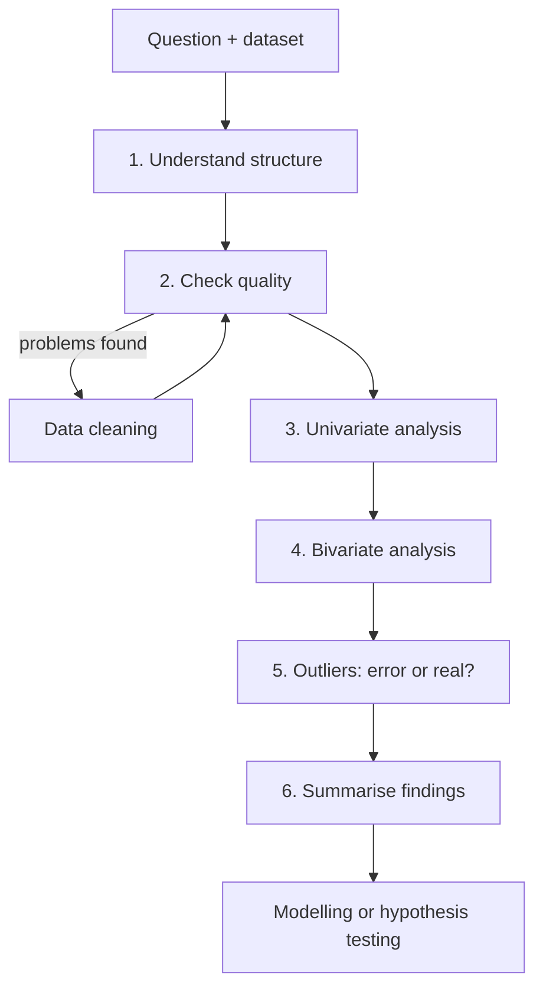

## Why should you care?

A new analyst at a supermarket chain is asked: "Which store should get the extra marketing budget?" She opens the sales file and immediately builds a model. It says the Nanded store has the best return on advertising.

A week later someone notices that one Nanded row says ₹45 lakh in a single day, ten times the usual. It was a typing error. The whole recommendation rested on one wrong number.

Fifteen minutes of looking at the data first would have caught it. That first look, done carefully and in a fixed order, is **exploratory data analysis**. Every analytics and machine-learning project starts with it.

## In one line

Exploratory data analysis (EDA) is the first, open-minded examination of a dataset, using summary numbers and simple charts, to understand its structure, check its quality and find patterns, relationships and outliers before any formal analysis or model.

## Explained

### Q1. What is EDA, and who introduced it?

==EDA is examining data with summaries and charts to understand it before formal analysis.==

The statistician ==**John Tukey** made the idea popular== in his 1977 book *Exploratory Data Analysis*. His point: before *testing* ideas about data (confirmatory analysis), first *let the data show you* what is in it.

| | Exploratory (EDA) | Confirmatory |
|---|---|---|
| Goal | ==Discover patterns, raise questions== | ==Test a specific claim== |
| Approach | Open-ended, flexible | Planned in advance |
| Tools | Summaries, charts | Hypothesis tests, models |
| Output | Insights and hypotheses | A decision: accept or reject |

### Q2. Why do EDA before anything else?

EDA answers four practical questions:

1. ==**Is the data what I think it is?**== Right rows, right columns, right data types.
2. ==**Can I trust it?**== Missing values, duplicates, impossible values (negative sales, a 240-year-old customer).
3. ==**What does each variable look like?**== Typical value, spread, shape.
4. ==**What is related to what?**== Which factors move together, and which groups differ.

It also guides what comes next: which variables to clean, which method suits the data, and which questions are worth testing. Skipping EDA is the most common reason analyses and models fail quietly.

### Q3. What are the steps of EDA?

==Steps of EDA: understand structure, check quality, univariate analysis, bivariate analysis, outliers, summarise findings.==

1. ==**Understand the structure:** number of rows and columns==, what one row means, the data type of each column.
2. ==**Check quality:** missing values, duplicate rows==, wrong types, impossible values.
3. ==**Univariate analysis:** study one variable at a time==.
4. ==**Bivariate (and multivariate) analysis:**== study two or more variables together.
5. ==**Look for outliers:** values far from the rest==, and decide why they are there.
6. ==**Summarise findings:** a short list of insights==, problems and questions for the next stage.

Problems found in step 2 are fixed during [[data-cleaning]]; EDA finds them, cleaning fixes them.

### Q4. How do you study one variable (univariate analysis)?

The summary depends on the variable's type (see [[types-of-variables]]):

| Variable type | Example | Summaries | Charts |
|---|---|---|---|
| Numerical | Daily revenue, footfall | ==Mean, median, min, max, standard deviation, quartiles== | ==Histogram, box plot== |
| Categorical | Store type, region | ==Count and percentage of each category, mode== | ==Bar chart== |

For a numerical variable, describe its **centre** ([[central-tendency]]), its **spread** ([[dispersion]]) and its **shape**: symmetric, or with a long tail on one side. If the mean is much larger than the median, a few very large values are pulling it up.

### Q5. How do you study relationships (bivariate analysis)?

| Pair of variables | Question | Tool |
|---|---|---|
| Numerical and numerical | Do they move together? | ==Scatter plot==, [[correlation]] |
| Categorical and numerical | Do groups differ? | ==Group means or medians, side-by-side box plots== |
| Categorical and categorical | Are they linked? | ==Cross-tabulation (counts table)== |
| Time and numerical | Is there a trend or season? | ==Totals by month or weekday, line chart== |

==A relationship found in EDA is a clue to investigate, not proof of cause.==

### Q6. What is an outlier, and what should you do with one?

==An **outlier** is a value far away from most of the others.== One common rule marks values more than 1.5 × IQR beyond the quartiles (see [[quartiles-and-percentiles]]).

Never delete an outlier automatically. First ask **why** it is there:

- ==**Error**== (typing mistake, faulty sensor): ==correct it or remove it==.
- ==**Genuine but rare**== (Diwali-day sales): ==keep it==; it is real and often the most important data point.
- ==**Different group**== (a wholesale order in retail data): ==analyse it separately==.

## Analogy and real-life example

EDA is like a doctor's first examination. Before ordering an MRI (the model), the doctor checks temperature, pulse, weight and blood pressure, and asks what is wrong. Most problems are spotted here, and the basic checks decide which expensive test makes sense.

A real example: a food-delivery company plans to predict delivery time. EDA shows that 3% of orders have a delivery time of 0 minutes (cancelled orders recorded as delivered), that times are much longer on rainy evenings, and that one city has twice the average. Each finding changes the model: remove the bad rows, add rainfall as a factor, treat that city separately.

## Diagram

## Worked example

**Problem.** One week of data from a small store:

| Day | Footfall | Rainfall (mm) | Festival |
|---|---|---|---|
| Mon | 480 | 0 | No |
| Tue | 455 | 12 | No |
| Wed | 470 | 0 | No |
| Thu | 410 | 35 | No |
| Fri | 500 | *(blank)* | No |
| Sat | 560 | 0 | No |
| Sun | 920 | 0 | Yes (Diwali) |

Do a quick EDA.

**Solution.**

1. **Structure:** 7 rows, one row = one day; 4 columns: day (categorical), footfall (numerical), rainfall (numerical), festival (categorical).
2. **Quality:** rainfall is missing for Friday. No impossible values.
3. **Univariate (footfall):**
   - Mean = (480 + 455 + 470 + 410 + 500 + 560 + 920) ÷ 7 = 3,795 ÷ 7 ≈ **542**.
   - Median: sorted values 410, 455, 470, **480**, 500, 560, 920, so median = **480**.
   - Mean > median: one large value pulls the mean up.
4. **Outlier:** Sunday's 920 is almost double the other days. It is Diwali, so it is **genuine**: keep it, but report it separately. Without Sunday, mean footfall = 2,875 ÷ 6 ≈ **479**.
5. **Bivariate:** the two rainy weekdays had 455 and 410 visitors; the dry weekdays (Mon, Wed) had 480 and 470. Rain may reduce footfall. With only 7 days this is a clue, not a conclusion.
6. **Findings:** typical footfall is about 480 a day; festivals more than double it; rain may lower it; Friday's rainfall must be fixed or noted before any rain analysis.

## Try it

A summary of a customer file shows:

| Column | Min | Max | Missing |
|---|---|---|---|
| age | 0 | 240 | 0 |
| bill_amount (₹) | −350 | 18,400 | 12 |
| city | — | — | 0 |

Two problems are found for you:

1. **age max = 240:** impossible; a data-entry error.
2. **12 missing bill amounts:** must be investigated before computing average bills.

Find two more things worth checking, and say what you would do.

> [!answer]- Answer
> - **age min = 0:** probably a blank stored as 0. Check how many rows have it; treat them as missing, not as babies.
> - **bill_amount min = −350:** negative bills may be refunds. Ask the business; analyse refunds separately instead of mixing them with sales.
> - **bill_amount max = 18,400:** could be a genuine bulk purchase or an error. Look at that row before deciding.
> - **city:** check the spellings, e.g. "Pune", "pune" and "Poona" counted as three cities.

## Key facts and formulas

> [!important] Key facts
> - EDA = first examination of data with summaries and charts, before formal analysis. Introduced by John Tukey (1977).
> - Exploratory = discover patterns and questions; confirmatory = test a specific claim.
> - Six steps: structure → quality → univariate → bivariate → outliers → summarise.
> - Univariate: numerical → centre, spread, shape (histogram, box plot); categorical → counts, percentages, mode (bar chart).
> - Bivariate: num–num → scatter plot, correlation; cat–num → group comparison, box plots; cat–cat → cross-tab; time → trend and season.
> - Mean much larger than median → a long right tail (a few very large values).
> - Outlier rule of thumb: beyond 1.5 × IQR from the quartiles. Decide: error, genuine, or a different group.
> - EDA finds data problems; data cleaning fixes them.

## Common mistakes

> [!warning] Common mistake
> Deleting every outlier. Outliers are often the most important data: festival sales, fraud, equipment failure. Remove one only after showing it is an error.

> [!warning] Common mistake
> Reading only the mean. A mean of 542 visitors hides that six days were near 480 and one was 920. Always look at the median, the spread and a chart too.

> [!warning] Common mistake
> Treating a pattern from EDA as a proven fact. EDA generates hypotheses; confirming them needs proper tests and enough data.

> [!warning] Common mistake
> Computing averages of code numbers. The mean of store IDs or pin codes means nothing: they are labels (categorical), even though they look like numbers.

## Think deeper

- **How much EDA is enough?** A deadline is tomorrow. Which two or three checks would you never skip, and why?
- **Finding what you want.** If you look at 50 charts, some patterns will appear by pure chance. How can an analyst avoid "discovering" coincidences and presenting them as insights?
- **Missing is information.** Rainfall is blank only at two stores. Why might *where* data is missing matter as much as *how much* is missing?

> [!beyond] Beyond the syllabus
> Libraries such as ydata-profiling and Sweetviz produce an automatic EDA report from a DataFrame in one line. They are fast for a first look, but an analyst must still read the report with the business question in mind.

## Self-check

> [!quiz] Q1. Which statement best describes EDA?
> (A) Testing a pre-stated hypothesis with a significance test
> (B) Examining data with summaries and charts to understand it before formal analysis
> (C) Building a predictive model on the cleaned data
> (D) Collecting data through surveys
>
> > [!answer]- Answer: B
> > EDA is the open-ended first look at data. Testing a stated hypothesis is confirmatory analysis.

> [!quiz] Q2. Daily revenue has mean ₹4.4 lakh and median ₹3.3 lakh. What does this suggest?
> (A) The data has no outliers
> (B) A few very high values pull the mean up (long right tail)
> (C) Most days have revenue above ₹4.4 lakh
> (D) The data must contain errors
>
> > [!answer]- Answer: B
> > When the mean is well above the median, a minority of large values stretches the distribution to the right. They may be genuine, such as festival days.

> [!quiz] Q3. To compare footfall between Supermarket and Express stores, which EDA tool fits best?
> (A) Correlation coefficient
> (B) Cross-tabulation of two categorical variables
> (C) Group summaries or side-by-side box plots
> (D) A pie chart of store types
>
> > [!answer]- Answer: C
> > Store type is categorical and footfall is numerical, so compare group summaries (mean, median) or box plots by group.

> [!quiz] Q4. A store's sales on Diwali are four times its normal daily sales. What should an analyst do?
> (A) Delete the row, because it is an outlier
> (B) Replace it with the average
> (C) Keep it, explain it as a genuine festival effect, and consider reporting festival days separately
> (D) Ignore the whole week
>
> > [!answer]- Answer: C
> > The value is real and explained. Deleting it would hide the most important sales day; reporting it separately keeps the normal-day summary honest.

## Flashcards

What is EDA? :: The first examination of data with summaries and charts to understand it before formal analysis
Who popularised EDA? :: John Tukey, in his 1977 book Exploratory Data Analysis
How does exploratory analysis differ from confirmatory analysis? :: Exploratory discovers patterns and questions; confirmatory tests a specific claim
List the six steps of EDA. :: Structure, quality, univariate, bivariate, outliers, summarise findings
How do you summarise a numerical variable? :: Centre, spread and shape (mean, median, SD, quartiles; histogram or box plot)
How do you summarise a categorical variable? :: Counts and percentages of each category, mode; bar chart
Which tool compares a numerical variable across groups? :: Group summaries or side-by-side box plots
What does mean much larger than median suggest? :: A long right tail: a few very large values
What is the 1.5 × IQR rule? :: Values more than 1.5 × IQR below Q1 or above Q3 are flagged as possible outliers
What should you do before removing an outlier? :: Find out whether it is an error, a genuine rare value, or a different group

## Sources

- John W. Tukey, *Exploratory Data Analysis*, Addison-Wesley, 1977
- NIST/SEMATECH *e-Handbook of Statistical Methods*, Ch. 1: Exploratory Data Analysis
- Wes McKinney, *Python for Data Analysis*, 3rd ed., O'Reilly, 2022, Ch. 5: Getting Started with pandas; Ch. 10: Data Aggregation and Group Operations
- S. C. Albright & W. L. Winston, *Business Analytics: Data Analysis and Decision Making*, 7th ed., Cengage, 2020, Ch. 2: Describing the Distribution of a Variable; Ch. 3: Finding Relationships among Variables
