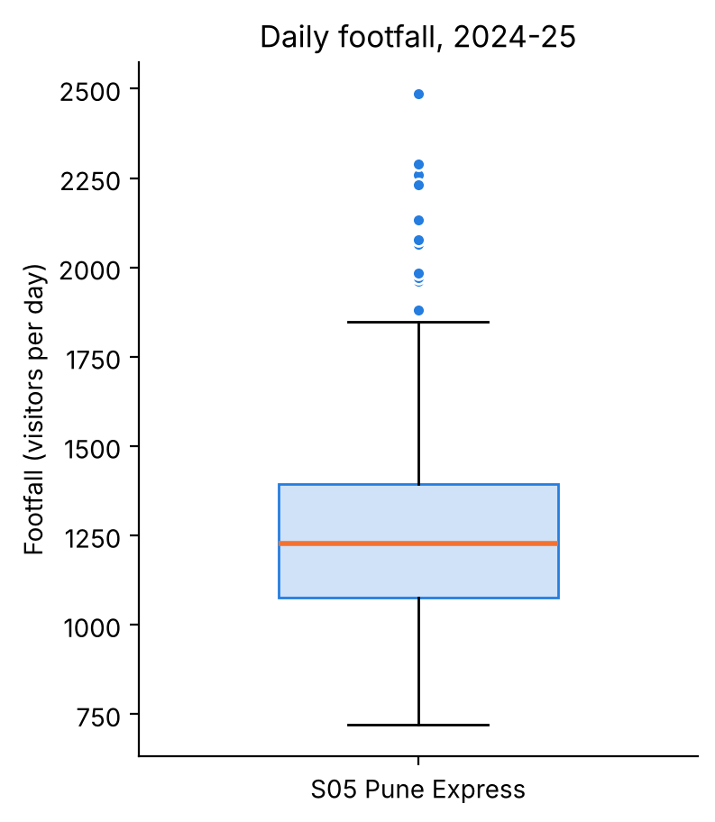
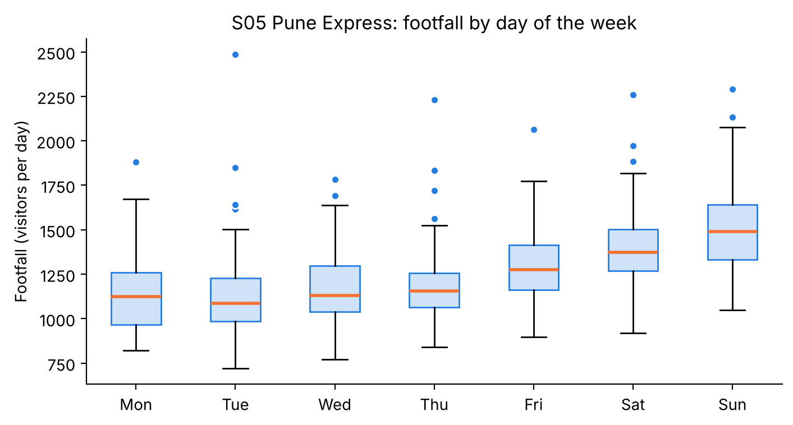
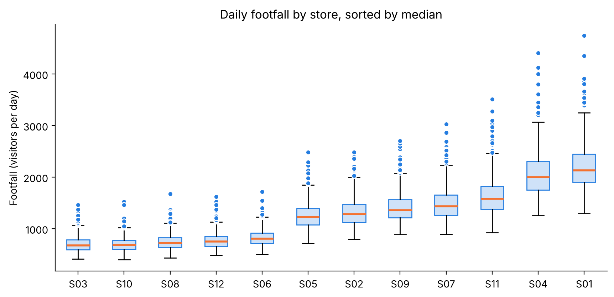
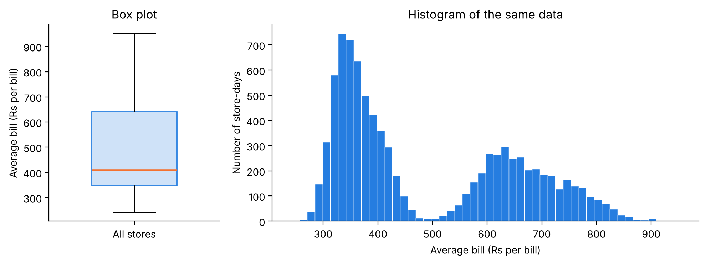

## Aim

To create box plots of business variables in Python, compute the five-number summary and the 1.5 × IQR outlier fences behind them, and use side-by-side box plots to compare groups.

## Concepts used

- [[distribution-plots]]: parts of a box plot and the 1.5 × IQR rule.
- [[quartiles-and-percentiles]]: Q1, Q3 and the IQR.
- [[histogram-practical]]: the same data drawn as histograms.

## Setup (Colab)

[Open in Colab](https://colab.research.google.com/github/Prathameshv07/ai-ds-notes/blob/main/content/assets/notebooks/data-viz/box-plot-practical.ipynb). Nothing to install.

- **Dataset:** Sahyadri Mart daily sales (synthetic; its data card in `content/assets/data/` lists every column). One row = one store on one day.
- Most steps use **S05**, the Pune Express store.
- `BOX` in Step 1 is a dictionary of style settings (colours of the box, median and outlier dots). `**BOX` passes them all to `plt.boxplot()`, so every chart looks the same. Plain `plt.boxplot(data)` also works.
- The outputs below come from pandas 3 and matplotlib 3.11. On current Colab versions, numbers and charts are the same.

## Code

### Step 1. Load the data, pick S05 (the Pune Express store) and set a clean chart style

```python
# Step 1. Load the data, pick S05 (the Pune Express store) and set a clean chart style
import pandas as pd
import matplotlib.pyplot as plt

url = ("https://raw.githubusercontent.com/Prathameshv07/ai-ds-notes/main/"
       "content/assets/data/sahyadri-mart-sales.csv")
df = pd.read_csv(url, parse_dates=["date"])
s05 = df[df["store_id"] == "S05"]
f = s05["footfall"]
plt.rcParams.update({"axes.spines.top": False, "axes.spines.right": False})
BOX = dict(patch_artist=True, boxprops=dict(facecolor="#cfe2f8", edgecolor="#257de0"),
           medianprops=dict(color="#f47230", linewidth=2),
           flierprops=dict(marker="o", markersize=5, markerfacecolor="#257de0", markeredgecolor="white"))
print("Days for S05:", len(f))
```

### Step 2. The numbers behind the box: five-number summary, IQR and fences

```python
# Step 2. The numbers behind the box: five-number summary, IQR and fences
q1, median, q3 = f.quantile([0.25, 0.50, 0.75])
iqr = q3 - q1
low_fence, high_fence = q1 - 1.5 * iqr, q3 + 1.5 * iqr
inside = f[(f >= low_fence) & (f <= high_fence)]
print(f"Minimum      : {f.min()}")
print(f"Q1           : {q1:.0f}")
print(f"Median (Q2)  : {median:.0f}")
print(f"Q3           : {q3:.0f}")
print(f"Maximum      : {f.max()}")
print(f"IQR = Q3 - Q1: {iqr:.0f}")
print(f"Fences       : {low_fence:.0f} to {high_fence:.0f}")
print(f"Whiskers end : {inside.min()} and {inside.max()}  (furthest days inside the fences)")
print(f"Outliers     : {(f < low_fence).sum()} low, {(f > high_fence).sum()} high")
```

### Step 3. Draw the box plot of S05's daily footfall

```python
# Step 3. Draw the box plot of S05's daily footfall
plt.figure(figsize=(4, 5))
plt.boxplot(f, widths=0.5, **BOX)
plt.xticks([1], ["S05 Pune Express"])
plt.ylabel("Footfall (visitors per day)")
plt.title("Daily footfall, 2024-25")
plt.show()
```

### Step 4. Who are the outliers? List the high-outlier days

```python
# Step 4. Who are the outliers? List the high-outlier days
out = s05[f > high_fence]
print(out[["date", "day_of_week", "is_festival", "discount_pct", "footfall"]]
      .sort_values("footfall", ascending=False).to_string(index=False))
print("\nFestival days:", out["is_festival"].sum(), "| Saturdays or Sundays:",
      out["day_of_week"].isin(["Saturday", "Sunday"]).sum(), "| of", len(out))
```

### Step 5. Side-by-side box plots: S05 footfall by day of the week

```python
# Step 5. Side-by-side box plots: S05 footfall by day of the week
days = ["Monday", "Tuesday", "Wednesday", "Thursday", "Friday", "Saturday", "Sunday"]
groups = [s05.loc[s05["day_of_week"] == d, "footfall"] for d in days]
plt.figure(figsize=(8, 4))
plt.boxplot(groups, **BOX)
plt.xticks(range(1, 8), [d[:3] for d in days])
plt.ylabel("Footfall (visitors per day)")
plt.title("S05 Pune Express: footfall by day of the week")
plt.show()
print(s05.groupby("day_of_week")["footfall"].median().reindex(days).rename("median").to_string())
```

### Step 6. Compare all 12 stores, sorted by median footfall

```python
# Step 6. Compare all 12 stores, sorted by median footfall
order = df.groupby("store_id")["footfall"].median().sort_values().index
groups = [df.loc[df["store_id"] == s, "footfall"] for s in order]
plt.figure(figsize=(10, 4.5))
plt.boxplot(groups, **BOX)
plt.xticks(range(1, 13), order)
plt.ylabel("Footfall (visitors per day)")
plt.title("Daily footfall by store, sorted by median")
plt.show()
summary = df.groupby("store_id")["footfall"].describe()[["25%", "50%", "75%"]].loc[order]
summary["IQR"] = summary["75%"] - summary["25%"]
print(summary.astype(int).to_string())
```

### Step 7. What a box plot cannot show: two humps in the average bill of all stores

```python
# Step 7. What a box plot cannot show: two humps in the average bill of all stores
bill = df["revenue_inr"] / df["transactions"]                 # rupees per bill
fig, axes = plt.subplots(1, 2, figsize=(10, 3.8), gridspec_kw={"width_ratios": [1, 2.5]})
axes[0].boxplot(bill, widths=0.5, **BOX)
axes[0].set_xticks([1], ["All stores"])
axes[0].set_ylabel("Average bill (Rs per bill)")
axes[0].set_title("Box plot")
axes[1].hist(bill, bins=50, color="#257de0", edgecolor="white", linewidth=0.5)
axes[1].set_xlabel("Average bill (Rs per bill)")
axes[1].set_ylabel("Number of store-days")
axes[1].set_title("Histogram of the same data")
plt.tight_layout()
plt.show()
```

## Output

### Step 1

```output
Days for S05: 731
```

### Step 2

```output
Minimum      : 721
Q1           : 1077
Median (Q2)  : 1227
Q3           : 1393
Maximum      : 2486
IQR = Q3 - Q1: 316
Fences       : 603 to 1867
Whiskers end : 721 and 1849  (furthest days inside the fences)
Outliers     : 0 low, 15 high
```

### Step 3



### Step 4

```output
      date day_of_week  is_festival  discount_pct  footfall
2025-10-21     Tuesday            1            10      2486
2025-10-19      Sunday            1            10      2290
2024-09-07    Saturday            1            10      2259
2024-10-31    Thursday            1            10      2230
2025-03-30      Sunday            1            10      2132
2025-12-21      Sunday            0            15      2077
2024-11-01      Friday            1            10      2064
2025-12-28      Sunday            0            10      1983
2025-10-18    Saturday            1            10      1971
2024-12-22      Sunday            0            10      1961
2024-12-08      Sunday            0             5      1889
2025-10-11    Saturday            0             5      1884
2025-10-20      Monday            1            10      1881
2024-10-12    Saturday            1            10      1880
2024-04-07      Sunday            1            10      1879

Festival days: 10 | Saturdays or Sundays: 11 | of 15
```

### Step 5



```output
day_of_week
Monday       1125.0
Tuesday      1086.0
Wednesday    1132.0
Thursday     1155.5
Friday       1274.5
Saturday     1373.5
Sunday       1491.0
```

### Step 6



```output
           25%   50%   75%  IQR
store_id                       
S03        595   674   785  189
S10        602   681   773  171
S08        642   724   831  189
S12        659   756   853  194
S06        715   808   921  205
S05       1077  1227  1393  316
S02       1128  1286  1477  349
S09       1213  1363  1563  350
S07       1264  1438  1658  394
S11       1383  1581  1819  436
S04       1755  2001  2302  547
S01       1907  2135  2451  544
```

### Step 7



## Explanation

### Step 2: the five numbers behind the box

| Part of the plot | Value | Meaning |
|---|---|---|
| Bottom of box (Q1) | 1,077 | 25% of days had fewer visitors |
| Line in box (median) | 1,227 | Half the days below, half above |
| Top of box (Q3) | 1,393 | 75% of days had fewer visitors |
| Box height (IQR) | 316 | The middle 50% of days |
| Fences | 603 and 1,867 | Q1 − 1.5 × 316 and Q3 + 1.5 × 316 |
| Whiskers | 721 and 1,849 | Quietest and busiest days inside the fences |

`f.quantile()` uses the same (linear) method as `plt.boxplot()`, so these numbers match the chart exactly. The hand method in [[quartiles-and-percentiles]], position $k(n+1)/4$, can differ by a visitor or two here; with 731 days the difference does not matter. ==Whiskers end at the last data value inside the fences, not at the fences themselves.==

### Steps 3–4: outliers are real days, not errors

- The box sits low and the 15 outliers are all on the top: footfall is **right-skewed**, matching the histogram practical.
- Step 4 names them: 10 are festival days or the days just before them (Diwali, Ganesh Chaturthi, Gudi Padwa, Dussehra). The other 5 are weekends: four December Sundays and one Saturday in the October festive season.
- These are the store's most important days. ==An outlier is a value to investigate, not to delete automatically.== Deleting them would hide exactly the days that need extra staff and stock.

### Step 5: side-by-side box plots compare groups

- Medians climb from about 1,090–1,160 (Monday–Thursday) to 1,275 on Friday, 1,374 on Saturday and 1,491 on Sunday.
- Sunday's whole box sits above Tuesday's box: almost any Sunday is busier than a typical Tuesday.
- The Tuesday outlier at 2,486 is Diwali 2025 (21 Oct), not a normal Tuesday.

**Decision:** schedule the most staff on Saturday and Sunday, and the fewest on Tuesday.

### Step 6: twelve stores in one chart

- Sorting by median turns the chart into a ranking: the five small Express stores (S03, S10, S08, S12, S06) on the left, Mumbai (S01) and Pune (S04) supermarkets on the right.
- Bigger stores also have taller boxes: S01's IQR is 544 against S03's 189. Spread grows with size, as the coefficient of variation in [[dispersion-practical]] showed.
- Twelve histograms would fill a page; twelve box plots fit one chart.

### Step 7: what a box plot hides

The box plot of all stores' average bill looks like one ordinary, slightly skewed group with no outliers. The histogram of the **same data** shows two separate humps: Express and Supermarket stores. ==A box plot cannot show two humps; always check a histogram too.==

## Try it

Draw side-by-side box plots of S05's footfall for each discount level (0, 5, 10 and 15%). Does a bigger discount always bring more visitors?

Start from: `levels = [0, 5, 10, 15]` and `groups = [s05.loc[s05["discount_pct"] == d, "footfall"] for d in levels]`

> [!answer]- Answer
> ```python
> levels = [0, 5, 10, 15]
> groups = [s05.loc[s05["discount_pct"] == d, "footfall"] for d in levels]
> plt.boxplot(groups, **BOX)
> plt.xticks(range(1, 5), [f"{d}%" for d in levels])
> plt.xlabel("Discount")
> plt.ylabel("Footfall")
> plt.show()
> print(s05.groupby("discount_pct")["footfall"].agg(["count", "median"]).to_string())
> ```
> ```output
>               count  median
> discount_pct               
> 0               389  1152.0
> 5               148  1285.0
> 10              132  1369.0
> 15               62  1325.0
> ```
> Median footfall rises from 0% to 10%, but **not** from 10% to 15%. Be careful before concluding that discounts cause the rise: festival days always carry a 10% or bigger discount, so the 10% box includes the busiest festival days. A chart shows the pattern; separating the causes needs more analysis (regression, Unit 3).

## Viva questions

1. What five numbers does a box plot show? Where is each one drawn?
2. Define IQR. Why is it not affected by outliers?
3. Write the formulas for the lower and upper fences. Where exactly do the whiskers end?
4. Step 4 found 15 outliers. Should they be removed before analysis? Justify.
5. How can you tell from a box plot that the data is right-skewed?
6. Why are side-by-side box plots better than separate histograms for comparing 12 stores?
7. What feature of a distribution can a box plot not show? How did Step 7 prove it?
8. Which matplotlib parameter changes the 1.5 in the whisker rule?

## Flashcards

matplotlib function for a box plot? :: plt.boxplot(data); pass a list of Series for side-by-side boxes
How do you get Q1, the median and Q3 of a column in pandas? :: df["col"].quantile([0.25, 0.5, 0.75])
How do you find the upper-outlier rows in pandas? :: df[df["col"] > q3 + 1.5 * (q3 - q1)]
Which plt.boxplot parameter sets the whisker rule? :: whis (default 1.5, times the IQR)
What does patch_artist=True do in plt.boxplot? :: Draws filled boxes, so facecolor can be set
pandas shortcut for box plots by group? :: df.boxplot(column="col", by="group")

## Sources

- Matplotlib documentation: [matplotlib.pyplot.boxplot](https://matplotlib.org/stable/api/_as_gen/matplotlib.pyplot.boxplot.html)
- pandas documentation: [Series.quantile](https://pandas.pydata.org/docs/reference/api/pandas.Series.quantile.html)
- Sahyadri Mart sales dataset: data card in `content/assets/data/sahyadri-mart-sales.md` (synthetic, this site)
