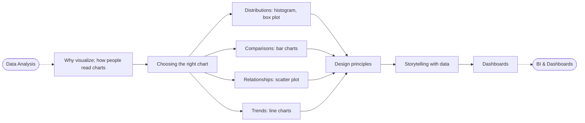

## Why this subject matters

The manager of a Pune grocery store reads one line in a report: "Average daily footfall: 1,257." She staffs the store for 1,257 people every day.

On Sundays about 1,500 people walk in and the billing queues stretch out of the door. On Tuesdays the staff stand idle. In the week before Diwali, 2,000 to 2,500 people arrive and shelves run empty by noon. The average was correct, and it hid every one of these facts.

One chart of the same numbers, days of the week side by side, would have shown all of them in five seconds. **Data visualization** is the skill of turning numbers into pictures that people read correctly and quickly. **Storytelling** is the next step: choosing the one chart, title and highlight that leads a busy person to the right decision.

## A short story

In 1854 Britain sent an army to the Crimean War. Florence Nightingale, a nurse, took charge of the army hospital at Scutari and kept careful records of every death.

Her numbers showed something shocking: far more soldiers were dying of diseases spread by dirt, crowding and bad drains than of battle wounds. Officials had seen tables of these numbers and ignored them.

So Nightingale drew them. Her "rose" diagram, published in 1858, showed each month as a wedge, with deaths from preventable disease dwarfing deaths from wounds. A busy minister could see the problem at a glance. The diagram helped push the government into sanitary reforms in military hospitals.

The data had existed all along. The picture is what changed minds.

## Where it is used today

- **Business dashboards:** daily sales, stock levels and targets on one screen for managers.
- **News and government:** election results, COVID-19 case curves, rainfall and reservoir levels.
- **Finance and UPI apps:** spending by category, stock price charts.
- **Cricket and sport:** wagon wheels, pitch maps, worm charts of a run chase.
- **Data science and ML:** checking data before modelling, and showing model results (errors, feature importance) to people who must trust them.
- **Research:** every paper's results are judged largely by its figures.

## What you will be able to do

- Choose the right chart for a question: distribution, comparison, relationship, composition or trend.
- Draw histograms, box plots, bar charts, scatter plots and line charts in Python with matplotlib and seaborn.
- Read a chart critically and spot a misleading one (cut axes, wrong chart type, too many colours).
- Design clean charts: clear titles, labelled axes, sensible colour, nothing extra.
- Build a short data story: the question, the evidence and the decision, for a manager who has two minutes.

## Careers that use it

- **Data Analyst and Business Analyst:** charts and dashboards are the main output of the job.
- **Data Scientist:** exploring data and explaining results to non-technical teams.
- **BI Developer:** building dashboards in tools such as Power BI and Tableau.
- **ML Engineer and AI Researcher:** plotting training curves, errors and results.
- **Product, marketing and consulting roles:** presenting evidence for decisions.

## Map of the subject

## Sources

- Cole Nussbaumer Knaflic, *Storytelling with Data*, Wiley, 2015, Ch. 1 (verify)
- Claus O. Wilke, *Fundamentals of Data Visualization*, O'Reilly, 2019, Ch. 1 (verify; free online at clauswilke.com/dataviz)
- Edward R. Tufte, *The Visual Display of Quantitative Information*, 2nd ed., Graphics Press, 2001 (verify)
- Florence Nightingale, *Notes on Matters Affecting the Health, Efficiency and Hospital Administration of the British Army*, 1858 (verify)
