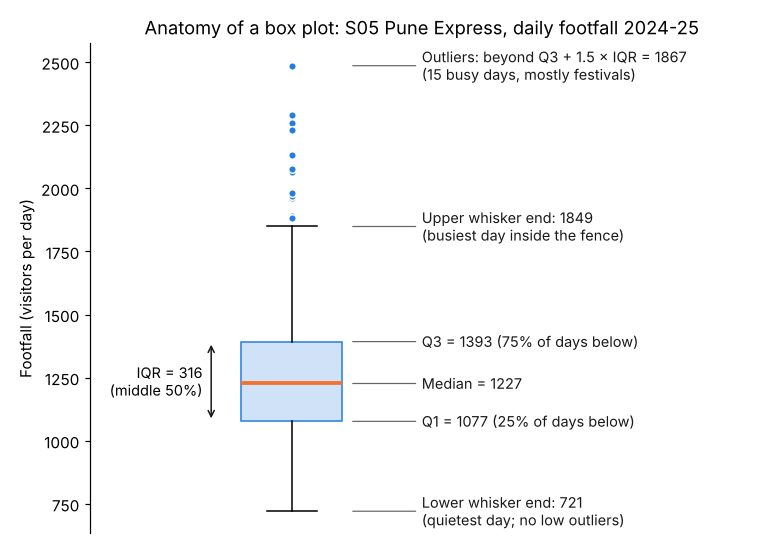
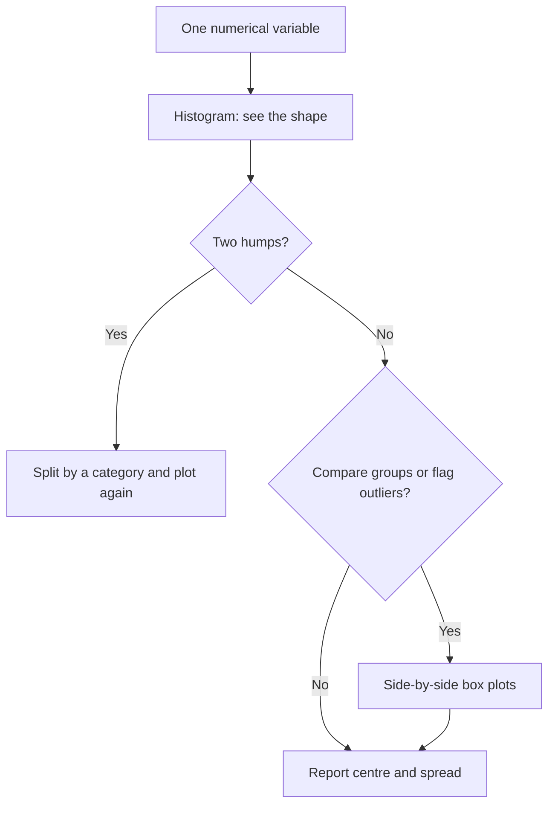

## Why should you care?

Sahyadri Mart's Pune Express store had 731 days of footfall in 2024–25. Its mean is 1,257 visitors and its standard deviation is 248. Now answer three questions from those two numbers alone:

- Are most days close to 1,257, or are there two kinds of day?
- Are there a few extreme days? How many, and how extreme?
- Is the data lopsided, with a long tail of very busy days?

You can't. Summary numbers compress 731 values into one or two. A **graph of the distribution** shows all 731 at once, and the answers jump out: most days sit between 900 and 1,500, the shape leans right, and 15 festival-season days stand far above the rest.

## In one line

A histogram shows the shape of a numerical variable by counting how many values fall in each interval; a box plot summarises it with five numbers (minimum, Q1, median, Q3, maximum) and marks outliers.

## Explained

### Q1. What is a distribution, and why graph it?

The **distribution** of a variable is the full pattern of its values: which values occur, and how often.

A graph of the distribution answers four questions at once:

- **Centre:** where is a typical value?
- **Spread:** how far do values range?
- **Shape:** symmetric, or with a long tail on one side? One hump or two?
- **Unusual values:** are there outliers or gaps?

Numbers such as the mean and SD ([[central-tendency]], [[dispersion]]) answer the first two only partly, and the last two not at all.

### Q2. What is a histogram?

==A histogram is a bar graph of a frequency table: the x-axis is divided into equal intervals (bins), and each bar's height is the number of values in that bin.==

- The x-axis is a **numerical** variable (footfall, salary, delivery time).
- Bars **touch**, because the intervals are continuous: 900–1,100 runs straight into 1,100–1,300.
- The y-axis is a count (frequency) or a percentage.

Building one is building a frequency table ([[frequency-distribution]]) and drawing it. For S05: 244 of 731 days (33%) fall in 1,100–1,299, the tallest bar.

### Q3. How is a histogram different from a bar chart?

| | Histogram | Bar chart |
|---|---|---|
| x-axis | Numerical, cut into intervals | Categories (store, city, product) |
| Bars | Touch | Have gaps |
| Order of bars | Fixed by the number line | Can be reordered, e.g. sorted by height |
| Shows | Shape of one variable | Comparison between categories |

A chart of "revenue by city" is a bar chart even if the bars look like a histogram.

### Q4. How many bins should a histogram have?

The bin width changes the picture:

- **Too few** bins (4): one or two fat bars; the shape disappears.
- **Too many** bins (200): a comb of thin spikes; random noise looks like a pattern.

A common starting point is **Sturges' rule**: $k = 1 + \log_2 n$ bins. For $n = 731$: $k = 1 + 9.51 \approx 11$.

Treat it as a start, not a law. Try two or three bin counts; trust only the features that survive all of them.

### Q5. What shapes can a histogram show?

| Shape | Mean vs median | Business example |
|---|---|---|
| Symmetric | Mean ≈ median | Average bill at one store |
| Right-skewed | Mean > median | Footfall, income, house prices |
| Left-skewed | Mean < median | Marks in an easy exam |
| Bimodal | Mean may lie in the gap | Bills of small and large stores mixed |

==A bimodal histogram usually means two groups are mixed in one column.== Split the data by the group and look again. Skewness as a number is in [[skewness-and-kurtosis]].

### Q6. What is a box plot?

==A box plot draws the five-number summary: minimum, Q1, median, Q3 and maximum, with outliers shown as separate dots.==

- **Q1** and **Q3** are the first and third quartiles: 25% and 75% of values lie below them ([[quartiles-and-percentiles]]).
- The **box** runs from Q1 to Q3. Its height is the **interquartile range**, IQR = Q3 − Q1, which holds the middle 50% of the data.
- The **line inside** the box is the median.
- The **whiskers** reach out to the most extreme values that are not outliers.

The box plot was introduced by the statistician John Tukey in the 1970s as a quick, hand-drawn summary.

### Q7. How are outliers and whiskers decided?

The usual rule is Tukey's **1.5 × IQR rule**:

$$\text{Lower fence} = Q_1 - 1.5 \times IQR \qquad \text{Upper fence} = Q_3 + 1.5 \times IQR$$

==A value outside the fences is plotted as an outlier; each whisker stops at the most extreme value inside the fences.==

The fences themselves are not drawn. If no value falls outside, the whiskers end at the minimum and maximum. This is also the rule used by matplotlib, pandas and seaborn.

### Q8. How do you read shape from a box plot?

Compare the two halves:

- **Symmetric:** median near the middle of the box; whiskers of similar length.
- **Right-skewed:** median closer to Q1; longer upper whisker, outliers on top. S05 footfall: median 1,227 is 150 above Q1 but 166 below Q3, with all 15 outliers high.
- **Left-skewed:** the mirror image.

Box plots shine when **comparing groups**: 12 stores or 7 weekdays side by side take one chart, where 12 histograms would fill a page.

### Q9. Histogram or box plot: which one when?

| Question | Better choice |
|---|---|
| What is the detailed shape of one variable? | Histogram |
| Are there two humps (two groups mixed)? | Histogram: a box plot hides this |
| Which values are outliers, by a fixed rule? | Box plot |
| How do many groups compare? | Side-by-side box plots |
| Explaining to a manager with no statistics | Histogram (easier to read) |

In exploratory data analysis ([[exploratory-data-analysis]]) use both: the histogram for shape, the box plot for outliers and comparisons.

> [!beyond] Beyond the syllabus
> When bins have **unequal widths**, bar height must show **frequency density** (frequency ÷ width), so that area, not height, is proportional to the count. A **violin plot** combines a box plot with a smoothed histogram on each side, so it shows humps as well as quartiles.

## Analogy and real-life example

A histogram is a **photograph of a crowd taken from above**: you see where people bunch up, where the crowd thins out, and whether there are two separate groups.

A box plot is the **security guard's summary**: "Half the crowd is between gate 3 and gate 5, the middle person is at gate 4, and these 15 people are standing far away from everyone." Quick and comparable across many events, but it would not notice that the crowd was really two groups.

## Diagram

## Worked example

A Nashik tiffin service records orders for 9 days, sorted: **42, 45, 47, 48, 50, 52, 55, 58, 95**.

**Frequency table** (bins of width 10):

| Orders | 40–49 | 50–59 | 60–69 | 70–79 | 80–89 | 90–99 |
|---|---|---|---|---|---|---|
| Days | 4 | 4 | 0 | 0 | 0 | 1 |

The histogram has two tall bars, a long gap, and one bar at 90–99: right-skewed with one extreme day.

**Five-number summary** (quartile positions $k(n+1)/4$, as in [[quartiles-and-percentiles]]):

1. Q1 at position 2.5: $45 + 0.5(47 - 45) = 46$. Median at position 5: 50. Q3 at position 7.5: $55 + 0.5(58 - 55) = 56.5$.
2. Min = 42, Q1 = 46, median = 50, Q3 = 56.5, max = 95. IQR = 56.5 − 46 = 10.5.
3. Lower fence = 46 − 1.5 × 10.5 = 30.25; upper fence = 56.5 + 15.75 = 72.25.
4. 95 > 72.25, so **95 is an outlier**. The upper whisker stops at 58; the lower whisker at 42.
5. Mean = 492 / 9 = 54.7 > median 50: the outlier drags the mean up, confirming right skew.

The 95 was a wedding order. It is real, so keep it, but plan daily cooking around the median.

## Try it

A Thane cloud kitchen's delivery times (minutes, sorted) over 9 orders: **18, 22, 25, 26, 28, 30, 31, 33, 34**.
Q1 = $22 + 0.5(25 - 22) = 23.5$ and median = 28. Find Q3, the IQR, the fences, any outliers and the whisker ends. Is the data skewed?

> [!answer]- Answer
> - Q3 at position 7.5: $31 + 0.5(33 - 31) = 32$. IQR = 32 − 23.5 = 8.5.
> - Fences: 23.5 − 12.75 = 10.75 and 32 + 12.75 = 44.75. No value lies outside, so **no outliers**.
> - Whiskers end at 18 and 34 (the min and max).
> - The box is nearly symmetric (median 4.5 above Q1, 4 below Q3), but the lower whisker (23.5 − 18 = 5.5) is longer than the upper (34 − 32 = 2). Mean = 247 / 9 = 27.4 < median 28: **slightly left-skewed**, pulled by one fast 18-minute delivery.

## Key facts and formulas

> [!important] Key facts
> - Histogram: numerical variable cut into equal bins; bar height = count in the bin; bars touch.
> - Bar chart: categories; bars have gaps. Histogram ≠ bar chart.
> - Sturges' rule: $k = 1 + \log_2 n$ bins (a starting point).
> - Shapes: symmetric (mean ≈ median), right-skewed (mean > median), left-skewed (mean < median), bimodal (two groups mixed).
> - Box plot: five-number summary = min, Q1, median, Q3, max; box = Q1 to Q3; line = median.
> - $IQR = Q_3 - Q_1$ (middle 50% of the data).
> - Fences: $Q_1 - 1.5 \times IQR$ and $Q_3 + 1.5 \times IQR$; values outside are outliers; whiskers end at the last values inside.
> - Use histograms for shape, box plots for outliers and comparing groups.

## Common mistakes

> [!warning] Common mistakes
> - **Gaps between histogram bars.** Gaps signal categories; a histogram's intervals are continuous.
> - **Trusting one bin count.** A "pattern" that vanishes when the bins change is noise.
> - **Deleting every box-plot outlier.** An outlier is a value to *investigate*. Sahyadri Mart's outliers are real festival days, the most important days of the year.
> - **Thinking the whiskers show the min and max.** They do only when there are no outliers.
> - **Reading a box plot as two groups or one.** A box plot cannot show two humps; check a histogram.
> - **Comparing histograms with different axes or bins.** Use the same bins and the same y-scale.

## Think deeper

1. Fifteen of S05's 731 days are outliers by the 1.5 × IQR rule. For a perfectly bell-shaped variable, about 0.7% of values fall outside the fences anyway. What does this tell you about calling a value an "error" just because it is an outlier?
2. Across all 12 stores, the mean average bill is ₹491, yet only 1.6% of store-days have a bill between ₹450 and ₹530. When is one summary for mixed groups worse than no summary?
3. A manager wants "one chart" of daily footfall for all 12 stores. Would you draw 12 histograms, one histogram of everything, or 12 box plots? Defend your choice.
4. Why might a delivery app prefer to show customers the 90th percentile of delivery time rather than a histogram?

## Self-check

> [!quiz] Q1. In a histogram, why do the bars touch?
> (A) To save space
> (B) Because the x-axis is a continuous numerical scale cut into adjacent intervals
> (C) Because the variable is categorical
> (D) Because each bar shows a percentage
>
> > [!answer]- Answer: B
> > The bins are consecutive intervals of a number line, so one ends exactly where the next begins. Gaps are used for categories (bar charts).

> [!quiz] Q2. Q1 = 40 and Q3 = 60. The three largest values are 84, 88 and 97. Where does the upper whisker end?
> (A) At 90, the upper fence
> (B) At 88
> (C) At 97, the maximum
> (D) At 60, the top of the box
>
> > [!answer]- Answer: B
> > IQR = 20, so the upper fence is 60 + 30 = 90. The whisker stops at the largest value inside the fence, 88; 97 is drawn as an outlier dot. The fence itself is never drawn.

> [!quiz] Q3. A histogram has a long tail to the right. Which is most likely?
> (A) Mean < median
> (B) Mean = median
> (C) Mean > median
> (D) There are no outliers
>
> > [!answer]- Answer: C
> > Large values in the right tail pull the mean up; the median is not affected by how extreme they are.

> [!quiz] Q4. A box plot of one column looks normal, but the histogram of the same column shows two separate humps. What should you do next?
> (A) Remove the outliers
> (B) Increase the number of bins until the humps merge
> (C) Look for a category (such as store type) that splits the data into two groups
> (D) Report the median, since it is in the middle
>
> > [!answer]- Answer: C
> > Two humps usually mean two groups mixed in one column. A box plot cannot show this; split by the likely category and plot each group.

> [!quiz] Q5. You must compare daily footfall across the 7 days of the week in one chart. Which is best?
> (A) Seven separate histograms on different scales
> (B) Side-by-side box plots, one per day
> (C) A pie chart of total footfall per day
> (D) One histogram of all days together
>
> > [!answer]- Answer: B
> > Side-by-side box plots on one axis compare centre, spread and outliers across many groups at a glance.

## Flashcards

What does a histogram show? :: The shape of a numerical variable: how many values fall in each interval (bin)
Histogram vs bar chart? :: Histogram: numerical intervals, bars touch; bar chart: categories, bars have gaps
Sturges' rule for the number of bins? :: k = 1 + log₂ n
In a right-skewed distribution, how do mean and median compare? :: Mean > median
What does a bimodal histogram usually mean? :: Two groups are mixed in one column
What is the five-number summary? :: Minimum, Q1, median, Q3, maximum
What does the box in a box plot span? :: Q1 to Q3, the interquartile range (middle 50%)
Formula for the box-plot fences? :: Q1 − 1.5 × IQR and Q3 + 1.5 × IQR
Where do box-plot whiskers end? :: At the most extreme values inside the fences
What can a histogram show that a box plot cannot? :: Two humps (bimodality) and the detailed shape
Who introduced the box plot? :: John Tukey, in the 1970s

## Sources

- James R. Evans, *Business Analytics*, Pearson, Ch. 3 and 4 (verify)
- Claus O. Wilke, *Fundamentals of Data Visualization*, O'Reilly, 2019, Ch. 7 (histograms) and 9 (box plots) (verify)
- John W. Tukey, *Exploratory Data Analysis*, Addison-Wesley, 1977, Ch. 2 (verify)
- NIST/SEMATECH e-Handbook of Statistical Methods, Sections 1.3.3.14 (Histogram) and 1.3.3.7 (Box Plot) (verify)
- Sahyadri Mart sales dataset: data card in `content/assets/data/sahyadri-mart-sales.md` (synthetic, this site)
