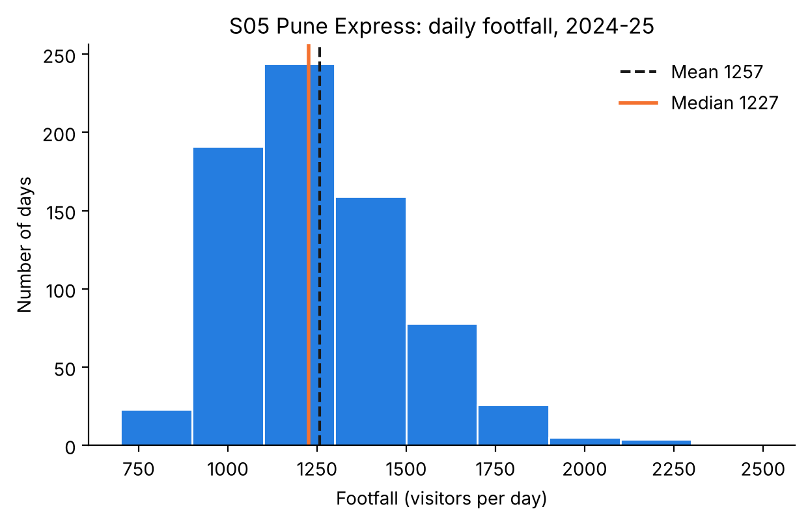
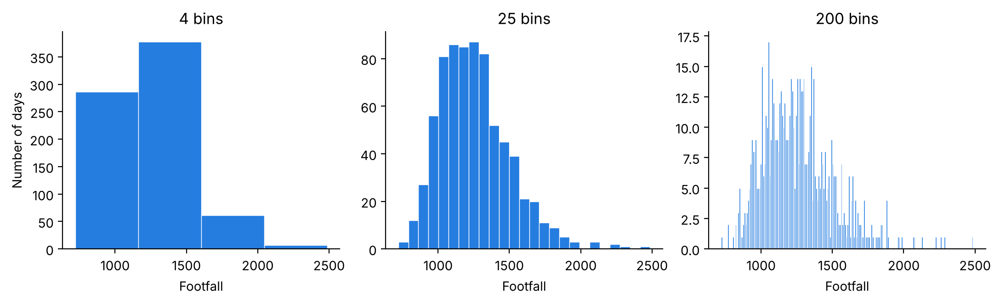

## Aim

To create histograms of business variables in Python and use them to describe each variable's distribution: its centre, spread, shape and unusual values.

## Concepts used

- [[distribution-plots]]: what a histogram is, bins, and the common shapes.
- [[central-tendency]]: mean versus median, which the shape explains.
- [[skewness-and-kurtosis]]: the skewness number printed in Step 5.

## Setup (Colab)

[Open in Colab](https://colab.research.google.com/github/Prathameshv07/ai-ds-notes/blob/main/content/assets/notebooks/data-viz/histogram-practical.ipynb). Nothing to install.

- **Dataset:** Sahyadri Mart daily sales (synthetic; its data card in `content/assets/data/` lists every column). One row = one store on one day.
- Most steps use **S05**, the Pune Express store, as in the earlier practicals.
- **Libraries:** pandas for the data, matplotlib for the charts. `plt.hist()` is the core function; pandas' `df["col"].plot.hist()` calls it for you.
- The outputs below come from pandas 3 and matplotlib 3.11. On current Colab versions, numbers and charts are the same.

## Code

### Step 1. Load the data, pick S05 (the Pune Express store) and set a clean chart style

```python
# Step 1. Load the data, pick S05 (the Pune Express store) and set a clean chart style
import pandas as pd
import matplotlib.pyplot as plt

url = ("https://raw.githubusercontent.com/Prathameshv07/ai-ds-notes/main/"
       "content/assets/data/sahyadri-mart-sales.csv")
df = pd.read_csv(url, parse_dates=["date"])
s05 = df[df["store_id"] == "S05"]
plt.rcParams.update({"axes.spines.top": False, "axes.spines.right": False})
BLUE = "#257de0"   # one colour for one variable
print("Days for S05:", len(s05), "| footfall from", s05["footfall"].min(), "to", s05["footfall"].max())
```

### Step 2. A frequency table first: count S05's days in footfall classes of width 200

```python
# Step 2. A frequency table first: count S05's days in footfall classes of width 200
edges = list(range(700, 2501, 200))            # 700, 900, ..., 2500
classes = pd.cut(s05["footfall"], bins=edges, right=False)   # [700, 900) means 700 to 899
table = classes.value_counts(sort=False).rename("days").to_frame()
table["percent"] = (table["days"] / len(s05) * 100).round(1)
print(table.to_string())
print("Total days:", table["days"].sum())
```

### Step 3. Draw the same table as a histogram, and mark the mean and median

```python
# Step 3. Draw the same table as a histogram, and mark the mean and median
f = s05["footfall"]
plt.figure(figsize=(7, 4))
plt.hist(f, bins=edges, color=BLUE, edgecolor="white")
plt.axvline(f.mean(), color="#191919", linestyle="--", linewidth=1.5, label=f"Mean {f.mean():.0f}")
plt.axvline(f.median(), color="#f47230", linewidth=2, label=f"Median {f.median():.0f}")
plt.title("S05 Pune Express: daily footfall, 2024-25")
plt.xlabel("Footfall (visitors per day)")
plt.ylabel("Number of days")
plt.legend(frameon=False)
plt.show()
```

### Step 4. Same data, different bin counts: too few hide the shape, too many show noise

```python
# Step 4. Same data, different bin counts: too few hide the shape, too many show noise
fig, axes = plt.subplots(1, 3, figsize=(11, 3.4), sharey=False)
for ax, b in zip(axes, [4, 25, 200]):
    ax.hist(f, bins=b, color=BLUE, edgecolor="white", linewidth=0.5)
    ax.set_title(f"{b} bins")
    ax.set_xlabel("Footfall")
axes[0].set_ylabel("Number of days")
plt.tight_layout()
plt.show()
```

### Step 5. Three variables, three shapes: average bill, footfall and rainfall

```python
# Step 5. Three variables, three shapes: average bill, footfall and rainfall
s01 = df[df["store_id"] == "S01"]
cols = {
    "S05 average bill (Rs)": s05["revenue_inr"] / s05["transactions"],
    "S05 footfall": s05["footfall"],
    "S01 Mumbai rainfall (mm)": s01["rainfall_mm"],
}
fig, axes = plt.subplots(1, 3, figsize=(11, 3.4))
for ax, (name, x) in zip(axes, cols.items()):
    ax.hist(x.dropna(), bins=25, color=BLUE, edgecolor="white", linewidth=0.5)
    ax.set_title(name)
    ax.set_xlabel(f"mean {x.mean():.0f}, median {x.median():.0f}")
    print(f"{name:26s} mean {x.mean():8.1f}  median {x.median():8.1f}  skewness {x.skew():5.2f}")
axes[0].set_ylabel("Number of days")
plt.tight_layout()
plt.show()
```

### Step 6. All 12 stores together: the average bill has two humps. Why?

```python
# Step 6. All 12 stores together: the average bill has two humps. Why?
df["avg_bill"] = df["revenue_inr"] / df["transactions"]      # rupees per bill
fig, axes = plt.subplots(1, 2, figsize=(11, 3.6), sharex=True, sharey=True)
axes[0].hist(df["avg_bill"], bins=50, color=BLUE, edgecolor="white", linewidth=0.5)
axes[0].axvline(df["avg_bill"].mean(), color="#191919", linestyle="--", linewidth=1.5,
                label=f"Mean Rs {df['avg_bill'].mean():.0f}")
axes[0].set_title("All stores together")
axes[0].legend(frameon=False)
for kind, colour in [("Express", BLUE), ("Supermarket", "#f47230")]:
    part = df.loc[df["store_type"] == kind, "avg_bill"]
    axes[1].hist(part, bins=50, range=(df["avg_bill"].min(), df["avg_bill"].max()),
                 color=colour, alpha=0.7, edgecolor="white", linewidth=0.5, label=kind)
axes[1].set_title("Split by store type")
axes[1].legend(frameon=False)
for ax in axes:
    ax.set_xlabel("Average bill (Rs per bill)")
axes[0].set_ylabel("Number of store-days")
plt.tight_layout()
plt.show()
print(df.groupby("store_type")["avg_bill"].agg(["mean", "median"]).round(0).to_string())
between = df["avg_bill"].between(450, 530).mean() * 100
print(f"Store-days with an average bill between Rs 450 and Rs 530: {between:.1f}%")
```

## Output

### Step 1

```output
Days for S05: 731 | footfall from 721 to 2486
```

### Step 2

```output
              days  percent
footfall                   
[700, 900)      23      3.1
[900, 1100)    191     26.1
[1100, 1300)   244     33.4
[1300, 1500)   159     21.8
[1500, 1700)    78     10.7
[1700, 1900)    26      3.6
[1900, 2100)     5      0.7
[2100, 2300)     4      0.5
[2300, 2500)     1      0.1
Total days: 731
```

### Step 3



### Step 4



### Step 5

```output
S05 average bill (Rs)      mean    401.5  median    401.1  skewness -0.01
S05 footfall               mean   1257.3  median   1227.0  skewness  0.93
S01 Mumbai rainfall (mm)   mean      6.3  median      0.0  skewness  3.66
```


### Step 6


```output
              mean  median
store_type                
Express      361.0   356.0
Supermarket  673.0   662.0
Store-days with an average bill between Rs 450 and Rs 530: 1.6%
```

## Explanation

### Steps 2–3: a histogram is a frequency table, drawn

- `pd.cut(..., bins=edges, right=False)` puts each day into a class such as `[1100, 1300)`: 1,100 included, 1,300 not.
- Each bar in Step 3 has exactly the height of its row in Step 2. ==A histogram is a frequency table drawn as touching bars.==
- **Reading it:** most days (81%) fall between 900 and 1,500 visitors. The bars climb steeply on the left and fall slowly on the right: a **right-skewed** shape.
- The long right tail pulls the mean (1,257) above the median (1,227). For staffing a typical day, the median is the safer figure.

### Step 4: bin count changes the story

| Bins | What you see | Verdict |
|---|---|---|
| 4 | Two fat bars; the tail is hidden | Too few |
| 25 | One hump, a clear right tail | About right |
| 200 | Spikes and holes from random noise | Too many |

Sturges' rule gives $1 + \log_2 731 \approx 11$ bins; Step 3 used 9 bins of a round width, 200. ==Choose the bins, then check that the shape survives a different choice.==

### Step 5: three variables, three shapes

| Variable | Shape | Mean vs median | Skewness |
|---|---|---|---|
| S05 average bill | Symmetric, bell-like | 401.5 ≈ 401.1 | −0.01 |
| S05 footfall | Right-skewed | 1,257 > 1,227 | 0.93 |
| S01 rainfall | Extremely right-skewed, J-shaped | 6.3 ≫ 0.0 | 3.66 |

Rainfall shows why shape matters. 537 of S01's 731 days (73%) had no rain at all, so the median is 0 mm. The mean of 6.3 mm describes almost no actual day: it is the monsoon downpours averaged over the whole year.

### Step 6: two humps mean two groups

- The left chart has two humps with a near-empty valley between them. The mean bill, ₹491, falls in that valley: only 1.6% of store-days have a bill between ₹450 and ₹530.
- The right chart explains it: Express stores (median bill ₹356) and Supermarkets (₹662) are two different populations stored in one column.
- ==A bimodal histogram is a signal to split the data by a category.== Any analysis of "the average bill" must be done per store type.

`range=(...)` makes both groups use the same bin edges, and `alpha=0.7` makes the bars slightly see-through, so the two groups can be compared fairly.

## Try it

Draw a histogram of the daily revenue of **S01**, the Mumbai Supermarket, in ₹ lakh with 30 bins. Describe its shape, and compare its mean and median.

Start from: `r = df.loc[df["store_id"] == "S01", "revenue_inr"] / 1e5`

> [!answer]- Answer
> ```python
> r = df.loc[df["store_id"] == "S01", "revenue_inr"] / 1e5
> plt.hist(r, bins=30, color=BLUE, edgecolor="white")
> plt.xlabel("Daily revenue (Rs lakh)")
> plt.ylabel("Number of days")
> plt.title("S01 Mumbai Supermarket")
> plt.show()
> print(f"mean {r.mean():.2f}  median {r.median():.2f}  skewness {r.skew():.2f}  max {r.max():.2f}")
> ```
> ```output
> mean 10.77  median 10.41  skewness 1.70  max 30.05
> ```
> One hump around ₹9–11 lakh with a long, thin right tail up to a single ₹30 lakh day (in the Diwali season). Right-skewed: mean ₹10.77 lakh > median ₹10.41 lakh.

## Viva questions

1. What is a histogram? How is it different from a bar chart?
2. What does `pd.cut()` do? What does `right=False` change?
3. How does the number of bins affect a histogram? What is Sturges' rule?
4. In a right-skewed distribution, which is larger, the mean or the median? Why?
5. S01's median rainfall is 0 mm but its mean is 6.3 mm. Which would you report, and why?
6. What does a histogram with two humps tell you? What would you do next?
7. Why did Step 6 use the same `range` for both store types?
8. Name two things a histogram shows that the mean and standard deviation do not.

## Flashcards

matplotlib function to draw a histogram? :: plt.hist(x, bins=...)
pandas shortcut for a histogram of a column? :: df["col"].plot.hist(bins=...)
How do you build a frequency table with fixed class edges in pandas? :: pd.cut(x, bins=edges).value_counts(sort=False)
What does right=False do in pd.cut? :: Makes classes [a, b): include the left edge, exclude the right
Why add edgecolor="white" to plt.hist? :: Thin gaps make each bin visible without breaking the continuous axis
How do you overlay two groups' histograms fairly? :: Same bins (range=...), alpha for transparency, and a legend
pandas method for skewness of a column? :: df["col"].skew()

## Sources

- Matplotlib documentation: [matplotlib.pyplot.hist](https://matplotlib.org/stable/api/_as_gen/matplotlib.pyplot.hist.html)
- pandas documentation: [pandas.cut](https://pandas.pydata.org/docs/reference/api/pandas.cut.html), [Series.value_counts](https://pandas.pydata.org/docs/reference/api/pandas.Series.value_counts.html)
- Sahyadri Mart sales dataset: data card in `content/assets/data/sahyadri-mart-sales.md` (synthetic, this site)
