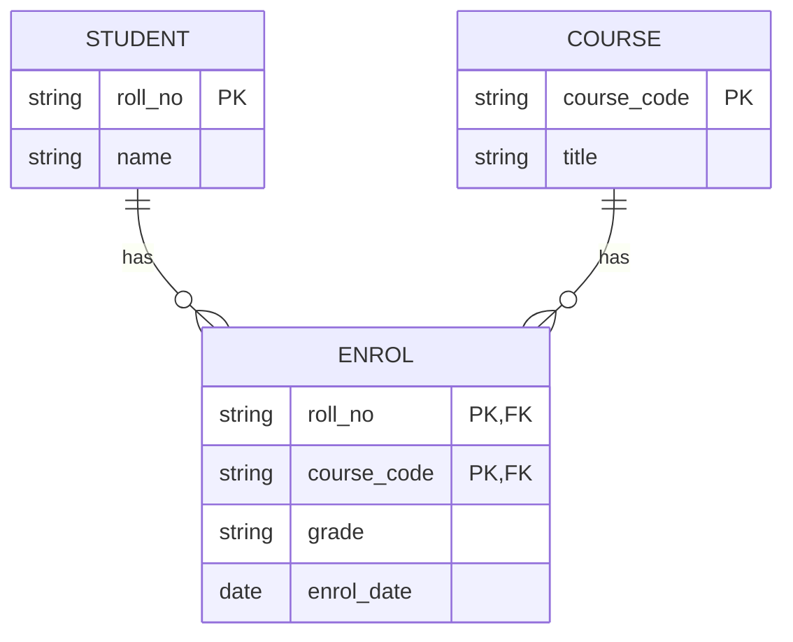

## Why should you care?

A student enrols in many courses; a course has many students. Where do you store the student's **grade** in each course? Not in STUDENT: a student has a different grade in each course. Not in COURSE: a course gives different grades to each student. The grade belongs to the **pair**.

Many-to-many relationships are everywhere: orders and products, doctors and patients, actors and films. The associative entity is the standard way to turn them into tables, and it is one of the most asked database interview questions.

## In one line

An associative (composite, bridge) entity turns an M:N relationship into two 1:M relationships, and stores the facts that belong to each pair.

## Explained

### Q1. Why can't an M:N relationship be stored directly?

- In a relational table, ==each cell holds **one value**==.
- If STUDENT stored a list of course codes, or COURSE a list of roll numbers, one cell would hold many values.
- Copying a student's row once per course instead ==creates **redundancy** and update problems== (see [[what-is-dbms]]).
- So ==an M:N relationship must be **broken down** before it becomes tables==.

### Q2. What is an associative entity? ⭐

==An associative entity is an entity that implements an M:N relationship between two (or more) entities.==

- Also called a ==**composite**, **bridge** or **linking** entity==.
- ==Its primary key is usually the **combination of the primary keys** of the entities it connects==, for example roll number + course code.
- It can have **its own attributes**: the facts that belong to the pair, such as grade or enrolment date.
- In Chen notation it is drawn as a **diamond inside a rectangle**.

### Q3. How does it turn M:N into two 1:M relationships? ⭐

| Before | After |
|---|---|
| STUDENT M:N COURSE | STUDENT 1:M **ENROL** M:1 COURSE |

- ==Each student has **many** ENROL rows; each ENROL row belongs to **one** student.==
- ==Each course has **many** ENROL rows; each ENROL row belongs to **one** course.==
- Both new relationships are **strong (identifying)**, because ENROL's key contains both parents' keys (see [[weak-entities]]).

### Q4. When else is an associative entity used?

- ==**M:N recursive relationships**==: COURSE is a prerequisite for COURSE becomes PREREQUISITE (course code, needs course code).
- ==**Ternary relationships**==: DOCTOR, PATIENT and DRUG become PRESCRIPTION (see [[relationship-degree]]).
- ==**When the pair has its own facts**==: quantity in an order, marks in an exam, role in a film.

## Analogy and real-life example

A wedding guest list for two families. Many guests come from each family, and some guests are related to both. The **invitation card** is the associative entity: one card links one guest to one event, and it records the pair's own facts, such as the number of people invited and whether they replied.

## Diagram

## Worked example

**Problem.** An online grocery app: an ORDER contains many PRODUCTs, and a PRODUCT appears in many ORDERs. For each product in an order we need the quantity and the price charged. Design the associative entity.

**Solution.**

1. **Spot the M:N:** ORDER M:N PRODUCT.
2. **Find the pair's facts:** quantity and price charged belong to one product **in** one order, not to the order or the product alone.
3. **Create the associative entity:** ORDER_LINE.
4. **Primary key:** order ID + product ID.
5. **Attributes:** quantity, price charged.
6. **Result:** ORDER 1:M ORDER_LINE M:1 PRODUCT, both relationships strong (identifying).

**Why store price charged, when PRODUCT already has a price?** The product's price may change tomorrow; the order must still show what the customer actually paid.

## Try it

A film database: an ACTOR acts in many FILMs, and a FILM has many ACTORs. We want each actor's role name in each film.

Done for you: the relationship is **M:N**.

Name the associative entity, its primary key and its attribute.

> [!answer]- Answer
> - Associative entity: **CAST** (or ACTS_IN).
> - Primary key: **actor ID + film ID**.
> - Attribute: **role name**.
> - Result: ACTOR 1:M CAST M:1 FILM.

## Key facts and formulas

> [!important] Key facts
> - An M:N relationship cannot be stored directly in relational tables.
> - Associative (composite, bridge, linking) entity: implements an M:N relationship.
> - Its PK is usually the combination of the connected entities' PKs.
> - It turns one M:N into two 1:M relationships, both strong (identifying).
> - It holds the pair's own attributes, such as grade, quantity or role.
> - Also used for M:N recursive and ternary relationships.
> - Chen notation: a diamond inside a rectangle.

## Common mistakes

> [!warning] Common mistake
> Putting the pair's facts in one of the parents, such as grade in STUDENT. A student has many grades, one per course, so the value has nowhere single to live.

> [!warning] Common mistake
> Drawing the M:N line in the final design. An ERD that will become tables must show the associative entity, not a bare M:N line.

> [!warning] Common mistake
> Thinking the key **must** be the combination. If the same pair can repeat, such as a student repeating a course in another year, the key needs another attribute (year), or a surrogate key (see [[keys]]).

## Think deeper

- **Repeated pairs.** A student fails and repeats a course. What happens to the key roll number + course code? How would you fix it?
- **Historical price.** Why does ORDER_LINE store the price charged even though PRODUCT has a price? What would go wrong otherwise?
- **Name it well.** "STUDENT_COURSE" or "ENROL"? Why does a meaningful name help the people reading the design?

## Self-check

> [!quiz] Q1. What does an associative entity implement?
> (A) A 1:1 relationship
> (B) A 1:M relationship
> (C) An M:N relationship
> (D) A derived attribute
>
> > [!answer]- Answer: C
> > It breaks an M:N relationship into two 1:M relationships.

> [!quiz] Q2. In STUDENT–ENROL–COURSE, where is a student's grade in a course stored?
> (A) STUDENT
> (B) COURSE
> (C) ENROL
> (D) It cannot be stored
>
> > [!answer]- Answer: C
> > The grade belongs to the pair (one student in one course), so it lives in the associative entity.

> [!quiz] Q3. The usual primary key of ORDER_LINE is:
> (A) Order ID only
> (B) Product ID only
> (C) Order ID + product ID
> (D) Quantity
>
> > [!answer]- Answer: C
> > It combines the keys of the two entities it connects.

> [!quiz] Q4. Students may repeat a failed course in a later year. Why does the key roll number + course code now fail?
> (A) It is too long
> (B) The same pair appears twice, so the key is no longer unique
> (C) Course codes change every year
> (D) Associative entities cannot have keys
>
> > [!answer]- Answer: B
> > A key must be unique. Adding the year (or using a surrogate key) fixes it.

## Flashcards

What is an associative entity? :: An entity that implements an M:N relationship between entities
Give three other names for an associative entity. :: Composite, bridge or linking entity
Why can't M:N be stored directly in tables? :: A cell holds one value, and copying rows creates redundancy
What is the usual primary key of an associative entity? :: The combination of the primary keys of the entities it connects
An associative entity turns one M:N relationship into what? :: Two 1:M relationships
What attributes does an associative entity hold? :: Facts that belong to the pair, such as grade or quantity
How does Chen notation draw an associative entity? :: A diamond inside a rectangle
Name two other uses of an associative entity. :: M:N recursive relationships and ternary relationships

## Sources

- Coronel, Morris & Rob, *Database Systems: Design, Implementation, and Management*, 9th ed., Ch. 4 (4.1.11)
- Silberschatz, Korth & Sudarshan, *Database System Concepts*, 7th ed., Ch. 6 (6.7)
