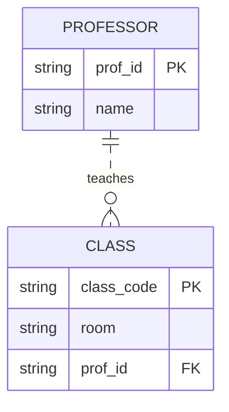

## Why should you care?

"A professor teaches classes." Fine, but how many? Can a professor teach none this semester? Can a class run with no professor? Can a professor teach twelve classes?

If the database doesn't know these limits, it will happily accept a class with no teacher or a professor with fifty classes. Connectivity, cardinality and participation are how an ER diagram records exactly these limits, so the database can enforce them.

## In one line

Connectivity names the relationship type (1:1, 1:M, M:N), cardinality gives the minimum and maximum number of linked instances, and participation says whether a link is optional or mandatory.

## Explained

### Q1. What is connectivity? ⭐ [2M]

==Connectivity describes the classification of a relationship: 1:1, 1:M or M:N.==

- ==**1:1**==: one principal heads one college.
- ==**1:M**==: one department offers many courses.
- ==**M:N**==: many students enrol in many courses.

You met these types in [[data-models]]. Connectivity is simply the ER-diagram name for them.

### Q2. What is cardinality? ⭐

==Cardinality is the minimum and maximum number of instances of one entity that can be linked to one instance of the other.==

- Written as **(min, max)** next to the entity, in Chen-style diagrams.
- Example: PROFESSOR *teaches* CLASS, with **(1,4)** beside CLASS: ==each professor teaches at least 1 and at most 4 classes==.
- ==Cardinalities come from **business rules**==, such as "a professor may teach at most four classes".
- The DBMS can enforce the maximum and minimum only if they are recorded in the design.

### Q3. How does crow's foot notation show cardinality?

Each line end carries two marks: the inner one is the **minimum**, the outer one is the **maximum**.

| Symbol at line end | Meaning |
|---|---|
| ==Two bars `||`== | Exactly one (mandatory one) |
| ==Circle and bar `o|`== | Zero or one (optional one) |
| ==Bar and crow's foot `|{`== | One or many (mandatory many) |
| ==Circle and crow's foot `o{`== | Zero or many (optional many) |

A **circle** always means "zero is allowed", that is, optional.

### Q4. What is participation? ⭐

==Participation says whether an entity must take part in a relationship.==

- ==**Mandatory participation**==: every instance must be linked. Every CLASS must be taught by a PROFESSOR.
- ==**Optional participation**==: an instance may exist without a link. A PROFESSOR on research leave may teach no classes this semester.
- Optional participation means the **minimum cardinality is 0**; mandatory means it is **at least 1**.
- Elmasri and Navathe call these **total** and **partial** participation.

### Q5. What is existence dependence? ⭐ [2M]

==An entity is **existence-dependent** if it can exist only when it is linked to another entity.==

- Example: an EXAM_SEAT record exists only for a STUDENT who has registered for the exam.
- An entity that can exist on its own is **existence-independent** (also called a strong or regular entity), such as STUDENT or COURSE.
- Existence dependence is the first step towards **weak entities** (see [[weak-entities]]).

## Analogy and real-life example

A cricket team sheet. Each team (one) has many players (connectivity 1:M). A playing eleven has exactly 11 players (cardinality 11,11). A player may be in the squad without playing today (optional participation in "plays in match"), but every player on the field must belong to a team (mandatory).

## Diagram

## Worked example

**Problem.** Write the connectivity, cardinality and participation for these college rules:

1. Each hostel room has 1 to 3 students.
2. Each student lives in at most one hostel room; day scholars live in none.

**Solution.**

1. **Connectivity:** one room, many students; one student, one room. So ROOM to STUDENT is **1:M**.
2. **Cardinality beside STUDENT:** (1,3), because a room holds at least 1 and at most 3 students.
3. **Cardinality beside ROOM:** (0,1), because a student is in zero or one room.
4. **Participation:** STUDENT's participation in "lives in" is **optional** (day scholars). For ROOM, the rule says 1 to 3 students, so a listed room is **mandatory** (no empty rooms are listed).
5. **Crow's foot:** `ROOM |o--|{ STUDENT`, that is, zero-or-one at the ROOM end and one-or-many at the STUDENT end.

## Try it

A library's rules: each member may borrow 0 to 3 books at a time; each book copy is with at most one member.

Done for you: the connectivity is **1:M** (one member, many book copies).

Give the cardinality beside BOOK_COPY, the cardinality beside MEMBER, and the participation of each.

> [!answer]- Answer
> - Beside BOOK_COPY: **(0,3)**, because a member has 0 to 3 books.
> - Beside MEMBER: **(0,1)**, because a copy is with no member or one member.
> - Both participations are **optional**: a member may have no books, and a copy may be on the shelf.

## Key facts and formulas

> [!important] Key facts
> - Connectivity = relationship classification: 1:1, 1:M, M:N.
> - Cardinality = (minimum, maximum) number of linked instances, from business rules.
> - Crow's foot: `||` exactly one, `o|` zero or one, `|{` one or many, `o{` zero or many; circle = optional.
> - Mandatory participation: minimum ≥ 1 (total). Optional participation: minimum 0 (partial).
> - Existence-dependent entity: exists only when linked to another entity. Existence-independent = strong (regular) entity.

## Common mistakes

> [!warning] Common mistake
> Writing the cardinality on the wrong side. In (min, max) notation, the numbers beside CLASS say how many classes one professor can have, not how many professors a class can have.

> [!warning] Common mistake
> Mixing up connectivity and cardinality. Connectivity is the type (1:M). Cardinality is the exact limits (1,4).

> [!warning] Common mistake
> Making every relationship mandatory "to be safe". A mandatory rule that is not true in real life, such as "every student must have a hostel room", blocks valid data from being entered.

## Think deeper

- **Who enforces the maximum?** The DBMS easily enforces "exactly one professor per class" through a required foreign key. How would you enforce "at most four classes per professor"?
- **Optional today, mandatory tomorrow.** If the college makes hostel compulsory for first-years only, how would you show that in the design?
- **Zero or one versus exactly one.** Why do optional links usually lead to empty (null) values in tables, and why might a designer try to avoid them?

## Self-check

> [!quiz] Q1. In crow's foot notation, `o{` at a line end means:
> (A) Exactly one
> (B) Zero or one
> (C) One or many
> (D) Zero or many
>
> > [!answer]- Answer: D
> > The circle means zero is allowed; the crow's foot means many.

> [!quiz] Q2. "Each class is taught by exactly one professor." What is CLASS's participation in "teaches"?
> (A) Optional
> (B) Mandatory
> (C) Derived
> (D) Recursive
>
> > [!answer]- Answer: B
> > Every class must have a professor, so the minimum is 1 and participation is mandatory.

> [!quiz] Q3. Cardinality (1,4) beside CLASS in PROFESSOR teaches CLASS means:
> (A) Each class has 1 to 4 professors
> (B) Each professor teaches 1 to 4 classes
> (C) There are 4 professors
> (D) The relationship is M:N
>
> > [!answer]- Answer: B
> > The numbers beside CLASS give how many classes one professor can be linked to.

> [!quiz] Q4. A college makes hostel participation mandatory for all students, but many students are day scholars. What happens?
> (A) Nothing; the design is safer
> (B) Day scholars cannot be entered without a fake room
> (C) Rooms become optional
> (D) The relationship becomes M:N
>
> > [!answer]- Answer: B
> > A mandatory rule that does not match reality blocks valid data or forces fake values.

## Flashcards

What is connectivity? :: The relationship classification: 1:1, 1:M or M:N
What is cardinality? :: The minimum and maximum number of instances of one entity linked to one instance of the other
Where do cardinalities come from? :: Business rules
What does a circle mean in crow's foot notation? :: Zero is allowed (optional)
What does `||` mean in crow's foot notation? :: Exactly one
What does `|{` mean in crow's foot notation? :: One or many
What is mandatory participation? :: Every instance must take part in the relationship (minimum at least 1)
What is optional participation? :: An instance may exist without taking part (minimum 0)
What is an existence-dependent entity? :: One that can exist only when linked to another entity
Elmasri and Navathe's names for mandatory and optional participation? :: Total and partial participation

## Sources

- Coronel, Morris & Rob, *Database Systems: Design, Implementation, and Management*, 9th ed., Ch. 4 (4.1.4, 4.1.5, 4.1.8)
- Silberschatz, Korth & Sudarshan, *Database System Concepts*, 7th ed., Ch. 6 (6.4)
- Elmasri & Navathe, *Fundamentals of Database Systems*, 7th ed., Ch. 3 (3.4)
