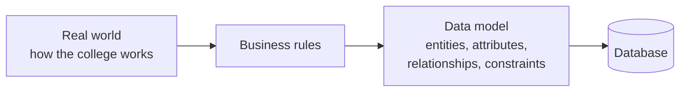

## Why should you care?

Nobody builds a house by buying bricks first. An architect draws a plan, the family checks it ("we need two bedrooms, not one"), and only then does construction start. Changing a line on paper costs nothing; moving a wall later costs lakhs.

Databases work the same way. If you start creating tables before you understand how the college actually works, you discover too late that a student can take more than one elective, or that a course can have two teachers. A **data model** is the plan you draw and check before you build.

## In one line

A data model is a simple, usually graphical, picture of real-world data: what things exist, what we store about them, how they are related, and which rules they must follow.

## Explained

### Q1. What is a data model?

==A data model is a simple, usually graphical, representation of complex real-world data structures.==

- It shows the **things** an organisation cares about (students, courses, teachers) and how they connect.
- It leaves out storage details: no files, disks or code.
- **Data modelling** is the process of building one. It is **iterative**: you draw a first version, check it with users, correct it, and repeat until it matches reality.

A data model is to a database what a blueprint is to a building.

### Q2. Why are data models important?

- **Communication:** designers, programmers and end users all read the same picture, so misunderstandings appear early.
- **Different views, one model:** the principal sees "results by department", a clerk sees "fee receipts", a programmer sees tables. The model joins these views into one consistent design.
- **Cheaper mistakes:** errors caught on paper cost far less than errors found after the database holds a year of data.
- **A good database starts with a good model.** A bad model gives redundancy and wrong answers, however good the DBMS is.

### Q3. What are the building blocks of a data model?

| Block | Meaning | College example |
|---|---|---|
| **Entity** | A thing about which data is stored | STUDENT, COURSE |
| **Attribute** | A property of an entity | Student name, roll number |
| **Relationship** | An association between entities | A student *enrols in* a course |
| **Constraint** | A rule the data must follow | Marks must be between 0 and 100 |

==An entity is a person, place, thing or event about which data is collected.== Entities are written in capitals and in the singular: STUDENT, not students.

### Q4. What kinds of relationships are there?

Relationships are described by how many of one entity link to how many of the other:

| Type | Read it as | Example |
|---|---|---|
| **One-to-one (1:1)** | One A has one B, and one B has one A | One principal manages one college |
| **One-to-many (1:M)** | One A has many B; each B has one A | One department offers many courses |
| **Many-to-many (M:N)** | One A has many B, and one B has many A | A student enrols in many courses; a course has many students |

Always read a relationship **in both directions**; only then is its type clear. Unit 2 draws these as ER diagrams (see [[er-model]]).

### Q5. What are business rules?

==A business rule is a brief, precise and unambiguous description of a policy, procedure or principle of an organisation.==

Examples from a college:
- A student may enrol in many courses.
- Each course is offered by exactly one department.
- A student may borrow at most three library books at a time.

Business rules come from managers, written policies (the college handbook) and, most importantly, **interviews with end users**, who know how work really happens. Rules must be written down and checked, because people often describe the same process differently.

### Q6. How do business rules become a data model?

A simple translation rule works most of the time:

- ==Nouns in a business rule usually become entities; verbs become relationships.==
- Facts about a noun become its attributes.
- Words like "at most", "exactly one" or "must" become constraints or the relationship type.

Example: "A **department** *offers* many **courses**; each **course** is *offered by* one **department**."
- Entities: DEPARTMENT, COURSE
- Relationship: offers
- Type: 1:M (read both directions)

## Analogy and real-life example

A wedding caterer plans a menu before cooking. The guest list (entities), each guest's food preference (attributes), which guests sit at which table (relationships), and "no onion or garlic at table 4" (a constraint) all go on paper first. If the plan is wrong, two hundred plates are wrong.

## Diagram

## Worked example

**Problem.** The college library gives these business rules. Build the data model.

1. A member can borrow many books.
2. A book copy is borrowed by at most one member at a time.
3. A member may borrow at most three books at a time.
4. For each member we store ID, name and phone; for each book, accession number, title and author.

**Solution.**

1. **Nouns → entities:** MEMBER, BOOK.
2. **Facts → attributes:** MEMBER (member ID, name, phone); BOOK (accession number, title, author).
3. **Verb → relationship:** MEMBER *borrows* BOOK.
4. **Read both ways:** one member borrows many books (rule 1); one book copy is with at most one member (rule 2). So the relationship is **1:M** from MEMBER to BOOK.
5. **Constraint:** a member can have at most three books at a time (rule 3).

## Try it

A food-delivery app gives these rules:
- A customer can place many orders. Each order is placed by one customer.
- An order contains many menu items. A menu item can appear in many orders.

Already done for you: the entities are CUSTOMER, ORDER and MENU ITEM.

Find the two relationships and their types.

> [!answer]- Answer
> - CUSTOMER *places* ORDER: **1:M** (one customer, many orders; each order has one customer).
> - ORDER *contains* MENU ITEM: **M:N** (one order has many items; one item appears in many orders).

## Key facts and formulas

> [!important] Key facts
> - Data model = simple, usually graphical, representation of real-world data.
> - Data modelling is iterative: draw, check with users, correct, repeat.
> - Four building blocks: entity, attribute, relationship, constraint.
> - Relationship types: one-to-one (1:1), one-to-many (1:M), many-to-many (M:N).
> - Business rule = brief, precise, unambiguous statement of a policy, procedure or principle.
> - Sources of business rules: managers, written policies, interviews with end users.
> - Nouns → entities; verbs → relationships; read every relationship in both directions.

## Common mistakes

> [!warning] Common mistake
> Reading a relationship in one direction only. "A department offers many courses" alone could be 1:M or M:N. You must also ask: "Is a course offered by one department or many?"

> [!warning] Common mistake
> Making every noun an entity. "Phone number" is a noun, but it is a fact about a student, so it is an **attribute**. An entity is something you store several facts about.

> [!warning] Common mistake
> Writing vague rules such as "students take courses". A business rule must be precise: how many courses, how many students, and is it compulsory?

## Think deeper

- **Rules change.** The college now allows a student to take two minors instead of one. Which part of the model changes: an entity, an attribute, a relationship type or a constraint?
- **Whom do you believe?** The handbook says "each course has one teacher", but the timetable clerk says two teachers often share a course. Which source should the model follow, and what would you do next?
- **Where is the boundary?** Is CITY an attribute of STUDENT, or its own entity? What would make you choose one over the other?

> [!beyond] Beyond the syllabus
> Data models have evolved over time. The 1960s used **hierarchical** and **network** models, where data was linked like a family tree or a web of pointers. Codd's **relational** model (1970) replaced them with tables. Peter Chen's **entity-relationship** model (1976) gave us the diagrams of Unit 2. Later came **object-oriented** models and, for web-scale apps, **NoSQL** models (see [[nosql-databases]]).

## Self-check

> [!quiz] Q1. Which of these is NOT a building block of a data model?
> (A) Entity
> (B) Attribute
> (C) Index
> (D) Constraint
>
> > [!answer]- Answer: C
> > The four building blocks are entity, attribute, relationship and constraint. An index is a storage structure inside the DBMS, not part of the model.

> [!quiz] Q2. "A student can enrol in many courses, and a course can have many students." What is the relationship type?
> (A) 1:1
> (B) 1:M
> (C) M:N
> (D) None
>
> > [!answer]- Answer: C
> > Read in both directions: many courses per student and many students per course gives many-to-many.

> [!quiz] Q3. In the rule "A teacher guides many projects", which word most likely becomes a relationship?
> (A) teacher
> (B) guides
> (C) many
> (D) projects
>
> > [!answer]- Answer: B
> > Verbs become relationships. "Teacher" and "projects" are nouns, so they become entities; "many" decides the relationship type.

> [!quiz] Q4. The handbook and a clerk describe a process differently. What should the designer do?
> (A) Follow the handbook, because it is written
> (B) Follow the clerk, because they do the work
> (C) Check with both and the manager, then write a precise rule everyone agrees on
> (D) Leave the rule out of the model
>
> > [!answer]- Answer: C
> > Business rules must be precise and verified. Conflicting sources are common; the designer resolves them before modelling.

## Flashcards

What is a data model? :: A simple, usually graphical, representation of real-world data structures
Why is data modelling called iterative? :: The model is drawn, checked with users, corrected and redrawn until it matches reality
Name the four building blocks of a data model. :: Entity, attribute, relationship, constraint
What is an entity? :: A person, place, thing or event about which data is collected
What is an attribute? :: A property of an entity, such as a student's name
What is a constraint? :: A rule the data must follow, such as marks between 0 and 100
Name the three relationship types. :: One-to-one (1:1), one-to-many (1:M), many-to-many (M:N)
What is a business rule? :: A brief, precise, unambiguous description of a policy, procedure or principle of an organisation
Where do business rules come from? :: Managers, written policies and interviews with end users
In a business rule, what usually becomes an entity, and what a relationship? :: Nouns become entities; verbs become relationships

## Sources

- Coronel & Morris, *Database Systems: Design, Implementation, and Management*, Ch. 2 (verify)
- Silberschatz, Korth & Sudarshan, *Database System Concepts*, Ch. 1 (verify)
