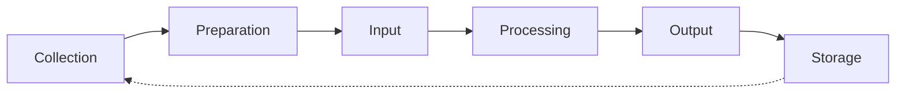

## Why should you care?

Think about your semester result. Hundreds of answer sheets are checked, marks are typed in, totals and grades are calculated, mark sheets are printed, and the records are kept for years in case you need a transcript. If any step goes wrong (a mark typed twice, a grade rule applied wrongly), hundreds of students get the wrong result.

That chain of steps is **data processing**. Every database exists to serve it, and every data science project you will ever do follows the same cycle.

## In one line

Data processing is the series of steps (collect, prepare, input, process, output, store) that turns raw data into useful information.

## Explained

### Q1. What is data processing?

==Data processing is the collection and manipulation of raw data to produce meaningful information.==

- **Data:** raw facts, such as marks 72, 65, 81 (see [[what-is-dbms]]).
- **Information:** processed data that helps a decision, such as "Asha passed with grade A".
- **Processing** includes classifying, sorting, calculating, summarising and storing.

Data processing is not a one-off task. Its output (stored results) often becomes the input for the next round, so it runs as a **cycle**.

### Q2. What is the data processing cycle?

==Data processing cycle: collection → preparation → input → processing → output → storage.==

| Stage | What happens | Exam-result example |
|---|---|---|
| Collection | Gather raw data from sources | Collect answer sheets and marks |
| Preparation | Check and clean it | Fix missing or wrong roll numbers |
| Input | Enter it into the system | Type marks into the result software |
| Processing | Calculate, sort, summarise | Compute totals, grades, ranks |
| Output | Present the information | Print mark sheets, publish results |
| Storage | Keep data for later use | Save records for transcripts |

### Q3. What are the methods of data processing?

| Method | How it is done | Example |
|---|---|---|
| **Manual** | By hand, with paper and pen | A teacher totals marks in a register |
| **Mechanical** | With simple machines | Calculators, old punch-card machines |
| **Electronic** | By computers and software | Result software, a DBMS |

Electronic data processing is the fastest and most accurate, and it handles huge volumes. Every database system is an example of electronic data processing.

### Q4. What are batch, online and real-time processing?

- **Batch processing:** ==In batch processing, data is collected over a period and processed together as one group.== Example: monthly salary slips; a bank adding interest at the end of the day.
- **Online processing:** ==In online processing, each transaction is processed immediately while the user waits.== Example: booking a train ticket on IRCTC.
- **Real-time processing:** a stricter form of online processing where the response must come within a fixed, very short time. Example: traffic-signal control, an aircraft's control systems.
- **Distributed processing:** the work is shared across several connected computers in different places. Example: UPI payments handled by many bank servers.

### Q5. How does database processing differ from file-based processing?

| File-based processing | Database processing |
|---|---|
| Each application has its own files | All applications share one database |
| Same data stored many times | Redundancy controlled |
| New questions need new programs | New questions answered with a query |
| Rules and security inside each program | Rules and security enforced by the DBMS |

The full list of file-system problems is in [[what-is-dbms]].

## Analogy and real-life example

A dhaba kitchen follows the same cycle. Vegetables arrive from the market (collection), get washed and chopped (preparation), go into the pot (input), are cooked (processing), and are served on a plate (output). Leftover gravy goes into the fridge for tomorrow (storage). The chef cooks dal in one large batch every morning (batch processing) but makes each roti fresh when you order it (online processing).

## Diagram

## Worked example

**Problem.** A college prepares monthly attendance reports. Teachers mark attendance on paper sheets every day. At month end, a clerk types all sheets into the ERP, which calculates each student's percentage and prints a defaulter list of students below 75%. Map this to the cycle and name the processing type.

**Solution.**

1. **Collection:** daily attendance on paper sheets.
2. **Preparation:** the clerk checks sheets for missing dates or unclear marks.
3. **Input:** the sheets are typed into the ERP.
4. **Processing:** the ERP calculates each student's percentage and filters those below 75%.
5. **Output:** the printed defaulter list.
6. **Storage:** the month's attendance is saved for the semester total.

**Type:** **batch processing**, because a whole month of data is processed together, not each lecture as it happens.

## Try it

You pay ₹40 for chai through UPI.

Already done: **Collection and input:** you scan the QR code and enter ₹40 and your PIN.

Complete the remaining stages and name the processing type.

> [!answer]- Answer
> - **Processing:** the bank checks your PIN and balance, debits ₹40 from you and credits the shop.
> - **Output:** "Payment successful" on your screen and a message to the shopkeeper.
> - **Storage:** the transaction is saved in both banks' databases.
> - **Type:** **online** processing (each payment handled at once while you wait), and **distributed**, because several banks' servers take part.

## Key facts and formulas

> [!important] Key facts
> - Data processing = collecting and manipulating raw data to produce meaningful information.
> - Cycle: collection, preparation, input, processing, output, storage.
> - Methods: manual, mechanical, electronic.
> - Batch: data grouped and processed together later (salary slips).
> - Online: each transaction processed immediately (ticket booking).
> - Real-time: response within a strict time limit (traffic signals).
> - Distributed: processing shared across several connected computers (UPI).

## Common mistakes

> [!warning] Common mistake
> Treating "online" and "real-time" as the same thing. Online means processed immediately while the user waits. Real-time adds a **strict deadline**: a late answer is a wrong answer, as in a traffic-signal system.

> [!warning] Common mistake
> Thinking batch processing is outdated. Banks, payroll and exam results still run large batch jobs, because processing many records together is cheaper and easier to check.

> [!warning] Common mistake
> Skipping the preparation stage. Typing unchecked data into a computer only produces wrong results faster.

## Think deeper

- **Batch or online?** Should a college publish internal marks as soon as each teacher enters them (online), or once all subjects are entered and checked (batch)? What are the risks of each?
- **Garbage in, garbage out.** Which stage of the cycle does a DBMS protect best, and which stage still depends on careful people?
- **Where does a data scientist fit?** A data scientist mostly works on stored data. Which stages of the cycle do they repeat, and on what output?

> [!beyond] Beyond the syllabus
> In data engineering, the same idea appears as **batch** versus **stream** processing. Batch pipelines move data into a warehouse every night (see [[data-warehouse]]). Stream pipelines process each event, such as a click or a payment, within seconds of it happening, using tools such as Apache Kafka and Apache Spark.

## Self-check

> [!quiz] Q1. Which stage of the data processing cycle fixes missing or wrong values before entry?
> (A) Collection
> (B) Preparation
> (C) Processing
> (D) Output
>
> > [!answer]- Answer: B
> > Preparation checks and cleans the collected data before it is input.

> [!quiz] Q2. Monthly salary slips for all employees are generated together on the last day of the month. This is:
> (A) Batch processing
> (B) Online processing
> (C) Real-time processing
> (D) Manual processing
>
> > [!answer]- Answer: A
> > A whole month's data is grouped and processed at one time, which is batch processing.

> [!quiz] Q3. Which system most needs real-time processing?
> (A) Printing annual reports
> (B) Air-traffic control
> (C) Monthly attendance reports
> (D) Library book stock-taking
>
> > [!answer]- Answer: B
> > Air-traffic control must respond within a strict time limit; a delayed answer could be dangerous.

> [!quiz] Q4. A college sends results by SMS only after all subjects are entered and verified. What does it gain by not using online processing?
> (A) Faster results for each subject
> (B) Fewer errors, because all data is checked together before release
> (C) No need for a database
> (D) Real-time updates
>
> > [!answer]- Answer: B
> > Batch release allows one complete check before results go out. The cost is that students wait longer.

## Flashcards

What is data processing? :: Collecting and manipulating raw data to produce meaningful information
List the stages of the data processing cycle. :: Collection, preparation, input, processing, output, storage
What happens in the preparation stage? :: Collected data is checked and cleaned before input
Name the three methods of data processing. :: Manual, mechanical, electronic
What is batch processing? :: Data collected over a period and processed together as one group
What is online processing? :: Each transaction processed immediately while the user waits
How is real-time processing different from online processing? :: It must respond within a strict, very short time limit
What is distributed processing? :: Processing shared across several connected computers in different places
Give an example of batch processing. :: Monthly salary slips or end-of-day bank interest

## Sources

- Coronel, Morris & Rob, *Database Systems: Design, Implementation, and Management*, 9th ed., Ch. 1 (1.2, 1.5–1.6)
