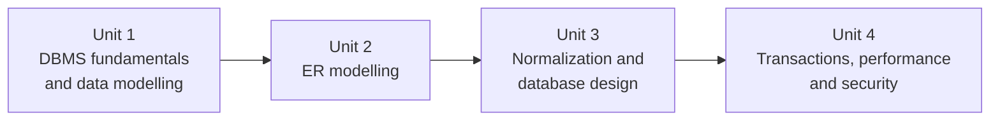

## Why this subject matters

Think about the last hour of your day. You paid for chai with UPI, checked your attendance on the college portal, and maybe looked up a train on IRCTC. Each of those taps read or changed a record in a database, in under a second, while lakhs of other people did the same thing.

None of this works if data is lost, duplicated or seen by the wrong person. This subject is about how we store data so that it stays **correct, shared, fast and safe**. In data science, it matters even more: every model you will ever train starts with data that somebody stored and someone else had to query.

## A short story

In 1970, Edgar F. Codd, a mathematician working at IBM, published a short paper with a simple idea: store data in plain **tables**, and let people ask for what they want instead of writing step-by-step programs to dig it out.

IBM was slow to build it, because its existing database product was selling well. A young programmer named Larry Ellison read the research and built a product on the idea first; his company later became Oracle. IBM's own research produced the language we still use today, SQL.

Codd won the Turing Award, computing's highest honour, in 1981. More than fifty years later, almost every app on your phone still talks to a database built on his idea of tables.

## Where it is used today

- **Payments and banking:** every UPI transfer, ATM withdrawal and card swipe.
- **Travel:** railway and flight bookings, where two people must never get the same seat.
- **Government:** large identity, tax and land-record systems that serve the whole country.
- **E-commerce and food delivery:** products, orders, stock and delivery tracking.
- **Sport:** cricket score sites keep every ball of every match in a database, which is how a commentator finds a record within seconds.
- **Data science and AI:** training data, dashboards and reports are pulled from databases with SQL.

> [!beyond] Beyond the syllabus
> AI chatbots that answer from a company's own documents often use a newer kind of store called a **vector database**, which finds text by meaning rather than by exact words. It builds on the same ideas you learn here: storing, indexing and querying data.

## What you will be able to do

By the end of this course you will be able to:

1. Explain what a DBMS is, its architecture, and its data models (Unit 1).
2. Design a database for a real problem using ER diagrams (Unit 2).
3. Improve a design with normalization, and plan a database from start to finish (Unit 3).
4. Explain how a DBMS keeps data correct with transactions and concurrency control, and how it is tuned, secured and administered (Unit 4).

## Careers that use it

| Career | How they use databases |
|---|---|
| Data analyst | Writes SQL every day to pull and summarise data for reports |
| Data scientist | Queries and cleans data before building models |
| Data engineer | Builds the pipelines and warehouses that move data between databases |
| Database administrator (DBA) | Keeps databases running, secure, backed up and fast |
| Backend developer | Connects apps and websites to their databases |
| ML engineer | Stores features, model results and logs for production systems |

## Map of the subject

- **Unit 1** answers *what* a database system is and how we describe data.
- **Unit 2** turns a real problem into a picture of entities and relationships.
- **Unit 3** turns that picture into clean, well-designed tables.
- **Unit 4** keeps those tables correct, fast and safe when many people use them at once.

Start with [[what-is-dbms]].

## Sources

- E. F. Codd, "A Relational Model of Data for Large Shared Data Banks", *Communications of the ACM*, 13(6), 1970
- Coronel & Morris, *Database Systems: Design, Implementation, and Management*, Ch. 1 (verify)
- UDSII-002 Database Management System syllabus, BSc Data Science Sem II
