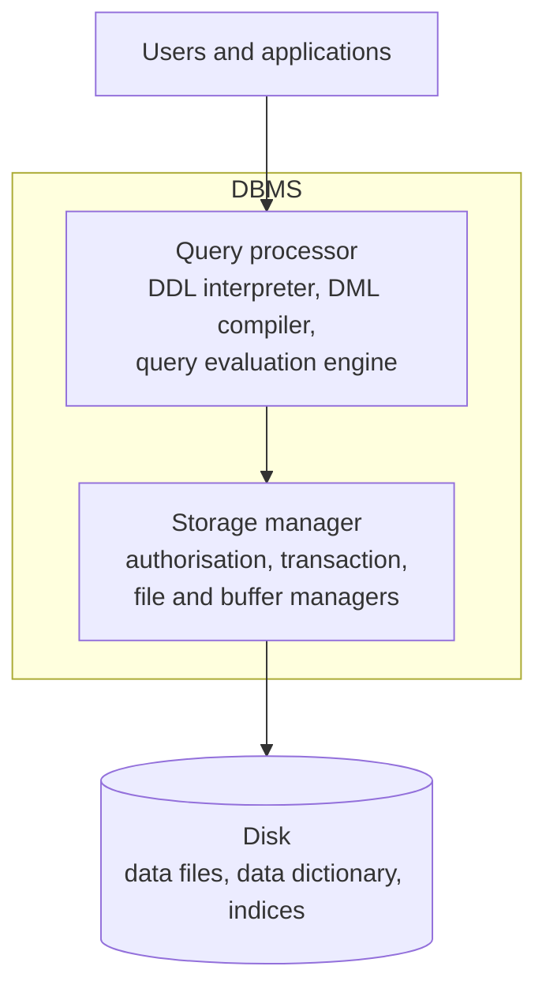

## Why should you care?

You tap "Pay" in a food-delivery app. Within two seconds, your order is saved, the restaurant sees it, and your money moves. Behind that tap, a phone, an application server, a DBMS, a disk, and several people who designed and look after the system all did their part.

When something goes wrong (the app is slow, an order vanishes, data leaks), you need to know which part failed and whose job it is to fix it. That map of parts and people is the **architecture** of a database system.

## In one line

DBMS architecture describes the parts of a database system, the people who use and run it, and how a request travels from a user to the stored data and back.

## Explained

### Q1. What are the components of a database system?

A database system has five components:

1. **Hardware:** servers, disks, network, and users' computers and phones.
2. **Software:**
   - the **operating system**, which manages the hardware;
   - the **DBMS**, which manages the database (MySQL, PostgreSQL, Oracle);
   - **application programs and utilities** that users work with (a fee portal, a backup tool).
3. **People:** everyone who designs, runs or uses the system (Q2).
4. **Procedures:** written rules for using and running the system, such as "back up every night at 2 a.m."
5. **Data:** the stored facts, plus **metadata**. ==Metadata is data about the data: table names, column types, rules and owners.==

### Q2. Who are the people in a database system?

| Person | What they do | College example |
|---|---|---|
| System administrator | Looks after hardware, operating system, network | IT staff who keep the server running |
| Database administrator (DBA) | Manages the DBMS and the database | Sets up accounts, backups, permissions |
| Database designer | Designs the database structure | Decides the tables and columns |
| System analysts and programmers | Design and write the applications | Build the fee-payment portal |
| End users | Use the applications for their work | Students, clerks, the principal |

### Q3. What does the DBA do, and what kinds of end users are there?

==The DBA (database administrator) controls the database: its structure, security, backup and performance.==

End users come in two kinds:

- **Naive users** only click through ready-made screens, such as a student paying fees.
- **Sophisticated users** write their own queries, such as a data analyst using SQL.

### Q4. What is the query processor?

The DBMS has two main parts above the stored data. The first is the query processor. ==The query processor turns user queries into low-level instructions the storage manager can run.== It contains:

- the **DDL interpreter**, for structure commands (DDL, data definition language, such as `CREATE TABLE`);
- the **DML compiler**, for data commands (DML, data manipulation language, such as `SELECT` and `INSERT`); it picks a fast plan for each;
- the **query evaluation engine**, which carries out that plan.

### Q5. What is the storage manager, and what is on disk?

==The storage manager links the stored data with the queries and programs that use it.== It contains:

- the **authorisation and integrity manager**: checks permissions and rules;
- the **transaction manager**: keeps data correct during failures and simultaneous use (see [[acid-properties]]);
- the **file manager**: handles space on disk;
- the **buffer manager**: brings data from disk into memory.

On **disk** sit the data files, the **data dictionary** (metadata) and **indices** (lookup structures that find rows fast, like a book's index). How the DBMS hides these details from users is in [[levels-of-abstraction]].

### Q6. Where do the user, application and database sit?

- **Two-tier architecture:** the application on the user's computer talks directly to the database server. Simple, but every computer holds the database connection details, which is risky for large systems.
- **Three-tier architecture:** ==In a three-tier architecture, the client talks to an application server, which talks to the database.== Almost every web and mobile app today is three-tier.

## Analogy and real-life example

A restaurant kitchen. Customers (end users) never enter the kitchen; they tell the waiter (application server) what they want. The head chef (query processor) reads the order and plans how to cook it. The storekeeper (storage manager) fetches ingredients from the store room (disk) and keeps a register of what is where (data dictionary). The manager (DBA) decides who may enter the store room and checks stock every night (backup).

## Diagram

## Worked example

**Problem.** A student pays fees on the college portal. Trace the request through a three-tier system and name the components involved.

**Solution.**

1. **Client tier:** the student (naive end user) fills the form in a browser on their phone (hardware) and taps Pay.
2. **Application tier:** the portal (an application program written by the programmers) checks the form and sends an `INSERT` for the payment and an `UPDATE` for the fee status to the DBMS.
3. **Query processor:** the DML compiler checks the commands and makes a plan; the query evaluation engine runs it.
4. **Storage manager:** the authorisation manager confirms the portal may write fee data; the transaction manager makes sure both changes happen together or not at all; the buffer and file managers write the data to disk.
5. **Back up the chain:** the DBMS reports success, the portal shows a receipt, and that night the DBA's backup procedure copies the new data.

## Try it

A food-delivery app shows you a list of restaurants near you. Map each part to its tier.

- The app on your phone: client tier.
- The company's server that receives your location and builds the list: ?
- The system that stores restaurants, menus and ratings: ?
- The person who decides which employees may see customers' phone numbers: ?

> [!answer]- Answer
> - The server that builds the list: **application tier** (application server).
> - The store of restaurants, menus and ratings: **database tier** (DBMS and disk).
> - The person controlling access to phone numbers: the **DBA**, using the authorisation features of the DBMS.

## Key facts and formulas

> [!important] Key facts
> - Five components of a database system: hardware, software, people, procedures, data.
> - Software = operating system + DBMS + application programs and utilities.
> - People: system administrator, DBA, database designer, system analysts and programmers, end users (naive and sophisticated).
> - Query processor = DDL interpreter + DML compiler + query evaluation engine.
> - Storage manager = authorisation and integrity manager + transaction manager + file manager + buffer manager.
> - On disk: data files, data dictionary (metadata), indices.
> - Two-tier: client talks directly to the database. Three-tier: client → application server → database.

## Common mistakes

> [!warning] Common mistake
> Mixing up the DBA and the database designer. The designer decides **what** tables and columns exist; the DBA **runs** the database day to day: accounts, permissions, backups, performance.

> [!warning] Common mistake
> Forgetting that **procedures** and **people** are components. A database system is not just software: without a backup procedure, a perfect DBMS can still lose a year of data.

> [!warning] Common mistake
> Thinking the data dictionary stores the actual records. It stores **metadata**: the description of the data, not the data itself.

## Think deeper

- **Why three tiers?** A two-tier app is simpler and faster to build. Why do banks and UPI apps never let your phone talk directly to their database? Think about security and about lakhs of phones connecting at once.
- **One DBA or many?** A college has one DBA. A bank has teams of them. What extra work appears when a database grows from one department to a whole organisation?
- **Where would you look first?** Fee receipts are being generated, but the fee status is not updating. Which component in the diagram is most likely failing, and why?

> [!beyond] Beyond the syllabus
> Large modern apps often go further than three tiers. They are split into many small services (microservices), each owning its own database, and connected by messages. Data engineers then gather data from all these databases into one place for analysis.

## Self-check

> [!quiz] Q1. Which of these is NOT one of the five components of a database system?
> (A) Procedures
> (B) People
> (C) Compiler
> (D) Data
>
> > [!answer]- Answer: C
> > The five components are hardware, software, people, procedures and data. A compiler is only one piece of software.

> [!quiz] Q2. Who is responsible for backups, user accounts and access permissions in a database?
> (A) End user
> (B) Database administrator
> (C) System analyst
> (D) Database designer
>
> > [!answer]- Answer: B
> > The DBA runs the database day to day: security, backups and performance. The designer only plans its structure.

> [!quiz] Q3. Which component makes sure that a fee payment and its fee-status update either both happen or neither happens?
> (A) Buffer manager
> (B) DDL interpreter
> (C) Transaction manager
> (D) Data dictionary
>
> > [!answer]- Answer: C
> > The transaction manager, part of the storage manager, keeps related changes together even if the system fails midway.

> [!quiz] Q4. A college wants students to view results on their phones. Why is a three-tier design better than letting each phone connect to the database directly?
> (A) Phones cannot run any apps
> (B) Only the application server holds the database connection, so the database is not exposed to every phone
> (C) Three-tier systems need no DBMS
> (D) Two-tier systems cannot store results
>
> > [!answer]- Answer: B
> > In three tiers, phones talk only to the application server. The database stays hidden, which is safer and handles many users better.

## Flashcards

Name the five components of a database system. :: Hardware, software, people, procedures, data
What three kinds of software are in a database system? :: Operating system, DBMS, application programs and utilities
What is metadata? :: Data about the data, such as table names, column types and rules
What does a DBA do? :: Controls the database's structure, security, backup and performance
What is a naive user? :: An end user who only uses ready-made application screens
What is a sophisticated user? :: An end user who writes their own queries, such as an analyst using SQL
What does the query processor do? :: Turns user queries into low-level instructions for the storage manager
Name the parts of the query processor. :: DDL interpreter, DML compiler, query evaluation engine
Name the parts of the storage manager. :: Authorisation and integrity manager, transaction manager, file manager, buffer manager
What is stored in the data dictionary? :: Metadata
What is three-tier architecture? :: Client → application server → database

## Sources

- Coronel, Morris & Rob, *Database Systems: Design, Implementation, and Management*, 9th ed., Ch. 1 (1.7.1–1.7.2)
- Silberschatz, Korth & Sudarshan, *Database System Concepts*, 7th ed., Ch. 1 (1.6–1.8)
- Elmasri & Navathe, *Fundamentals of Database Systems*, 7th ed., Ch. 2 (2.4–2.5)
