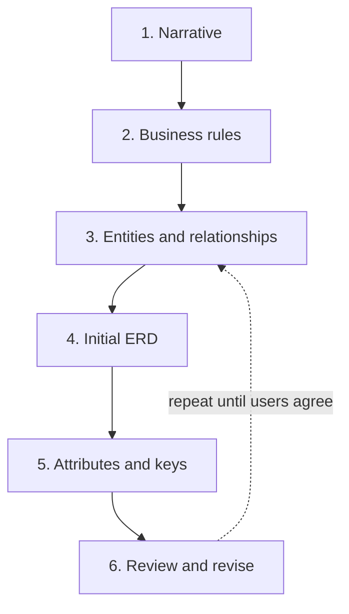
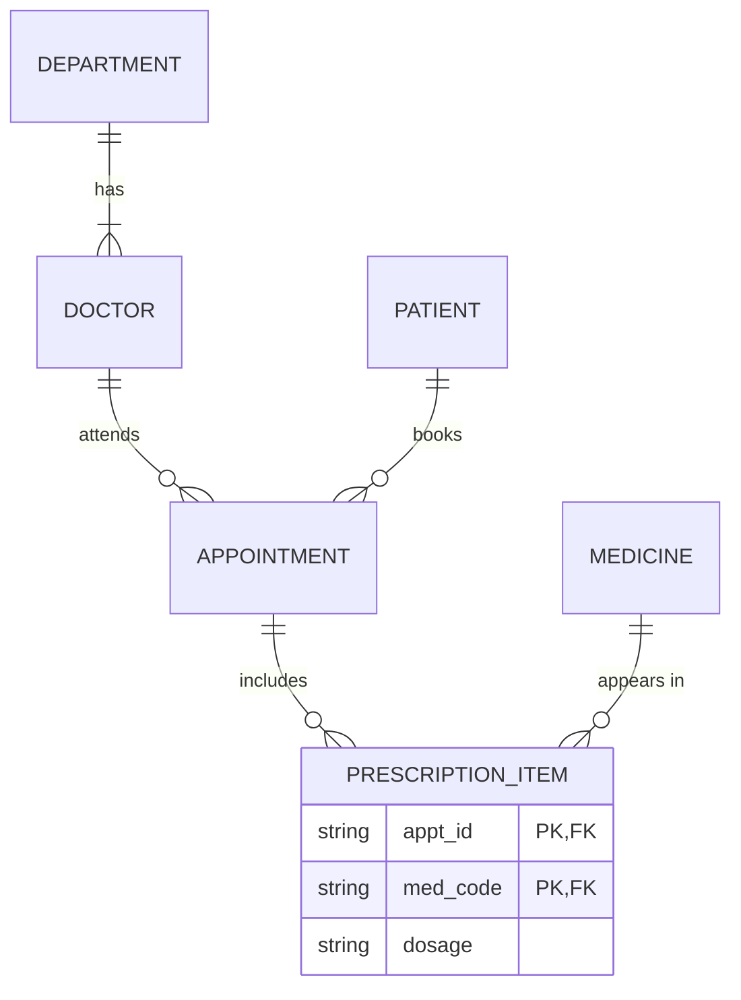

## Why should you care?

"Design a database for a hospital OPD." In an exam or an interview, this one line is all you get. Students who jump straight to drawing boxes end up with missing entities, wrong cardinalities and M:N lines that can't become tables.

Good designers follow a fixed, repeatable process. They don't draw the perfect diagram in one go; they draw, check and redraw. This note gives you that process step by step.

## In one line

An ER diagram is developed iteratively: write the narrative, extract business rules, find entities and relationships, draw, add attributes and keys, then review and revise.

## Explained

### Q1. What are the steps to develop an ER diagram? ⭐

1. ==**Write a detailed narrative**== of how the organisation works.
2. ==**Identify the business rules**== from the narrative (see [[data-models]]).
3. ==**Identify the main entities and relationships**==: nouns become entities, verbs become relationships.
4. ==**Draw the initial ERD**==.
5. ==**Add attributes and primary keys**== (see [[keys]]).
6. ==**Review and revise**== the ERD with the users.

Steps 3 to 6 repeat until the users agree the diagram matches reality. That is why ER design is called ==**iterative**==.

### Q2. What happens during review and revision?

The designer checks the draft with the users and with these questions:

- ==**Is every business rule shown?**== Each rule should map to a relationship, cardinality or constraint.
- ==**Are all M:N relationships resolved?**== Replace each with an associative entity (see [[associative-entities]]).
- ==**Are weak entities and keys correct?**== (see [[weak-entities]]).
- ==**Are there multivalued or derived attributes?**== Move multivalued ones into their own entity; don't store derived ones.
- ==**Does it answer the users' questions?**== Try each required report against the diagram.

### Q3. What are the conflicting goals in database design? ⭐

A designer must balance three goals that often pull in different directions:

| Goal | Meaning |
|---|---|
| ==**Design standards**== | Follow good practice: minimal redundancy, no nulls where avoidable, clear names |
| ==**Processing speed**== | Answer queries and transactions fast, sometimes by adding redundancy |
| ==**Information requirements**== | Produce every report and answer the users need |

==A perfect design that is too slow, or a fast design that cannot produce the reports, both fail.== The designer documents each trade-off.

## Analogy and real-life example

An architect designing a house for a family follows the same loop: listen to the family (narrative), note their needs ("three bedrooms, parents on the ground floor": business rules), sketch a plan, add measurements (attributes), and show it to them. They say "the kitchen is too far from the dining room", and the architect redraws.

## Diagram

## Worked example

**Problem.** Develop an ERD for a hospital OPD from this narrative:

> The OPD has several departments. Each doctor belongs to one department. A patient books appointments; each appointment is with one doctor on one date and time. A doctor sees many patients, and a patient may see many doctors over time. At each appointment, the doctor may prescribe several medicines, each with a dosage.

**Solution.**

1. **Business rules:** a department has many doctors; a doctor belongs to one department; a patient has many appointments; an appointment is with one doctor and one patient; an appointment may have many prescribed medicines; a medicine may be prescribed in many appointments.
2. **Entities:** DEPARTMENT, DOCTOR, PATIENT, APPOINTMENT, MEDICINE.
3. **Relationships:** DEPARTMENT 1:M DOCTOR; DOCTOR 1:M APPOINTMENT; PATIENT 1:M APPOINTMENT; APPOINTMENT M:N MEDICINE.
4. **Resolve M:N:** associative entity PRESCRIPTION_ITEM (appointment ID + medicine code), with attribute dosage.
5. **Keys:** surrogate keys for DOCTOR, PATIENT and APPOINTMENT; department code; medicine code.
6. **Review:** "Which medicines did Dr Rao prescribe last month?" follows DOCTOR → APPOINTMENT → PRESCRIPTION_ITEM → MEDICINE. The design answers it.

## Try it

Narrative: *A coaching class runs several batches. Each batch has one teacher; a teacher may take many batches. Students join one or more batches and pay a fee for each batch they join.*

Done for you: entities are BATCH, TEACHER, STUDENT.

Find the relationships and resolve any M:N.

> [!answer]- Answer
> - TEACHER 1:M BATCH (one teacher, many batches; each batch one teacher).
> - STUDENT M:N BATCH, resolved with an associative entity ADMISSION (student ID + batch ID), holding the **fee paid**, which belongs to the pair.

## Key facts and formulas

> [!important] Key facts
> - Steps: narrative → business rules → entities and relationships → initial ERD → attributes and keys → review and revise.
> - ERD development is iterative: steps 3–6 repeat until users agree.
> - Review checks: every rule shown, M:N resolved, keys and weak entities correct, multivalued and derived attributes handled, reports answerable.
> - Conflicting goals: design standards, processing speed, information requirements.

## Common mistakes

> [!warning] Common mistake
> Drawing before reading the narrative carefully. Missing one business rule ("a patient may see many doctors") changes a 1:M into an M:N.

> [!warning] Common mistake
> Leaving M:N lines in the final ERD. Every M:N must become an associative entity before tables are built.

> [!warning] Common mistake
> Stopping after the first draft. The first ERD is almost never right; review with users is part of the method, not an extra.

## Think deeper

- **Speed versus standards.** The OPD dashboard counts today's appointments per department every few seconds. Would you store a count in DEPARTMENT? What standard does that break?
- **Missing narrative.** If the narrative never mentions bills, should the designer add BILL anyway? Who should decide?
- **Testing a design.** Write three questions the OPD manager might ask, and trace each through the ERD.

> [!beyond] Beyond the syllabus
> Industry teams often draw ERDs in free tools such as draw.io, dbdiagram.io or Mermaid, and many tools can generate the SQL to create tables directly from the diagram. Some can also do the reverse: draw an ERD from an existing database, which helps when you join a team with an undocumented system.

## Self-check

> [!quiz] Q1. What is the first step in developing an ER diagram?
> (A) Draw the initial ERD
> (B) Write a detailed narrative of the organisation's operations
> (C) Choose primary keys
> (D) Normalize the tables
>
> > [!answer]- Answer: B
> > The narrative is the source of the business rules, which drive everything else.

> [!quiz] Q2. Why is ER diagram development called iterative?
> (A) It uses loops in code
> (B) The draft is reviewed and revised repeatedly until it matches reality
> (C) It is done once per year
> (D) It has exactly six steps
>
> > [!answer]- Answer: B
> > Drawing, reviewing with users and redrawing repeat until the users agree.

> [!quiz] Q3. Which is NOT one of the three conflicting goals of database design?
> (A) Design standards
> (B) Processing speed
> (C) Information requirements
> (D) Number of entities
>
> > [!answer]- Answer: D
> > The three goals are design standards, processing speed and information requirements.

> [!quiz] Q4. In the OPD design, why is PRESCRIPTION_ITEM needed?
> (A) To store doctors' departments
> (B) To resolve the M:N between APPOINTMENT and MEDICINE and store each dosage
> (C) To make patients optional
> (D) To create a recursive relationship
>
> > [!answer]- Answer: B
> > Dosage belongs to one medicine in one appointment, so it lives in the associative entity.

## Flashcards

List the six steps to develop an ER diagram. :: Narrative, business rules, entities and relationships, initial ERD, attributes and keys, review and revise
Why is ERD development iterative? :: The draft is reviewed with users and revised until it matches reality
What must happen to every M:N relationship before tables are built? :: It must be resolved with an associative entity
Name the three conflicting goals of database design. :: Design standards, processing speed, information requirements
How do you test whether an ERD meets information requirements? :: Trace each required report or question through the diagram

## Sources

- Coronel, Morris & Rob, *Database Systems: Design, Implementation, and Management*, 9th ed., Ch. 4 (4.2–4.3)
- Elmasri & Navathe, *Fundamentals of Database Systems*, 7th ed., Ch. 3 (3.6–3.7)
