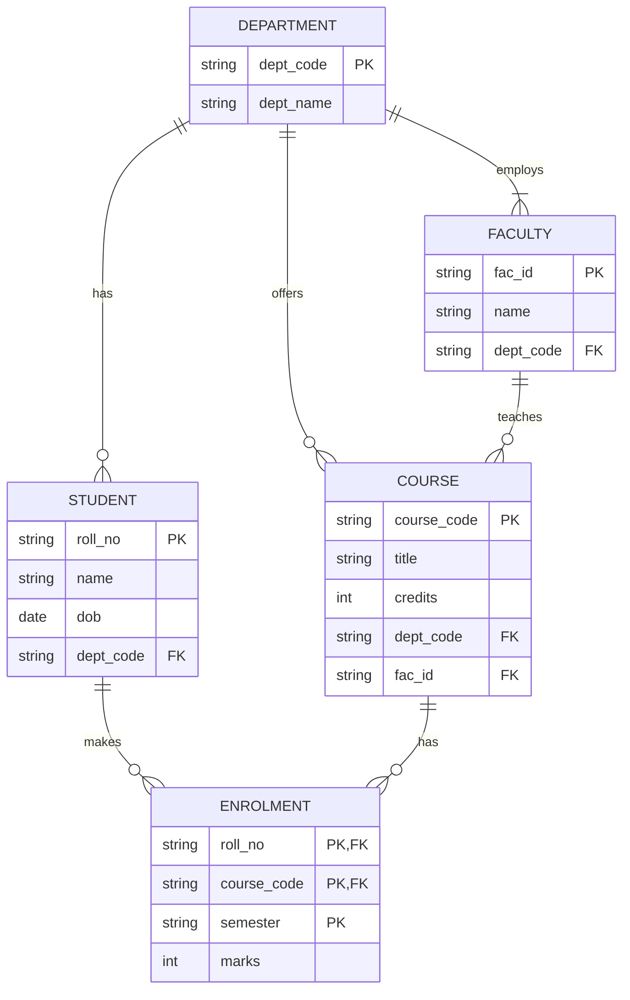
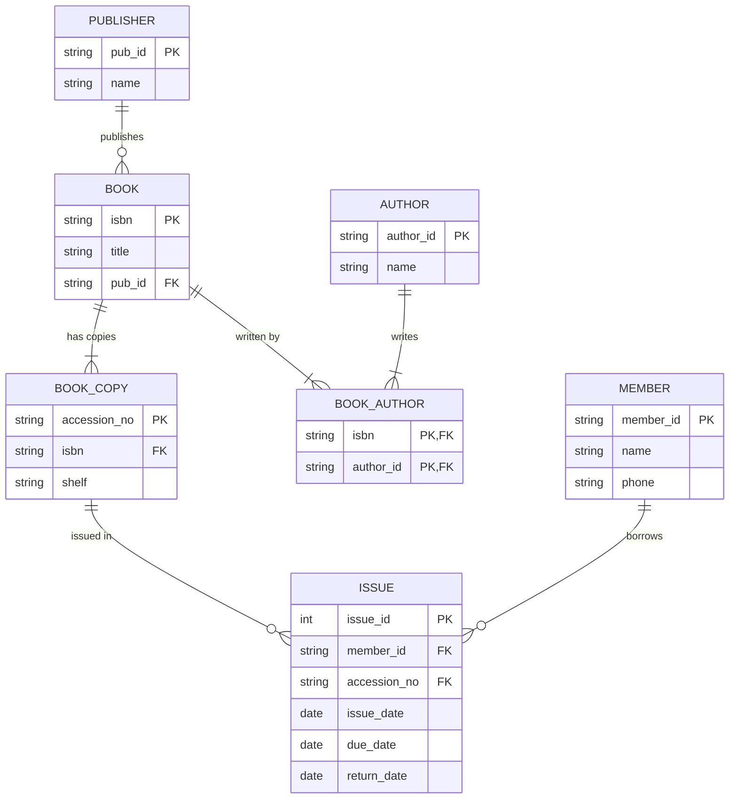

## Aim

To design ER diagrams for (a) a **student management system** and (b) a **library management system**: identify entities, attributes, primary keys, relationships and cardinalities from business rules, and draw them in crow's foot notation.

## Concepts used

- [[er-diagram-development]]: the six-step method followed here.
- [[connectivity-and-cardinality]]: the symbols at each line end.
- [[associative-entities]]: resolving every M:N relationship.
- [[keys]]: choosing primary keys.

## Setup

No Python is needed. Use any one tool:

- **Mermaid** (recommended, text-based): open [mermaid.live](https://mermaid.live), paste the code below, and the diagram appears on the right. The same code also works in Obsidian notes.
- **draw.io** (free, drag-and-drop): open [app.diagrams.net](https://app.diagrams.net), choose *Entity Relation* shapes, and draw the same entities and lines.
- **Paper:** for the journal, draw by hand in Chen or crow's foot notation.

## Code

### Part A. Student management system: business rules

1. A department has many students; each student belongs to one department.
2. A department offers many courses; each course is offered by one department.
3. A faculty member belongs to one department and teaches many courses; each course has one faculty member.
4. A student enrols in many courses, and a course has many students. For each enrolment we store the semester and the marks.

### Part A. Mermaid code

```text
erDiagram
  DEPARTMENT ||--o{ STUDENT : has
  DEPARTMENT ||--o{ COURSE : offers
  DEPARTMENT ||--|{ FACULTY : employs
  FACULTY ||--o{ COURSE : teaches
  STUDENT ||--o{ ENROLMENT : makes
  COURSE ||--o{ ENROLMENT : has
  DEPARTMENT {
    string dept_code PK
    string dept_name
  }
  STUDENT {
    string roll_no PK
    string name
    date dob
    string dept_code FK
  }
  FACULTY {
    string fac_id PK
    string name
    string dept_code FK
  }
  COURSE {
    string course_code PK
    string title
    int credits
    string dept_code FK
    string fac_id FK
  }
  ENROLMENT {
    string roll_no PK, FK
    string course_code PK, FK
    string semester PK
    int marks
  }
```

### Part B. Library management system: business rules

1. A book (title) can have many copies; each copy has a unique accession number.
2. A book can have many authors, and an author can write many books.
3. A publisher publishes many books; each book has one publisher.
4. A member can borrow many copies over time, and a copy is borrowed by many members over time. For each issue we store the issue date, due date and return date.

### Part B. Mermaid code

```text
erDiagram
  PUBLISHER ||--o{ BOOK : publishes
  BOOK ||--|{ BOOK_COPY : "has copies"
  BOOK ||--|{ BOOK_AUTHOR : "written by"
  AUTHOR ||--|{ BOOK_AUTHOR : writes
  MEMBER ||--o{ ISSUE : borrows
  BOOK_COPY ||--o{ ISSUE : "issued in"
  BOOK {
    string isbn PK
    string title
    string pub_id FK
  }
  BOOK_COPY {
    string accession_no PK
    string isbn FK
    string shelf
  }
  AUTHOR {
    string author_id PK
    string name
  }
  BOOK_AUTHOR {
    string isbn PK, FK
    string author_id PK, FK
  }
  PUBLISHER {
    string pub_id PK
    string name
  }
  MEMBER {
    string member_id PK
    string name
    string phone
  }
  ISSUE {
    int issue_id PK
    string member_id FK
    string accession_no FK
    date issue_date
    date due_date
    date return_date
  }
```

## Output

### Part A. Student management ERD



### Part B. Library management ERD



## Explanation

**Part A**

- **Entities:** DEPARTMENT, STUDENT, FACULTY and COURSE come straight from the nouns in the rules.
- **1:M relationships:** rules 1–3 each give "one ... many", drawn with `||` on the one side and `o{` (or `|{`) on the many side. A department must employ at least one faculty member, so that end is `|{` (mandatory).
- **M:N resolved:** rule 4 is M:N. ENROLMENT is the associative entity. Marks belong to one student in one course, so they live here.
- **Key of ENROLMENT:** roll no + course code + **semester**, because a student who fails may take the same course again in a later semester.

**Part B**

- **BOOK vs BOOK_COPY:** a title (ISBN) and a physical copy are different things. The library lends copies, so ISSUE links to BOOK_COPY, not BOOK.
- **BOOK_COPY's key:** the accession number is unique across the library, so BOOK_COPY has its own key. It is existence-dependent on BOOK but **not weak**, and the relationship is non-identifying.
- **M:N resolved twice:** BOOK–AUTHOR becomes BOOK_AUTHOR; MEMBER–BOOK_COPY becomes ISSUE.
- **Surrogate key in ISSUE:** the same member can borrow the same copy again later, so member + copy is not unique. ISSUE uses a surrogate key, issue_id.

## Try it

Add **fines** to the library: a fine is charged on an issue when the book is returned late; one issue has at most one fine, with an amount and a paid/unpaid status. Which entity holds the fine, and what is the relationship?

> [!answer]- Answer
> Either add `fine_amount` and `fine_paid` as optional attributes of ISSUE, or create FINE (issue_id PK/FK, amount, paid) in a **1:1** relationship with ISSUE, optional on ISSUE's side. A separate FINE entity avoids empty fine columns on the many issues that are returned on time.

## Viva questions

1. What is the difference between an entity and an entity instance? Give an example from your ERD.
2. Why does the library ERD have both BOOK and BOOK_COPY?
3. Why is semester part of ENROLMENT's primary key?
4. Which relationships in your diagrams were M:N, and how did you resolve them?
5. Why does ISSUE use a surrogate key instead of member ID + accession number?
6. Is BOOK_COPY a weak entity? Justify your answer.
7. What do `||`, `o{` and `|{` mean at the end of a line?
8. How would the diagram change if each course could have two faculty members?

## Flashcards

In the library ERD, why does ISSUE link to BOOK_COPY and not BOOK? :: The library lends physical copies, not titles
Why does ENROLMENT's key include semester? :: A student may repeat a course in a later semester
Why does ISSUE use a surrogate key? :: The same member can borrow the same copy more than once
Which associative entity links BOOK and AUTHOR? :: BOOK_AUTHOR

## Sources

- Coronel, Morris & Rob, *Database Systems: Design, Implementation, and Management*, 9th ed., Ch. 4 (4.1–4.2)
- Mermaid documentation: [Entity Relationship Diagrams](https://mermaid.js.org/syntax/entityRelationshipDiagram.html)
- [diagrams.net (draw.io)](https://www.drawio.com), free diagramming tool
