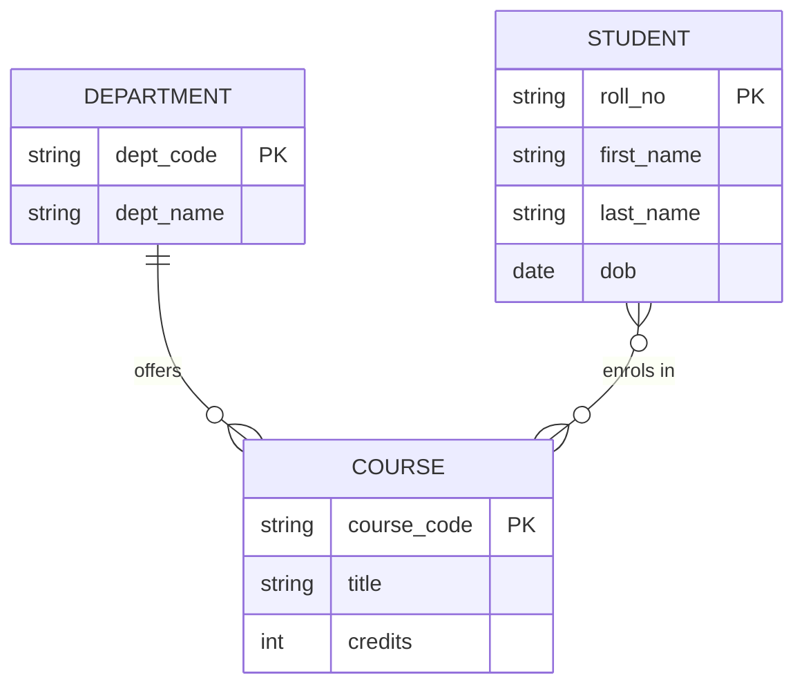

## Why should you care?

A college asks you to build its admission system. The principal talks about "students", the office talks about "applications", and the accounts team talks about "fee heads". Before writing a single table, you need one picture that everyone can read, check and correct.

That picture is an **ER diagram**. It is the most common design drawing in the database world, and it is what interviewers ask you to sketch when they say "design a database for a food-delivery app".

## In one line

The ER model describes a database design as entities, their attributes and the relationships between them, drawn as an ER diagram (ERD).

## Explained

### Q1. What is the ER model?

==The entity relationship model (ERM) describes a database as entities, their attributes and the relationships between them.==

- It was introduced by **Peter Chen in 1976**.
- It is a **conceptual** model: it shows what data is needed, not how it is stored (see [[levels-of-abstraction]]).
- ==Its drawing is called an **ER diagram (ERD)**==.
- It uses the building blocks you met in [[data-models]]: entities, attributes, relationships and constraints.

### Q2. What is an entity?

==An entity is a thing about which data is stored, such as STUDENT or COURSE.==

- In an ERD, "entity" usually means the whole **entity set**: all students.
- ==One particular student is an **entity instance** (or occurrence).==
- Entities are drawn as **rectangles**, with names in capitals and singular: STUDENT, not Students.

### Q3. What types of attributes are there?

| Type | Meaning | STUDENT example |
|---|---|---|
| ==**Required** / **optional**== | Must have a value / may be empty | Name (required), email (optional) |
| ==**Simple** / **composite**== | Cannot be divided / made of parts | Gender (simple), name = first + last (composite) |
| ==**Single-valued** / **multivalued**== | One value / many values | Date of birth / phone numbers |
| ==**Derived**== | Calculated from other attributes | Age, from date of birth |
| ==**Identifier**== | Uniquely identifies each instance | Roll number (see [[keys]]) |

The set of allowed values of an attribute is its **domain**: marks from 0 to 100.

### Q4. What is a relationship?

==A relationship is an association between entities, named with a verb.==

- Example: STUDENT *enrols in* COURSE; DEPARTMENT *offers* COURSE.
- The entities in a relationship are its **participants**.
- ==A relationship works in **both directions**==: a department offers courses, and each course is offered by a department.
- How many instances link on each side is its **connectivity and cardinality** (see [[connectivity-and-cardinality]]).

### Q5. What are Chen and crow's foot notation?

| Element | ==**Chen notation**== | ==**Crow's foot notation**== |
|---|---|---|
| Entity | Rectangle | Rectangle |
| Attribute | Oval joined to the entity | Listed inside the rectangle |
| Relationship | Diamond with a verb | Line with a verb label |
| How many | Numbers such as 1 and M | Symbols at line ends (bar, circle, "crow's foot") |

Chen notation is common in textbooks and exams. Crow's foot is common in industry tools, and is used in these notes' diagrams.

## Analogy and real-life example

An ER diagram is like a seating plan for a wedding. The guests are entity instances, the tables are entity sets, each guest's details (name, side of the family, food choice) are attributes, and "sits with" or "is related to" are relationships. The plan is drawn and checked before anyone arrives.

## Diagram

## Worked example

**Problem.** Classify every attribute of a STUDENT entity with these attributes: roll number, name (first and last), date of birth, age, phone numbers (one or more), email (some students don't have one).

**Solution.**

1. **Roll number:** identifier; simple, single-valued, required.
2. **Name:** composite (first name + last name), required.
3. **Date of birth:** simple, single-valued, required.
4. **Age:** derived from date of birth, so it need not be stored.
5. **Phone numbers:** multivalued, because one student may have several.
6. **Email:** optional, because it may be empty.

## Try it

A food-delivery app stores RESTAURANT with: restaurant ID, name, address (street, area, city, PIN), cuisines served (one or more), average rating (calculated from all reviews), and GST number (small stalls may not have one).

Done for you: restaurant ID is the **identifier**; address is **composite**.

Classify cuisines served, average rating and GST number.

> [!answer]- Answer
> - **Cuisines served:** multivalued (a restaurant may serve North Indian, Chinese and South Indian).
> - **Average rating:** derived (calculated from reviews).
> - **GST number:** optional (small stalls may not have one).

## Key facts and formulas

> [!important] Key facts
> - ER model: entities, attributes and relationships; introduced by Peter Chen (1976); drawn as an ERD.
> - Entity = thing about which data is stored; entity set = all of them; entity instance = one of them.
> - Attribute types: required/optional, simple/composite, single-valued/multivalued, derived, identifier.
> - Domain = set of allowed values of an attribute.
> - Relationship = association between entities, named with a verb, read in both directions.
> - Chen: rectangle, oval, diamond. Crow's foot: rectangle with attributes inside, labelled line, symbols at line ends.

## Common mistakes

> [!warning] Common mistake
> Storing derived attributes such as age. Age changes every year, so a stored age soon becomes wrong. Store date of birth and calculate age when needed.

> [!warning] Common mistake
> Making a multivalued attribute a single column, such as "phone: 98xxx, 97xxx". One field holding several values breaks searching and updating; a multivalued attribute usually becomes its own entity.

> [!warning] Common mistake
> Naming relationships with nouns ("enrolment") instead of verbs ("enrols in"). A verb makes the diagram read as a sentence: STUDENT enrols in COURSE.

## Think deeper

- **Attribute or entity?** Is CITY an attribute of STUDENT, or its own entity? What would make you change your answer (for example, storing each city's district and PIN codes)?
- **Two notations.** Why might a company choose crow's foot for its developers but a teacher choose Chen for an exam?
- **What the ERD leaves out.** An ERD shows structure, not rules like "fees must be paid before the exam form opens". Where should such rules be recorded?

## Self-check

> [!quiz] Q1. Who introduced the entity relationship model?
> (A) E. F. Codd
> (B) Peter Chen
> (C) Larry Ellison
> (D) Charles Bachman
>
> > [!answer]- Answer: B
> > Peter Chen introduced the ER model in 1976. Codd proposed the relational model.

> [!quiz] Q2. A student's age, calculated from date of birth, is which type of attribute?
> (A) Composite
> (B) Multivalued
> (C) Derived
> (D) Identifier
>
> > [!answer]- Answer: C
> > Its value is calculated from another attribute, so it is derived.

> [!quiz] Q3. In Chen notation, a relationship is drawn as a:
> (A) Rectangle
> (B) Oval
> (C) Diamond
> (D) Double line
>
> > [!answer]- Answer: C
> > Chen uses rectangles for entities, ovals for attributes and diamonds for relationships.

> [!quiz] Q4. A designer stores "phone numbers" as one text field such as "98xxx, 97xxx". What is the main problem?
> (A) Phone numbers are derived
> (B) A multivalued attribute is squeezed into one field, which makes searching and updating hard
> (C) Phone numbers cannot be identifiers
> (D) The field should be optional
>
> > [!answer]- Answer: B
> > Several values in one field break searches such as "find the student with this number". A multivalued attribute needs its own structure.

## Flashcards

What does the ER model describe? :: A database design as entities, their attributes and the relationships between them
Who introduced the ER model, and when? :: Peter Chen, 1976
What is an entity instance? :: One particular occurrence of an entity, such as one student
What is a composite attribute? :: An attribute made of smaller parts, such as name = first name + last name
What is a multivalued attribute? :: An attribute that can hold several values, such as phone numbers
What is a derived attribute? :: An attribute calculated from others, such as age from date of birth
What is a domain? :: The set of allowed values of an attribute
How does Chen notation draw entities, attributes and relationships? :: Rectangles, ovals and diamonds
In crow's foot notation, where are attributes shown? :: Inside the entity rectangle

## Sources

- Coronel, Morris & Rob, *Database Systems: Design, Implementation, and Management*, 9th ed., Ch. 4 (4.1.1–4.1.3)
- Silberschatz, Korth & Sudarshan, *Database System Concepts*, 7th ed., Ch. 6 (6.2–6.3, 6.10)
- Elmasri & Navathe, *Fundamentals of Database Systems*, 7th ed., Ch. 3 (3.3–3.4, 3.7)
