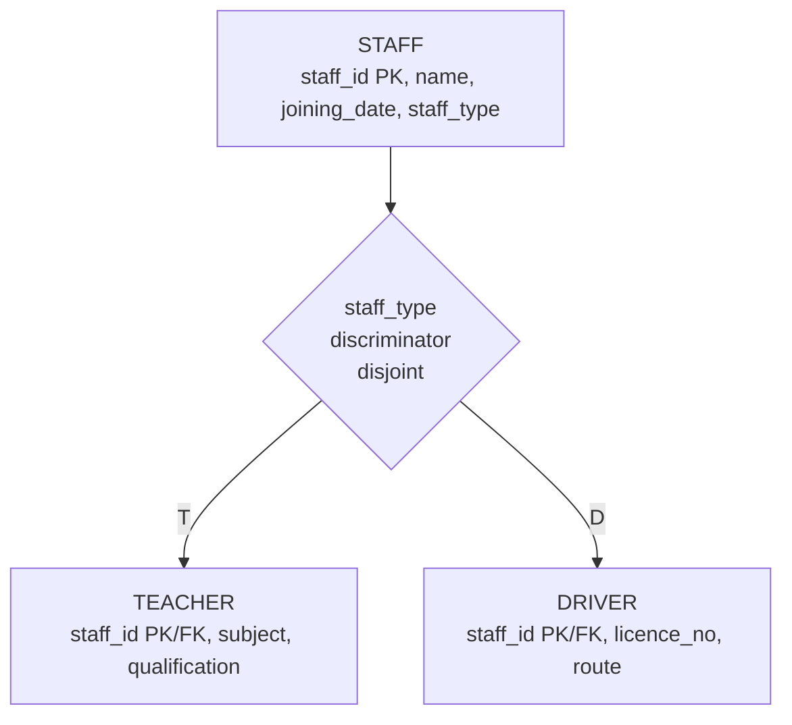

## Why should you care?

A college stores STAFF. Teaching staff have a subject and a qualification; lab assistants have a lab and a shift; drivers have a licence number and a route. If all of these go into one STAFF table, most columns stay empty for most rows: a driver has no subject, a teacher has no licence.

The **extended ER model** solves this by letting one entity have specialised sub-entities. It also offers **entity clustering**, which keeps huge diagrams readable.

## In one line

The extended ER model adds supertypes and subtypes (with inheritance and constraints) to the ER model, and entity clustering groups many entities into one virtual entity to simplify large diagrams.

## Explained

### Q1. What are supertypes and subtypes? ⭐

==A **supertype** holds the attributes common to all instances; a **subtype** holds the attributes unique to one group.==

- Example: STAFF (staff ID, name, joining date) is the supertype; TEACHER (subject, qualification) and DRIVER (licence number, route) are subtypes.
- ==Use subtypes when groups have **unique attributes or relationships**==; otherwise they just add complexity.
- This avoids many **empty (null) values** in one wide table.
- The model with these features is the ==**extended (or enhanced) ER model, EERM**==.

### Q2. What are the specialization hierarchy and inheritance?

- ==A **specialization hierarchy** arranges supertypes above subtypes in levels.== STAFF → TEACHER → VISITING_TEACHER is a three-level hierarchy.
- ==**Inheritance**: a subtype inherits all attributes and relationships of its supertype.== A TEACHER also has staff ID, name and joining date.
- The ==**primary key** of a subtype is the same as its supertype's== (staff ID), and it is also a foreign key to the supertype.
- A subtype can have **its own relationships**: only TEACHER *teaches* COURSE.

### Q3. What is a subtype discriminator, and what are disjoint and overlapping subtypes? ⭐

- ==A **subtype discriminator** is the supertype attribute that decides which subtype an instance belongs to==, such as staff type = "T" (teacher) or "D" (driver).
- ==**Disjoint (non-overlapping)**: an instance belongs to **at most one** subtype.== A staff member is a teacher or a driver, not both.
- ==**Overlapping**: an instance may belong to **more than one** subtype.== A PERSON at a university may be both a STUDENT and an EMPLOYEE.

### Q4. What is the completeness constraint? ⭐

==The completeness constraint says whether every supertype instance must belong to a subtype.==

- ==**Partial completeness**==: some instances belong to no subtype. A peon is STAFF but needs no special subtype.
- ==**Total completeness**==: every instance belongs to at least one subtype. Every STAFF member is either TEACHING or NON_TEACHING.

### Q5. What are specialization and generalization?

- ==**Specialization** is top-down==: start with a supertype (STAFF), find groups with unique attributes, and create subtypes.
- ==**Generalization** is bottom-up==: start with separate entities (TEACHER, DRIVER), notice common attributes, and create a supertype.
- Both produce the same kind of hierarchy; they differ only in the direction of discovery.

### Q6. What is entity clustering? ⭐

==An **entity cluster** is a virtual entity that represents several entities and relationships in an ERD.==

- It is drawn as one box (often dashed) to **hide detail** in a large diagram, for example "ADMISSIONS" standing for APPLICANT, APPLICATION, DOCUMENT and MERIT_LIST.
- ==It is not a real entity: it never becomes a table==.
- Rule: ==avoid showing **attributes**== on clusters, to keep the diagram clean and avoid confusion.

## Analogy and real-life example

Vehicle registration. Every VEHICLE has a registration number, owner and colour (supertype). A TRUCK also has load capacity and a goods permit; a BUS has seating capacity and a route permit (subtypes). The vehicle type written in the RC book is the discriminator. A vehicle is a truck or a bus, never both: disjoint.

## Diagram

## Worked example

**Problem.** A hospital stores EMPLOYEE (ID, name, phone). Doctors also have a specialisation and registration number. Nurses have a ward and a shift. Some employees are clerks with no extra attributes. No employee is both a doctor and a nurse. Design the hierarchy.

**Solution.**

1. **Supertype:** EMPLOYEE (emp ID, name, phone, emp type).
2. **Subtypes:** DOCTOR (specialisation, registration no); NURSE (ward, shift). Clerks need no subtype.
3. **Primary keys:** DOCTOR and NURSE use emp ID, also a foreign key to EMPLOYEE.
4. **Discriminator:** emp type.
5. **Disjoint or overlapping:** **disjoint**, because no one is both.
6. **Completeness:** **partial**, because clerks belong to no subtype.

## Try it

A university PERSON can be a STUDENT (roll no, programme), an EMPLOYEE (salary grade, department), or both (a PhD scholar who teaches). Everyone in the database is at least one of these.

Done for you: the supertype is PERSON.

State the disjoint/overlapping constraint and the completeness constraint.

> [!answer]- Answer
> - **Overlapping**, because one person can be both a student and an employee.
> - **Total completeness**, because every person is at least one subtype.

## Key facts and formulas

> [!important] Key facts
> - EERM = ER model + supertypes and subtypes.
> - Supertype: common attributes; subtype: unique attributes or relationships.
> - Specialization hierarchy: levels of supertypes and subtypes; inheritance passes attributes and relationships down.
> - Subtype PK = supertype PK (also an FK).
> - Subtype discriminator: supertype attribute that decides the subtype.
> - Disjoint: at most one subtype. Overlapping: more than one allowed.
> - Completeness: partial (some instances in no subtype) or total (every instance in a subtype).
> - Specialization = top-down; generalization = bottom-up.
> - Entity cluster: virtual entity representing several entities and relationships; never a table; no attributes shown.

## Common mistakes

> [!warning] Common mistake
> Creating subtypes for groups with no unique attributes or relationships. Subtypes are worth it only when they remove nulls or carry special relationships.

> [!warning] Common mistake
> Giving a subtype a new primary key. A subtype shares its supertype's key, so a teacher and their staff record are the same person.

> [!warning] Common mistake
> Turning an entity cluster into a table. A cluster only simplifies the drawing; the real entities inside it become the tables.

## Think deeper

- **One wide table or many?** When might a designer keep STAFF as one table with some empty columns instead of creating subtypes? Think about how often each subtype's data is used.
- **Changing roles.** A lab assistant becomes a teacher. What changes in a disjoint design?
- **Clusters for whom?** Who benefits from an entity cluster: the DBMS, the programmers or the managers reading the design?

## Self-check

> [!quiz] Q1. In a specialization hierarchy, a subtype's primary key is:
> (A) A new surrogate key
> (B) The same as its supertype's primary key
> (C) The discriminator
> (D) Not needed
>
> > [!answer]- Answer: B
> > The subtype shares the supertype's key, which is also a foreign key to it.

> [!quiz] Q2. A person can be both a STUDENT and an EMPLOYEE. These subtypes are:
> (A) Disjoint
> (B) Overlapping
> (C) Clustered
> (D) Weak
>
> > [!answer]- Answer: B
> > Overlapping subtypes allow an instance to belong to more than one subtype.

> [!quiz] Q3. Some STAFF members (peons) belong to no subtype. The completeness constraint is:
> (A) Total
> (B) Partial
> (C) Disjoint
> (D) Mandatory
>
> > [!answer]- Answer: B
> > Partial completeness allows supertype instances that belong to no subtype.

> [!quiz] Q4. What is an entity cluster?
> (A) A table that joins several tables
> (B) A virtual entity that represents several entities and relationships to simplify an ERD
> (C) A group of weak entities
> (D) A subtype with many attributes
>
> > [!answer]- Answer: B
> > It exists only in the diagram, to hide detail; it never becomes a table.

## Flashcards

What is a supertype? :: An entity holding the attributes common to all its subtypes
What is a subtype? :: An entity holding attributes or relationships unique to one group of the supertype
What is inheritance in the EERM? :: A subtype gets all attributes and relationships of its supertype
What is a subtype's primary key? :: The same as its supertype's, also used as a foreign key
What is a subtype discriminator? :: The supertype attribute that decides which subtype an instance belongs to
What are disjoint subtypes? :: Subtypes where an instance belongs to at most one subtype
What are overlapping subtypes? :: Subtypes where an instance may belong to more than one subtype
What is total completeness? :: Every supertype instance belongs to at least one subtype
Specialization or generalization: which is top-down? :: Specialization
What is an entity cluster? :: A virtual entity representing several entities and relationships to simplify an ERD

## Sources

- Coronel, Morris & Rob, *Database Systems: Design, Implementation, and Management*, 9th ed., Ch. 5 (5.1–5.2)
- Silberschatz, Korth & Sudarshan, *Database System Concepts*, 7th ed., Ch. 6 (6.8)
- Elmasri & Navathe, *Fundamentals of Database Systems*, 7th ed., Ch. 4 (4.1–4.3)
