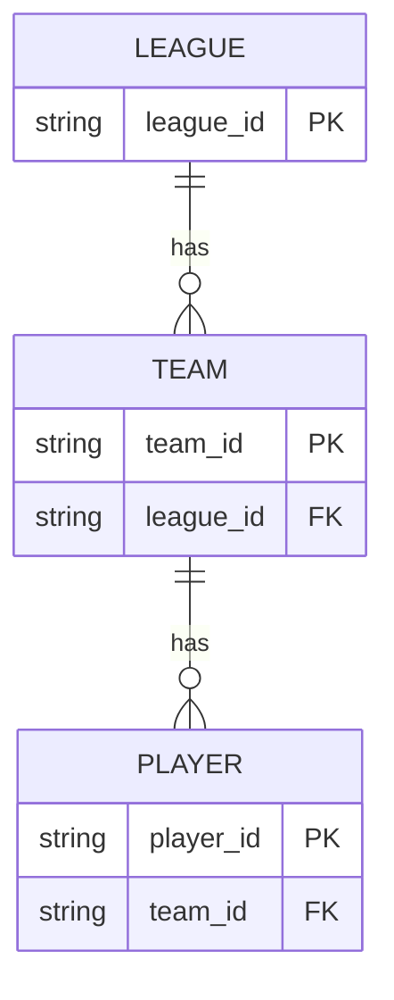

## Why should you care?

A college database stores each department's current HOD. Next year the HOD changes, the old name is overwritten, and nobody can answer "who was HOD when this student graduated?" Elsewhere, a sports database links PLAYER and TEAM only through LEAGUE, and suddenly nobody can tell which player plays for which team.

These are not rare bugs. They are standard design traps, and textbooks teach them as **design cases**. Knowing them lets you build databases that stay correct as the organisation changes.

## In one line

Flexible database design handles four common cases correctly: placing the foreign key in 1:1 relationships, keeping history of time-variant data, avoiding fan traps, and removing redundant relationships.

## Explained

### Q1. How do you implement a 1:1 relationship?

==In a 1:1 relationship, put the foreign key on the side with **mandatory** participation.==

- Example: PROFESSOR *chairs* DEPARTMENT. Every department has one chair (mandatory); most professors chair nothing (optional).
- ==Put **chair_prof_id** in DEPARTMENT==, not dept_code in PROFESSOR. Otherwise most professors have an empty column.
- ==If **both** sides are optional, choose the side that gives the **fewest nulls**==, or use a separate table for the relationship.
- If both sides are mandatory, check whether they are really one entity.

### Q2. How do you keep history of time-variant data? ⭐

==**Time-variant data** is data whose values change over time, where the history must be kept.==

- Examples: a teacher's salary, a department's HOD, a product's price.
- ==Overwriting the value **loses history**.==
- Fix: ==create a **history entity**==, such as SALARY_HISTORY (teacher ID, effective date, salary) or HOD_HISTORY (dept code, start date, end date, prof ID).
- The current value is the row with the latest date (or no end date).

### Q3. What is a fan trap? ⭐

==A **fan trap** happens when one entity has 1:M relationships to two other entities, so the real link between those two is missing.==

- Example: LEAGUE 1:M TEAM and LEAGUE 1:M PLAYER. You know each player's league, but ==not which **team** a player is in==.
- The two relationships "fan out" from LEAGUE, hiding the real link.
- ==Fix: restructure the path==: LEAGUE 1:M TEAM 1:M PLAYER. Now each player's team, and through it the league, is known.

### Q4. What is a redundant relationship? ⭐

==A **redundant relationship** exists when there are **multiple paths** between related entities and one of them adds no information.==

- Example: COUNTRY 1:M STATE 1:M CITY, **and also** COUNTRY 1:M CITY.
- The city's country is already known through its state, so ==the direct COUNTRY–CITY link is redundant==.
- Danger: ==the two paths can **disagree**== (a city's state is in India, but its direct country link says Nepal).
- Fix: remove the redundant relationship, unless it is needed for speed and its consistency is controlled.

## Analogy and real-life example

A school's records register. Writing a new class teacher's name over the old one each year loses history (time-variant data). Listing students under "school" and teachers under "school", but never students under their class teacher, makes it impossible to say whose student is whose (a fan trap).

## Diagram

## Worked example

**Problem.** A college design has these problems. Name each case and fix it.

1. DEPARTMENT has an attribute hod_name, overwritten each time the HOD changes.
2. COLLEGE 1:M DEPARTMENT, COLLEGE 1:M STUDENT, but no link between STUDENT and DEPARTMENT.
3. Every PROFESSOR row has a column chairs_dept_code, empty for most professors.

**Solution.**

1. **Time-variant data.** Create HOD_HISTORY (dept code, prof ID, start date, end date). The current HOD is the row with no end date.
2. **Fan trap.** Restructure: COLLEGE 1:M DEPARTMENT 1:M STUDENT, so each student's department is known.
3. **1:1 placement.** Move the foreign key to DEPARTMENT as chair_prof_id, the side with mandatory participation. Professors no longer carry empty columns.

## Try it

An online store's design has: CUSTOMER 1:M ORDER 1:M ORDER_LINE, and also CUSTOMER 1:M ORDER_LINE directly.

Done for you: the customer of an order line is already known **through** ORDER.

Name the problem and its risk, and give the fix.

> [!answer]- Answer
> - **Redundant relationship:** two paths from CUSTOMER to ORDER_LINE.
> - **Risk:** the paths can disagree (an order line linked to customer A directly, but its order belongs to customer B).
> - **Fix:** remove the direct CUSTOMER–ORDER_LINE relationship.

## Key facts and formulas

> [!important] Key facts
> - 1:1 relationship: put the FK on the mandatory side; if both optional, choose the side with fewer nulls.
> - Time-variant data: values change over time and history must be kept; store it in a history entity with dates.
> - Fan trap: one entity in two 1:M relationships hides the link between the other two; fix by restructuring the path.
> - Redundant relationship: multiple paths between entities, one adding no information; risk of inconsistency; remove it.

## Common mistakes

> [!warning] Common mistake
> Putting the 1:1 foreign key on the optional side. The column stays empty for most rows.

> [!warning] Common mistake
> Overwriting values that the organisation will ask about later, such as prices or salaries. Ask users: "Will you ever need the old value?"

> [!warning] Common mistake
> Spotting a fan trap but "fixing" it by adding a third relationship (TEAM–PLAYER) while keeping LEAGUE–PLAYER. That creates a redundant relationship instead.

## Think deeper

- **How much history?** Should a college keep every change to a student's address, or only the current one? Who decides, and what does the extra history cost?
- **Useful redundancy.** When might a designer keep a redundant relationship deliberately, such as for faster reports? How would they keep the two paths consistent?
- **Spotting fan traps.** Look at any ERD where one entity has two 1:M lines going out. What question would you ask to check for a fan trap?

## Self-check

> [!quiz] Q1. In PROFESSOR *chairs* DEPARTMENT (1:1), every department has a chair but most professors don't chair anything. Where should the foreign key go?
> (A) In PROFESSOR
> (B) In DEPARTMENT
> (C) In both
> (D) In a new entity, always
>
> > [!answer]- Answer: B
> > The FK goes on the mandatory side (DEPARTMENT), so no column stays mostly empty.

> [!quiz] Q2. A product's price changes often, and reports must show the price on any past date. This is a case of:
> (A) A fan trap
> (B) Time-variant data
> (C) A redundant relationship
> (D) Entity clustering
>
> > [!answer]- Answer: B
> > Values that change over time, with history needed, are time-variant data; use a history entity.

> [!quiz] Q3. LEAGUE 1:M TEAM and LEAGUE 1:M PLAYER, with no TEAM–PLAYER link. Which problem is this?
> (A) Redundant relationship
> (B) Fan trap
> (C) Weak entity
> (D) Recursive relationship
>
> > [!answer]- Answer: B
> > Two 1:M relationships fan out from LEAGUE, hiding which player is in which team.

> [!quiz] Q4. Why is a redundant relationship dangerous?
> (A) It slows down every query
> (B) The two paths can store different, contradictory answers
> (C) It creates M:N relationships
> (D) It removes primary keys
>
> > [!answer]- Answer: B
> > Two paths to the same fact can disagree, which makes the data inconsistent.

## Flashcards

Where does the FK go in a 1:1 relationship? :: On the side with mandatory participation
What is time-variant data? :: Data whose values change over time, where the history must be kept
How do you store time-variant data? :: In a history entity with dates, such as SALARY_HISTORY
What is a fan trap? :: One entity with 1:M relationships to two others, so the real link between those two is missing
How do you fix a fan trap? :: Restructure the relationships so the path goes through the entities in the right order
What is a redundant relationship? :: An extra path between entities that adds no information
What is the risk of a redundant relationship? :: The paths can disagree, causing inconsistent data

## Sources

- Coronel, Morris & Rob, *Database Systems: Design, Implementation, and Management*, 9th ed., Ch. 5 (5.4)
