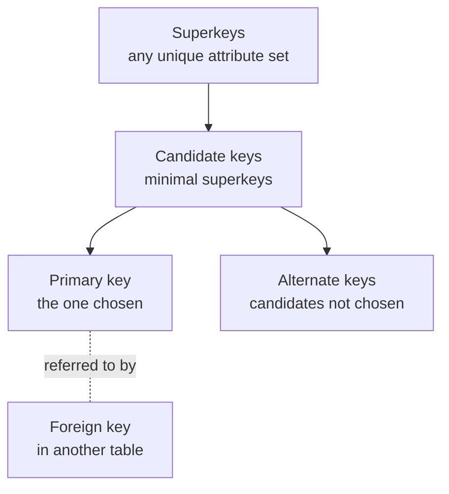

## Why should you care?

Two students in your class are both called "Rahul Sharma". The exam cell enters marks by name, and one Rahul gets the other's result. Every system that stores people (banks, hospitals, IRCTC) faces this problem: names repeat, phone numbers change, and spellings vary.

A **key** is how a database tells instances apart with certainty. Choosing the right key is one of the most important design decisions you will make, and keys are central to normalization in Unit 3.

## In one line

A key is one or more attributes that uniquely identify each row; the primary key is the one chosen for this, and entity integrity requires it to be unique and never empty.

## Explained

### Q1. What is a key? [2M]

==A key is an attribute, or a set of attributes, that uniquely identifies each instance of an entity.==

- If you know the key, you know exactly which row you mean, and so every other attribute of it.
- Example: knowing the roll number tells you the student's name, date of birth and course.
- A key made of **two or more attributes** is a ==**composite key**==, such as course code + section.

### Q2. What are the types of keys? ⭐

| Key | Meaning | STUDENT example |
|---|---|---|
| ==**Superkey**== | Any attribute set that identifies each row uniquely | roll no; roll no + name |
| ==**Candidate key**== | A **minimal** superkey: no attribute can be removed | roll no; email |
| ==**Primary key (PK)**== | The candidate key **chosen** to identify rows | roll no |
| ==**Alternate key**== | A candidate key not chosen as PK | email |
| ==**Foreign key (FK)**== | An attribute that refers to the PK of another (or the same) table | dept code in STUDENT |
| ==**Secondary key**== | Used only for searching; need not be unique | last name |

### Q3. What is entity integrity? ⭐ [2M]

==Entity integrity means every primary key value is **unique** and **not null**.==

- **Unique:** no two rows share a primary key value.
- **Not null:** every row has a primary key value. A row with an empty key cannot be identified.
- The DBMS enforces this automatically for any column declared as the primary key.
- A related rule, **referential integrity**, says a foreign key must match an existing primary key or be empty.

### Q4. Natural key or surrogate key?

- ==A **natural key** is a real-world identifier==, such as a vehicle registration number or a GST number.
- ==A **surrogate key** is a system-generated number with no business meaning==, such as student_id 10457.
- Use a natural key when it is unique, stable and short.
- ==Use a surrogate key when no good natural key exists==, or the natural key is long, made of many attributes, or may change.

### Q5. What makes a good primary key? ⭐

Coronel, Morris and Rob give six guidelines:

1. ==**Unique values**==: must identify each row.
2. ==**Non-intelligent**==: carries no hidden meaning (codes like "DS-2025-MUM" break when the meaning changes).
3. ==**No change over time**==: a changing key forces updates in every table that refers to it.
4. ==**Preferably single-attribute**==: simpler foreign keys.
5. ==**Preferably numeric**==: easy to generate and fast to compare.
6. ==**Security-compliant**==: never sensitive data such as a PAN, Aadhaar or phone number.

## Analogy and real-life example

Train travel. Your name and age are on the ticket, but the railway identifies the booking by its **PNR number**. The PNR is a key: unique, never empty, and meaningless on its own. Two passengers called "Rahul Sharma" on the same train cause no confusion, because their PNRs differ.

## Diagram

## Worked example

**Problem.** STUDENT has roll no, name, email, phone, Aadhaar number and date of birth. Every student has a unique roll no and a unique college email; names repeat; phones change. Find the candidate keys, pick the primary key, and justify it.

**Solution.**

1. **Superkeys:** {roll no}, {email}, {roll no, name}, {email, phone} and many more.
2. **Candidate keys:** {roll no} and {email}. Both are unique and minimal. Name is not unique; phone changes; Aadhaar is unique but sensitive.
3. **Primary key:** **roll no**. It is unique, never empty, short, does not change, and is not sensitive.
4. **Alternate key:** email.
5. **Rejected:** Aadhaar number, because it is personal data and fails the security-compliant guideline.

## Try it

A hospital's PATIENT entity has: patient name, mobile number, date of birth, and nothing else that is unique.

Done for you: name + date of birth is **not** a safe key, because two patients can share both.

What key would you use, and what type is it?

> [!answer]- Answer
> A **surrogate key** such as patient_id (for example 200731), generated by the system. There is no stable, unique, non-sensitive natural key: mobile numbers change and are shared within families.

## Key facts and formulas

> [!important] Key facts
> - Key = attribute(s) that uniquely identify each row; composite key = two or more attributes.
> - Superkey ⊇ candidate key (minimal superkey) ⊇ primary key (the chosen one); alternate keys are the other candidates.
> - Foreign key refers to a primary key; secondary key is for searching only.
> - Entity integrity: PK values unique and not null.
> - Referential integrity: an FK matches an existing PK or is null.
> - Natural key = real-world identifier; surrogate key = system-generated, no business meaning.
> - Good PK: unique, non-intelligent, unchanging, preferably single-attribute and numeric, security-compliant.

## Common mistakes

> [!warning] Common mistake
> Using names or phone numbers as primary keys. Names repeat and phone numbers change. A key must be unique **and** stable.

> [!warning] Common mistake
> Thinking every superkey is a candidate key. {roll no, name} is a superkey but not a candidate key, because roll no alone already identifies the row.

> [!warning] Common mistake
> Using Aadhaar or PAN as a primary key. They are unique but sensitive. A key is copied into many tables as a foreign key, which spreads personal data everywhere.

## Think deeper

- **Intelligent keys.** A college codes students as "DS25-047" (programme, year, number). What happens when a student changes programme?
- **Natural or surrogate?** Why might a bank use a surrogate customer ID even though every customer has a PAN?
- **Composite keys.** A weak entity's key includes its parent's key. When might you add a surrogate key instead (see [[weak-entities]])?

## Self-check

> [!quiz] Q1. A minimal superkey is called a:
> (A) Primary key
> (B) Candidate key
> (C) Foreign key
> (D) Secondary key
>
> > [!answer]- Answer: B
> > A candidate key identifies rows uniquely and has no unnecessary attributes. The primary key is the candidate key that is chosen.

> [!quiz] Q2. Entity integrity requires primary key values to be:
> (A) Numeric and short
> (B) Unique and not null
> (C) Equal to a foreign key
> (D) Sorted
>
> > [!answer]- Answer: B
> > Every row must have a key value, and no two rows may share one.

> [!quiz] Q3. A system-generated number with no business meaning, used as a primary key, is a:
> (A) Natural key
> (B) Surrogate key
> (C) Secondary key
> (D) Superkey
>
> > [!answer]- Answer: B
> > Surrogate keys are created by the system when no good natural key exists.

> [!quiz] Q4. Why is a phone number a poor primary key for CUSTOMER?
> (A) It is too short
> (B) It can change and can be shared, so it is neither stable nor reliably unique
> (C) Phone numbers are derived attributes
> (D) It cannot be stored as a number
>
> > [!answer]- Answer: B
> > A key must be unique and should never change. Phone numbers fail both, and they are also personal data.

## Flashcards

What is a key? :: An attribute or set of attributes that uniquely identifies each row
What is a composite key? :: A key made of two or more attributes
What is a superkey? :: Any attribute set that uniquely identifies each row
What is a candidate key? :: A minimal superkey
What is a primary key? :: The candidate key chosen to identify rows
What is an alternate key? :: A candidate key not chosen as the primary key
What is a foreign key? :: An attribute that refers to the primary key of another (or the same) table
What is entity integrity? :: Every primary key value is unique and not null
What is a surrogate key? :: A system-generated key with no business meaning
Name the six primary key guidelines. :: Unique, non-intelligent, no change over time, preferably single-attribute, preferably numeric, security-compliant

## Sources

- Coronel, Morris & Rob, *Database Systems: Design, Implementation, and Management*, 9th ed., Ch. 3 (3.2) and Ch. 5 (5.3)
- Silberschatz, Korth & Sudarshan, *Database System Concepts*, 7th ed., Ch. 2 (2.3) and Ch. 6 (6.5)
- Elmasri & Navathe, *Fundamentals of Database Systems*, 7th ed., Ch. 3 (3.3)
