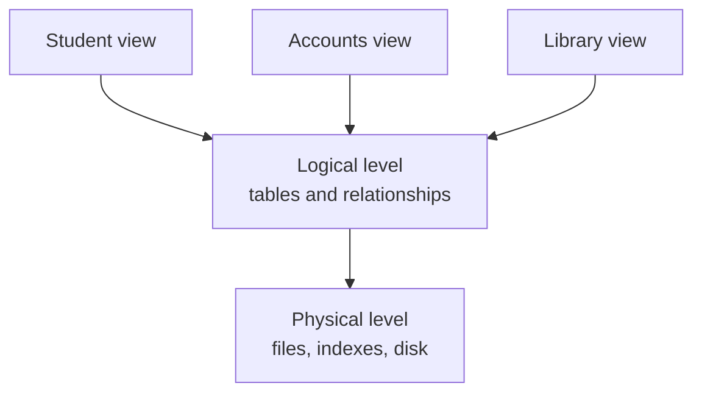

## Why should you care?

You drive a car without knowing how fuel is injected into the engine. A mechanic knows the engine but doesn't care where you drive. The company that built the car designed both. Each person sees only the level they need.

A college database has the same problem. A student wants to see their marks, not how bytes are laid out on a disk. The accounts office needs fee data, not exam data. And when the IT team moves the database to a faster server, nobody's app should break. **Levels of abstraction** are how a DBMS gives each person the right view while hiding everything else.

## In one line

A DBMS describes data at three levels (physical, logical and view), so that each user sees only what they need and changes at one level do not break the others.

## Explained

### Q1. What is data abstraction?

==Data abstraction means hiding the complex details of how data is stored and showing users only what they need.==

- Without it, every user and every program would need to know file formats, disk locations and indexes.
- With it, users ask simple questions ("show my marks") and the DBMS works out the details.
- ==The DBMS achieves this by describing data at **three levels**==, from the closest to the hardware to the closest to the user.

### Q2. What are the three levels? ⭐

| Level | Describes | Who works here | College example |
|---|---|---|---|
| ==**Physical (internal)**== | ==*How* data is stored: files, blocks, indexes== | DBMS, DBA | STUDENT records stored in files on an SSD, indexed by roll number |
| ==**Logical (conceptual)**== | ==*What* data is stored and how it is related== | Database designer, DBA | Tables STUDENT, COURSE, FEES and their links |
| ==**View (external)**== | ==*Part* of the data, shaped for one group of users== | End users, applications | A student sees only their own marks; accounts sees only fees |

There is ==**one** physical level and **one** logical level, but **many** views==, one for each kind of user.

### Q3. What are a schema and an instance? ⭐

==A schema is the overall design of the database; an instance is the data stored in it at one moment.==

- ==**Schema:** like a blank admission form==: the fields and their types. It changes rarely.
- ==**Instance:** the filled-in forms in the cupboard today==. It changes every time data is added, updated or deleted.

==Each level has its own schema==: a **physical schema**, a **logical schema**, and several **external schemas** (subschemas), one per view.

### Q4. What is the three-schema architecture? ⭐

==The three-schema (ANSI/SPARC) architecture is the formal name for this design==:

- ==**External level:** many external schemas==, one per user group.
- ==**Conceptual level:** one conceptual (logical) schema== for the whole organisation.
- ==**Internal level:** one internal (physical) schema== describing storage.

==Between the levels sit **mappings**==. When a student asks for marks, the DBMS maps the request from their view to the logical tables, then to the physical files, and maps the answer back up. Users never see these mappings.

### Q5. What is data independence? ⭐

Data independence is the main payoff of the levels: ==you can change one level without rewriting the level above it==.

- ==**Physical data independence:** changing how data is stored without changing the logical schema.== Examples: a new disk, a new index, reorganised files. Apps keep working.
- ==**Logical data independence:** changing the logical schema without changing user views.== Examples: adding a column, splitting a table. Apps built on the views keep working.

### Q6. How do the textbook's four models fit these levels?

==Coronel, Morris and Rob describe abstraction with four models==. They map onto the three levels like this:

| Coronel's model | What it shows | Level |
|---|---|---|
| ==External model== | Each user group's view of the data | View |
| ==Conceptual model== | The whole organisation's data, independent of any DBMS (usually an ER diagram) | Logical |
| ==Internal model== | The conceptual model adapted to a chosen DBMS (for example, relational tables) | Logical |
| ==Physical model== | How the data is stored on disks | Physical |

## Analogy and real-life example

A railway station. Passengers see the departure board: train, platform, time (view level). The station master sees the full timetable of every train, platform and crew (logical level). The signalling engineers see tracks, switches and cables (physical level). When engineers replace a cable, the board does not change. When a new train is added to the timetable, a passenger's board can simply show one more line.

## Diagram

## Worked example

**Problem.** The college ERP makes three changes. For each, say which level changes and which type of data independence keeps users safe.

1. The IT team moves the database from a hard disk to a faster SSD and adds an index on roll number.
2. The designer adds an `email` column to the STUDENT table.
3. The exam cell wants a new screen showing only students with backlogs.

**Solution.**

1. **Physical level** changes. The tables and views stay the same, so apps keep working: **physical data independence**.
2. **Logical level** changes. Existing views (the student's marks screen, the accounts fee screen) do not use `email`, so they keep working: **logical data independence**.
3. **View level** changes: a new external schema is added. The logical and physical levels are untouched.

## Try it

Classify each change.

(a) The DBA compresses old data files to save disk space.
- Level: physical. Independence: physical data independence.

(b) The FEES table is split into FEES_DUE and FEES_PAID, and the accounts view is redefined so it still shows the same columns.

(c) The principal gets a new dashboard view of results by department.

> [!answer]- Answer
> (b) **Logical level** changes; because the accounts view is redefined to look the same, its users and apps are unaffected. This is **logical data independence**.
>
> (c) **View level**: a new external schema is added; nothing below it changes.

## Key facts and formulas

> [!important] Key facts
> - Data abstraction = hiding storage details and showing users only what they need.
> - Three levels: physical (how data is stored), logical (what data is stored and how it is related), view (part of the data for one user group).
> - One physical schema, one logical schema, many external schemas (subschemas).
> - Schema = design of the database (changes rarely). Instance = data at one moment (changes often).
> - Three-schema (ANSI/SPARC) architecture: external, conceptual, internal levels, linked by mappings.
> - Physical data independence: change storage without changing the logical schema.
> - Logical data independence: change the logical schema without changing views.
> - Coronel's four models: external, conceptual, internal, physical.

## Common mistakes

> [!warning] Common mistake
> Mixing up schema and instance. Adding a new student changes the **instance**. Adding a new column changes the **schema**.

> [!warning] Common mistake
> Thinking there is one view for everyone. The view level holds **many** external schemas, one per group of users. Only the logical and physical levels are single.

> [!warning] Common mistake
> Swapping the two independences. Ask: "Which level changed?" If storage changed, it is physical data independence. If the tables changed, it is logical data independence.

## Think deeper

- **Which is harder?** Most textbooks say logical data independence is harder to achieve than physical. Why might adding or splitting a table be riskier for apps than moving files to a new disk?
- **Security through views.** How can the view level stop a library clerk from seeing students' marks, even though both live in the same database?
- **Cost of layers.** Every request must be mapped down through the levels and back up. When could this extra work matter, and how might a DBMS keep it fast?

> [!beyond] Beyond the syllabus
> Cloud databases push abstraction further. In a "serverless" database, you never see or choose the physical level at all: the provider decides disks, servers and copies, and even resizes them automatically while your queries keep running.

## Self-check

> [!quiz] Q1. Which level describes *how* data is actually stored on disk?
> (A) View level
> (B) Logical level
> (C) Physical level
> (D) External level
>
> > [!answer]- Answer: C
> > The physical (internal) level describes files, blocks and indexes. The logical level describes what is stored; the view level shows part of it to users.

> [!quiz] Q2. A new student is admitted and their record is added. What has changed?
> (A) The physical schema
> (B) The logical schema
> (C) The instance
> (D) An external schema
>
> > [!answer]- Answer: C
> > Adding data changes the instance. The schema, the design, stays the same.

> [!quiz] Q3. The DBA adds an index to speed up searches, and no application needs any change. This shows:
> (A) Logical data independence
> (B) Physical data independence
> (C) Data redundancy
> (D) Data isolation
>
> > [!answer]- Answer: B
> > An index is a storage-level change. The logical schema and apps are unaffected, which is physical data independence.

> [!quiz] Q4. How many logical schemas and how many external schemas does a typical database have?
> (A) One logical, one external
> (B) Many logical, one external
> (C) One logical, many external
> (D) Many logical, many external
>
> > [!answer]- Answer: C
> > There is one logical schema for the whole database, and one external schema per user group.

## Flashcards

What is data abstraction? :: Hiding the details of how data is stored and showing users only what they need
Name the three levels of data abstraction. :: Physical, logical, view
What does the physical level describe? :: How data is stored: files, blocks, indexes
What does the logical level describe? :: What data is stored and how it is related
What does the view level describe? :: Part of the data, shaped for one group of users
What is a schema? :: The overall design of the database
What is an instance? :: The data stored in the database at one moment
What is a subschema? :: An external schema: the design of one user view
What is physical data independence? :: Changing storage without changing the logical schema
What is logical data independence? :: Changing the logical schema without changing user views
What are Coronel's four data models? :: External, conceptual, internal, physical

## Sources

- Silberschatz, Korth & Sudarshan, *Database System Concepts*, 7th ed., Ch. 1 (1.3)
- Coronel, Morris & Rob, *Database Systems: Design, Implementation, and Management*, 9th ed., Ch. 2 (2.6)
- Elmasri & Navathe, *Fundamentals of Database Systems*, 7th ed., Ch. 2 (2.1–2.2)
