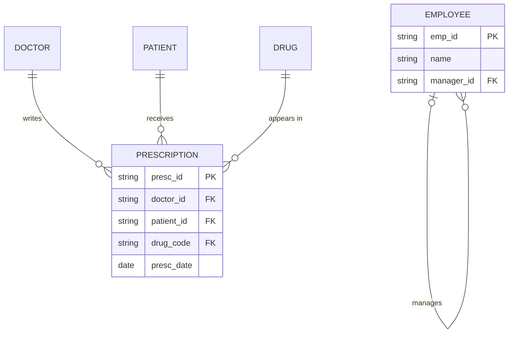

## Why should you care?

In a college, a teacher is guided by a senior teacher, who is guided by the HOD. Some subjects need another subject first: you take Python before Machine Learning. A doctor prescribes a drug to a patient.

The first two link an entity **to itself**. The third links **three** entities at once. Ordinary "A relates to B" thinking breaks down here. Relationship degree gives you the vocabulary, and the right diagrams, for these cases.

## In one line

The degree of a relationship is the number of entity types in it: unary (one, also called recursive), binary (two) or ternary (three).

## Explained

### Q1. What is relationship degree? ⭐

==The degree of a relationship is the number of entity types associated with it.==

| Degree | Entities | Example |
|---|---|---|
| ==**Unary (recursive)**== | 1 | EMPLOYEE *manages* EMPLOYEE |
| ==**Binary**== | 2 | DEPARTMENT *offers* COURSE |
| ==**Ternary**== | 3 | DOCTOR *prescribes* DRUG *to* PATIENT |

==**Binary relationships are the most common**==. Higher degrees (four or more) exist in theory but are rare; designers usually break them down.

### Q2. What is a recursive (unary) relationship? ⭐

==A recursive relationship exists between instances of the **same** entity.==

- The entity plays two **roles**: in "EMPLOYEE manages EMPLOYEE", one is the manager and the other is the managed.
- ==It can be 1:1, 1:M or M:N==:
  - **1:1:** an EMPLOYEE *is married to* an EMPLOYEE (in a company that records it).
  - **1:M:** an EMPLOYEE *manages* many EMPLOYEEs.
  - **M:N:** a COURSE *is a prerequisite for* many COURSEs, and may need many COURSEs.

### Q3. How is a 1:M recursive relationship stored? [2M]

- The entity gets a foreign key that points back to its **own** primary key.
- Example: EMPLOYEE (emp_id, name, ==**manager_id**==), where manager_id holds another employee's emp_id.
- The top person (the principal or CEO) has an empty manager_id, so ==the relationship is optional at the top==.
- An **M:N** recursive relationship, such as course prerequisites, cannot be stored this way; it needs an associative entity (see [[associative-entities]]).

### Q4. What is a ternary relationship? ⭐

==A ternary relationship links three entities at the same time.==

- Example: a DOCTOR writes a prescription of a DRUG for a PATIENT.
- Why not three binary relationships? "Doctor treats patient", "patient takes drug" and "doctor prescribes drug" ==lose the fact of **which doctor** prescribed **which drug** to **which patient**==.
- In practice, a ternary relationship is usually implemented as an associative entity, here PRESCRIPTION, linked to all three.

## Analogy and real-life example

A family tree is a recursive relationship: PERSON *is parent of* PERSON. Everyone in it is the same kind of thing, yet each link has two roles, parent and child. A wedding photo with the bride, groom and priest is closer to a ternary relationship: the event needs all three at once.

## Diagram

## Worked example

**Problem.** Give the degree and connectivity of each relationship.

1. A STUDENT is a mentor to many junior STUDENTs; each junior has one mentor.
2. A TEACHER teaches a SUBJECT to a CLASS (the same teacher may teach different subjects to different classes).
3. A CUSTOMER places ORDERs.

**Solution.**

1. **Unary (recursive)**, one entity (STUDENT) in two roles, mentor and junior. Connectivity **1:M**.
2. **Ternary**: TEACHER, SUBJECT and CLASS. Three binary links would lose which teacher teaches which subject to which class. Implement it with an associative entity such as TEACHING_ASSIGNMENT.
3. **Binary**: CUSTOMER and ORDER. Connectivity **1:M**.

## Try it

In a cricket league: (a) a PLAYER can be the captain of other PLAYERs in a team; (b) a PLAYER bats against a BOWLER at a VENUE, and we want to record runs scored for each combination.

Done for you: (a) is **unary (recursive), 1:M**.

What is (b), and how would you implement it?

> [!answer]- Answer
> (b) is **ternary**: PLAYER, BOWLER and VENUE together determine the runs. Implement it with an associative entity, such as BATTING_RECORD, linked to all three, holding the runs as an attribute. (If BOWLER is also stored in PLAYER, the design links PLAYER twice, in two roles.)

## Key facts and formulas

> [!important] Key facts
> - Degree = number of entity types in a relationship.
> - Unary (recursive) = 1, binary = 2, ternary = 3; binary is the most common.
> - Recursive relationship: between instances of the same entity, which plays two roles; can be 1:1, 1:M or M:N.
> - 1:M recursive: a foreign key pointing to the same table (manager_id → emp_id).
> - M:N recursive and ternary relationships are implemented with an associative entity.
> - Three binary relationships cannot replace a ternary one: they lose the three-way fact.

## Common mistakes

> [!warning] Common mistake
> Confusing degree with connectivity. Degree counts the **entities** (unary, binary, ternary). Connectivity counts the **instances** on each side (1:1, 1:M, M:N).

> [!warning] Common mistake
> Drawing a second entity, such as MANAGER, copied from EMPLOYEE. A manager is an employee; a recursive relationship avoids storing the same person twice.

> [!warning] Common mistake
> Making the top of a hierarchy mandatory. The principal or CEO has no manager, so "manages" must be optional on that side.

## Think deeper

- **Loops.** In a 1:M recursive relationship, what stops the data from saying "A manages B, B manages C, C manages A"? Who should check this?
- **When is ternary really needed?** Take "a supplier supplies a part to a project". Find a case where three binary relationships would give a wrong answer.
- **Prerequisite chains.** If Machine Learning needs Python, and Python needs Programming Basics, how would you find every course a student must finish before Machine Learning?

## Self-check

> [!quiz] Q1. EMPLOYEE *manages* EMPLOYEE is a relationship of degree:
> (A) Unary
> (B) Binary
> (C) Ternary
> (D) Zero
>
> > [!answer]- Answer: A
> > Only one entity type takes part, in two roles: a unary (recursive) relationship.

> [!quiz] Q2. Which relationship degree is the most common?
> (A) Unary
> (B) Binary
> (C) Ternary
> (D) Quaternary
>
> > [!answer]- Answer: B
> > Most relationships link two entities, such as DEPARTMENT offers COURSE.

> [!quiz] Q3. How is a 1:M recursive relationship such as "manages" usually stored?
> (A) A new table MANAGER
> (B) A foreign key in EMPLOYEE pointing to EMPLOYEE's own primary key
> (C) A multivalued attribute
> (D) It cannot be stored
>
> > [!answer]- Answer: B
> > A column such as manager_id holds another employee's emp_id.

> [!quiz] Q4. Why can't "doctor treats patient", "patient takes drug" and "doctor prescribes drug" replace a ternary prescription relationship?
> (A) Binary relationships are not allowed with drugs
> (B) They lose which doctor prescribed which drug to which patient
> (C) They need more attributes
> (D) They make the model recursive
>
> > [!answer]- Answer: B
> > The three-way fact is lost when it is split into pairs.

## Flashcards

What is the degree of a relationship? :: The number of entity types associated with it
What is a unary relationship? :: A relationship between instances of the same entity (also called recursive)
What is a ternary relationship? :: A relationship that links three entities at the same time
Which relationship degree is the most common? :: Binary
Give an example of a 1:M recursive relationship. :: EMPLOYEE manages EMPLOYEE
Give an example of an M:N recursive relationship. :: COURSE is a prerequisite for COURSE
How is a 1:M recursive relationship stored? :: A foreign key in the table pointing to its own primary key
How is a ternary relationship usually implemented? :: As an associative entity linked to all three entities

## Sources

- Coronel, Morris & Rob, *Database Systems: Design, Implementation, and Management*, 9th ed., Ch. 4 (4.1.9–4.1.10)
- Elmasri & Navathe, *Fundamentals of Database Systems*, 7th ed., Ch. 3 (3.4, 3.9)
