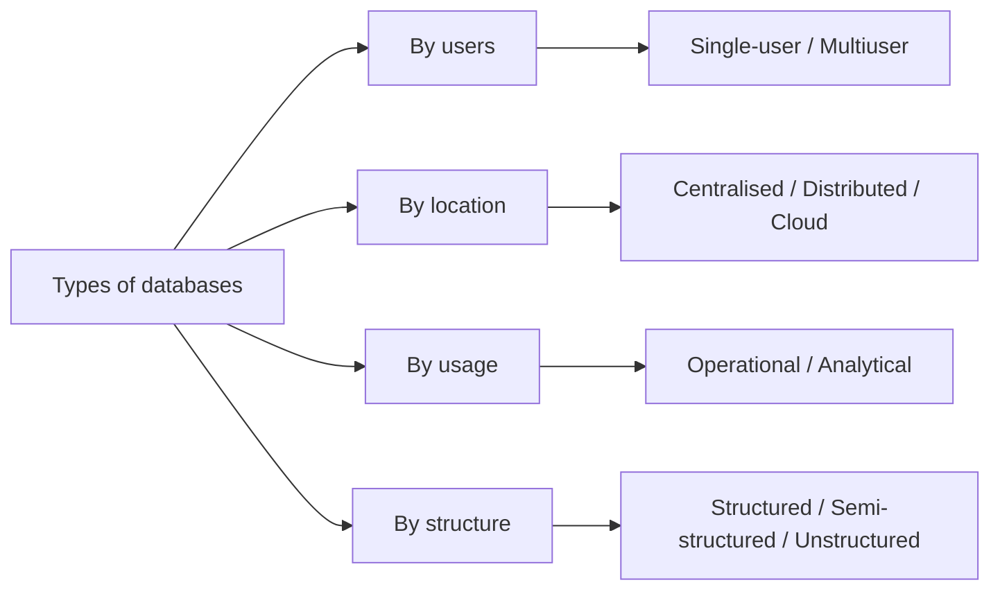

## Why should you care?

Your phone's contacts app, your college ERP, an online sale where lakhs of people order at once, and the year-end dashboard your principal looks at all run on databases. They are not the same kind of database, though. Contacts serve one person. The sale serves huge crowds at the same second. The dashboard records nothing new; it only summarises years of past data.

Picking the wrong type is costly. A single-user tool collapses under a sale-day crowd, and a live payment system slows down when someone runs a five-year report on it. So the first question in any database project is: what type do we need?

## In one line

Databases are classified by how many users they serve, where the data is kept, what the data is used for, and how structured the data is.

## Explained

### Q1. On what basis do we classify databases?

There is no single list of "types". Instead, ==we describe a database by answering four questions==:

| Question | Types |
|---|---|
| ==How many users?== | Single-user, multiuser (workgroup, enterprise) |
| ==Where is the data?== | Centralised, distributed, cloud |
| ==What is it used for?== | Operational, analytical |
| ==How structured is the data?== | Structured, semi-structured, unstructured |

Every database has one answer to each question. Your college ERP is multiuser, centralised, operational and structured, all at once.

### Q2. What are the types by number of users?

- ==**Single-user database:** one user at a time==. When it runs on a personal computer, ==it is called a **desktop database**==. Example: a shopkeeper's billing software on one laptop.
- ==**Multiuser database:** many users== at the same time.
  - ==**Workgroup database:** a small group, usually fewer than 50 users==, such as one department.
  - ==**Enterprise database:** a whole organisation==, often hundreds or thousands of users across departments. Example: a bank's core banking system.

### Q3. What are the types by location?

- ==**Centralised database:** all data is kept at one site==. Easy to manage, but if that site fails, everyone stops.
- **Distributed database:** ==A distributed database spreads data across several networked sites, but users see it as one database.== Example: a national booking system with servers in several cities.
- ==**Cloud database:** created and run on a cloud provider's servers==, such as AWS, Microsoft Azure or Google Cloud. You rent it instead of buying hardware. Underneath, it may be centralised or distributed.

### Q4. What are the types by usage?

- **Operational database:** ==An operational database records day-to-day transactions as they happen.==
  - Examples: a UPI payment, a seat booking, a new admission.
  - Many small reads and writes every second.
  - ==Called **OLTP**== (online transaction processing).
- **Analytical database:** ==An analytical database stores historical data for reports and decisions.==
  - Example question: "Which city's sales grew fastest in three years?"
  - Mostly read, rarely changed.
  - ==Called **OLAP**== (online analytical processing). A **data warehouse** is the classic example (see [[data-warehouse]]).

### Q5. What are the types by structure?

- ==**Structured data** fits fixed rows and columns==, such as a marks table. It is stored in **relational databases** such as MySQL, PostgreSQL and Oracle.
- **Semi-structured data:** ==Semi-structured data has some structure but no fixed table shape, such as JSON or XML.== On a shopping site, a phone has fields like RAM and battery; a saree has fabric and length.
- ==**Unstructured data** has no predefined format==: photos, videos, PDFs, voice notes.

Semi-structured and very large data sets are often kept in **NoSQL databases**, such as MongoDB, which do not force every record into the same columns (see [[nosql-databases]]).

## Analogy and real-life example

One UPI payment touches several types. When you pay, the bank's **operational, multiuser, distributed** database records it within seconds. Every night, the day's payments are copied into an **analytical** database. Next morning, analysts ask "Which merchants grew fastest this month?" there, not on the live system, so payments never slow down because of a report.

> [!beyond] Beyond the syllabus
> In data careers, the analytical side is where most of the work happens. Data analysts and data scientists rarely query the live operational database; they work on copies in a warehouse or a "data lake", built by data engineers using pipelines that move data every night or even every few minutes.

## Diagram

## Worked example

**Problem.** Classify a national railway ticket-booking system on all four questions.

**Solution.**

1. **Users:** thousands of people book at the same moment, from every department of the railway and every passenger in the country. So it is **multiuser, enterprise**.
2. **Location:** passengers across India need fast responses, and booking must continue if one server fails. So the data is best kept **distributed** across sites.
3. **Usage:** it records each booking as it happens. So it is **operational** (OLTP).
4. **Structure:** every booking has the same fields: PNR, train, date, seat, passenger name. So it is **structured**, stored in a relational database.

**Answer:** multiuser (enterprise), distributed, operational, structured.

## Try it

Classify two systems in your college.

(a) The library's book-issue system, used by two librarians at once.
- Users: multiuser (workgroup), because two people use it at the same time.
- Location: ?
- Usage: ?
- Structure: ?

(b) The year-end report that summarises five years of student results. Classify all four.

> [!answer]- Answer
> (a) Multiuser (workgroup), centralised (one library server), operational (records each issue and return as it happens), structured (book ID, student ID, dates).
>
> (b) Single-user or a small workgroup, centralised, **analytical** (it only reads past data to summarise it), structured.

## Key facts and formulas

> [!important] Key facts
> - Four ways to classify: users, location, usage, structure.
> - By users: single-user (desktop) and multiuser (workgroup, usually fewer than 50 users; enterprise, the whole organisation).
> - By location: centralised (one site), distributed (many sites, seen as one), cloud (run on a provider's servers).
> - By usage: operational = OLTP, records daily events; analytical = OLAP, historical data for decisions; data warehouse is analytical.
> - By structure: structured (tables), semi-structured (JSON, XML), unstructured (images, video, text files).
> - Relational databases store structured data; NoSQL databases handle semi-structured and very large data.

## Common mistakes

> [!warning] Common mistake
> Treating the types as one list and picking a single label. A database has a type on **every** axis: IRCTC-style booking is multiuser *and* distributed *and* operational *and* structured.

> [!warning] Common mistake
> Thinking "cloud" and "distributed" mean the same thing. Cloud is about **who runs the servers** (a provider). Distributed is about **how the data is spread** (many sites). A cloud database can sit on one site.

> [!warning] Common mistake
> Believing NoSQL means "no structure" or "SQL is outdated". NoSQL only means the data is not forced into fixed relational tables. Most companies use both, each for what it does best.

## Think deeper

- **Why two databases?** Companies copy data from operational to analytical databases every night instead of using one. What do they gain? What do they lose? (Think about how fresh the report data is.)
- **When the network breaks.** In a distributed booking system, the Mumbai and Delhi servers lose contact for a minute. Should bookings stop, so no seat is sold twice, or continue, so customers are not turned away?
- **Starting small.** A new startup has ten users today and hopes for a million next year. Should it buy its own servers or start with a cloud database? What would change your answer?

> [!beyond] Beyond the syllabus
> The "stop or continue" question is a famous result called the **CAP theorem**: when the network between sites breaks, a distributed database must choose between staying consistent and staying available. Interviewers for data engineering roles often ask about it.

## Self-check

> [!quiz] Q1. A database used by one department of about 20 people at the same time is a:
> (A) Desktop database
> (B) Workgroup database
> (C) Enterprise database
> (D) Data warehouse
>
> > [!answer]- Answer: B
> > It is multiuser, but small and limited to one department, which is a workgroup database (usually fewer than 50 users).

> [!quiz] Q2. Which of these is semi-structured data?
> (A) A marks table with fixed columns
> (B) A JSON record of a product
> (C) A voice note
> (D) A CCTV video
>
> > [!answer]- Answer: B
> > JSON has keys and values, so it has some structure, but records need not share the same fields. A marks table is structured; audio and video are unstructured.

> [!quiz] Q3. A bank's live UPI payment system is best described as:
> (A) Analytical
> (B) Operational
> (C) A data warehouse
> (D) Single-user
>
> > [!answer]- Answer: B
> > It records each payment as it happens, with many small writes every second: an operational (OLTP) database.

> [!quiz] Q4. Every month-end, a five-year sales report makes a company's live order system slow. What is the best fix?
> (A) Give the analyst a faster laptop
> (B) Copy the data to a separate analytical database and run reports there
> (C) Stop taking orders while the report runs
> (D) Convert the order system to a single-user database
>
> > [!answer]- Answer: B
> > The report reads huge amounts of history and competes with live orders. Separating operational and analytical work fixes the cause. The laptop does not, and stopping orders loses business.

## Flashcards

What are the four bases for classifying databases? :: Number of users, location, usage, structure of data
What is a desktop database? :: A single-user database that runs on a personal computer
How many users does a workgroup database usually serve? :: Fewer than 50, such as one department
What is an enterprise database? :: A multiuser database serving a whole organisation
What is a distributed database? :: Data spread across several networked sites but seen by users as one database
What is an operational database? :: A database that records day-to-day transactions as they happen (OLTP)
What is an analytical database? :: A database of historical data used for reports and decisions (OLAP)
What does OLTP stand for? :: Online transaction processing
What does OLAP stand for? :: Online analytical processing
Give an example of semi-structured data. :: JSON or XML
Which kind of database stores semi-structured data flexibly? :: A NoSQL database, such as MongoDB

## Sources

- Coronel, Morris & Rob, *Database Systems: Design, Implementation, and Management*, 9th ed., Ch. 1 (1.3.2)
- Silberschatz, Korth & Sudarshan, *Database System Concepts*, 7th ed., Ch. 8 (8.1), Ch. 11 (11.2–11.3), Ch. 20 (20.2)
