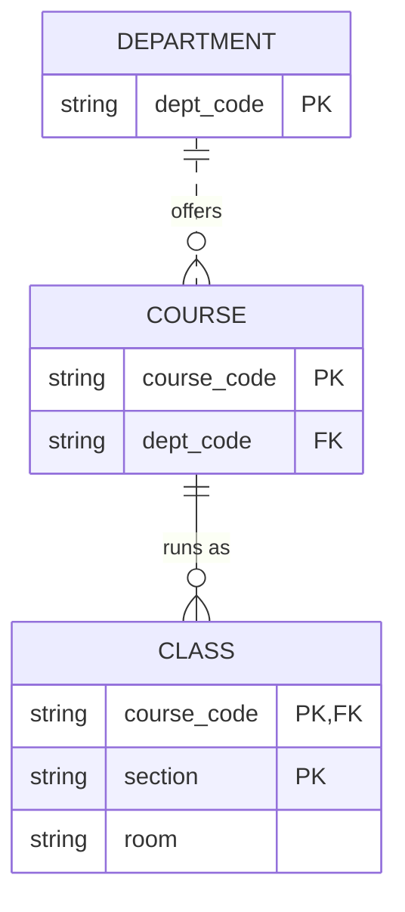

## Why should you care?

Your college runs the course "DBMS" in three sections: A, B and C. Is "Section A" enough to identify a class? No. Every course has a Section A. You can only say "DBMS, Section A".

Some things in the real world simply cannot be identified on their own; they borrow part of their identity from something else. ER modelling calls them **weak entities**, and spotting them correctly decides how their primary keys are built.

## In one line

A weak entity cannot exist without its parent and borrows part of its primary key from it; the relationship that gives it this key is a strong (identifying) relationship.

## Explained

### Q1. What is relationship strength?

Relationship strength depends on how the child entity's primary key is built (see [[keys]]).

- ==**Weak (non-identifying) relationship**==: the child's primary key **does not** contain the parent's primary key. Example: COURSE has its own code; DEPARTMENT's code is only a foreign key in it.
- ==**Strong (identifying) relationship**==: the child's primary key **contains** the parent's primary key. Example: CLASS is identified by course code **plus** section.
- In crow's foot notation, ==a weak relationship is a **dashed line**; a strong relationship is a **solid line**==.

### Q2. What is a weak entity?

==A weak entity meets two conditions:==

1. ==It is **existence-dependent**==: it cannot exist without a parent entity.
2. ==Its **primary key is partly or totally derived** from the parent's primary key==.

Example: DEPENDENT of an EMPLOYEE. A dependent (such as an employee's child, for medical cover) exists only because the employee exists, and is identified by employee number **plus** dependent number.

### Q3. How do strong and weak entities differ?

| | ==Strong (regular) entity== | ==Weak entity== |
|---|---|---|
| Exists on its own? | Yes | No, needs its parent |
| Primary key | Its own | Includes the parent's key |
| Relationship to parent | Weak or strong | Always strong (identifying) |
| Chen notation | Single rectangle | ==Double rectangle; identifying relationship is a double diamond== |
| Example | STUDENT, COURSE | CLASS (course + section), BILL_ITEM (bill + line number) |

In Elmasri and Navathe's terms, the weak entity's own part of the key (such as section) is its **partial key**, drawn with a dashed underline.

### Q4. Is every existence-dependent entity weak?

==No. Existence dependence alone is not enough.==

- If an entity is existence-dependent but has **its own** primary key, it is not weak.
- Example: a college gives every class a unique class code such as "C1042". The class still cannot exist without a course, but its key no longer includes the course code. The relationship becomes weak (non-identifying), and CLASS is no longer a weak entity.
- So ==the **designer's choice of primary key** decides whether an entity is weak==.

## Analogy and real-life example

Flat numbers in a housing society. "Flat 302" means nothing on its own; every building has a 302. "Building B, Flat 302" is unique. The flat is a weak entity: it cannot exist without its building, and its full address borrows the building's name.

## Diagram

## Worked example

**Problem.** A restaurant's billing system has BILL (bill number, date, table) and BILL_ITEM (line number, dish, quantity). Line numbers restart at 1 on every bill. Is BILL_ITEM weak? What is its primary key, and how strong is the relationship?

**Solution.**

1. **Existence dependence:** a bill item cannot exist without its bill. Condition 1 is met.
2. **Key:** line number alone repeats on every bill (every bill has line 1). So the key must be **bill number + line number**, which includes the parent's key. Condition 2 is met.
3. **Conclusion:** BILL_ITEM is a **weak entity**.
4. **Relationship strength:** BILL to BILL_ITEM is **strong (identifying)**, drawn with a solid line.

## Try it

A hospital stores WARD (ward number) and BED (bed number, type). Bed numbers restart at 1 in every ward.

Done for you: BED is **existence-dependent** on WARD.

(a) Is BED a weak entity, and what is its key?
(b) The hospital later gives every bed a unique hospital-wide tag such as "B0457" and uses it as the key. What changes?

> [!answer]- Answer
> (a) Yes. Its key is **ward number + bed number**, which includes the parent's key. The WARD–BED relationship is strong (identifying).
>
> (b) BED is still existence-dependent, but its key no longer contains the ward number. It is **no longer weak**, and the relationship becomes weak (non-identifying).

## Key facts and formulas

> [!important] Key facts
> - Weak (non-identifying) relationship: child's PK does not contain the parent's PK; crow's foot dashed line.
> - Strong (identifying) relationship: child's PK contains the parent's PK; crow's foot solid line.
> - Weak entity = existence-dependent + PK partly or totally derived from the parent's PK.
> - A weak entity is always in a strong (identifying) relationship with its parent.
> - Chen: weak entity = double rectangle; identifying relationship = double diamond; partial key = dashed underline.
> - Whether an entity is weak depends on the designer's choice of primary key.

## Common mistakes

> [!warning] Common mistake
> Calling every existence-dependent entity weak. Both conditions are needed: existence dependence **and** a key borrowed from the parent.

> [!warning] Common mistake
> Confusing "weak relationship" with "weak entity". A weak relationship is the **non-identifying** kind, which never creates a weak entity. A weak entity always comes with a **strong** relationship.

> [!warning] Common mistake
> Using only the partial key (such as section "A") to look up a record. Without the parent's key it matches many rows.

## Think deeper

- **Composite or surrogate?** Why might a designer prefer a short unique tag (such as "C1042") over "course code + section"? What do you lose?
- **Deleting the parent.** If a course is deleted, what should happen to its classes? Why does existence dependence make this question important?
- **Many parents.** Can an entity be identified through two parents at once? (You will meet this soon as an associative entity: see [[associative-entities]].)

## Self-check

> [!quiz] Q1. Which two conditions make an entity weak?
> (A) It has many attributes and no relationships
> (B) It is existence-dependent and its primary key is partly or totally derived from the parent
> (C) It is optional and multivalued
> (D) It has a surrogate key and a foreign key
>
> > [!answer]- Answer: B
> > Both conditions are needed: existence dependence and a primary key borrowed from the parent.

> [!quiz] Q2. In crow's foot notation, a strong (identifying) relationship is drawn as a:
> (A) Dashed line
> (B) Solid line
> (C) Double diamond
> (D) Circle
>
> > [!answer]- Answer: B
> > Solid line = strong (identifying); dashed line = weak (non-identifying). The double diamond is Chen notation.

> [!quiz] Q3. CLASS has key "course code + section". The relationship COURSE–CLASS is:
> (A) Weak (non-identifying)
> (B) Strong (identifying)
> (C) Recursive
> (D) Ternary
>
> > [!answer]- Answer: B
> > The child's key contains the parent's key, which makes the relationship identifying.

> [!quiz] Q4. A college gives every class a unique code like "C1042" and uses it as the key. CLASS still cannot exist without a course. Is CLASS weak?
> (A) Yes, because it is existence-dependent
> (B) No, because its key no longer comes from COURSE
> (C) Yes, because it has a foreign key
> (D) It depends on the number of sections
>
> > [!answer]- Answer: B
> > Existence dependence alone is not enough; the key must also be borrowed from the parent.

## Flashcards

What is a weak (non-identifying) relationship? :: One where the child's primary key does not contain the parent's primary key
What is a strong (identifying) relationship? :: One where the child's primary key contains the parent's primary key
How is a weak relationship drawn in crow's foot notation? :: As a dashed line
What two conditions define a weak entity? :: Existence-dependent, and primary key partly or totally derived from the parent's primary key
What relationship always joins a weak entity to its parent? :: A strong (identifying) relationship
How does Chen notation draw a weak entity? :: A double rectangle, with a double diamond for its identifying relationship
What is a partial key? :: The weak entity's own part of its key, such as section in course + section
What decides whether an entity is weak? :: The designer's choice of primary key

## Sources

- Coronel, Morris & Rob, *Database Systems: Design, Implementation, and Management*, 9th ed., Ch. 4 (4.1.6–4.1.7)
- Silberschatz, Korth & Sudarshan, *Database System Concepts*, 7th ed., Ch. 6 (6.5)
- Elmasri & Navathe, *Fundamentals of Database Systems*, 7th ed., Ch. 3 (3.5)
