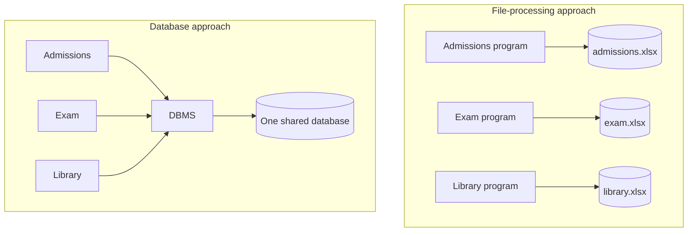

## Why should you care?

Your college has three offices. Admissions keeps student details in one Excel file, the exam cell in another, and the library in a third. You change your phone number at admissions. A month later, the exam cell sends your hall-ticket message to the old number.

Nobody made a mistake. The setup is the problem: the same fact lives in three places, and nothing keeps the copies in sync. A database management system (DBMS) exists to fix exactly this. Every app you use, from UPI to IRCTC to food delivery, runs on top of one.

## In one line

A DBMS is software that keeps data in one shared, organised place and controls how it is defined, accessed, updated and protected.

## Explained

### Q1. What are data, a database and a DBMS?

- **Data:** raw facts, such as `Asha`, `9876543210`, `85`.
- **Information:** data processed so that it means something, such as "Asha scored 85 in DBMS". Collecting, storing, sorting and summarising data to get information is called **data processing**.
- **Database:** an organised collection of related data, such as all the student, course and marks records of a college.
- **DBMS:** the software that creates and manages a database. Examples: MySQL, PostgreSQL, Oracle Database, SQLite, MongoDB.

A **database system** is the whole package: the database, the DBMS, the application programs that use it, and the people who use them.

### Q2. Why not just use files?

Before DBMSs, each department wrote its own programs and kept its own files. This **file-processing system** causes eight problems:

- **Redundancy:** the same data is stored many times (your phone number in three files).
- **Inconsistency:** copies disagree when one is updated and the others are not.
- **Hard to access data:** every new question, such as "students with fees pending and attendance below 75%", needs a new program.
- **Data isolation:** data is scattered across files in different formats, so combining it is painful.
- **Integrity problems:** rules such as "marks must be between 0 and 100" are buried in program code and easy to break.
- **Atomicity problems:** a crash halfway through a task leaves half-finished work, for example money taken from a student's account but the fee not marked as paid (see [[acid-properties]]).
- **Concurrent-access problems:** two people editing the same file at once can overwrite each other's changes.
- **Security problems:** it is hard to let the library see names but not marks.

### Q3. What does a DBMS actually do?

A DBMS sits between users (or apps) and the stored data. Its main jobs:

1. **Define** the structure of the data: tables, columns, data types and rules.
2. **Store** data efficiently on disk.
3. **Retrieve and update** data through a query language such as SQL.
4. **Enforce rules** (integrity constraints) on every change, from every app.
5. **Control concurrent access**, so many users can work at the same time safely.
6. **Secure** data by giving each user only the access they need.
7. **Back up and recover** data after failures.

Apps no longer need to know how data is laid out on disk; they simply ask the DBMS. This separation is called **data independence** (see [[levels-of-abstraction]]).

### Q4. What are the advantages and disadvantages?

**Advantages:** controlled redundancy, consistent data, easy sharing, quick answers to new questions, rules enforced in one place, safe multi-user access, better security, and backup and recovery.

**Disadvantages:** the software, hardware and trained staff cost money; it adds complexity; and for a tiny single-user task it is heavier than a simple file.

## Analogy and real-life example

Picture a college with no library: every student keeps books on their own shelf at home. Copies multiply, nobody knows who has what, and two people may claim the same book.

A library with a librarian is the DBMS. There is one catalogue (the structure), one collection (the database), rules on who may borrow what (security and integrity), a register that stops two people taking the same copy (concurrency control), and duplicate records in case one register is lost (backup).

IRCTC Tatkal booking shows this at scale. Thousands of people try to book the last berth in the same second, and the DBMS makes sure exactly one booking succeeds.

## Diagram

## Worked example

**Problem.** A coaching class keeps three files:

| File | Columns |
|---|---|
| fees.xlsx | Roll no, Name, Phone, Fees paid |
| attendance.xlsx | Roll no, Name, Batch, Days present |
| results.xlsx | Roll no, Name, Phone, Test marks |

Find the problems, then show how a DBMS solves them.

**Solution.**

1. **Redundancy:** Name appears in all three files; Phone in two.
2. **Inconsistency:** a student changes their phone number. The office updates fees.xlsx but forgets results.xlsx, so the class now has two different numbers for one student.
3. **Hard to access data:** "students with fees pending and attendance below 75%" means opening two files and matching rows by hand.
4. **Integrity:** nothing stops someone typing 120 in a test out of 100.
5. **Security:** the teacher who enters marks can also see and change fee data.

**With a DBMS:** student details (roll no, name, phone, batch) are stored once, in one Student table. The Fees, Attendance and Results tables refer to a student only by roll no. A rule rejects marks above 100. The teacher gets permission on Results only. The pending-fees question becomes a single query.

## Try it

A food-delivery startup in Pune keeps a separate CSV file of orders for each restaurant. Each file has: order ID, customer name, phone, address, items, amount.

Two problems are found for you:

1. **Redundancy:** a customer who orders from five restaurants has their address stored five times.
2. **Inconsistency:** the customer moves house, the new address is updated in one file only, and the next order goes to the old address.

Find two more problems, and name the DBMS feature that fixes each.

> [!answer]- Answer
> Any two of these:
> - **Hard to access data:** "one customer's total spend this month" needs every restaurant's file. A DBMS answers it with one query.
> - **Concurrent access:** two delivery partners accept the same order at the same moment. Concurrency control lets only one succeed.
> - **Security:** each restaurant can see every customer's phone number. Access control limits each restaurant to its own orders.
> - **Atomicity:** the app crashes after taking payment but before saving the order. A DBMS undoes the half-finished work.

## Key facts and formulas

> [!important] Key facts
> - Data = raw facts. Information = processed, meaningful data.
> - Database = organised collection of related data. DBMS = the software that manages it.
> - Database system = database + DBMS + application programs + users.
> - Eight problems of file processing: redundancy, inconsistency, hard data access, data isolation, integrity, atomicity, concurrent access, security.
> - Seven DBMS jobs: define, store, retrieve and update, enforce rules, control concurrency, secure, back up and recover.
> - Disadvantages: cost, complexity, overhead for small tasks.
> - Examples: MySQL, PostgreSQL, Oracle Database, SQLite (relational); MongoDB (NoSQL).

## Common mistakes

> [!warning] Common mistake
> Treating "database" and "DBMS" as the same thing. The database is the data; the DBMS is the software. MySQL is a DBMS; your college's student records stored in MySQL are a database.

> [!warning] Common mistake
> Saying "a DBMS removes all redundancy". It *controls* redundancy. Some duplication is kept on purpose, for speed or for backup (see [[normalization]]).

> [!warning] Common mistake
> Calling a spreadsheet a DBMS. A spreadsheet stores rows and columns, but it does not enforce rules for every user, manage many simultaneous updates safely, or undo half-finished work after a crash the way a DBMS does.

## Think deeper

- **When is a DBMS overkill?** A shopkeeper tracks 50 items alone on one laptop. What would a DBMS cost them, and what would they gain? At what point does it become worth it?
- **One shared place is also one point of failure.** If the central database goes down, every app stops. How might a bank protect itself? (Hint: think about backups and copies on other servers.)
- **The data science angle.** pandas can load a CSV and answer questions too. Why do companies still keep their data in a DBMS and expect data scientists to know SQL? Think about size, many users, and data that changes every second.

## Self-check

> [!quiz] Q1. Which of these is NOT a DBMS?
> (A) MySQL
> (B) PostgreSQL
> (C) Microsoft Excel
> (D) Oracle Database
>
> > [!answer]- Answer: C
> > Excel is a spreadsheet. It stores tables but does not provide DBMS features such as enforced constraints, concurrency control and recovery.

> [!quiz] Q2. A student's phone number is updated in the exam file but not in the library file. Which problem is this?
> (A) Data isolation
> (B) Data inconsistency
> (C) Concurrent-access problem
> (D) Security problem
>
> > [!answer]- Answer: B
> > The two copies now disagree. Inconsistency happens because of redundancy: the same data was stored twice.

> [!quiz] Q3. Two users try to book the last IRCTC berth at the same second. Which DBMS feature makes sure only one succeeds?
> (A) Backup and recovery
> (B) Concurrency control
> (C) Data independence
> (D) Data processing
>
> > [!answer]- Answer: B
> > Concurrency control manages simultaneous access so that two transactions cannot both take the same berth.

> [!quiz] Q4. A tea stall owner wants to track the daily stock of 20 items, alone, on one phone. What is the most sensible choice?
> (A) A full Oracle Database server
> (B) A simple spreadsheet or a lightweight app
> (C) A distributed database across three cities
> (D) Twenty separate text files, one per item
>
> > [!answer]- Answer: B
> > One user and very little data: a full DBMS adds cost and complexity with almost no benefit. Separate text files would bring back the file-processing problems.

## Flashcards

What is data? :: Raw facts without context, such as a name or a number
What is information? :: Data processed so that it has meaning
What is a database? :: An organised collection of related data
What is a DBMS? :: Software that defines, stores, retrieves, updates and protects a database
What is a database system? :: Database + DBMS + application programs + users
What is data redundancy? :: Storing the same data in more than one place
What is data inconsistency? :: Copies of the same data that disagree
Name four problems of file-processing systems. :: Any four of: redundancy, inconsistency, hard data access, data isolation, integrity, atomicity, concurrent access, security
What is data independence? :: Apps can use data without knowing how it is stored on disk
Give two disadvantages of a DBMS. :: Any two of: cost, complexity, overhead for small tasks

## Sources

- Silberschatz, Korth & Sudarshan, *Database System Concepts*, Ch. 1 (verify)
- Coronel & Morris, *Database Systems: Design, Implementation, and Management*, Ch. 1 (verify)
- Elmasri & Navathe, *Fundamentals of Database Systems*, Ch. 1 (verify)
