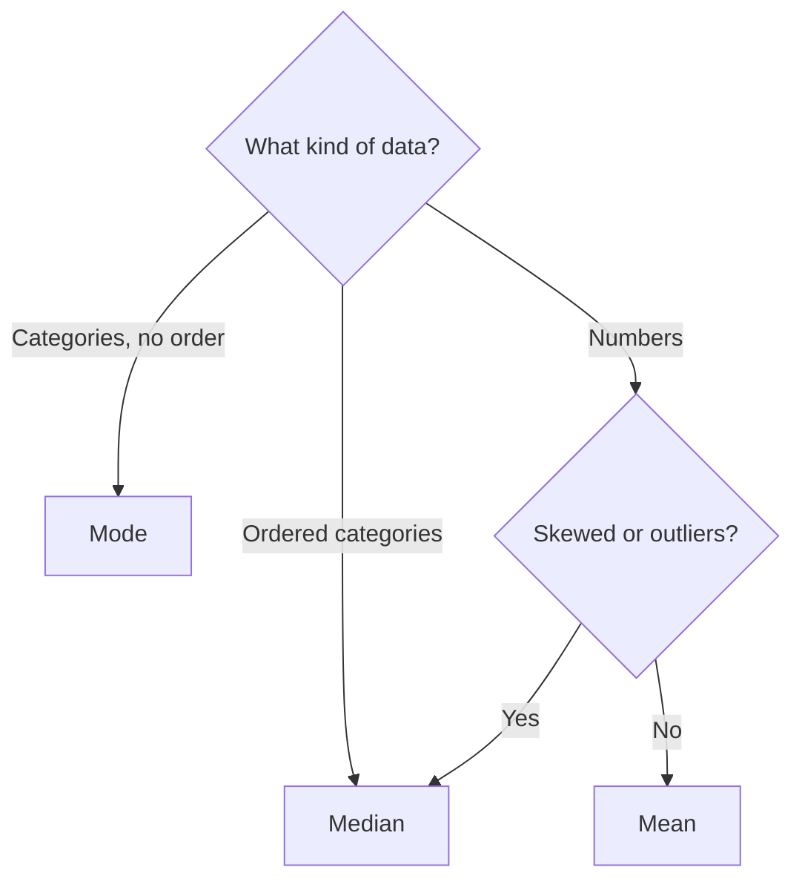

## Why should you care?

A Pune startup advertises: "Average salary here: ₹25.4 lakh a year." You apply, get the offer, and it says ₹6 lakh.

Nobody lied. The company has 10 people. Nine earn ₹6 lakh each; the founder pays himself ₹2 crore. Add all ten salaries (₹254 lakh) and divide by 10: ₹25.4 lakh. True, and useless to you.

The middle salary, ₹6 lakh, would have told the real story. Choosing the right "average" is the first decision in describing any data, and choosing the wrong one is the easiest way to mislead, by accident or on purpose.

## In one line

A measure of central tendency is a single value that represents the centre, or typical value, of a dataset; the three main ones are the mean, the median and the mode.

## Explained

### Q1. What is central tendency, and what makes a good average?

A dataset may have thousands of values. A measure of central tendency (an "average") replaces them with **one** typical value, so we can describe and compare groups quickly.

A good average should be:
- rigidly defined (everyone gets the same answer);
- easy to understand and calculate;
- based on all the observations;
- not unduly affected by extreme values;
- suitable for further calculation (algebra);
- stable from sample to sample.

No single average has all six properties, which is why we need three.

### Q2. What is the arithmetic mean?

==The arithmetic mean is the sum of all values divided by the number of values.==

$$\bar{x} = \frac{\sum x_i}{n}$$

Here $x_i$ are the values and $n$ is how many there are. For a whole population, the mean is written $\mu$ and the count $N$.

Example: daily footfall 120, 150, 90 → $\bar{x} = 360 / 3 = 120$.

- **Strength:** uses every value; easy to use in further formulas.
- **Weakness:** one extreme value pulls it strongly, as the founder's salary did.
- **Property:** the deviations from the mean always add up to zero: $\sum (x_i - \bar{x}) = 0$.

### Q3. What is a weighted mean?

When some values count more than others, multiply each value by its weight $w_i$:

$$\bar{x}_w = \frac{\sum w_i x_i}{\sum w_i}$$

Example: your SGPA. A 4-credit subject counts twice as much as a 2-credit subject, so grade points are weighted by credits.

In business, the average price per kg, the average bill value of a chain, and a price index are all weighted means. Averaging such figures without weights is a common error.

### Q4. What is the median?

==The median is the middle value when the data are arranged in order.==

- **Odd $n$:** the value at position $\frac{n+1}{2}$. For 3, 7, 9, 12, 40 the median is 9.
- **Even $n$:** the mean of the two middle values. For 3, 7, 9, 12 the median is $(7 + 9)/2 = 8$.

The median is **robust**: change 40 to 4,000 and it stays 9. That is why house prices, incomes and delivery times are usually reported as medians.

It needs only an order, so it also works for ordinal data, such as ratings from "poor" to "excellent" (see [[types-of-variables]]).

### Q5. What is the mode?

==The mode is the value that occurs most often.==

- Shoe sizes sold today: 7, 8, 8, 9, 8, 10 → mode = 8.
- A dataset can have one mode, two (**bimodal**), several, or none (every value different).
- It is the **only** average for nominal data: the most popular payment method (UPI, card, cash) has a mode but no mean or median.

The mode is less useful for continuous data such as revenue in rupees, where almost every value is different.

### Q6. Which average should I use?

| Data | Best average | Why |
|---|---|---|
| Nominal (categories) | Mode | No order, no arithmetic |
| Ordinal (ranks, ratings) | Median (or mode) | Order exists, distances don't |
| Numerical, roughly symmetric | Mean | Uses all values |
| Numerical, skewed or with outliers | Median | Not pulled by extremes |

==Use the mean for symmetric numerical data and the median for skewed data or data with outliers.==

When the mean is much larger than the median, a few large values are pulling it up: the data are **right-skewed** (see [[skewness-and-kurtosis]]).

> [!beyond] Beyond the syllabus
> **Grouped data** (a frequency table with classes): mean $= \frac{\sum f_i x_i}{\sum f_i}$ with $x_i$ the class midpoints; median $= L + \frac{N/2 - cf}{f} \times h$; mode $= L + \frac{f_1 - f_0}{2f_1 - f_0 - f_2} \times h$, where $L$ is the lower limit of the median (or modal) class, $cf$ the cumulative frequency before it, $f$ (or $f_1$) its frequency, $f_0$ and $f_2$ the frequencies of the classes before and after, and $h$ the class width. The **geometric mean** (for growth rates) and **harmonic mean** (for rates such as speed) are other averages for special cases.

## Analogy and real-life example

A batter scores 0, 2, 1, 3 and 150 in five innings. The batting average (mean) is $156 / 5 = 31.2$. The median innings is 2.

Which number describes a *typical* innings? The median: on most days this batter gets out cheaply. The mean says how many runs the batter adds over a season; the median says what to expect next time. Both are true; they answer different questions.

## Diagram

## Worked example

Bills (₹) of 7 customers at a Sahyadri Mart Express store one morning: 120, 250, 180, 250, 300, 220, 2,400. The last customer was a caterer buying in bulk.

1. **Mean:** sum = 3,720, so $\bar{x} = 3720 / 7 = ₹531.43$.
2. **Median:** order the bills: 120, 180, 220, **250**, 250, 300, 2,400. $n = 7$, position $(7+1)/2 = 4$, so median = ₹250.
3. **Mode:** 250 appears twice, every other value once, so mode = ₹250.

Now drop the caterer:
- mean = 1,320 / 6 = ₹220;
- median = $(220 + 250)/2 = ₹235$.

**Conclusion:** one bulk buyer more than doubled the mean (₹220 → ₹531) but moved the median only from ₹235 to ₹250. To describe a typical customer's bill, report the median.

## Try it

**(a)** A student's grade points are 8, 7, 9 and 10 in subjects of 4, 4, 2 and 2 credits. Find the SGPA (weighted mean).
Start: $\sum w_i x_i = 4(8) + 4(7) + 2(9) + 2(10) = \;?$ and $\sum w_i = 12$.

**(b)** Daily footfall over six days: 905, 1,130, 870, 1,499, 1,180, 1,010. Find the median.

> [!answer]- Answer
> **(a)** $\sum w_i x_i = 32 + 28 + 18 + 20 = 98$, so SGPA $= 98 / 12 = 8.17$. The simple mean, $34 / 4 = 8.5$, is too high, because the two high grades are in 2-credit subjects.
>
> **(b)** Ordered: 870, 905, **1,010, 1,130**, 1,180, 1,499. $n = 6$ is even, so median $= (1010 + 1130)/2 = 1{,}070$.

## Key facts and formulas

> [!important] Key facts
> - Mean: $\bar{x} = \frac{\sum x_i}{n}$ (population: $\mu = \frac{\sum x_i}{N}$).
> - Weighted mean: $\bar{x}_w = \frac{\sum w_i x_i}{\sum w_i}$.
> - Median: middle value of ordered data; position $\frac{n+1}{2}$; for even $n$, mean of the two middle values.
> - Mode: most frequent value; can be none, one or several (bimodal).
> - $\sum (x_i - \bar{x}) = 0$ always.
> - Outliers pull the mean, not the median: the median is robust.
> - Nominal → mode; ordinal → median; symmetric numerical → mean; skewed numerical → median.
> - Mean much greater than median → right-skewed data.

## Common mistakes

> [!warning] Common mistake
> Finding the median without sorting first. The middle of 9, 2, 40, 7, 3 as written is 40; the true median is 7.

> [!warning] Common mistake
> Averaging averages. If one store has a ₹700 average bill over 1,500 bills and another ₹300 over 500 bills, the chain's average bill is not ₹500. Weight by the number of bills: $(700 \times 1500 + 300 \times 500)/2000 = ₹600$.

> [!warning] Common mistake
> Expecting the mean to be a possible value. "2.3 children per family" is a correct mean even though no family has 2.3 children. The median and mode are always actual values (or, for even $n$, halfway between two).

## Think deeper

- **Why does the government report median household income, not the mean?** Think about who would push the mean up.
- **A manager says: "Average delivery time is 30 minutes, so we're fine."** What single extra number would you ask for? (See [[dispersion]].)
- **When is the mean the better choice even with outliers?** A shop's total stock to order next month depends on the total sales, so the mean (total ÷ days) matters, not the median.
- **The ML angle:** a model that predicts one number for every customer makes the smallest *squared* error if it predicts the mean, and the smallest *absolute* error if it predicts the median. Why might that be?

## Self-check

> [!quiz] Q1. What is the median of 4, 8, 6, 2, 100?
> (A) 6
> (B) 24
> (C) 8
> (D) 4
>
> > [!answer]- Answer: A
> > Ordered: 2, 4, 6, 8, 100. The 3rd value, 6, is the median. 24 is the mean, pulled up by 100.

> [!quiz] Q2. A clothes shop wants to know which shirt size (S, M, L, XL) to stock most. Which measure should it use?
> (A) Mean
> (B) Median
> (C) Mode
> (D) Weighted mean
>
> > [!answer]- Answer: C
> > Sizes here are categories; the shop needs the most frequent one, the mode.

> [!quiz] Q3. In a locality, the mean flat price is ₹2.1 crore and the median is ₹1.2 crore. What does this suggest?
> (A) Prices are symmetric
> (B) A few very expensive flats pull the mean up
> (C) Most flats cost more than ₹2.1 crore
> (D) The median has been calculated wrongly
>
> > [!answer]- Answer: B
> > Mean much higher than median means right skew: a few large values pull the mean up while the median stays at the typical flat.

> [!quiz] Q4. A shop sells 100 kg of rice at ₹40/kg and 300 kg at ₹60/kg. What is its average selling price per kg?
> (A) ₹50
> (B) ₹52.50
> (C) ₹55
> (D) ₹60
>
> > [!answer]- Answer: C
> > Weighted mean: $(100 \times 40 + 300 \times 60)/400 = 22000/400 = ₹55$. ₹50 is the unweighted mean of the two prices.

> [!quiz] Q5. For any dataset, what does $\sum (x_i - \bar{x})$ equal?
> (A) 0
> (B) The variance
> (C) $n$
> (D) It depends on the data
>
> > [!answer]- Answer: A
> > Values above the mean and below it balance exactly. This is why variance squares the deviations before adding them.

## Flashcards

What is a measure of central tendency? :: A single value that represents the centre, or typical value, of a dataset
Formula for the arithmetic mean? :: Sum of values ÷ number of values: x̄ = Σx / n
Formula for the weighted mean? :: Σwx / Σw
What is the median? :: The middle value of the data arranged in order
Position of the median for n values? :: (n + 1) / 2; for even n, the mean of the two middle values
What is the mode? :: The most frequent value
What is a bimodal dataset? :: A dataset with two modes
Which average is robust to outliers? :: The median
Which average is the only one for nominal data? :: The mode
Mean much larger than median indicates? :: Right (positive) skew: a few large values pull the mean up
What is Σ(x − x̄) always equal to? :: Zero

## Sources

- James R. Evans, *Business Analytics*, Pearson, Ch. 4 (verify)
- S. C. Gupta and V. K. Kapoor, *Fundamentals of Mathematical Statistics*, Sultan Chand, Ch. 2 (verify)
- Freedman, Pisani & Purves, *Statistics*, 4th ed., Norton, Ch. 4 (verify)
- NIST/SEMATECH *e-Handbook of Statistical Methods*, Section 1.3.5.1: Measures of Location
