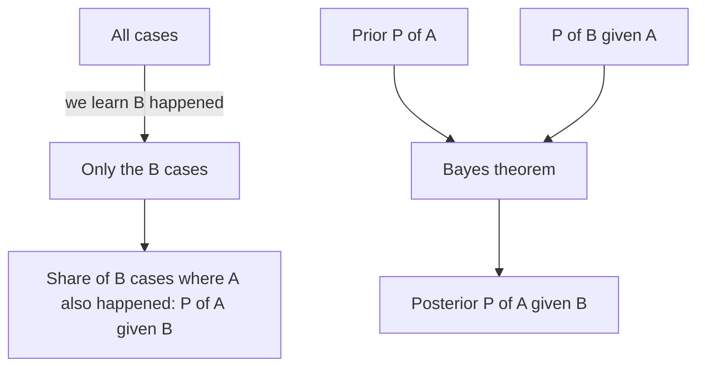

## Why should you care?

Across two years of Sahyadri Mart data, only about 10% of days are "high-sales days" (a store's top 10%). But on festival days the picture changes completely: about 66% of them are high-sales days. On ordinary days, only about 7%.

The manager does not care about "the chance of a high-sales day" in general. She cares about the chance **given what she already knows**: tomorrow is Diwali eve, or a rainy Tuesday. New information changes probabilities, and conditional probability is the tool that updates them. It powers fraud alerts, medical tests, spam filters and every recommendation that says "customers who bought this also bought…".

## In one line

Conditional probability $P(A \mid B)$ is the probability that $A$ happens given that $B$ has already happened, found by restricting attention to the cases where $B$ is true.

## Explained

### Q1. What is conditional probability? ⭐

$P(A \mid B)$ is read "the probability of $A$ given $B$".

$$P(A \mid B) = \frac{P(A \cap B)}{P(B)}, \quad P(B) > 0$$

==Knowing that B happened shrinks the sample space to B only.== Among those cases, we ask how often $A$ also happens.

In a table of counts this is simply: ==count of A-and-B ÷ count of B==.

### Q2. What is the multiplication rule? [2M]

Rearranging the definition gives the probability that **both** events happen:

$$P(A \cap B) = P(B) \times P(A \mid B) = P(A) \times P(B \mid A)$$

==Use it for events in sequence==: the first happens, then the second given the first.

Example: 2 of 10 items in a box are faulty. Pick two without replacement. $P(\text{both faulty}) = \frac{2}{10} \times \frac{1}{9} = \frac{2}{90} \approx 0.022$. ==The second probability is conditional==: one faulty item is already gone.

### Q3. When are two events independent? ⭐

==A and B are independent if knowing B does not change the chance of A==:

$$P(A \mid B) = P(A)$$

Equivalently, ==for independent events, multiply the probabilities==: $P(A \cap B) = P(A) \times P(B)$.

- Two tosses of a coin: independent.
- Festival day and high-sales day: **not** independent, because 0.66 is far from 0.10.

==Checking independence in data means comparing P(A | B) with P(A).==

### Q4. What is Bayes' theorem? ⭐

Often we know $P(B \mid A)$ but want the reverse, $P(A \mid B)$. Bayes' theorem turns it round:

$$P(A \mid B) = \frac{P(B \mid A)\, P(A)}{P(B)}$$

where the denominator comes from the **law of total probability**:

$$P(B) = P(B \mid A)\,P(A) + P(B \mid A')\,P(A')$$

- ==$P(A)$ is the **prior**==: what you believed before the new evidence.
- ==$P(A \mid B)$ is the **posterior**==: the updated belief after seeing $B$.

==$P(A \mid B)$ and $P(B \mid A)$ are usually very different.== Most festival days are high-sales days, but most high-sales days are not festivals.

### Q5. In an office of 100 employees, 60 are men and 40 are women; 30 men and 20 women have a company laptop. Find P(laptop | woman) and P(woman | laptop). Are "woman" and "has a laptop" independent? ⭐

1. ==P(laptop | woman): count of both ÷ count of women== $= 20/40 = 0.5$.
2. ==P(woman | laptop): count of both ÷ count with laptops== $= 20/(30 + 20) = 20/50 = 0.4$.
3. ==Check independence: compare P(laptop | woman) with P(laptop).== $P(\text{laptop}) = 50/100 = 0.5$.
4. ==Equal, so the events are independent==: knowing an employee is a woman does not change the chance of having a laptop. (Also $P(\text{laptop}) \times P(\text{woman}) = 0.5 \times 0.4 = 0.2 = 20/100$.)

### Q6. Distinguish between mutually exclusive and independent events.

| Point | Mutually exclusive | Independent |
|---|---|---|
| ==Meaning== | Cannot happen together | One does not affect the other's probability |
| ==Joint probability== | $P(A \cap B) = 0$ | $P(A \cap B) = P(A)P(B)$ |
| ==Key rule== | $P(A \cup B) = P(A) + P(B)$ | $P(A \mid B) = P(A)$ |
| ==Example== | One bill paid fully by UPI or fully by cash | Two separate coin tosses |

==Mutually exclusive events (with non-zero probabilities) are always dependent==: if one happens, the other's probability drops to 0.

## Analogy and real-life example

A cricket captain wins the toss. The chance of winning the match was, say, 50%. "Given we won the toss and the pitch suits our spinners", it might be 65%. Commentators update win probabilities after every over: each one is a conditional probability given the match so far.

Banks do the same with fraud. A ₹2 lakh transaction at 3 a.m. from a new city is far more likely to be fraud than an average transaction. The alert system computes $P(\text{fraud} \mid \text{these details})$.

## Diagram

## Worked example

Use the customer table from [[probability-basics]] (200 customers; big bill = over ₹500).

| | Big bill | Small bill | Total |
|---|---|---|---|
| UPI | 50 | 70 | 120 |
| Cash | 10 | 40 | 50 |
| Card | 20 | 10 | 30 |
| **Total** | **80** | **120** | **200** |

1. $P(\text{Big} \mid \text{Card}) = 20/30 = 0.667$. Two in three card users have a big bill.
2. $P(\text{Big} \mid \text{Cash}) = 10/50 = 0.20$.
3. $P(\text{Big}) = 80/200 = 0.40$. Since $0.667 \ne 0.40$, **payment method and bill size are not independent**.
4. Reverse direction: $P(\text{Card} \mid \text{Big}) = 20/80 = 0.25$. Check with Bayes:
   $P(\text{Card} \mid \text{Big}) = \frac{P(\text{Big} \mid \text{Card}) P(\text{Card})}{P(\text{Big})} = \frac{0.667 \times 0.15}{0.40} = 0.25$.

**Conclusion:** card users are much more likely to have big bills (0.667), yet only a quarter of big bills are paid by card (0.25), because card users are few.

## Try it

A payment app knows: 1% of transactions are fraud. Its alert flags 95% of fraud transactions, but also wrongly flags 5% of genuine ones. A transaction is flagged. What is the probability it is really fraud?

Start: $P(\text{flag}) = 0.95 \times 0.01 + 0.05 \times 0.99 = \;?$

> [!answer]- Answer
> $P(\text{flag}) = 0.0095 + 0.0495 = 0.059$.
> $P(\text{fraud} \mid \text{flag}) = \frac{0.95 \times 0.01}{0.059} = \frac{0.0095}{0.059} \approx 0.16$.
>
> Only about **16%** of flagged transactions are fraud. Fraud is rare (prior 1%), so even a good alert produces many more false alarms than true catches. This is the base-rate effect.

## Key facts and formulas

> [!important] Key facts
> - Conditional probability: $P(A \mid B) = \frac{P(A \cap B)}{P(B)}$, with $P(B) > 0$.
> - From a table: $P(A \mid B)$ = count of (A and B) ÷ count of B.
> - Multiplication rule: $P(A \cap B) = P(B)\,P(A \mid B)$.
> - Independent events: $P(A \mid B) = P(A)$, so $P(A \cap B) = P(A)\,P(B)$.
> - Total probability: $P(B) = P(B \mid A)P(A) + P(B \mid A')P(A')$.
> - Bayes' theorem: $P(A \mid B) = \frac{P(B \mid A)\,P(A)}{P(B)}$.
> - Prior $P(A)$ → evidence $B$ → posterior $P(A \mid B)$.
> - $P(A \mid B)$ and $P(B \mid A)$ are generally different.

## Common mistakes

> [!warning] Common mistake
> Swapping the condition. "90% of fraud happens online" is $P(\text{online} \mid \text{fraud})$; it does not mean 90% of online transactions are fraud, which is $P(\text{fraud} \mid \text{online})$.

> [!warning] Common mistake
> Ignoring the base rate. A 95%-accurate test for a rare event gives mostly false alarms, as the Try it shows. Always ask how common the event is to begin with.

> [!warning] Common mistake
> Multiplying probabilities of events that are not independent. Festival day (0.044) and high-sales day (0.10) do not co-occur with probability $0.044 \times 0.10 = 0.0044$; in the data it is about 0.029, nearly seven times more.

## Think deeper

- **Recommendation engines:** "customers who bought X also bought Y" estimates $P(\text{Y} \mid \text{X})$. Why might a high $P(\text{Y} \mid \text{X})$ be useless if $P(\text{Y})$ is already high (say, milk)?
- **Naive Bayes spam filters** multiply many conditional probabilities as if words were independent. They are not, yet the filters work well. Why might a "wrong" assumption still give good decisions?
- **Updating twice:** after one fraud flag the probability is 16%. If a second, independent check also flags the transaction, use the 16% as the new prior. What happens?

## Self-check

> [!quiz] Q1. $P(A \cap B) = 0.12$ and $P(B) = 0.4$. What is $P(A \mid B)$?
> (A) 0.048
> (B) 0.3
> (C) 0.52
> (D) 3.33
>
> > [!answer]- Answer: B
> > $P(A \mid B) = 0.12 / 0.4 = 0.3$.

> [!quiz] Q2. $P(A) = 0.5$, $P(B) = 0.2$ and $P(A \cap B) = 0.1$. Are $A$ and $B$ independent?
> (A) Yes, because $P(A)P(B) = P(A \cap B)$
> (B) No, because $P(A) \ne P(B)$
> (C) No, because $P(A \cap B) > 0$
> (D) Cannot tell
>
> > [!answer]- Answer: A
> > $0.5 \times 0.2 = 0.1 = P(A \cap B)$. Equivalently $P(A \mid B) = 0.1/0.2 = 0.5 = P(A)$.

> [!quiz] Q3. Two cards are drawn without replacement from a deck of 52. What is the probability that both are aces?
> (A) $\frac{4}{52} \times \frac{4}{52}$
> (B) $\frac{4}{52} \times \frac{3}{51}$
> (C) $\frac{4}{52} + \frac{3}{51}$
> (D) $\frac{2}{52}$
>
> > [!answer]- Answer: B
> > Multiplication rule: after one ace is drawn, 3 aces remain among 51 cards. Option A would be correct only with replacement.

> [!quiz] Q4. In Bayes' theorem, what is the prior?
> (A) $P(A \mid B)$
> (B) $P(B \mid A)$
> (C) $P(A)$, the probability before seeing the evidence
> (D) $P(B)$
>
> > [!answer]- Answer: C
> > The prior is the starting belief $P(A)$; the posterior is the updated $P(A \mid B)$.

> [!quiz] Q5. 66% of festival days are high-sales days. What can you say about the share of high-sales days that are festival days?
> (A) It is also 66%
> (B) It is 34%
> (C) It cannot be found without knowing how common festival days and high-sales days are
> (D) It must be over 90%
>
> > [!answer]- Answer: C
> > Reversing a conditional needs Bayes: $P(\text{fest} \mid \text{high}) = P(\text{high} \mid \text{fest}) P(\text{fest}) / P(\text{high})$. In the Sahyadri Mart data it is only about 29%.

## Flashcards

What is conditional probability P(A | B)? :: The probability of A given that B has happened
Formula for P(A | B)? :: P(A and B) / P(B)
Conditional probability from a table of counts? :: Count of (A and B) ÷ count of B
Multiplication rule? :: P(A and B) = P(B) × P(A | B)
Test for independence? :: P(A | B) = P(A), or equivalently P(A and B) = P(A) × P(B)
Bayes' theorem? :: P(A | B) = P(B | A) P(A) / P(B)
Law of total probability (two cases)? :: P(B) = P(B | A) P(A) + P(B | not A) P(not A)
What is a prior? :: The probability of A before seeing new evidence
What is a posterior? :: The updated probability P(A | B) after seeing evidence B
What is the base-rate effect? :: For a rare event, even an accurate test gives mostly false alarms

## Sources

- James R. Evans, *Business Analytics*, 3rd ed., Pearson, 2021, Ch. 5: Probability Distributions and Data Modeling
- Freedman, Pisani & Purves, *Statistics*, 4th ed., Norton, 2007, Ch. 13: What Are the Chances?; Ch. 14: More about Chance
- S. C. Gupta and V. K. Kapoor, *Fundamentals of Mathematical Statistics*, Sultan Chand, chapter "Theory of Probability"
