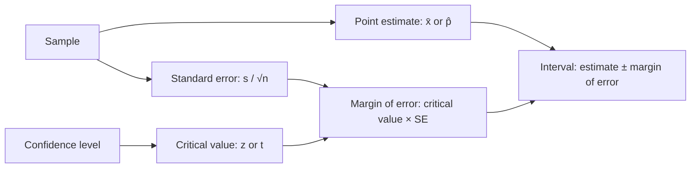

## Why should you care?

After surveying 36 days of footfall at the Pune Express store, an analyst reports: "Average daily footfall is 1,250." The manager asks the right question: "Exactly 1,250? How sure are you?"

A single number from a sample is almost never exactly right; a different sample would give a different number. A better report is: "Average daily footfall is between about 1,170 and 1,330, with 95% confidence." That range is honest about uncertainty, and it tells the manager whether the precision is good enough to act on. Opinion polls ("±3 percentage points"), clinical trials and A/B tests all report results this way.

## In one line

A confidence interval is a range of values, computed from a sample, that is expected to contain the population parameter with a stated confidence level such as 95%: estimate ± margin of error.

## Explained

### Q1. What are point and interval estimates? ⭐

- ==A **point estimate** is a single value from the sample used to estimate a parameter==: $\bar{x}$ for μ, $\hat{p}$ for $p$, $s$ for σ.
- ==An **interval estimate** gives a range around the point estimate==, with a confidence level.

A good estimator is:
- ==**unbiased:** right on average== across samples;
- ==**consistent:** gets closer to the parameter as n grows==;
- ==**efficient:** has the smallest SE among unbiased estimators==.

### Q2. How is a confidence interval for a mean built? ⭐

Every confidence interval has the same structure:

$$\text{point estimate} \pm \underbrace{(\text{critical value}) \times SE}_{\text{margin of error}}$$

==When σ is known (or n is large), use the z critical value==:

$$\bar{x} \pm z^* \frac{\sigma}{\sqrt{n}}$$

| Confidence level | 90% | 95% | 99% |
|---|---|---|---|
| $z^*$ | 1.645 | 1.96 | 2.576 |

==The critical value comes from the normal distribution of $\bar{x}$== ([[sampling-distributions]]).

### Q3. What if σ is unknown?

Usually σ is unknown and we use the sample SD $s$. ==Then use the **t distribution** with n − 1 degrees of freedom==:

$$\bar{x} \pm t^*_{n-1} \frac{s}{\sqrt{n}}$$

- ==The t distribution is bell-shaped like z, but with heavier tails==, which widens the interval to allow for the extra uncertainty in $s$.
- ==As n grows, t approaches z==: for 95%, $t^* = 2.030$ at 35 df, 2.011 at 48 df, and close to 1.96 beyond about 100.

Get $t^*$ from a t-table, Excel `T.INV.2T`, or Python `scipy.stats.t.ppf`.

### Q4. How is a confidence interval for a proportion built?

$$\hat{p} \pm z^* \sqrt{\frac{\hat{p}(1 - \hat{p})}{n}}$$

==Use it when the sample has at least 10 "yes" and 10 "no" answers.==

An opinion poll's "±3 points" is this margin of error at 95% confidence, for a sample of about 1,000.

### Q5. What does "95% confidence" mean? ⭐

==If we took many samples and built an interval from each, about 95% of those intervals would contain the true parameter.==

- The parameter is fixed; ==the interval is what varies== from sample to sample.
- Any one interval either contains μ or it does not; ==95% is the success rate of the method==.
- So "between 1,169 and 1,331 with 95% confidence" means: we used a method that captures the truth 95 times in 100.

### Q6. What controls the width of an interval?

| Change | Effect on width |
|---|---|
| ==Higher confidence (95% → 99%)== | Wider |
| ==Larger sample n== | Narrower (width ∝ $1/\sqrt{n}$) |
| ==More variable data (larger σ)== | Wider |

**Sample size for a target margin of error $E$** (mean, 95%):

$$n = \left(\frac{z^* \sigma}{E}\right)^2$$

==Always round n up.==

## Analogy and real-life example

Estimating with a single number is like trying to catch a fish with a spear: you will almost surely miss by a little. A confidence interval is a net. A wider net (higher confidence) catches the fish more often but tells you less precisely where it is. A bigger sample lets you use a smaller net with the same success rate.

Real use: election surveys in India often report vote shares with a margin of error; A/B tests on e-commerce sites report "conversion rose by 1.2 points, 95% CI 0.4 to 2.0 points" before a change is rolled out.

## Diagram

## Worked example

A random sample of 36 days of footfall at the Pune Express store gives $\bar{x} = 1{,}250$ and $s = 240$. Build a 95% confidence interval for the mean daily footfall μ.

1. σ is unknown, so use t with $n - 1 = 35$ df: $t^* = 2.030$.
2. $SE = s/\sqrt{n} = 240/\sqrt{36} = 40$.
3. Margin of error $= 2.030 \times 40 = 81.2$.
4. Interval: $1250 \pm 81.2$, that is **(1,168.8, 1,331.2)**.

**Interpretation:** we are 95% confident that the store's true average daily footfall lies between about 1,169 and 1,331 visitors. With z instead of t the margin would be $1.96 \times 40 = 78.4$, slightly too narrow.

## Try it

**(a)** In a survey of 800 customers, 520 say they are satisfied. Find a 95% confidence interval for the proportion of satisfied customers.

Start: $\hat{p} = 520/800 = 0.65$; $SE = \sqrt{0.65 \times 0.35/800} = \;?$

**(b)** How many bills must be sampled to estimate the mean bill within ±₹20 at 95% confidence, if σ is about ₹300?

> [!answer]- Answer
> **(a)** $SE = \sqrt{0.000284} = 0.0169$; margin $= 1.96 \times 0.0169 = 0.033$. Interval: $0.65 \pm 0.033$, that is **(0.617, 0.683)**: between about 62% and 68% of customers are satisfied.
>
> **(b)** $n = (1.96 \times 300/20)^2 = 29.4^2 = 864.4$, so round up to **865 bills**.

## Key facts and formulas

> [!important] Key facts
> - Point estimate: a single value ($\bar{x}$, $\hat{p}$); interval estimate: a range with a confidence level.
> - Good estimator: unbiased, consistent, efficient.
> - CI structure: estimate ± critical value × SE.
> - Mean, σ known or large n: $\bar{x} \pm z^* \sigma/\sqrt{n}$; $z^*$ = 1.645 (90%), 1.96 (95%), 2.576 (99%).
> - Mean, σ unknown: $\bar{x} \pm t^*_{n-1}\, s/\sqrt{n}$; t has heavier tails and approaches z as n grows.
> - Proportion: $\hat{p} \pm z^* \sqrt{\hat{p}(1-\hat{p})/n}$.
> - 95% confidence: 95% of intervals built this way contain the parameter.
> - Width grows with confidence and σ, shrinks with $\sqrt{n}$.
> - Sample size for margin $E$: $n = (z^* \sigma / E)^2$, rounded up.

## Common mistakes

> [!warning] Common mistake
> Saying "there is a 95% probability that μ is in (1,169, 1,331)". μ is fixed; it is either in that interval or not. The 95% describes the method's long-run success rate.

> [!warning] Common mistake
> Reading a 95% CI as the range of 95% of individual values. The interval is for the **mean** footfall; individual days vary far more (SD 240, not SE 40).

> [!warning] Common mistake
> Using z with a small sample and unknown σ. With $n = 10$, $t^* = 2.262$, not 1.96: the z interval would be about 13% too narrow.

## Think deeper

- **Trading confidence for precision:** a manager wants both 99% confidence and a narrow interval. What is the only way to get both, and what does it cost?
- **Overlapping intervals:** footfall intervals for two stores overlap slightly. Does that prove their means are equal? (See [[hypothesis-testing]].)
- **Bias is invisible to a CI:** if the 36 days were all weekdays, the interval would be precise and wrong. Which part of the formula would warn you? (None.)

## Self-check

> [!quiz] Q1. Which $z^*$ is used for a 95% confidence interval?
> (A) 1.645
> (B) 1.96
> (C) 2.576
> (D) 2.0
>
> > [!answer]- Answer: B
> > 95% of the standard normal lies between −1.96 and +1.96.

> [!quiz] Q2. $\bar{x} = 80$, $\sigma = 12$, $n = 36$. What is the 95% confidence interval for μ?
> (A) 80 ± 1.96
> (B) 80 ± 3.92
> (C) 80 ± 23.52
> (D) 80 ± 2
>
> > [!answer]- Answer: B
> > $SE = 12/6 = 2$; margin $= 1.96 \times 2 = 3.92$. Option C wrongly uses σ instead of the SE.

> [!quiz] Q3. What happens to the width of a confidence interval if the sample size is multiplied by 4 (all else equal)?
> (A) It is halved
> (B) It is divided by 4
> (C) It doubles
> (D) It does not change
>
> > [!answer]- Answer: A
> > Width is proportional to $1/\sqrt{n}$, and $\sqrt{4} = 2$.

> [!quiz] Q4. When should the t distribution be used instead of z for a mean?
> (A) When the population SD σ is unknown and estimated by s
> (B) When the sample is very large
> (C) When the data are categorical
> (D) When the confidence level is 99%
>
> > [!answer]- Answer: A
> > Estimating σ by $s$ adds uncertainty; the t distribution with $n - 1$ df allows for it.

> [!quiz] Q5. Which statement correctly interprets a 95% confidence interval?
> (A) 95% of the data lie in the interval
> (B) The sample mean is in the interval with probability 0.95
> (C) About 95% of intervals built this way contain the true parameter
> (D) The parameter changes 5% of the time
>
> > [!answer]- Answer: C
> > The confidence level is the long-run capture rate of the method. The sample mean is always at the centre of its own interval.

## Flashcards

Point estimate vs interval estimate? :: Point: a single value; interval: a range with a confidence level
Three properties of a good estimator? :: Unbiased, consistent, efficient
General form of a confidence interval? :: Estimate ± critical value × standard error
CI for a mean with σ known? :: x̄ ± z* σ/√n
CI for a mean with σ unknown? :: x̄ ± t* s/√n with n − 1 degrees of freedom
z* for 90%, 95%, 99% confidence? :: 1.645, 1.96, 2.576
CI for a proportion? :: p̂ ± z* √(p̂(1 − p̂)/n)
Meaning of 95% confidence? :: About 95% of intervals built this way contain the true parameter
Effect of larger n on CI width? :: Narrower, in proportion to 1/√n
Sample size for margin of error E? :: n = (z* σ / E)², rounded up
t vs z distribution? :: t has heavier tails and approaches z as the degrees of freedom grow

## Sources

- James R. Evans, *Business Analytics*, 3rd ed., Pearson, 2021, Ch. 6: Sampling and Estimation
- Freedman, Pisani & Purves, *Statistics*, 4th ed., Norton, 2007, Part VI: Sampling (Ch. 19–23)
