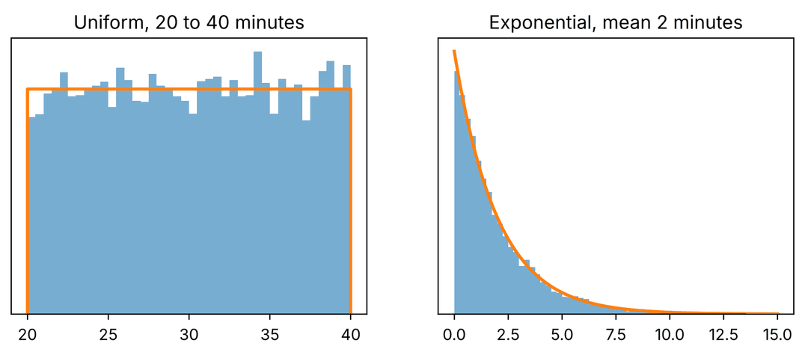

## Aim

To generate random numbers from uniform and exponential distributions, compare their properties with theory, and use exponential gaps to simulate customer arrivals at a billing counter.

## Concepts used

- [[continuous-distributions]]: uniform and exponential distributions, memorylessness.
- [[discrete-distributions]]: the Poisson distribution of arrivals per hour.

## Before the lab

- **Open:** a Google account and the *Open in Colab* link in Setup. Nothing to install; it also runs on a phone, but a laptop is easier.
- **Revise first:** [[continuous-distributions]] Q3 (uniform) and Q4 (exponential); [[discrete-distributions]] Q5 (Poisson).
- **Colab basics:** click a cell and press **Shift+Enter** to run it; a cell's output appears just below it.

## Setup (Colab)

[Open in Colab](https://colab.research.google.com/github/Prathameshv07/ai-ds-notes/blob/main/content/assets/notebooks/prob-stats/continuous-distributions-practical.ipynb). Nothing to install.

- This practical uses simulated numbers only; no dataset is needed.
- The outputs below come from pandas 3.0 and NumPy 2.5; the notebook gives identical numbers on pandas 2.2 and NumPy 2.0 (current Colab).
- Random numbers use `np.random.default_rng(2026)`, a fixed seed, so your results match these exactly when you run the cells in order.

## Steps

1. Open the notebook with the *Open in Colab* link. You should see the title **Uniform and Exponential Random Numbers (ABA Unit 2, Practical 4)**.
2. Click *File → Save a copy in Drive*, so your changes are kept. You should see "Copy of" in the notebook's name.
3. Run the **Step 1** cell (Uniform: 10,000 delivery times between 20 and 40 minutes). You should see `Mean 30.11 (theory 30.0)   SD 5.76 (theory 5.77)`.
4. Run the **Step 2** cell (Exponential: 10,000 gaps between customers, mean 2 minutes (30 customers an hour)). You should see `Mean 1.975 (theory 2)   SD 1.991 (theory 2)`.
5. Run the **Step 3** cell (Memoryless: having waited 3 minutes, is a further 2-minute wait just as likely?). You should see `P(gap > 5 | gap > 3) = 0.3643`.
6. Run the **Step 4** cell (Histograms with the theoretical density curves). You should see two histograms: a flat uniform one and a falling exponential one, each matching an orange curve.
7. Run the **Step 5** cell (Simulate 10,000 hours of arrivals by adding up exponential gaps). You should see `Customers per hour: mean 30.12, variance 29.61 (Poisson: both 30)`.
8. Run the **Step 6** cell (Every distribution can be built from uniform numbers (inverse transform)). You should see `From uniform numbers: mean 1.971, SD 2.001 (exponential theory: 2 and 2)`.
9. Add a new cell below the last step (*+ Code*), type the **Try it** variation and run it. You should see numbers you can check against the collapsed answer.

## Code

### Step 1. Uniform: 10,000 delivery times between 20 and 40 minutes

```python
# Step 1. Uniform: 10,000 delivery times between 20 and 40 minutes
import numpy as np
import pandas as pd
from scipy import stats

rng = np.random.default_rng(2026)
u = rng.uniform(20, 40, size=10_000)
print(f"Mean {u.mean():.2f} (theory {(20 + 40) / 2})   SD {u.std(ddof=1):.2f} (theory {20 / np.sqrt(12):.2f})")
print(f"P(25 <= X <= 30): simulated {((u >= 25) & (u <= 30)).mean():.4f}, theory {5 / 20:.4f}")
```

### Step 2. Exponential: 10,000 gaps between customers, mean 2 minutes (30 customers an hour)

```python
# Step 2. Exponential: 10,000 gaps between customers, mean 2 minutes (30 customers an hour)
g = rng.exponential(scale=2, size=10_000)        # scale = mean = 1 / rate
print(f"Mean {g.mean():.3f} (theory 2)   SD {g.std(ddof=1):.3f} (theory 2)")
print(f"P(gap > 3 min) : simulated {(g > 3).mean():.4f}, theory {np.exp(-0.5 * 3):.4f}")
print(f"P(gap <= 1 min): simulated {(g <= 1).mean():.4f}, theory {1 - np.exp(-0.5 * 1):.4f}")
```

### Step 3. Memoryless: having waited 3 minutes, is a further 2-minute wait just as likely?

```python
# Step 3. Memoryless: having waited 3 minutes, is a further 2-minute wait just as likely?
print(f"P(gap > 5 | gap > 3) = {(g[g > 3] > 5).mean():.4f}")
print(f"P(gap > 2)           = {(g > 2).mean():.4f}   theory for both: {np.exp(-0.5 * 2):.4f}")
```

### Step 4. Histograms with the theoretical density curves

```python
# Step 4. Histograms with the theoretical density curves
import matplotlib.pyplot as plt

fig, axes = plt.subplots(1, 2, figsize=(9, 3.2))
axes[0].hist(u, bins=40, density=True, color="tab:blue", alpha=0.6)
axes[0].plot([20, 20, 40, 40], [0, 1 / 20, 1 / 20, 0], color="tab:orange", lw=2)
axes[0].set_title("Uniform, 20 to 40 minutes")
axes[1].hist(g, bins=60, range=(0, 15), density=True, color="tab:blue", alpha=0.6)
x = np.linspace(0, 15, 300)
axes[1].plot(x, stats.expon.pdf(x, scale=2), color="tab:orange", lw=2)
axes[1].set_title("Exponential, mean 2 minutes")
for ax in axes:
    ax.set_yticks([])
plt.show()
```

### Step 5. Simulate 10,000 hours of arrivals by adding up exponential gaps

```python
# Step 5. Simulate 10,000 hours of arrivals by adding up exponential gaps
gaps = rng.exponential(scale=2, size=(10_000, 80))   # 80 gaps per hour is always enough here
arrival_times = gaps.cumsum(axis=1)
counts = (arrival_times <= 60).sum(axis=1)           # customers arriving within 60 minutes
print(f"Customers per hour: mean {counts.mean():.2f}, variance {counts.var(ddof=1):.2f} (Poisson: both 30)")
table = pd.DataFrame({"simulated": pd.Series(counts).value_counts(normalize=True).sort_index(),
                      "Poisson(30)": stats.poisson.pmf(np.arange(counts.max() + 1), 30)[pd.Series(counts).value_counts().sort_index().index]})
print(table.loc[[20, 25, 30, 35, 40]].round(4).to_string())
```

### Step 6. Every distribution can be built from uniform numbers (inverse transform)

```python
# Step 6. Every distribution can be built from uniform numbers (inverse transform)
r = rng.random(10_000)                 # uniform on 0 to 1
expo = -2 * np.log(1 - r)              # turns uniform numbers into exponential gaps, mean 2
print(f"From uniform numbers: mean {expo.mean():.3f}, SD {expo.std(ddof=1):.3f} (exponential theory: 2 and 2)")
```

## Output

### Step 1

```output
Mean 30.11 (theory 30.0)   SD 5.76 (theory 5.77)
P(25 <= X <= 30): simulated 0.2488, theory 0.2500
```

### Step 2

```output
Mean 1.975 (theory 2)   SD 1.991 (theory 2)
P(gap > 3 min) : simulated 0.2196, theory 0.2231
P(gap <= 1 min): simulated 0.3967, theory 0.3935
```

### Step 3

```output
P(gap > 5 | gap > 3) = 0.3643
P(gap > 2)           = 0.3610   theory for both: 0.3679
```

### Step 4



### Step 5

```output
Customers per hour: mean 30.12, variance 29.61 (Poisson: both 30)
    simulated  Poisson(30)
20     0.0124       0.0134
25     0.0516       0.0511
30     0.0732       0.0726
35     0.0473       0.0453
40     0.0132       0.0139
```

### Step 6

```output
From uniform numbers: mean 1.971, SD 2.001 (exponential theory: 2 and 2)
```

## Explanation

### Step 1: uniform numbers

`rng.uniform(20, 40, size=n)` gives values spread evenly between 20 and 40. Mean 30.11 and SD 5.76 match the theory $(a+b)/2 = 30$ and $(b-a)/\sqrt{12} = 5.77$; $P(25 \le X \le 30)$ is 0.2488 against $5/20 = 0.25$.

### Steps 2–3: exponential gaps

- ==NumPy's exponential takes the mean, not the rate==: `scale` is 1/rate. 30 customers an hour is a rate of 0.5 per minute, so `scale=2`.
- Mean 1.975 and SD 1.991 are both close to 2: for an exponential the mean and SD are equal.
- $P(\text{gap} > 3) = 0.2196$ against $e^{-1.5} = 0.2231$.
- **Memoryless:** among gaps that already exceeded 3 minutes, 36.4% exceeded 5; among all gaps, 36.1% exceeded 2. Both match $e^{-1} = 0.368$: having waited 3 minutes does not shorten the remaining wait.

### Step 4: the shapes

The uniform histogram is flat; the exponential one is tallest at 0 and falls away, with a long right tail. Both match their density curves.

### Step 5: from gaps to counts

Adding up exponential gaps gives arrival times; counting arrivals within 60 minutes for 10,000 simulated hours gives a mean of 30.12 and variance 29.61. ==Exponential gaps produce Poisson counts==: mean ≈ variance ≈ 30, and the simulated shares of 20, 25, 30, 35 and 40 customers match the Poisson(30) probabilities.

### Step 6: everything from uniform numbers

$-2\ln(1 - U)$ turns uniform numbers $U$ into exponential gaps with mean 2 (the **inverse transform** method). This is how simulation software builds every distribution from one uniform random-number generator.

## Common errors and fixes

- **`NameError: name 'df' is not defined`** (or `'rng'`, `'np'`, `'stats'`): a cell was run before Step 1, or Colab restarted and forgot everything. **Fix:** *Runtime → Run before* on the current cell, or run the cells again from Step 1.
- **Your numbers differ slightly from the note:** cells were run out of order or more than once, so the random generator moved on. **Fix:** *Runtime → Restart and run all*.
- **Exponential gaps with mean 0.5 instead of 2:** the rate was passed as `scale`. **Fix:** NumPy's `scale` is the mean, 1/rate: `rng.exponential(scale=2)` for 30 customers an hour.
- **`NameError: name 'plt' is not defined`** in a plotting step: the cell was copied without its `import matplotlib.pyplot as plt` line. **Fix:** run the whole cell, including the import.

## Try it

Customers arrive at 45 per hour. Simulate 10,000 gaps. What is the mean gap, and what is the probability of a gap longer than 2 minutes?

Start from: the rate is 45/60 per minute, so `scale = 60 / 45`.

> [!answer]- Answer
> ```python
> rng = np.random.default_rng(1)
> gaps45 = rng.exponential(scale=60 / 45, size=10_000)   # mean gap = 60/45 minutes
> print(f"Mean gap {gaps45.mean():.3f} min (theory {60/45:.3f})")
> print(f"P(gap > 2 min): simulated {(gaps45 > 2).mean():.4f}, theory {np.exp(-45/60 * 2):.4f}")
> ```
> ```output
> Mean gap 1.335 min (theory 1.333)
> P(gap > 2 min): simulated 0.2226, theory 0.2231
> ```
> Faster arrivals mean shorter gaps: a 2-minute break now happens about 22% of the time, against 37% at 30 customers an hour.

## Viva questions

1. How do you generate uniform random numbers between a and b in NumPy?
2. What is the `scale` of NumPy's exponential, and how is it related to the rate λ?
3. Why are the mean and SD of the exponential distribution equal?
4. Explain memorylessness using Step 3's numbers.
5. How did Step 5 turn exponential gaps into Poisson counts?
6. What is the inverse transform method, and why does simulation software need it?

## Flashcards

NumPy: uniform random numbers on (a, b)? :: rng.uniform(a, b, size=n)
NumPy: exponential random numbers with mean m? :: rng.exponential(scale=m, size=n)
Exponential scale vs rate? :: scale = mean = 1 / rate
Inverse transform for an exponential with mean m? :: x = −m × ln(1 − U), with U uniform on (0, 1)
Gaps between Poisson arrivals follow which distribution? :: Exponential

## Sources

- [SciPy documentation: scipy.stats.expon and scipy.stats.poisson](https://docs.scipy.org/doc/scipy/reference/stats.html)
- [NumPy documentation: Random Generator](https://numpy.org/doc/stable/reference/random/generator.html)
