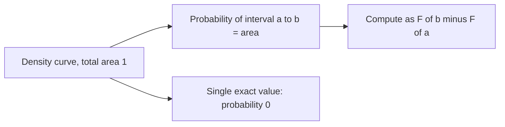

## Why should you care?

A delivery app promises your order "in 30 minutes". What is the chance it takes more than 40? At a billing counter, customers arrive about 30 times an hour. What is the chance the cashier gets a 3-minute break with nobody arriving?

Time, money, weight and distance are not counts: a delivery can take 31.4 minutes, a bill can be ₹527.35. For such variables we cannot list every value with its probability. Instead, a **density curve** describes how the values spread, and probabilities become **areas** under that curve.

## In one line

A continuous probability distribution describes a variable that can take any value in a range, and the probability of falling in an interval is the area under its density curve over that interval.

## Explained

### Q1. How does a continuous distribution give probabilities? ⭐

A continuous distribution is described by a **probability density function (pdf)** $f(x)$.

- ==The probability of an interval is the area under the curve over that interval==: $P(a \le X \le b)$ is the area between $a$ and $b$.
- ==The total area under the curve is 1.==
- ==The probability of any single exact value is 0==, because a single point has no width. So $P(X \le 30)$ and $P(X < 30)$ are the same.

A density can be above 1; only areas are probabilities.

### Q2. What is the cumulative distribution function (CDF)?

$$F(x) = P(X \le x)$$

==The CDF gives the probability of a value up to x==; it rises from 0 to 1.

==Any interval probability is a difference of two CDF values==:

$$P(a < X \le b) = F(b) - F(a)$$

Software (Excel's `NORM.DIST`, Python's `scipy.stats`) returns CDF values, so this one formula covers most calculations.

### Q3. What is the uniform distribution? ⭐

==Every value between a and b is equally likely.== The density is a flat rectangle:

$$f(x) = \frac{1}{b - a}, \quad a \le x \le b$$

- Mean $= \frac{a + b}{2}$; variance $= \frac{(b - a)^2}{12}$.
- Probability = ==width of the interval ÷ (b − a)==.

Example: a bus comes every 20 minutes and you arrive at a random time. Your wait is uniform on 0 to 20, so $P(\text{wait} > 15) = 5/20 = 0.25$.

Random-number generators produce uniform numbers between 0 and 1; simulations build everything else from them.

### Q4. What is the exponential distribution? ⭐

==It models the waiting time until the next event== when events happen at a constant average rate $\lambda$ per unit time.

$$f(x) = \lambda e^{-\lambda x}, \quad x \ge 0 \qquad P(X > x) = e^{-\lambda x}$$

- ==Mean and standard deviation are both 1/λ.==
- ==It is linked to the Poisson==: if the number of arrivals per hour is Poisson with rate $\lambda$ ([[discrete-distributions]]), the gaps between arrivals are exponential with mean $1/\lambda$.
- ==It is memoryless==: having waited 5 minutes does not change the chance of waiting 2 more.

It is right-skewed: many short gaps, a few long ones.

### Q5. Which continuous distributions matter most?

| Distribution | Shape | Typical use |
|---|---|---|
| ==Uniform== | Flat | ==Random arrival within a window==; simulation inputs |
| ==Exponential== | Decreasing, right-skewed | ==Time between arrivals, time to failure== |
| ==Normal== | Symmetric bell | ==Measurements, errors, averages== ([[normal-distribution]]) |

Choosing a distribution is a modelling decision: check it against a [[distribution-plots|histogram]] of real data.

## Analogy and real-life example

A discrete distribution is like a staircase of separate blocks, one block per value. A continuous distribution is like sand poured into a smooth heap: you cannot ask how much sand sits at one exact point, only how much lies between two marks.

Real uses: telecom companies model call durations, maintenance teams model the time until a machine part fails (exponential), and simulation models of a supermarket's billing queue use exponential gaps between arrivals.

## Diagram

## Worked example

Customers arrive at a billing counter at an average of 30 per hour, so $\lambda = 0.5$ per minute. Let $X$ be the gap (minutes) until the next customer: exponential with $\lambda = 0.5$.

1. **Mean gap:** $1/\lambda = 2$ minutes.
2. **A break of more than 3 minutes:** $P(X > 3) = e^{-0.5 \times 3} = e^{-1.5} = 0.223$.
3. **Next customer within 1 minute:** $P(X \le 1) = 1 - e^{-0.5} = 1 - 0.607 = 0.393$.
4. **Between 1 and 3 minutes:** $F(3) - F(1) = (1 - 0.223) - 0.393 = 0.384$.

**Conclusion:** the cashier gets a 3-minute gap about 22% of the time, even though the average gap is only 2 minutes. Exponential gaps are irregular: short gaps are common, long ones happen regularly too.

## Try it

A delivery takes anywhere from 20 to 40 minutes, uniformly. Find the mean, the SD, and $P(25 \le X \le 30)$.

Start: mean $= (20 + 40)/2$; variance $= (40 - 20)^2/12 = \;?$

> [!answer]- Answer
> Mean $= 30$ minutes. Variance $= 400/12 = 33.3$, so SD $= \sqrt{33.3} = 5.77$ minutes.
> $P(25 \le X \le 30) = (30 - 25)/(40 - 20) = 5/20 = 0.25$.

## Key facts and formulas

> [!important] Key facts
> - Probability = area under the density curve; total area = 1; $P(X = x) = 0$ for any single value.
> - CDF: $F(x) = P(X \le x)$; $P(a < X \le b) = F(b) - F(a)$.
> - Uniform$(a, b)$: $f(x) = \frac{1}{b-a}$; mean $\frac{a+b}{2}$; variance $\frac{(b-a)^2}{12}$.
> - Exponential$(\lambda)$: $f(x) = \lambda e^{-\lambda x}$; $P(X > x) = e^{-\lambda x}$; mean = SD = $1/\lambda$.
> - Poisson counts per interval ↔ exponential gaps between events.
> - Exponential is memoryless and right-skewed.

## Common mistakes

> [!warning] Common mistake
> Reading the height of a density as a probability. For an exponential with $\lambda = 2$ per minute, $f(0) = 2$, which is not a probability. Only areas are.

> [!warning] Common mistake
> Mixing the rate and the mean of the exponential. "30 customers per hour" is the rate $\lambda = 0.5$ per minute; the mean gap is $1/\lambda = 2$ minutes. Always check the time units match.

> [!warning] Common mistake
> Assuming every waiting time is exponential. If buses run to a timetable, waiting time is closer to uniform; exponential suits events with no schedule.

## Think deeper

- **Memorylessness in real life:** a light bulb that has worked 1,000 hours, is it as good as new? For bulbs maybe; for car tyres, no. Which business variables are plausibly memoryless?
- **From counts to times:** if a store's hourly arrivals are Poisson with $\lambda = 30$, how would you simulate a whole day's arrival times? ([[continuous-distributions-practical]].)
- **Tails matter:** a delivery app reports the mean delivery time; customers remember the slowest ones. Which part of the distribution drives complaints?

## Self-check

> [!quiz] Q1. For a continuous random variable, what is $P(X = 25)$?
> (A) 0
> (B) $f(25)$
> (C) $F(25)$
> (D) 1
>
> > [!answer]- Answer: A
> > A single point has no width, so the area above it is 0. Only intervals have positive probability.

> [!quiz] Q2. $X$ is uniform on 0 to 10. What is $P(2 \le X \le 5)$?
> (A) 0.2
> (B) 0.3
> (C) 0.5
> (D) 0.7
>
> > [!answer]- Answer: B
> > Width $3$ ÷ total width $10 = 0.3$.

> [!quiz] Q3. Calls arrive at a rate of 4 per hour. What is the mean time between calls?
> (A) 4 hours
> (B) 15 minutes
> (C) 4 minutes
> (D) 1 hour
>
> > [!answer]- Answer: B
> > Mean gap $= 1/\lambda = 1/4$ hour $= 15$ minutes.

> [!quiz] Q4. $F(40) = 0.84$ and $F(30) = 0.50$. What is $P(30 < X \le 40)$?
> (A) 0.34
> (B) 0.84
> (C) 1.34
> (D) 0.16
>
> > [!answer]- Answer: A
> > $F(40) - F(30) = 0.84 - 0.50 = 0.34$.

> [!quiz] Q5. What does "memoryless" mean for the exponential distribution?
> (A) The mean equals the SD
> (B) The chance of waiting a further time t does not depend on how long you have already waited
> (C) The distribution is symmetric
> (D) Past values are not recorded
>
> > [!answer]- Answer: B
> > $P(X > s + t \mid X > s) = P(X > t)$: the waiting time "starts afresh" at every moment.

## Flashcards

How are probabilities found for a continuous variable? :: As areas under the density curve
Total area under any density curve? :: 1
P(X = exact value) for a continuous variable? :: 0
Definition of the CDF? :: F(x) = P(X ≤ x)
Interval probability from the CDF? :: P(a < X ≤ b) = F(b) − F(a)
Density of the uniform distribution on (a, b)? :: 1 / (b − a)
Mean and variance of the uniform distribution? :: Mean (a + b)/2; variance (b − a)²/12
Exponential survival formula? :: P(X > x) = e^(−λx)
Mean and SD of the exponential distribution? :: Both 1/λ
What does the exponential distribution model? :: Waiting time until the next event at a constant rate
Link between Poisson and exponential? :: Poisson counts events per interval; the gaps between events are exponential

## Sources

- James R. Evans, *Business Analytics*, 3rd ed., Pearson, 2021, Ch. 5: Probability Distributions and Data Modeling
- S. C. Gupta and V. K. Kapoor, *Fundamentals of Mathematical Statistics*, Sultan Chand, chapter "Special Continuous Probability Distributions"
- NIST/SEMATECH *e-Handbook of Statistical Methods*, Section 1.3.6: Probability Distributions
