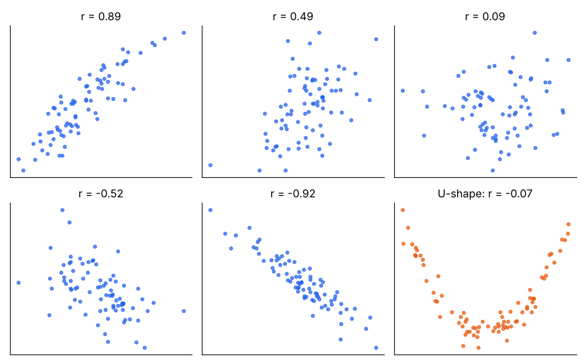
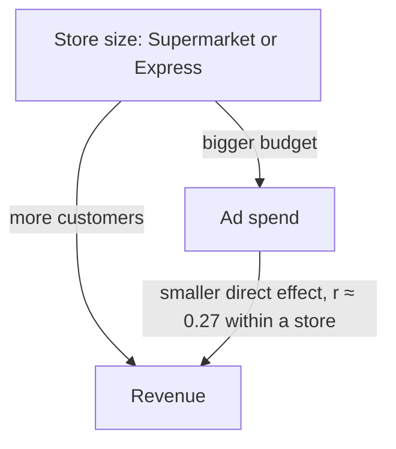

## Why should you care?

Sahyadri Mart's marketing head shows the board a chart: across all 12 stores and two years of days, ad spend and revenue have a correlation of 0.61. "Advertising clearly drives sales. Let's double the budget."

The analyst checks inside each store and finds a correlation of only about 0.27. The big supermarkets both spend more on ads *and* sell more, simply because they are big. Much of that 0.61 came from store size, not from advertising.

Correlation is the most used, and most misused, number in business analytics. Knowing what it does and does not say can save a company crores.

## In one line

The correlation coefficient r measures the strength and direction of the linear relationship between two numerical variables, on a scale from −1 to +1.

## Explained

### Q1. What is Karl Pearson's correlation coefficient? ⭐

[[covariance]] gives the direction but its size depends on units. ==Dividing by both standard deviations removes the units==:

$$r = \frac{\text{Cov}(x, y)}{s_x \, s_y} = \frac{\sum (x_i - \bar{x})(y_i - \bar{y})}{\sqrt{\sum (x_i - \bar{x})^2 \; \sum (y_i - \bar{y})^2}}$$

The second form is the easiest by hand: the $(n-1)$ terms cancel.

==Pearson's r always lies between −1 and +1, and has no units.==

It is also called the ==**product moment correlation coefficient**==.

### Q2. How do I read the value of r?

| r | Meaning |
|---|---|
| +1 | ==Perfect positive==: all points on a rising straight line |
| 0.7 to 1 | ==Strong positive== |
| 0.3 to 0.7 | ==Moderate positive== |
| −0.3 to 0.3 | ==Weak or no linear relationship== |
| −0.7 to −0.3 | Moderate negative |
| −1 to −0.7 | Strong negative |
| −1 | Perfect negative |

These cut-offs are rules of thumb; fields differ. ==The **sign** gives the direction, the **size** gives the strength==.

### Q3. What are the properties of r? ⭐

- $-1 \le r \le 1$; ==it has no units==.
- $r_{xy} = r_{yx}$: ==symmetric==.
- ==**Unchanged by change of origin and scale:**== converting rupees to lakh, or °C to °F, does not change r (if both scale factors have the same sign).
- $r^2$, the ==**coefficient of determination**, is the share of the variation in $y$== that a straight line in $x$ explains. $r = 0.6$ → $r^2 = 0.36$: 36%.
- ==r measures only linear relationships: r near 0 does not mean "no relationship".== The U-shape above has $r \approx 0$.
- ==r is sensitive to outliers==: one extreme point can create or destroy a strong r.

### Q4. Does correlation mean causation? ⭐

No. ==Correlation does not imply causation.== A strong r can arise because:

1. ==**x causes y**== (ads bring customers).
2. ==**y causes x**== (a store that sells more is given a bigger ad budget).
3. ==**A third variable, a confounder, drives both.**== In Sahyadri Mart, store size raises both ad spend and revenue: r = 0.61 across the chain, but about 0.27 within each store.
4. ==**Coincidence**==, especially when many pairs are tested.

To argue causation you need more: ==a controlled experiment (A/B test), or comparing like with like==, as the within-store check does.

### Q5. How do I check for a confounder?

- ==**Split the data** by the suspected third variable== (store, region, season) and ==compute r within each group==. ==If r shrinks a lot, the confounder was doing much of the work==.
- ==**Plot it:** colour a [[scatter-plot]] by group==. ==Separate clusters, one per group, are a warning sign==.
- Later tools (multiple regression, Unit 3) control for several variables at once.

> [!beyond] Beyond the syllabus
> **Spearman's rank correlation** applies Pearson's formula to the *ranks* of the values: $\rho = 1 - \frac{6 \sum d_i^2}{n(n^2 - 1)}$, where $d_i$ is the difference between the two ranks of item $i$ (no ties). It suits ordinal data (judges' rankings) and relationships that rise steadily but not in a straight line.

### Q6. Calculate Karl Pearson's coefficient of correlation for x: 1, 2, 3, 4, 5 and y: 2, 4, 5, 4, 5, and interpret it. ⭐

1. ==Means:== $\bar{x} = 3$, $\bar{y} = 4$.
2. ==Deviations:== $x - \bar{x}$: −2, −1, 0, 1, 2; $y - \bar{y}$: −2, 0, 1, 0, 1.
3. ==Sums:== $\sum (x - \bar{x})(y - \bar{y}) = 6$; $\sum (x - \bar{x})^2 = 10$; $\sum (y - \bar{y})^2 = 6$.
4. ==Formula:== $r = \frac{6}{\sqrt{10 \times 6}} = \frac{6}{7.746} = 0.77$.
5. ==Interpretation: strong positive linear relationship==; $r^2 = 0.60$, so a straight line in $x$ explains about 60% of the variation in $y$.

### Q7. What are the types of correlation?

- ==**Positive:** both variables move in the same direction== (ad spend and sales).
- ==**Negative:** they move in opposite directions== (price and demand).
- ==**Zero:** no linear relationship.==
- ==**Linear vs non-linear:**== points follow a straight line, or a curve.
- ==**Simple, multiple, partial:**== two variables; one variable with several others together; two variables with the others held constant.

### Q8. What is a scatter diagram, and how is it used to study correlation?

==A scatter diagram plots each pair (x, y) as one point==, with one variable on each axis.

Reading it:
- ==**Direction:** points rising left to right show positive correlation==; falling, negative.
- ==**Strength:** the closer the points lie to a straight line, the stronger the correlation.==
- ==**Form:** a curved pattern shows a non-linear relationship== that r may miss.
- ==**Outliers and groups:**== isolated points or separate clusters warn that r may mislead.

It should always be drawn before calculating r ([[scatter-plot]]).

## Analogy and real-life example

Ice-cream sales and drowning cases both rise in summer. Banning ice-cream would not save swimmers: hot weather drives both. The same trap appears in business all the time: a city with more ATMs has more thefts, and stores with more staff have more complaints. Both pairs are mostly driven by size.

## Diagram

## Worked example

Continue the [[covariance]] example: ad spend $x$ (₹ thousand) 2, 4, 6, 8, 10 and sales $y$ (₹ lakh) 5, 7, 6, 10, 12.

From the deviation table:
- $\sum (x - \bar{x})(y - \bar{y}) = 34$
- $\sum (x - \bar{x})^2 = 16 + 4 + 0 + 4 + 16 = 40$
- $\sum (y - \bar{y})^2 = 9 + 1 + 4 + 4 + 16 = 34$

$$r = \frac{34}{\sqrt{40 \times 34}} = \frac{34}{36.88} = 0.92$$

$r^2 = 0.85$: a straight line in ad spend explains about 85% of the variation in sales on these five days.

**Conclusion:** a strong positive linear relationship. On five days from one store, that is a hint worth testing, not proof that ads cause sales.

## Try it

Snack price $x$ (₹) and units sold $y$: (10, 50), (12, 44), (14, 40), (16, 34). The covariance note gave $\sum (x - \bar{x})(y - \bar{y}) = -52$. Find r.

Start: $\sum (x - \bar{x})^2 = 9 + 1 + 1 + 9 = 20$; $\sum (y - \bar{y})^2 = 64 + 4 + 4 + 64 = \;?$

> [!answer]- Answer
> $\sum (y - \bar{y})^2 = 136$. $r = -52/\sqrt{20 \times 136} = -52/52.15 = -0.997$. An almost perfect **negative** linear relationship: every ₹2 price rise cuts sales by a nearly constant amount.

## Key facts and formulas

> [!important] Key facts
> - $r = \frac{\text{Cov}(x, y)}{s_x s_y} = \frac{\sum (x - \bar{x})(y - \bar{y})}{\sqrt{\sum (x - \bar{x})^2 \sum (y - \bar{y})^2}}$.
> - $-1 \le r \le 1$; sign = direction, size = strength; no units.
> - Rules of thumb: $|r| \ge 0.7$ strong, 0.3–0.7 moderate, below 0.3 weak.
> - Unchanged by change of origin and scale; $r_{xy} = r_{yx}$.
> - $r^2$ (coefficient of determination) = share of variation in $y$ explained by a straight line in $x$.
> - r measures only linear relationships and is sensitive to outliers.
> - Correlation ≠ causation: direct cause, reverse cause, confounder or coincidence.

## Common mistakes

> [!warning] Common mistake
> Reading r = 0.5 as "50% related". It is $r^2 = 0.25$ that has a percentage meaning: 25% of the variation explained.

> [!warning] Common mistake
> Computing one r over mixed groups and drawing a business conclusion. The chain-wide 0.61 for ad spend and revenue mostly reflects store size. Always check within groups.

> [!warning] Common mistake
> Concluding "no relationship" from r ≈ 0 without plotting. Footfall and temperature may rise and then fall (people avoid both cold and very hot days): a strong curved relationship with r near zero.

## Think deeper

- **Reverse causation:** if head office gives bigger ad budgets to stores that already sell well, which way does the arrow point?
- **How would you prove ads work?** Design a fair test for Sahyadri Mart: which stores, which days, what to compare? (This leads to A/B testing and experimental design, Unit 4.)
- **Many correlations, some by chance:** with 16 columns there are 120 pairs. If you test them all, why will a few look "significant" purely by luck?
- **Within versus between:** could a correlation be *positive* across groups but *negative* within every group? Search for "Simpson's paradox".

## Self-check

> [!quiz] Q1. Which value of r shows the strongest linear relationship?
> (A) 0.65
> (B) −0.85
> (C) 0.10
> (D) −0.40
>
> > [!answer]- Answer: B
> > Strength is the size $|r|$; the sign only gives the direction. $|-0.85|$ is the largest.

> [!quiz] Q2. r between footfall and revenue is 0.96. What is the coefficient of determination?
> (A) 0.96
> (B) 0.92
> (C) 0.98
> (D) 0.48
>
> > [!answer]- Answer: B
> > $r^2 = 0.96^2 = 0.9216 \approx 0.92$: about 92% of the variation in revenue is explained by a straight line in footfall.

> [!quiz] Q3. Revenue is converted from rupees to ₹ lakh. What happens to r between ad spend and revenue?
> (A) Divided by 100,000
> (B) Unchanged
> (C) Becomes 1
> (D) Changes sign
>
> > [!answer]- Answer: B
> > r has no units and is unchanged by a change of scale. (The covariance would be divided by 100,000.)

> [!quiz] Q4. Cities with more hospitals have more deaths. What is the most likely explanation?
> (A) Hospitals cause deaths
> (B) A third variable, population size, drives both
> (C) The correlation must be calculated wrongly
> (D) Deaths cause hospitals to close
>
> > [!answer]- Answer: B
> > Bigger cities have more hospitals and more deaths. Population size is the confounder.

> [!quiz] Q5. A scatter plot shows points lying on a clear U-shaped curve, and r = 0.02. What should you conclude?
> (A) There is no relationship
> (B) There is a strong relationship that is not linear
> (C) r must be wrong
> (D) The variables are independent
>
> > [!answer]- Answer: B
> > r measures only straight-line patterns. The plot shows a strong curved relationship that r misses.

## Flashcards

What does Pearson's r measure? :: Strength and direction of the linear relationship between two numerical variables
Formula for r using covariance? :: r = Cov(x, y) / (s_x × s_y)
Range of r? :: −1 to +1
What does r = 0 mean? :: No linear relationship (a curved relationship may still exist)
What is the coefficient of determination? :: r²: the share of variation in y explained by a straight line in x
Effect of change of origin and scale on r? :: None (r is unchanged if both scale factors have the same sign)
Four reasons two variables can be correlated? :: x causes y, y causes x, a confounder drives both, or coincidence
What is a confounder? :: A third variable that influences both variables and creates or inflates their correlation
How do you check for a confounder? :: Compute r within groups of the suspected third variable and compare
Ad spend vs revenue at Sahyadri Mart: chain-wide vs within store? :: About 0.61 chain-wide, about 0.27 within each store (store size confounds)

## Sources

- James R. Evans, *Business Analytics*, 3rd ed., Pearson, 2021, Ch. 4: Descriptive Statistics
- S. C. Gupta and V. K. Kapoor, *Fundamentals of Mathematical Statistics*, Sultan Chand, Ch. 10: Correlation and Regression
- Freedman, Pisani & Purves, *Statistics*, 4th ed., Norton, 2007, Ch. 8: Correlation; Ch. 9: More about Correlation
- pandas documentation: [DataFrame.corr](https://pandas.pydata.org/docs/reference/api/pandas.DataFrame.corr.html)
