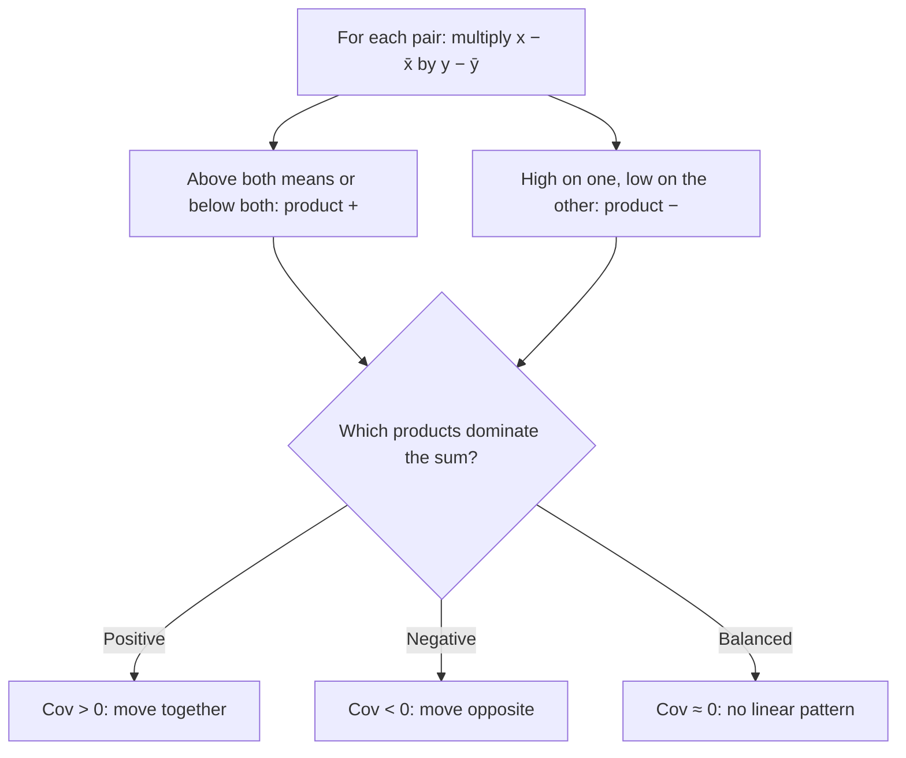

## Why should you care?

A shop near Dadar station sells umbrellas and cold drinks. The owner notices that in the monsoon, umbrella sales jump while cold-drink sales drop. On sunny days it is the other way round.

He wants to stock smartly: which products rise and fall **together**, and which move in **opposite** directions? Until now, every measure you have learnt (mean, SD, quartiles) describes one variable at a time. Business questions are usually about two: does advertising go with sales, does price go with demand, does rain go with footfall?

Covariance is the first, simplest measure of how two variables move together.

## In one line

Covariance measures whether two numerical variables tend to move in the same direction (positive), in opposite directions (negative), or show no linear pattern (near zero).

## Explained

### Q1. What does covariance measure? ⭐

Take each pair $(x_i, y_i)$, such as one day's ad spend and sales.

- If days with **above-average** $x$ also tend to have **above-average** $y$, ==the variables move together: **positive** covariance==.
- If above-average $x$ goes with **below-average** $y$, ==they move oppositely: **negative** covariance==.
- If there is no consistent pattern: ==covariance **near zero**==.

==Covariance measures the direction of the linear relationship between two variables.==

### Q2. What is the formula? ⭐

$$\text{Cov}(x, y) = s_{xy} = \frac{\sum (x_i - \bar{x})(y_i - \bar{y})}{n - 1}$$

For a whole population, ==divide by $N$== (and use $\mu_x$, $\mu_y$).

Read it in three steps:
1. ==Find each value's deviation== from its own mean.
2. ==Multiply the two deviations== for each pair.
3. ==Average== the products.

Compare with variance: $s^2 = \frac{\sum (x_i - \bar{x})(x_i - \bar{x})}{n - 1}$. ==The covariance of a variable with itself is its variance.==

### Q3. Why does multiplying deviations work?

Draw lines at $\bar{x}$ and $\bar{y}$ on a [[scatter-plot]]. ==They split it into four quadrants==.

| Point is… | $x - \bar{x}$ | $y - \bar{y}$ | Product |
|---|---|---|---|
| Above both means | + | + | **+** |
| Below both means | − | − | **+** |
| High $x$, low $y$ | + | − | **−** |
| Low $x$, high $y$ | − | + | **−** |

If most points fall in the "both above" and "both below" quadrants, ==the positive products win: positive covariance==. If most fall in the mixed quadrants, ==negative products win==.

### Q4. Why is covariance hard to interpret? [2M]

Its ==**size** depends on the units== of both variables.

- Ad spend in ₹ thousand and sales in ₹ lakh might give a covariance of 8.5.
- The same data with both in rupees gives 850,000,000.

Same relationship, very different numbers. So ==covariance tells you the **direction** reliably, but not the **strength**==. You cannot say whether 8.5 is "large".

The fix is to ==divide by both SDs==, which removes the units. That gives the correlation coefficient: [[correlation]].

### Q5. What properties should I know? ⭐

- $\text{Cov}(x, y) = \text{Cov}(y, x)$: ==the order does not matter==.
- $\text{Cov}(x, x) = \text{Var}(x)$.
- ==Adding constants changes nothing==: $\text{Cov}(x + a, y + c) = \text{Cov}(x, y)$.
- ==Multiplying scales it==: $\text{Cov}(bx, dy) = bd\,\text{Cov}(x, y)$. This is why units matter.
- ==If $x$ and $y$ are independent, the covariance is 0==. ==**The reverse is not true:**== covariance 0 only means no *linear* pattern; a U-shaped relationship can have zero covariance.

### Q6. Distinguish between covariance and correlation. ⭐

| Point | Covariance | Correlation |
|---|---|---|
| ==What it shows== | Direction of the linear relationship | Direction **and** strength |
| ==Units== | Unit of $x$ × unit of $y$ | No units |
| ==Range== | Any value, $-\infty$ to $+\infty$ | Between −1 and +1 |
| ==Effect of changing units== | Changes | Unchanged |
| ==Formula== | $\frac{\sum (x - \bar{x})(y - \bar{y})}{n - 1}$ | Covariance ÷ $(s_x s_y)$ |

==Correlation is covariance made unit-free==, so only correlation can say whether a relationship is strong.

### Q7. Calculate the covariance of x: 1, 2, 3, 4, 5 and y: 2, 4, 5, 4, 5.

1. ==Means:== $\bar{x} = 15/5 = 3$, $\bar{y} = 20/5 = 4$.
2. ==Deviations:== $x - \bar{x}$: −2, −1, 0, 1, 2; $y - \bar{y}$: −2, 0, 1, 0, 1.
3. ==Products of deviations:== 4, 0, 0, 0, 2; sum $= 6$.
4. ==Covariance: sum of products ÷ (n − 1)== $= 6/4 = 1.5$.

==Positive covariance:== $x$ and $y$ tend to rise together. The [[correlation]] note's Q6 measures how strongly.

## Analogy and real-life example

Two friends walk through a crowded market. If they keep stepping left together and right together, their movements have positive covariance. If one steps left whenever the other steps right (dodging each other), negative covariance. If each wanders independently, near zero.

Business example: across a year of days at a Mumbai shop, rainfall and umbrella sales have positive covariance; rainfall and cold-drink sales have negative covariance.

## Diagram

## Worked example

Five days at a store: ad spend $x$ (₹ thousand) and sales $y$ (₹ lakh).

| Day | $x$ | $y$ | $x - \bar{x}$ | $y - \bar{y}$ | Product |
|---|---|---|---|---|---|
| 1 | 2 | 5 | −4 | −3 | 12 |
| 2 | 4 | 7 | −2 | −1 | 2 |
| 3 | 6 | 6 | 0 | −2 | 0 |
| 4 | 8 | 10 | 2 | 2 | 4 |
| 5 | 10 | 12 | 4 | 4 | 16 |
| | $\bar{x} = 6$ | $\bar{y} = 8$ | | | **34** |

$$\text{Cov}(x, y) = \frac{34}{5 - 1} = 8.5$$

Unit: ₹ thousand × ₹ lakh.

**Conclusion:** positive, so higher ad spend goes with higher sales on these days. Every product is zero or positive: each day lies in a "both above" or "both below" quadrant. We cannot yet say how *strong* the relationship is; the [[correlation]] note finishes this example.

## Try it

Price of a snack (₹) and units sold on four days: (10, 50), (12, 44), (14, 40), (16, 34). Find the covariance.

Start: $\bar{x} = 13$, $\bar{y} = 42$. Deviations of $x$: $-3, -1, 1, 3$; of $y$: $8, 2, -2, -8$.

> [!answer]- Answer
> Products: $-24, -2, -2, -24$; sum $= -52$. $\text{Cov} = -52/3 = -17.33$ (₹ × units). **Negative:** when the price goes up, units sold go down, as the law of demand predicts.

## Key facts and formulas

> [!important] Key facts
> - Sample covariance: $s_{xy} = \frac{\sum (x_i - \bar{x})(y_i - \bar{y})}{n - 1}$; population: divide by $N$.
> - Positive: move together. Negative: move opposite. Near 0: no linear pattern.
> - $\text{Cov}(x, x) = \text{Var}(x)$; $\text{Cov}(x, y) = \text{Cov}(y, x)$.
> - $\text{Cov}(x + a, y + c) = \text{Cov}(x, y)$; $\text{Cov}(bx, dy) = bd\,\text{Cov}(x, y)$.
> - Unit = unit of $x$ × unit of $y$, so its size cannot show strength.
> - Independent → Cov = 0, but Cov = 0 does not imply independent.
> - Correlation = covariance ÷ (SD of $x$ × SD of $y$).

## Common mistakes

> [!warning] Common mistake
> Calling a large covariance a "strong" relationship. A covariance of 850,000,000 can describe exactly the same relationship as 8.5; only the units changed. Use correlation to judge strength.

> [!warning] Common mistake
> Concluding "no relationship" from zero covariance. Customer satisfaction may rise and then fall as waiting staff increase (too few: slow; too many: crowded). That curved relationship can have covariance near zero.

## Think deeper

- **Portfolios:** investors combine shares whose returns have negative covariance (for example, an airline and an oil company). Why does that reduce the risk of the total portfolio?
- **Many variables at once:** a dataset with 10 numerical columns has a 10 × 10 **covariance matrix**. What sits on its diagonal? (This matrix is the starting point of principal component analysis in ML.)
- **Does positive covariance mean ads cause sales?** What else could make both go up on the same days? (The [[correlation]] note returns to this.)

## Self-check

> [!quiz] Q1. On days when $x$ is above its mean, $y$ is usually below its mean. What is the sign of the covariance?
> (A) Positive
> (B) Negative
> (C) Zero
> (D) It depends on the units
>
> > [!answer]- Answer: B
> > Above-average $x$ with below-average $y$ gives negative products, so the sum and the covariance are negative. Units change the size, never the sign.

> [!quiz] Q2. What is $\text{Cov}(x, x)$?
> (A) 0
> (B) 1
> (C) The variance of $x$
> (D) The mean of $x$
>
> > [!answer]- Answer: C
> > Replace $y$ by $x$ in the formula: $\frac{\sum (x_i - \bar{x})^2}{n - 1}$, which is the variance.

> [!quiz] Q3. Revenue is converted from rupees to ₹ lakh (divided by 100,000). What happens to Cov(ad spend, revenue)?
> (A) Unchanged
> (B) Divided by 100,000
> (C) Multiplied by 100,000
> (D) Becomes the correlation
>
> > [!answer]- Answer: B
> > $\text{Cov}(x, dy) = d\,\text{Cov}(x, y)$ with $d = 1/100{,}000$. The relationship is the same; only the number shrinks.

> [!quiz] Q4. Two variables have covariance exactly 0. What can you conclude?
> (A) They are independent
> (B) There is no linear relationship between them
> (C) One of them is constant
> (D) Their means are equal
>
> > [!answer]- Answer: B
> > Zero covariance rules out a linear pattern only. A curved relationship (such as a U-shape) can still exist.

## Flashcards

What does covariance measure? :: The direction of the linear relationship between two variables
Formula for sample covariance? :: Σ(x − x̄)(y − ȳ) / (n − 1)
Positive covariance means? :: The variables tend to move in the same direction
Negative covariance means? :: The variables tend to move in opposite directions
What is Cov(x, x)? :: The variance of x
Why can't covariance show strength? :: Its size depends on the units of both variables
Effect on covariance of multiplying x by b and y by d? :: It is multiplied by bd
Does zero covariance mean independence? :: No; only that there is no linear relationship
How is correlation obtained from covariance? :: Divide by the product of the two SDs

## Sources

- James R. Evans, *Business Analytics*, 3rd ed., Pearson, 2021, Ch. 4: Descriptive Statistics
- S. C. Gupta and V. K. Kapoor, *Fundamentals of Mathematical Statistics*, Sultan Chand, Ch. 10: Correlation and Regression
- Freedman, Pisani & Purves, *Statistics*, 4th ed., Norton, 2007, Ch. 8: Correlation
- pandas documentation: [Series.cov](https://pandas.pydata.org/docs/reference/api/pandas.Series.cov.html)
