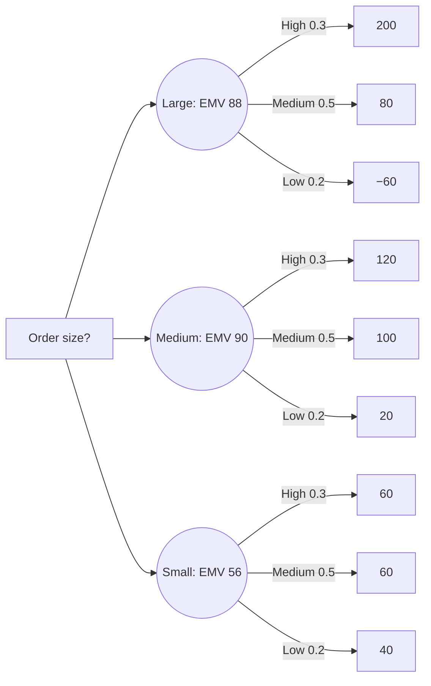

## Why should you care?

Three weeks before Diwali, the manager of Sahyadri Mart's Pune supermarket must order sweets and dry-fruit gift boxes. Order too much, and unsold boxes are sold at a loss in November. Order too little, and customers walk away to a competitor on the busiest days of the year. Demand is uncertain, but the order must be placed **now**.

Every business decision has this shape: choose today, find out tomorrow. Decision analysis gives a clear, defensible way to choose: list the options, list what might happen, put a rupee value on each combination, and apply a rule. With probabilities, the rule is usually **expected monetary value**; without them, there are rules for optimists, pessimists and everyone in between.

## In one line

Decision analysis is a structured way to choose among alternatives when the outcomes are uncertain, using a payoff table or decision tree and a criterion such as maximum expected monetary value.

## Explained

### Q1. What are the elements of a decision problem?

- ==**Decision alternatives:** the options the decision maker controls== (order large, medium or small).
- ==**States of nature:** the uncertain events the decision maker does not control== (demand high, medium or low).
- ==**Payoffs:** the result of each alternative under each state==, usually profit in rupees.

A **payoff table** shows alternatives as rows, states as columns, and payoffs in the cells.

### Q2. What are the three decision environments? ⭐

| Environment | What is known | How to decide |
|---|---|---|
| ==Certainty== | Which state will occur | Pick the best payoff in that state |
| ==Risk== | Probabilities of the states | Expected monetary value (EMV) |
| ==Uncertainty== | Only the list of states, no probabilities | Criteria in Q3 |

### Q3. How do I decide without probabilities? ⭐

- ==**Maximax (optimistic):** pick the alternative with the best best-case payoff.==
- ==**Maximin (pessimistic):** pick the alternative with the best worst-case payoff.==
- ==**Minimax regret (Savage):** pick the alternative whose largest regret is smallest.== Regret = best payoff in that state − your payoff.
- ==**Laplace (equally likely):** treat all states as equally likely and pick the best average.==
- ==**Hurwicz (realism):** weight the best case by α and the worst by 1 − α==, for a chosen optimism level $0 \le \alpha \le 1$.

Different criteria can recommend different alternatives: the choice reflects the decision maker's attitude to risk.

### Q4. How do I decide when probabilities are known? ⭐

The **expected monetary value** of an alternative is its probability-weighted average payoff:

$$\text{EMV} = \sum (\text{payoff} \times \text{probability of the state})$$

==Choose the alternative with the highest EMV.== It is the average payoff you would earn if you faced the same decision many times ([[discrete-distributions]]).

Equivalently, you can minimise the **expected opportunity loss (EOL)**, the probability-weighted regret; ==the lowest EOL always picks the same alternative as the highest EMV==.

### Q5. What is the expected value of perfect information (EVPI)?

Suppose a perfect forecaster could tell you the state in advance. You would always pick the best alternative for that state.

$$\text{EVPI} = \text{EV with perfect information} - \text{best EMV}$$

where EV with perfect information $= \sum (\text{best payoff in each state} \times \text{its probability})$.

==EVPI is the most you should ever pay for information== such as a market survey. ==EVPI equals the minimum EOL.==

### Q6. What is a decision tree? ⭐

==A decision tree draws a decision as a sequence of choices and chance events, from left to right.==

- ==**Decision node** (square): a choice== you make; branches are alternatives.
- ==**Chance node** (circle): an uncertain event==; branches are states with probabilities.
- ==**End node**: the final payoff.==

==Solve it by **rolling back** from right to left==: at each chance node compute the EMV; at each decision node keep the branch with the highest EMV.

Trees handle **sequential** decisions that tables cannot, such as "run a survey first, then decide".

### Q7. What does EMV leave out?

==EMV ignores risk==: two alternatives with equal EMV can have very different worst cases.
- A small shop might prefer a lower EMV to avoid a loss it cannot survive (**risk aversion**).
- ==Look at the **risk profile**==: the spread of possible payoffs and the chance of a loss.
- ==Run a **sensitivity analysis**==: how much can the probabilities change before the best choice changes?

Monte Carlo simulation (Unit 4) extends this to many uncertain inputs at once.

## Analogy and real-life example

Choosing whether to carry an umbrella is a decision under risk. Alternatives: carry or not. States: rain or no rain. Payoffs: getting wet is very bad, carrying a useless umbrella is mildly annoying. With a 30% forecast, the expected "cost" of getting wet often outweighs the nuisance of carrying, so you carry it. A forecast is valuable exactly because it changes such decisions; that value is what EVPI measures.

Businesses use the same logic for stock orders, new-product launches, oil drilling, legal settlements and insurance.

## Diagram

Payoffs in ₹ thousand of profit. Square = decision node, circle = chance node.

## Worked example

Payoff table for the Diwali order (profit, ₹ thousand):

| Order | High (0.3) | Medium (0.5) | Low (0.2) | Worst | Best | Average |
|---|---|---|---|---|---|---|
| Large | 200 | 80 | −60 | −60 | 200 | 73.3 |
| Medium | 120 | 100 | 20 | 20 | 120 | 80.0 |
| Small | 60 | 60 | 40 | 40 | 60 | 53.3 |

**Without probabilities:**
1. Maximax: best of the bests (200, 120, 60) → **Large**.
2. Maximin: best of the worsts (−60, 20, 40) → **Small**.
3. Laplace: best average (73.3, 80.0, 53.3) → **Medium**.
4. Minimax regret: the best payoffs per state are 200, 100, 40. Regrets: Large (0, 20, 100), Medium (80, 0, 20), Small (140, 40, 0). Largest regrets: 100, 80, 140 → **Medium**.

**With probabilities:**
5. EMV(Large) $= 0.3(200) + 0.5(80) + 0.2(-60) = 88$; EMV(Medium) $= 36 + 50 + 4 = 90$; EMV(Small) $= 18 + 30 + 8 = 56$ → **Medium**, EMV ₹90,000.
6. EV with perfect information $= 0.3(200) + 0.5(100) + 0.2(40) = 118$. EVPI $= 118 - 90 = 28$: a demand forecast is worth at most **₹28,000**.

**Conclusion:** order medium. It has the highest EMV, and unlike the large order it never makes a loss.

## Try it

Should the store run a Diwali ad campaign? The payoffs below already subtract the campaign's cost. With the campaign: high demand (0.7) gives ₹300 thousand profit, low demand (0.3) gives ₹50 thousand. Without it: high (0.7) gives ₹220 thousand, low (0.3) gives ₹100 thousand. Roll back the tree.

Start: EMV(campaign) $= 0.7 \times 300 + 0.3 \times 50 = \;?$

> [!answer]- Answer
> EMV(campaign) $= 210 + 15 = 225$. EMV(no campaign) $= 154 + 30 = 184$.
> **Run the campaign**: EMV ₹2.25 lakh against ₹1.84 lakh. Note the risk: in low demand the campaign does worse (₹50 thousand against ₹100 thousand).

## Key facts and formulas

> [!important] Key facts
> - Elements: decision alternatives, states of nature, payoffs (payoff table).
> - Environments: certainty, risk (probabilities known), uncertainty (no probabilities).
> - Maximax = optimistic; maximin = pessimistic; minimax regret (Savage); Laplace = equal probabilities; Hurwicz = $\alpha \times$ best $+ (1 - \alpha) \times$ worst.
> - Regret = best payoff in that state − payoff of the alternative.
> - $\text{EMV} = \sum \text{payoff} \times P(\text{state})$; choose the highest.
> - Min EOL picks the same alternative as max EMV.
> - EVPI = EV with perfect information − best EMV = minimum EOL; the most to pay for information.
> - Decision tree: square = decision, circle = chance; solve by rolling back (EMV at chance nodes, best branch at decision nodes).

## Common mistakes

> [!warning] Common mistake
> Expecting to earn the EMV. The medium order's EMV is ₹90,000, but the actual profit will be ₹120,000, ₹100,000 or ₹20,000. EMV is a long-run average, not a forecast of this Diwali.

> [!warning] Common mistake
> Computing regret across a row instead of down a column. Regret compares alternatives **within the same state**: best payoff in that column minus each payoff.

> [!warning] Common mistake
> Paying more than EVPI for a survey. Real surveys are imperfect, so their value is always less than EVPI. If a survey costs more than EVPI, reject it without further calculation.

## Think deeper

- **Where do the probabilities come from?** For Sahyadri Mart, past Diwali seasons in the sales data could estimate P(high demand). How many past Diwalis would you need before trusting them? ([[decision-analysis-practical]].)
- **Risk attitude:** a family-run single store and a 12-store chain face the same payoff table. Should they choose the same order? Why might EMV suit the chain better?
- **Sensitivity:** at what probability of high demand would the large order overtake the medium order? (Set the two EMVs equal and solve.)
- **Imperfect information:** a survey that is right 80% of the time is worth less than EVPI. Updating the demand probabilities after the survey needs [[conditional-probability]] and Bayes' theorem.

## Self-check

> [!quiz] Q1. A manager chooses the alternative whose worst-case payoff is the highest. Which criterion is this?
> (A) Maximax
> (B) Maximin
> (C) Minimax regret
> (D) Laplace
>
> > [!answer]- Answer: B
> > Maximin is the pessimistic criterion: it maximises the minimum payoff.

> [!quiz] Q2. An alternative pays ₹100 with probability 0.4 and ₹−20 with probability 0.6. What is its EMV?
> (A) ₹40
> (B) ₹28
> (C) ₹80
> (D) ₹52
>
> > [!answer]- Answer: B
> > $0.4 \times 100 + 0.6 \times (-20) = 40 - 12 = 28$.

> [!quiz] Q3. EV with perfect information is ₹150 thousand and the best EMV is ₹120 thousand. What is the most you should pay for a perfect forecast?
> (A) ₹150 thousand
> (B) ₹120 thousand
> (C) ₹30 thousand
> (D) ₹270 thousand
>
> > [!answer]- Answer: C
> > EVPI $= 150 - 120 = 30$ thousand rupees.

> [!quiz] Q4. In a decision tree, what does a circle (chance node) represent?
> (A) A choice made by the decision maker
> (B) An uncertain event with probabilities on its branches
> (C) The final payoff
> (D) The best alternative
>
> > [!answer]- Answer: B
> > Squares are decisions; circles are chance events; end nodes hold payoffs.

> [!quiz] Q5. How is a decision tree solved?
> (A) Left to right, choosing the most likely branch at each chance node
> (B) Right to left, taking EMV at chance nodes and the best branch at decision nodes
> (C) By adding all payoffs
> (D) By picking the largest payoff anywhere in the tree
>
> > [!answer]- Answer: B
> > This is rolling back (folding back) the tree.

## Flashcards

Three elements of a decision problem? :: Decision alternatives, states of nature, payoffs
Decision under risk vs uncertainty? :: Risk: probabilities of states are known; uncertainty: they are not
Maximax criterion? :: Optimistic: choose the alternative with the best best-case payoff
Maximin criterion? :: Pessimistic: choose the alternative with the best worst-case payoff
How is regret calculated? :: Best payoff in that state minus the alternative's payoff
Minimax regret criterion? :: Choose the alternative whose largest regret is smallest
Laplace criterion? :: Treat all states as equally likely and choose the best average payoff
Formula for EMV? :: Σ payoff × probability of the state
Formula for EVPI? :: EV with perfect information − best EMV
What does EVPI tell you? :: The most you should pay for information about the states
Decision tree symbols? :: Square = decision node; circle = chance node; end node = payoff
How is a decision tree solved? :: Roll back from right to left: EMV at chance nodes, best branch at decision nodes

## Sources

- James R. Evans, *Business Analytics*, 3rd ed., Pearson, 2021, Ch. 16: Decision Analysis
- James R. Evans, *Business Analytics*, 3rd ed., Pearson, 2021, Ch. 12: Monte Carlo Simulation and Risk Analysis
