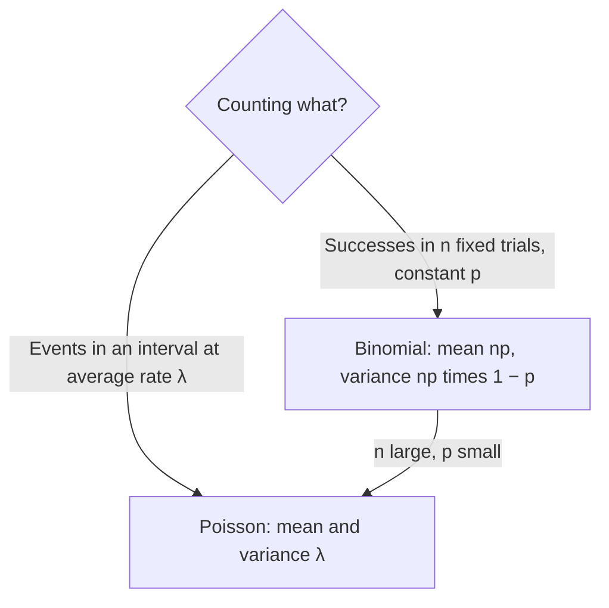

## Why should you care?

Five people walk into a Sahyadri Mart Express store in the next ten minutes. Each buys with probability 0.64. How likely is it that at least four of them buy? A customer helpline gets 2 complaint calls an hour on average. How likely is a quiet hour with no calls at all, and how many staff are needed so that a busy hour does not overwhelm them?

Questions like "how many?" (buyers, defects, calls, returns, failed payments) have whole-number answers that vary by chance. A **discrete probability distribution** gives the chance of each possible count. Two distributions, the binomial and the Poisson, answer a remarkable number of everyday business questions.

## In one line

A discrete probability distribution lists every possible value of a countable random variable together with its probability, and its expected value is the long-run average of that variable.

## Explained

### Q1. What is a random variable? [2M]

==A random variable is a numerical outcome of a random experiment.== It is written with a capital letter, such as $X$.

- ==**Discrete:** takes countable values== (0, 1, 2, …): buyers among 5 visitors, defects in a batch, calls per hour.
- ==**Continuous:** takes any value in a range==: delivery time, bill amount, rainfall. See [[continuous-distributions]].

### Q2. What is a probability distribution? [2M]

A table, graph or formula giving $P(X = x)$ for every value $x$. It is also called the **probability mass function (PMF)**.

Two conditions must hold:
1. ==Every probability is between 0 and 1.==
2. ==The probabilities add up to 1.==

| Defective items per day $x$ | 0 | 1 | 2 | 3 |
|---|---|---|---|---|
| $P(X = x)$ | 0.50 | 0.30 | 0.15 | 0.05 |

### Q3. What are the expected value and variance? ⭐

$$E(X) = \mu = \sum x \, P(x) \qquad \text{Var}(X) = \sigma^2 = \sum (x - \mu)^2 P(x)$$

- ==The expected value is the long-run average== over many repetitions, not the most likely single value.
- ==The variance measures the spread of the distribution==; $\sigma = \sqrt{\text{Var}(X)}$, as in [[dispersion]].

For the defects table: $E(X) = 0(0.5) + 1(0.3) + 2(0.15) + 3(0.05) = 0.75$ defects a day. Over 100 days expect about 75 defects.

### Q4. What is the binomial distribution? ⭐

It counts ==the number of successes in n trials==, when:
- ==the number of trials $n$ is fixed==;
- ==each trial has two outcomes== (success or failure);
- ==the probability of success $p$ is the same each time==;
- ==the trials are independent==.

$$P(X = k) = \binom{n}{k} p^k (1 - p)^{n - k}, \quad k = 0, 1, \dots, n$$

$\binom{n}{k} = \frac{n!}{k!(n-k)!}$ counts the ways to choose which $k$ trials succeed.

Mean $np$; variance $np(1 - p)$.

### Q5. What is the Poisson distribution? ⭐

It counts ==the number of events in a fixed interval== of time or space, when events occur independently at a constant average rate $\lambda$ (lambda): calls per hour, accidents per month, typos per page.

$$P(X = k) = \frac{e^{-\lambda} \lambda^k}{k!}, \quad k = 0, 1, 2, \dots$$

- ==Mean and variance are both equal to λ.==
- ==It approximates the binomial when n is large and p is small==, with $\lambda = np$ (rule of thumb: $n \ge 20$, $p \le 0.05$).

Unlike the binomial, there is no upper limit on the count.

### Q6. 20% of the items made by a machine are defective. In a random sample of 6, find the probability of exactly 2 defectives and of no defectives, and the mean and variance. ⭐

$X$ = number of defectives is binomial with $n = 6$, $p = 0.2$.

1. ==Exactly 2: binomial formula== $\binom{6}{2}(0.2)^2(0.8)^4 = 15 \times 0.04 \times 0.4096 = 0.246$.
2. ==None:== $(0.8)^6 = 0.262$.
3. ==Mean: np== $= 6 \times 0.2 = 1.2$ defectives.
4. ==Variance: np(1 − p)== $= 6 \times 0.2 \times 0.8 = 0.96$.

### Q7. A shop receives on average 3 online orders an hour. Using the Poisson distribution, find the probability of exactly 1 order and of at least 1 order in an hour.

$X$ = orders per hour is Poisson with $\lambda = 3$.

1. ==Exactly 1: Poisson formula== $\frac{e^{-3} 3^1}{1!} = 3e^{-3} = 3 \times 0.0498 = 0.149$.
2. ==At least 1: use the complement== $1 - P(X = 0) = 1 - e^{-3} = 1 - 0.0498 = 0.950$.

About 1 hour in 20 brings no orders at all.

### Q8. Distinguish between the binomial and Poisson distributions. ⭐

| Point | Binomial | Poisson |
|---|---|---|
| ==Counts== | Successes in $n$ fixed trials | Events in a fixed interval |
| ==Parameters== | $n$ and $p$ | $\lambda$ only |
| ==Possible values== | 0 to $n$ | 0, 1, 2, … with no upper limit |
| ==Mean and variance== | $np$ and $np(1-p)$; variance < mean | Both $\lambda$ |
| ==Example== | Buyers among 5 visitors | Calls per hour |

==Poisson approximates binomial when n is large and p small==, with $\lambda = np$.

## Analogy and real-life example

A binomial is a fixed number of coin tosses with a biased coin: 5 visitors, each a "toss" that comes up "buy" 64% of the time. A Poisson is like counting raindrops on a window pane in one minute: no fixed number of "tries", just a steady average rate.

Real uses: banks model the number of loan defaults in a portfolio (binomial), call centres plan staffing from calls per hour (Poisson), and quality teams count defects per batch.

## Diagram

## Worked example

Five visitors enter an Express store; each buys independently with $p = 0.64$. Let $X$ = number of buyers. $X$ is binomial with $n = 5$, $p = 0.64$.

1. **Exactly 3 buy:** $P(X = 3) = \binom{5}{3}(0.64)^3(0.36)^2 = 10 \times 0.262144 \times 0.1296 = 0.340$.
2. **At least 1 buys:** use the complement. $P(X = 0) = 0.36^5 = 0.006$, so $P(X \ge 1) = 1 - 0.006 = 0.994$.
3. **Mean:** $np = 5 \times 0.64 = 3.2$ buyers. **SD:** $\sqrt{5 \times 0.64 \times 0.36} = \sqrt{1.152} = 1.07$.

**Conclusion:** on average 3.2 of 5 visitors buy, and almost never (0.6%) does nobody buy.

## Try it

A helpline receives complaint calls at an average of $\lambda = 2$ per hour. Find $P(\text{no calls in an hour})$ and $P(\text{at most 2 calls})$.

Start: $P(X = 0) = e^{-2} \times 2^0 / 0! = e^{-2} = \;?$

> [!answer]- Answer
> $P(X = 0) = e^{-2} = 0.1353$.
> $P(X = 1) = e^{-2} \times 2 = 0.2707$; $P(X = 2) = e^{-2} \times 4/2 = 0.2707$.
> $P(X \le 2) = 0.1353 + 0.2707 + 0.2707 = 0.6767$.
>
> So about 1 hour in 7 is completely quiet, and about 1 hour in 3 brings 3 or more calls.

## Key facts and formulas

> [!important] Key facts
> - Random variable: a numerical outcome of a random experiment; discrete (countable) or continuous.
> - PMF conditions: $0 \le P(x) \le 1$ and $\sum P(x) = 1$.
> - $E(X) = \sum x P(x)$; $\text{Var}(X) = \sum (x - \mu)^2 P(x)$.
> - Binomial: $P(X = k) = \binom{n}{k} p^k (1-p)^{n-k}$; mean $np$, variance $np(1-p)$.
> - Binomial conditions: fixed $n$, two outcomes, constant $p$, independent trials.
> - Poisson: $P(X = k) = \frac{e^{-\lambda}\lambda^k}{k!}$; mean = variance = $\lambda$.
> - Poisson approximates binomial when $n$ is large and $p$ small, with $\lambda = np$.

## Common mistakes

> [!warning] Common mistake
> Treating the expected value as the most likely value. $E(X) = 0.75$ defects a day is impossible on any single day; it is the average over many days.

> [!warning] Common mistake
> Using the binomial when $p$ changes or trials depend on each other. Drawing 5 items without replacement from a box of 10 with 3 faulty ones is not binomial: each draw changes the next probability.

> [!warning] Common mistake
> Forgetting the complement for "at least" questions. $P(X \ge 1)$ needs five binomial terms but only one via $1 - P(X = 0)$.

## Think deeper

- **Is buying really independent?** Families and friends shop together. How would that change the spread of the number of buyers compared with the binomial?
- **Over-dispersion:** if a helpline's calls have mean 2 but variance 6, what does that say about the Poisson assumption? (Hint: busy and quiet periods.)
- **Expected value as a decision tool:** a warranty costs ₹300 and pays ₹5,000 with probability 0.04. Is it worth it for the buyer on average? For the seller? (See [[decision-analysis]].)

## Self-check

> [!quiz] Q1. Which of these is a discrete random variable?
> (A) Time taken to deliver an order
> (B) Number of returns in a day
> (C) Weight of a rice bag
> (D) Daily rainfall
>
> > [!answer]- Answer: B
> > A count of returns takes values 0, 1, 2, …; the others can take any value in a range.

> [!quiz] Q2. $X$ takes values 1, 2, 3 with probabilities 0.2, 0.5, 0.3. What is $E(X)$?
> (A) 2.0
> (B) 2.1
> (C) 1.0
> (D) 6.0
>
> > [!answer]- Answer: B
> > $1(0.2) + 2(0.5) + 3(0.3) = 0.2 + 1.0 + 0.9 = 2.1$.

> [!quiz] Q3. A binomial variable has $n = 20$ and $p = 0.1$. What is its variance?
> (A) 2
> (B) 1.8
> (C) 0.09
> (D) 18
>
> > [!answer]- Answer: B
> > $np(1-p) = 20 \times 0.1 \times 0.9 = 1.8$. Its mean is $np = 2$.

> [!quiz] Q4. A Poisson variable has mean 4. What is its variance?
> (A) 2
> (B) 4
> (C) 16
> (D) Cannot tell
>
> > [!answer]- Answer: B
> > For a Poisson distribution, mean = variance = $\lambda = 4$.

> [!quiz] Q5. Which situation fits the binomial distribution?
> (A) Number of customers arriving in an hour
> (B) Number of heads in 10 tosses of a coin
> (C) Time until the next customer arrives
> (D) Weight of a parcel
>
> > [!answer]- Answer: B
> > Fixed $n = 10$, two outcomes, constant $p$, independent tosses. A is Poisson; C and D are continuous.

## Flashcards

What is a random variable? :: A numerical outcome of a random experiment
Discrete vs continuous random variable? :: Discrete takes countable values; continuous takes any value in a range
Two conditions for a probability distribution? :: Each probability is between 0 and 1, and all probabilities sum to 1
Formula for expected value of a discrete variable? :: E(X) = Σ x P(x)
Formula for variance of a discrete variable? :: Var(X) = Σ (x − μ)² P(x)
Four conditions for a binomial distribution? :: Fixed n, two outcomes, constant p, independent trials
Binomial probability formula? :: P(X = k) = C(n, k) p^k (1 − p)^(n − k)
Mean and variance of a binomial? :: Mean np; variance np(1 − p)
Poisson probability formula? :: P(X = k) = e^(−λ) λ^k / k!
Mean and variance of a Poisson? :: Both equal λ
When does Poisson approximate binomial? :: n large and p small, with λ = np

## Sources

- James R. Evans, *Business Analytics*, 3rd ed., Pearson, 2021, Ch. 5: Probability Distributions and Data Modeling
- Freedman, Pisani & Purves, *Statistics*, 4th ed., Norton, 2007, Ch. 15: The Binomial Formula; Ch. 17: The Expected Value and Standard Error
- S. C. Gupta and V. K. Kapoor, *Fundamentals of Mathematical Statistics*, Sultan Chand, chapter "Special Discrete Probability Distributions"
- NIST/SEMATECH *e-Handbook of Statistical Methods*, Section 1.3.6: Probability Distributions
