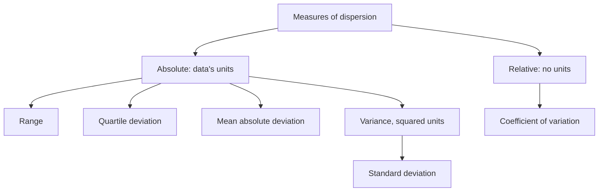

## Why should you care?

A food-delivery manager compares two delivery partners over five orders:

| | Order 1 | 2 | 3 | 4 | 5 | Mean |
|---|---|---|---|---|---|---|
| Partner A | 28 | 29 | 30 | 31 | 32 | 30 min |
| Partner B | 10 | 20 | 30 | 40 | 50 | 30 min |

Same mean. But you can plan your evening around Partner A, while Partner B's customer is either surprised or furious. An average tells you where the data sit; it says nothing about how much they **vary**. In business, that variation is risk: late deliveries, empty shelves, unpredictable cash flow. Measuring it is the job of dispersion.

## In one line

A measure of dispersion tells how spread out the values of a dataset are around its centre; the main ones are the range, variance, standard deviation and coefficient of variation.

## Explained

### Q1. What is dispersion, and what kinds of measures are there? ⭐

==Dispersion is the extent to which values differ from each other and from their average.== Small dispersion means the average is a good summary; large dispersion means it hides a lot.

- ==**Absolute measures** are in the data's own units== (minutes, ₹): range, quartile deviation, mean absolute deviation, variance, standard deviation.
- ==**Relative measures** have no units== (often a %), so they can compare datasets measured on different scales: the coefficient of variation is the main one.

Quartiles and the interquartile range have their own note: [[quartiles-and-percentiles]].

### Q2. What is the range? [2M]

$$\text{Range} = \text{Maximum} - \text{Minimum}$$

Partner A: $32 - 28 = 4$ min. Partner B: $50 - 10 = 40$ min.

- ==**Strength:** the simplest possible measure==; quick for quality checks and daily price bands.
- ==**Weakness:** it uses only two values==. One unusual day changes it completely, and it says nothing about the values in between.

### Q3. What is the variance? ⭐

Measure each value's distance from the mean, its **deviation** $x_i - \bar{x}$. ==Deviations always add up to zero, so we **square** them first==, then average.

$$\sigma^2 = \frac{\sum (x_i - \mu)^2}{N} \qquad s^2 = \frac{\sum (x_i - \bar{x})^2}{n - 1}$$

==$\sigma^2$ is the **population** variance== (all $N$ values); ==$s^2$ is the **sample** variance== ($n$ values from a larger population).

==Variance is the average squared deviation from the mean.== ==Its unit is the square of the data's unit== (min², ₹²), which is hard to interpret.

Another option, the ==**mean absolute deviation**== $\frac{\sum |x_i - \bar{x}|}{n}$, ==uses absolute values instead of squares==. It is easy to read but harder to use in further maths.

### Q4. What is the standard deviation? ⭐

==The standard deviation is the square root of the variance.==

$$\sigma = \sqrt{\sigma^2} \qquad s = \sqrt{s^2}$$

==Taking the root brings the unit back to the data's own unit.== Read it as =="a typical distance of a value from the mean"==.

- ==It uses every value==, and ==it is the basis of most later statistics==: the normal distribution, confidence intervals, z-scores, regression.
- Like the mean, ==it is pulled by outliers==, because squaring makes large deviations even larger.
- SD = 0 ==only when every value is the same==.

### Q5. Why divide by $n - 1$ for a sample? [2M]

==A sample's values sit a little closer to their own mean== $\bar{x}$ than to the true population mean $\mu$. So the squared deviations come out slightly too small. ==Dividing by $n - 1$ instead of $n$ corrects this underestimate== (**Bessel's correction**).

In practice:
- ==Data is the whole group you care about== (all 12 stores) ==→ divide by $N$==.
- ==Data is a sample== used to learn about something bigger ==→ divide by $n - 1$==.

For large $n$ the difference is tiny; for small samples it matters.

### Q6. What is the coefficient of variation (CV)? ⭐

$$CV = \frac{\sigma}{\bar{x}} \times 100\%$$

==The CV expresses the SD as a percentage of the mean==, so ==it compares spread between datasets with different means or units==.

Example: a Supermarket's daily footfall has SD 450; an Express store's has SD 150. The Supermarket looks more erratic, but its mean is 2,200 against 750. Both CVs are about 20%: relative to their size, they are equally steady.

==Lower CV means more consistent (less relative variability).==

> [!beyond] Beyond the syllabus
> **Combined standard deviation** of two groups with sizes $n_1, n_2$, means $\bar{x}_1, \bar{x}_2$, SDs $\sigma_1, \sigma_2$ and combined mean $\bar{x}$: $\sigma = \sqrt{\frac{n_1(\sigma_1^2 + d_1^2) + n_2(\sigma_2^2 + d_2^2)}{n_1 + n_2}}$, where $d_i = \bar{x}_i - \bar{x}$.

### Q7. What are the merits and demerits of the standard deviation?

**Merits**
- ==Uses every value== in the data.
- ==Rigidly defined and in the data's own units==, so it is easy to report.
- ==Basis of further statistics==: the normal distribution, standard error, confidence intervals, correlation and regression.

**Demerits**
- ==Affected by extreme values==, because deviations are squared.
- ==Harder to calculate by hand== than the range or quartile deviation.
- ==Cannot compare groups with different means or units==; use the coefficient of variation for that.

### Q8. Calculate the range, sample variance, standard deviation and coefficient of variation of: 4, 8, 6, 10, 12. ⭐

1. ==Range: maximum − minimum== $= 12 - 4 = 8$.
2. ==Mean:== $\bar{x} = 40/5 = 8$.
3. ==Squared deviations:== $(-4)^2, 0^2, (-2)^2, 2^2, 4^2$ → $16, 0, 4, 4, 16$; sum $= 40$.
4. ==Sample variance: sum of squares ÷ (n − 1)== $= 40/4 = 10$.
5. ==Standard deviation: square root of the variance== $= \sqrt{10} = 3.16$.
6. ==CV: SD ÷ mean × 100== $= 3.16/8 \times 100 = 39.5\%$.

## Analogy and real-life example

Two mutual funds both returned an average of 12% a year over ten years. Fund A's yearly returns stayed between 10% and 14%. Fund B swung from −8% to +35%.

In finance, the **standard deviation of returns is called volatility**, and it is the standard measure of risk. An investor who needs the money next year should prefer Fund A, even at the same average return. Same mean, different spread, different decision.

## Diagram

## Worked example

Find the sample variance, SD and CV of both delivery partners (mean = 30 for both).

**Partner A:** 28, 29, 30, 31, 32

| $x$ | $x - \bar{x}$ | $(x - \bar{x})^2$ |
|---|---|---|
| 28 | −2 | 4 |
| 29 | −1 | 1 |
| 30 | 0 | 0 |
| 31 | 1 | 1 |
| 32 | 2 | 4 |
| | sum = 0 | **10** |

$s^2 = 10 / (5 - 1) = 2.5$ min², $s = \sqrt{2.5} = 1.58$ min, $CV = 1.58 / 30 \times 100 = 5.3\%$.

**Partner B:** 10, 20, 30, 40, 50. Deviations −20, −10, 0, 10, 20; squares 400, 100, 0, 100, 400; sum = 1,000.

$s^2 = 1000 / 4 = 250$ min², $s = \sqrt{250} = 15.81$ min, $CV = 15.81 / 30 \times 100 = 52.7\%$.

**Conclusion:** Partner B's typical distance from the mean is 10 times Partner A's. Partner A is far more reliable, which the mean alone could never show.

## Try it

Store X: mean daily footfall 900, SD 180. Store Y: mean 1,800, SD 270. Which store is more consistent?

Start: $CV_X = 180 / 900 \times 100 = \;?$

> [!answer]- Answer
> $CV_X = 20\%$, $CV_Y = 270 / 1800 \times 100 = 15\%$. Store Y has the larger SD, but relative to its size it varies less, so **Store Y is more consistent**.

## Key facts and formulas

> [!important] Key facts
> - Range = Max − Min.
> - Population variance: $\sigma^2 = \frac{\sum (x_i - \mu)^2}{N}$; sample variance: $s^2 = \frac{\sum (x_i - \bar{x})^2}{n - 1}$.
> - Standard deviation = $\sqrt{\text{variance}}$; same unit as the data.
> - Mean absolute deviation = $\frac{\sum |x_i - \bar{x}|}{n}$.
> - $CV = \frac{\sigma}{\bar{x}} \times 100\%$; lower CV = more consistent.
> - Absolute measures have units; relative measures (CV) do not.
> - Adding a constant to every value does not change the SD; multiplying every value by $k$ multiplies the SD by $|k|$ and the variance by $k^2$.
> - SD = 0 only when all values are equal.

## Common mistakes

> [!warning] Common mistake
> Mixing up the divisors in software. pandas `.std()` and Excel `STDEV.S` divide by $n - 1$ (sample); NumPy `np.std()` and Excel `STDEV.P` divide by $n$ (population). The same data give two different answers. Know which one you used.

> [!warning] Common mistake
> Reporting variance as if it were in the data's units. A variance of 250 for delivery times is 250 **min²**, not 250 minutes. Report the SD (15.81 min) to people.

> [!warning] Common mistake
> Using the CV when the mean is near zero or the scale has no true zero. A mean temperature of 2 °C gives a meaningless, huge CV; °C has no true zero, so ratios on it make no sense.

## Think deeper

- **Is low variation always good?** For delivery times, yes. For a sales team's monthly targets, very low variation might mean targets are too easy. When is high variation desirable?
- **Why square, not take absolute values?** Squaring punishes big deviations more and makes the algebra smooth. When would you prefer the mean absolute deviation?
- **Mixing groups inflates spread.** The SD of daily revenue across all stores of a chain is huge, partly because large and small stores are mixed. How would you separate "true day-to-day variation" from "differences between stores"? (This idea grows into ANOVA in Unit 4.)
- **Quality control:** a biscuit factory fills 100 g packets. Why does the factory care more about the SD of packet weight than the mean?

## Self-check

> [!quiz] Q1. Daily revenue is measured in ₹. In what unit is its variance?
> (A) ₹
> (B) ₹²
> (C) Percent
> (D) It has no unit
>
> > [!answer]- Answer: B
> > Variance averages squared deviations, so its unit is the square of the data's unit. The SD brings it back to ₹.

> [!quiz] Q2. What is the standard deviation of 5, 5, 5, 5?
> (A) 5
> (B) 1
> (C) 0
> (D) 20
>
> > [!answer]- Answer: C
> > Every value equals the mean, so every deviation is 0. No spread means SD = 0.

> [!quiz] Q3. Fund A has an average return of 12% with SD 3%. Fund B has an average of 15% with SD 9%. Which is riskier relative to its return?
> (A) Fund A, CV 25%
> (B) Fund B, CV 60%
> (C) Both equal
> (D) Cannot be compared
>
> > [!answer]- Answer: B
> > $CV_A = 3/12 = 25\%$, $CV_B = 9/15 = 60\%$. Fund B carries much more risk per unit of return.

> [!quiz] Q4. Every employee gets a ₹2,000 raise. What happens to the SD of salaries?
> (A) It increases by ₹2,000
> (B) It stays the same
> (C) It doubles
> (D) It becomes zero
>
> > [!answer]- Answer: B
> > Adding a constant shifts every value and the mean by the same amount, so every deviation, and the SD, is unchanged. The mean rises by ₹2,000.

> [!quiz] Q5. You compute `df["footfall"].std()` in pandas. Which divisor does it use?
> (A) $n$
> (B) $n - 1$
> (C) $n + 1$
> (D) $\sqrt{n}$
>
> > [!answer]- Answer: B
> > pandas gives the sample SD (ddof = 1) by default. NumPy's `np.std()` uses $n$ unless you pass `ddof=1`.

## Flashcards

What is dispersion? :: The extent to which values differ from each other and from their average
Formula for the range? :: Maximum − Minimum
Main weakness of the range? :: It uses only the two extreme values, so one unusual value changes it
Formula for sample variance? :: s² = Σ(x − x̄)² / (n − 1)
Formula for population variance? :: σ² = Σ(x − μ)² / N
What is the standard deviation? :: The square root of the variance, in the data's own units
Why divide by n − 1 for a sample? :: Bessel's correction: deviations from the sample mean underestimate the true spread
Formula for the coefficient of variation? :: CV = (SD / mean) × 100%
What does a lower CV mean? :: More consistent data (less variability relative to the mean)
Effect on SD of adding a constant to every value? :: None
Effect on SD of multiplying every value by k? :: SD is multiplied by |k| (variance by k²)
Default divisor of pandas .std() vs NumPy np.std()? :: pandas: n − 1; NumPy: n

## Sources

- James R. Evans, *Business Analytics*, 3rd ed., Pearson, 2021, Ch. 4: Descriptive Statistics
- S. C. Gupta and V. K. Kapoor, *Fundamentals of Mathematical Statistics*, Sultan Chand, Ch. 3: Measures of Dispersion, Skewness and Kurtosis
- Freedman, Pisani & Purves, *Statistics*, 4th ed., Norton, 2007, Ch. 4: The Average and the Standard Deviation
- NIST/SEMATECH *e-Handbook of Statistical Methods*, Section 1.3.5.6: Measures of Scale
