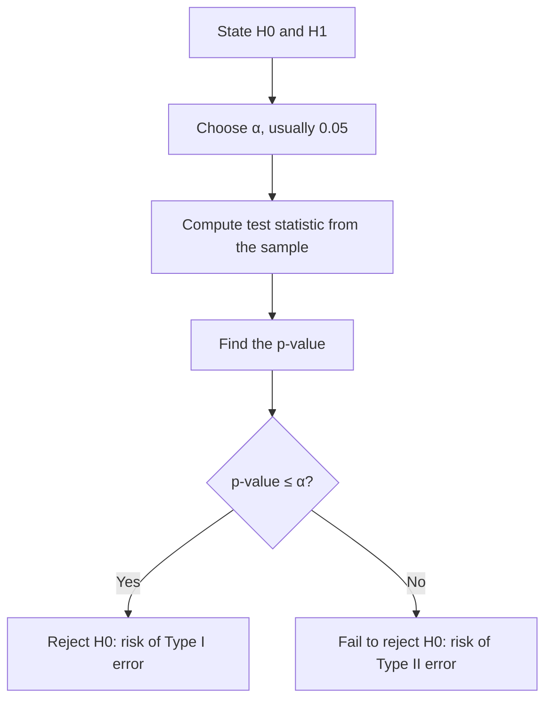

## Why should you care?

A delivery partner promises Sahyadri Mart an average delivery time of 30 minutes. Over 49 deliveries, the average is 32.1 minutes. Is the partner breaking the promise, or is 2.1 minutes just normal day-to-day luck? A new end-of-aisle display is tried, and average daily sales rise from 500 to 520 units. Real improvement, or noise?

Every business that experiments faces this question: **is the difference real, or could chance alone explain it?** Hypothesis testing answers it with a clear rule, and it also forces you to face the two ways of being wrong: crying wolf over a difference that is not there, or missing one that is.

## In one line

Hypothesis testing is a procedure that uses sample data to decide whether there is enough evidence to reject a claim about a population, the null hypothesis, at a chosen risk of error.

## Explained

### Q1. What are the null and alternative hypotheses? ⭐

- ==**Null hypothesis $H_0$:** the claim of "no effect" or "no difference", the status quo.== It always contains equality: $H_0: \mu = 30$.
- ==**Alternative hypothesis $H_1$ (or $H_a$):** what we look for evidence of.== $H_1: \mu \ne 30$, $\mu > 30$ or $\mu < 30$.

==$H_0$ is assumed true unless the data give strong evidence against it==, like "innocent until proven guilty".

- ==**Two-tailed test:** $H_1$ uses ≠== (a difference in either direction).
- ==**One-tailed test:** $H_1$ uses > or <== (a difference in one stated direction).

### Q2. What are the test statistic and the p-value? ⭐

==The **test statistic** measures how far the sample result is from $H_0$, in standard errors.== For a mean:

$$t = \frac{\bar{x} - \mu_0}{s / \sqrt{n}} \quad (\text{df} = n - 1)$$

(use $z$ with σ in place of $s$ when σ is known).

==The **p-value** is the probability of getting a result at least as extreme as the one observed, assuming $H_0$ is true.==

- ==Small p-value: such data would be surprising if $H_0$ were true==, so it is evidence against $H_0$.
- ==Large p-value: the data are consistent with $H_0$.==

### Q3. How is the decision made? [2M]

Choose a **significance level** α before looking at the data, usually 0.05.

- ==If p-value ≤ α: reject $H_0$==. The result is "statistically significant".
- ==If p-value > α: fail to reject $H_0$==. There is not enough evidence.

**Critical value approach (same decision):** reject $H_0$ if the test statistic falls in the **rejection region**, for example $|z| > 1.96$ for a two-tailed test at α = 0.05.

==We never "accept" or "prove" $H_0$==; we only fail to find evidence against it.

### Q4. What are Type I and Type II errors? ⭐

| | $H_0$ actually true | $H_0$ actually false |
|---|---|---|
| **Reject $H_0$** | ==Type I error (false alarm)== | Correct |
| **Fail to reject $H_0$** | Correct | ==Type II error (missed effect)== |

- ==α: the probability of a Type I error==, the risk you choose.
- ==β: the probability of a Type II error==.
- ==**Power** (1 − β): the chance of detecting a real effect==.
- ==Lowering α (stricter test) raises β==, for a fixed sample size.
- ==A larger sample reduces β without raising α.==

### Q5. What are the steps of a hypothesis test? ⭐

1. ==State $H_0$ and $H_1$.==
2. ==Choose the significance level α.==
3. ==Compute the test statistic from the sample.==
4. ==Find the p-value (or the critical value).==
5. ==Decide: reject or fail to reject $H_0$.==
6. ==State the conclusion in business terms.==

### Q6. What is the difference between statistical and practical significance? [2M]

- ==Statistical significance says a difference is unlikely to be chance alone.==
- ==Practical significance asks whether the difference is big enough to matter.==

With a huge sample, a 0.1% rise in sales can be "significant" but worthless. Report the size of the effect with a confidence interval ([[confidence-intervals]]), not just the p-value.

**Link with intervals:** a two-tailed test at α = 0.05 rejects $H_0: \mu = \mu_0$ exactly when $\mu_0$ lies outside the 95% confidence interval.

### Q7. A company claims its packets weigh 500 g on average (σ = 40 g). A sample of 64 packets has mean 510 g. Test the claim at the 5% level. ⭐

1. ==Hypotheses:== $H_0: \mu = 500$; $H_1: \mu \ne 500$ (two-tailed).
2. ==Level of significance:== α = 0.05; critical values ±1.96.
3. ==Test statistic: z is (x̄ − μ0) ÷ (σ/√n)== $= (510 - 500)/(40/8) = 10/5 = 2.0$.
4. ==Decision:== $|z| = 2.0 > 1.96$ (p-value 0.046 < 0.05), so **reject $H_0$**.
5. ==Conclusion: the mean weight differs significantly from 500 g==; the packets appear heavier than claimed.

### Q8. Distinguish between one-tailed and two-tailed tests. [2M]

- ==Two-tailed: $H_1$ uses ≠==; the rejection region is split between both tails (±1.96 at α = 0.05).
- ==One-tailed: $H_1$ uses > or <==; the whole rejection region is in one tail (1.645 at α = 0.05).

The direction must be chosen before seeing the data.

## Analogy and real-life example

A court trial is a hypothesis test. $H_0$: the accused is innocent. The evidence must be strong ("beyond reasonable doubt", a small α) to reject it. Convicting an innocent person is a **Type I error**; letting a guilty person go is a **Type II error**. A stricter standard of proof means fewer wrongful convictions but more guilty people walking free. A verdict of "not guilty" does not prove innocence, just as failing to reject $H_0$ does not prove it.

In business: an A/B test on a website checks $H_0$: "the new button does not change conversion". A Type I error launches a useless change; a Type II error discards a good one.

## Diagram

## Worked example

The partner promises a mean delivery time of 30 minutes. A sample of $n = 49$ deliveries gives $\bar{x} = 32.1$ minutes and $s = 7$ minutes. Test at α = 0.05.

1. $H_0: \mu = 30$; $H_1: \mu \ne 30$ (two-tailed).
2. α = 0.05.
3. $SE = 7/\sqrt{49} = 1$; $t = (32.1 - 30)/1 = 2.10$, with 48 df.
4. Two-tailed p-value $= 0.041$ (from `scipy.stats.t.sf(2.10, 48) * 2`). The critical value is $t^* = 2.011$.
5. $0.041 \le 0.05$ (and $2.10 > 2.011$): **reject $H_0$**.
6. **Conclusion:** the deliveries are significantly slower than promised. Sahyadri Mart has evidence to raise the issue with the partner.

Caution: if the partner is actually on time, this decision is a Type I error, a risk we accepted at 5%.

## Try it

A new display is claimed to raise average daily sales above 500 units. Over 36 days with the display, $\bar{x} = 520$ and $s = 60$. Test $H_0: \mu = 500$ against $H_1: \mu > 500$ at α = 0.05.

Start: $SE = 60/\sqrt{36} = 10$, so $t = (520 - 500)/10 = \;?$

> [!answer]- Answer
> $t = 2.00$ with 35 df. One-tailed p-value $= 0.027$ (critical value $t^* = 1.690$).
> $0.027 \le 0.05$: **reject $H_0$**. The display is associated with significantly higher sales.
> Check practical significance too: 20 extra units a day, about 4%. Is that worth the display's cost?

## Key facts and formulas

> [!important] Key facts
> - $H_0$: no effect, contains equality; $H_1$: the effect we seek evidence for (≠, > or <).
> - Two-tailed: $H_1$ with ≠; one-tailed: $H_1$ with > or <.
> - Test statistic for a mean: $t = \frac{\bar{x} - \mu_0}{s/\sqrt{n}}$ with $n - 1$ df (z if σ known).
> - p-value: probability, assuming $H_0$, of a result at least as extreme as observed.
> - Reject $H_0$ if p-value ≤ α; otherwise fail to reject. Never "accept" $H_0$.
> - Two-tailed critical z at α = 0.05: ±1.96; one-tailed: 1.645.
> - Type I error: reject a true $H_0$; probability α. Type II error: fail to reject a false $H_0$; probability β.
> - Power $= 1 - \beta$; larger $n$ raises power.
> - Statistical significance ≠ practical significance.

## Common mistakes

> [!warning] Common mistake
> Reading the p-value as the probability that $H_0$ is true. A p-value of 0.041 means: if $H_0$ were true, data this extreme would appear 4.1% of the time. It is not a 4.1% chance that the partner is on time.

> [!warning] Common mistake
> Writing "accept $H_0$" when p > α. Lack of evidence is not proof. A small sample may simply be too weak to detect a real difference (a Type II error).

> [!warning] Common mistake
> Choosing a one-tailed test after seeing which way the data went. It halves the p-value and doubles the real chance of a false alarm. Decide the direction before collecting data.

## Think deeper

- **Which error is worse?** For a test of "this batch of medicine is safe", which error is more serious, and how should that change α? For "this ad campaign works"?
- **Many tests, some false alarms:** if a company tests 20 independent product ideas at α = 0.05 and none truly works, about how many will still look "significant"?
- **Correlation tests:** a within-store correlation of 0.27 between ad spend and revenue, over 731 days, gives a tiny p-value. Does that make ads worth their cost? (See [[correlation]].)

## Self-check

> [!quiz] Q1. Which is a correct null hypothesis?
> (A) $H_0: \mu > 30$
> (B) $H_0: \mu = 30$
> (C) $H_0: \bar{x} = 32.1$
> (D) $H_0: \mu \ne 30$
>
> > [!answer]- Answer: B
> > $H_0$ is about a population parameter and contains equality. C is about the sample mean, which is already known.

> [!quiz] Q2. A test gives p-value = 0.08 at α = 0.05. What is the decision?
> (A) Reject $H_0$
> (B) Accept $H_0$ as proven
> (C) Fail to reject $H_0$
> (D) Reject $H_1$ as false
>
> > [!answer]- Answer: C
> > $0.08 > 0.05$, so the evidence is not strong enough. We never say $H_0$ is proven.

> [!quiz] Q3. What is a Type I error?
> (A) Failing to reject a false $H_0$
> (B) Rejecting a true $H_0$
> (C) Using the wrong test statistic
> (D) A calculation mistake
>
> > [!answer]- Answer: B
> > A Type I error is a false alarm; its probability is α.

> [!quiz] Q4. How can you reduce the probability of a Type II error without increasing α?
> (A) Use a smaller sample
> (B) Use a larger sample
> (C) Switch to a two-tailed test
> (D) Lower α to 0.01
>
> > [!answer]- Answer: B
> > A larger sample shrinks the SE, making a real effect easier to detect, so power rises. Lowering α would raise β.

> [!quiz] Q5. $\bar{x} = 52$, $\mu_0 = 50$, $s = 8$, $n = 64$. What is the test statistic?
> (A) 0.25
> (B) 2.0
> (C) 16
> (D) 0.5
>
> > [!answer]- Answer: B
> > $SE = 8/\sqrt{64} = 1$; $t = (52 - 50)/1 = 2.0$.

## Flashcards

What is the null hypothesis? :: The claim of no effect or no difference; it contains equality
What is the alternative hypothesis? :: The claim we look for evidence of (≠, > or <)
One-tailed vs two-tailed test? :: One-tailed: H1 uses > or <; two-tailed: H1 uses ≠
Test statistic for a mean with σ unknown? :: t = (x̄ − μ0) / (s/√n), with n − 1 df
What is a p-value? :: The probability, assuming H0 is true, of a result at least as extreme as the one observed
Decision rule with a p-value? :: Reject H0 if p ≤ α; otherwise fail to reject
What is a Type I error? :: Rejecting a true H0 (false alarm); probability α
What is a Type II error? :: Failing to reject a false H0 (missed effect); probability β
What is power? :: 1 − β: the probability of detecting a real effect
How do you increase power without raising α? :: Increase the sample size
Critical z values at α = 0.05? :: ±1.96 two-tailed; 1.645 one-tailed
Statistical vs practical significance? :: Statistical: unlikely to be chance; practical: big enough to matter
Six steps of a hypothesis test? :: State H0 and H1; choose α; compute statistic; find p-value; decide; conclude in context

## Sources

- James R. Evans, *Business Analytics*, 3rd ed., Pearson, 2021, Ch. 7: Statistical Inference
- Freedman, Pisani & Purves, *Statistics*, 4th ed., Norton, 2007, Ch. 26: Tests of Significance; Ch. 29: A Closer Look at Tests of Significance
