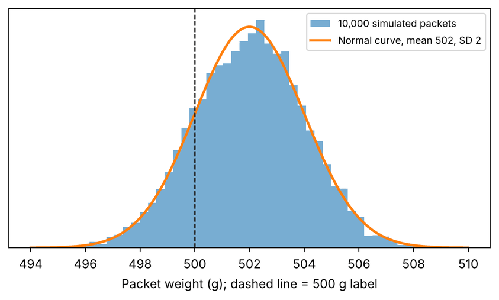

## Aim

To generate random numbers from a normal distribution, analyse their properties (mean, SD, shape, empirical rule, probabilities), and check how well a normal model fits real store footfall.

## Concepts used

- [[normal-distribution]]: properties, empirical rule, z-scores.
- [[skewness-and-kurtosis]]: shape measures used in Steps 2 and 6.

## Setup (Colab)

[Open in Colab](https://colab.research.google.com/github/Prathameshv07/ai-ds-notes/blob/main/content/assets/notebooks/prob-stats/normal-distribution-practical.ipynb). Nothing to install.

- Steps 1–5 use simulated butter-packet weights; Steps 6–7 load the shared sales dataset.
- **Dataset:** Sahyadri Mart daily sales (synthetic; its data card in `content/assets/data/` lists every column). One row = one store on one day.
- The outputs below come from pandas 3.0 and NumPy 2.5; the notebook gives identical numbers on pandas 2.2 and NumPy 2.0 (current Colab).
- Random numbers use `np.random.default_rng(2026)`, a fixed seed, so your results match these exactly when you run the cells in order.

## Code

### Step 1. Generate 10,000 butter-packet weights from a normal distribution, mean 502 g, SD 2 g

```python
# Step 1. Generate 10,000 butter-packet weights from a normal distribution, mean 502 g, SD 2 g
import numpy as np
import pandas as pd
from scipy import stats

rng = np.random.default_rng(2026)
w = rng.normal(loc=502, scale=2, size=10_000)
print("First 8 weights:", np.round(w[:8], 2))
```

### Step 2. Do the simulated weights have the properties of a normal distribution?

```python
# Step 2. Do the simulated weights have the properties of a normal distribution?
s = pd.Series(w)
print(f"Mean   {s.mean():.3f}  (theory 502)    SD {s.std():.3f}  (theory 2)")
print(f"Median {s.median():.3f}  skewness {s.skew():.3f}  (theory 0)    excess kurtosis {s.kurt():.3f}  (theory 0)")
```

### Step 3. Check the empirical rule

```python
# Step 3. Check the empirical rule
for k, theory in [(1, 0.6827), (2, 0.9545), (3, 0.9973)]:
    share = (np.abs(w - 502) <= k * 2).mean()
    print(f"Within {k} SD of the mean: {share:.4f}   (theory {theory})")
```

### Step 4. Probabilities: simulation vs the exact normal model (scipy.stats.norm)

```python
# Step 4. Probabilities: simulation vs the exact normal model (scipy.stats.norm)
exact_mid = stats.norm.cdf(506, 502, 2) - stats.norm.cdf(500, 502, 2)
print(f"P(weight < 500)       : simulated {(w < 500).mean():.4f}, exact {stats.norm.cdf(500, 502, 2):.4f}")
print(f"P(500 < weight < 506) : simulated {((w > 500) & (w < 506)).mean():.4f}, exact {exact_mid:.4f}")
print(f"Mean needed so that only 1% are under 500 g: {500 - stats.norm.ppf(0.01) * 2:.2f} g")
```

### Step 5. Histogram of the simulated weights with the normal curve on top

```python
# Step 5. Histogram of the simulated weights with the normal curve on top
import matplotlib.pyplot as plt

fig, ax = plt.subplots(figsize=(7, 3.5))
ax.hist(w, bins=50, density=True, color="tab:blue", alpha=0.6, label="10,000 simulated packets")
x = np.linspace(494, 510, 300)
ax.plot(x, stats.norm.pdf(x, 502, 2), color="tab:orange", lw=2, label="Normal curve, mean 502, SD 2")
ax.axvline(500, color="black", ls="--", lw=1)
ax.set_xlabel("Packet weight (g); dashed line = 500 g label")
ax.set_yticks([])
ax.legend(fontsize=8)
plt.show()
```

### Step 6. Real data: is S05's ordinary-day footfall close to normal?

```python
# Step 6. Real data: is S05's ordinary-day footfall close to normal?
url = ("https://raw.githubusercontent.com/Prathameshv07/ai-ds-notes/main/"
       "content/assets/data/sahyadri-mart-sales.csv")
df = pd.read_csv(url, parse_dates=["date"])
f = df[(df["store_id"] == "S05") & (df["is_festival"] == 0)]["footfall"]
m, sd = f.mean(), f.std()
print(f"S05 ordinary days: n = {len(f)}, mean {m:.1f}, SD {sd:.1f}, skewness {f.skew():.2f}")
for k, theory in [(1, 0.6827), (2, 0.9545), (3, 0.9973)]:
    print(f"Within {k} SD: {((f - m).abs() <= k * sd).mean():.4f}   (normal {theory})")
```

### Step 7. z-scores: which ordinary days were most unusual for S05?

```python
# Step 7. z-scores: which ordinary days were most unusual for S05?
days = df[(df["store_id"] == "S05") & (df["is_festival"] == 0)].copy()
days["z"] = (days["footfall"] - m) / sd
cols = ["date", "day_of_week", "discount_pct", "rainfall_mm", "footfall", "z"]
top = days.sort_values("z", key=abs, ascending=False)[cols].head(5)
print(top.round({"rainfall_mm": 1, "z": 2}).to_string(index=False))
print(f"\nDays with |z| > 3: {(days['z'].abs() > 3).sum()} of {len(days)}")
```

## Output

### Step 1

```output
First 8 weights: [500.41 502.48 498.21 504.79 503.28 501.42 501.38 502.61]
```

### Step 2

```output
Mean   501.996  (theory 502)    SD 2.011  (theory 2)
Median 502.039  skewness -0.028  (theory 0)    excess kurtosis -0.076  (theory 0)
```

### Step 3

```output
Within 1 SD of the mean: 0.6754   (theory 0.6827)
Within 2 SD of the mean: 0.9562   (theory 0.9545)
Within 3 SD of the mean: 0.9975   (theory 0.9973)
```

### Step 4

```output
P(weight < 500)       : simulated 0.1654, exact 0.1587
P(500 < weight < 506) : simulated 0.8144, exact 0.8186
Mean needed so that only 1% are under 500 g: 504.65 g
```

### Step 5



### Step 6

```output
S05 ordinary days: n = 699, mean 1237.6, SD 224.3, skewness 0.57
Within 1 SD: 0.6738   (normal 0.6827)
Within 2 SD: 0.9614   (normal 0.9545)
Within 3 SD: 0.9957   (normal 0.9973)
```

### Step 7

```output
      date day_of_week  discount_pct  rainfall_mm  footfall    z
2025-12-21      Sunday            15          0.0      2077 3.74
2025-12-28      Sunday            10          0.0      1983 3.32
2024-12-22      Sunday            10          0.0      1961 3.22
2024-12-08      Sunday             5          0.0      1889 2.90
2025-10-11    Saturday             5          0.0      1884 2.88

Days with |z| > 3: 3 of 699
```

## Explanation

### Steps 1–3: do simulated values behave like the theory?

- `rng.normal(loc=502, scale=2, size=10_000)`: `loc` is the mean, `scale` the SD.
- The sample mean (501.996) and SD (2.011) are very close to 502 and 2; skewness and excess kurtosis are near 0, as for any normal distribution.
- ==The empirical rule holds: 67.5%, 95.6% and 99.75% within 1, 2 and 3 SDs.==

### Step 4: probabilities, two ways

| Probability | Simulated | Exact (`scipy.stats.norm`) |
|---|---|---|
| Weight < 500 g | 0.1654 | 0.1587 |
| 500 g to 506 g | 0.8144 | 0.8186 |

`norm.cdf(x, mean, sd)` gives the area to the left of x; `norm.ppf(0.01)` gives the z with 1% to its left (−2.326), so a mean of 504.65 g keeps underweight packets to 1%. These match the theory note's worked example.

### Step 5: the picture

The histogram follows the normal curve closely. The part left of the dashed 500 g line is the 16% of underweight packets.

### Steps 6–7: is real footfall normal?

- S05's footfall on 699 ordinary days has 67.4%, 96.1% and 99.6% within 1, 2 and 3 SDs: close to 68–95–99.7.
- But the skewness is 0.57: a longer right tail, from busy December Sundays and the yearly growth trend.
- ==A normal model is a reasonable first approximation for this footfall, but the right tail is heavier than normal.==
- The five most unusual days (|z| ≥ 2.9) are all weekends, four of them December Sundays with discounts. z-scores point straight at the days worth investigating.

## Try it

Generate 10,000 exam marks from a normal distribution with mean 60 and SD 10. What share is above 75, and what mark cuts off the top 10%? Compare with the exact values from `scipy.stats.norm`.

Start from: `marks = rng.normal(60, 10, size=10_000)`; use `np.percentile(marks, 90)`.

> [!answer]- Answer
> ```python
> rng = np.random.default_rng(1)
> marks = rng.normal(60, 10, size=10_000)
> print(f"Share above 75: {(marks > 75).mean():.4f}   exact {1 - stats.norm.cdf(75, 60, 10):.4f}")
> print(f"Top-10% cut-off: {np.percentile(marks, 90):.1f}   exact {stats.norm.ppf(0.90, 60, 10):.1f}")
> ```
> ```output
> Share above 75: 0.0642   exact 0.0668
> Top-10% cut-off: 72.5   exact 72.8
> ```
> Both simulated values are close to the exact answers from the [[normal-distribution]] note's Try it (6.7% and 72.8).

## Viva questions

1. What do `loc` and `scale` mean in `rng.normal`?
2. State the empirical rule. How closely did the simulation follow it?
3. What do `norm.cdf` and `norm.ppf` return?
4. Why are simulated probabilities slightly different from exact ones? How could you make them closer?
5. S05 footfall follows the empirical rule well but has skewness 0.57. What does that tell you?
6. What is a z-score, and how did it help in Step 7?

## Flashcards

NumPy: normal random numbers with mean m and SD s? :: rng.normal(loc=m, scale=s, size=n)
SciPy: P(X ≤ x) for a normal distribution? :: stats.norm.cdf(x, mean, sd)
SciPy: value with probability q below it? :: stats.norm.ppf(q, mean, sd)
pandas: excess kurtosis of a column? :: s.kurt() (0 for a normal distribution)

## Sources

- [SciPy documentation: scipy.stats.norm](https://docs.scipy.org/doc/scipy/reference/generated/scipy.stats.norm.html)
- [NumPy documentation: Generator.normal](https://numpy.org/doc/stable/reference/random/generated/numpy.random.Generator.normal.html)
- Sahyadri Mart sales dataset: data card in `content/assets/data/sahyadri-mart-sales.md` (synthetic, this site)
