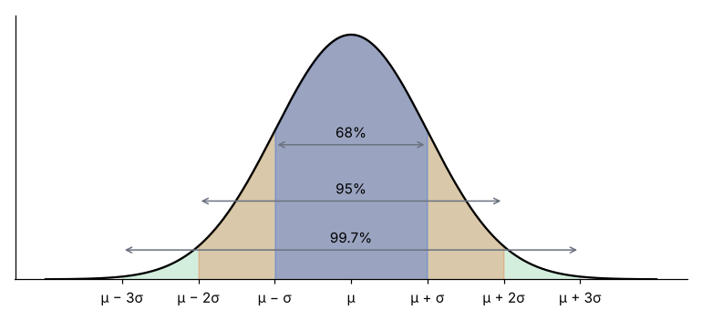
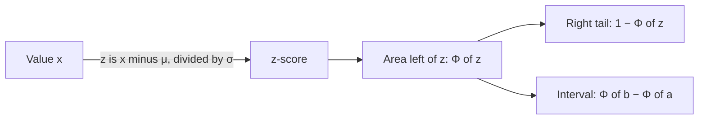

## Why should you care?

A dairy's machine fills butter packets labelled 500 g. No machine is perfect: real weights vary a little around the target. If the machine averages 502 g with an SD of 2 g, how many packets go out underweight, breaking the promise on the label? How high should the average be set so that only 1 in 100 packets is under 500 g?

Questions like this come up in quality control, exam score scaling, finance and every statistical test you will meet. The answer comes from one curve, the **normal distribution**. It is the most important distribution in statistics, because so many measurements, and almost all averages of large samples, follow it.

## In one line

The normal distribution is a symmetric, bell-shaped continuous distribution completely described by its mean μ and standard deviation σ, written $X \sim N(\mu, \sigma^2)$.

## Explained

### Q1. What are the properties of the normal curve? ⭐

- ==**Bell-shaped and symmetric** about the mean μ==.
- ==**Mean, median and mode are equal**== and sit at the centre.
- ==**Two parameters fix it completely**==: μ sets the centre, σ sets the spread.
- ==**The tails never touch the axis**==: extreme values are possible but very rare.
- ==**Total area under the curve is 1**==, half on each side of μ.

Its skewness is 0 and its kurtosis $\beta_2$ is 3 ([[skewness-and-kurtosis]]).

### Q2. What is the empirical (68–95–99.7) rule? ⭐

For any normal distribution:

| Interval | Share of values |
|---|---|
| $\mu \pm 1\sigma$ | about 68% |
| $\mu \pm 2\sigma$ | about 95% |
| $\mu \pm 3\sigma$ | about 99.7% |

==About 68%, 95% and 99.7% of values lie within 1, 2 and 3 SDs of the mean.==

So a value more than 3 SDs from the mean happens only about 3 times in 1,000: ==a useful flag for unusual values==.

### Q3. What is a z-score? ⭐

$$z = \frac{x - \mu}{\sigma}$$

==A z-score says how many standard deviations a value lies above or below the mean.== $z = 2$ means 2 SDs above; $z = -1.5$ means 1.5 SDs below.

Converting every value to $z$ turns any normal distribution into the ==**standard normal distribution** $Z \sim N(0, 1)$==, with mean 0 and SD 1. One table (or one software function) then serves every normal problem.

z-scores also compare values on different scales: 78 in a tough paper may beat 85 in an easy one.

### Q4. How do I find a normal probability?

1. ==Draw the curve and shade the area you want.==
2. ==Convert the boundary values to z-scores.==
3. ==Look up the area to the left of z==: the standard normal CDF $\Phi(z)$, from a z-table, Excel `NORM.S.DIST(z, TRUE)` or Python `scipy.stats.norm.cdf(z)`.
4. ==Use symmetry and the complement==: $P(Z > z) = 1 - \Phi(z)$; $P(a < Z < b) = \Phi(b) - \Phi(a)$.

Useful values: $\Phi(1) = 0.8413$, $\Phi(1.645) = 0.95$, $\Phi(1.96) = 0.975$, $\Phi(2) = 0.9772$, $\Phi(2.326) = 0.99$.

### Q5. How do I go backwards, from a probability to a value?

To find the value with a given share below it (a percentile):
1. ==Find the z with that area to its left== (Excel `NORM.S.INV`, Python `norm.ppf`).
2. ==Convert back== to a value: $x = \mu + z\sigma$.

Example: the top 5% of a test with $\mu = 60$, $\sigma = 10$ starts at $z = 1.645$, that is $x = 60 + 1.645 \times 10 = 76.45$ marks.

### Q6. Why is the normal distribution so important? ⭐

- ==Many measurements are roughly normal==: heights, filling weights, measurement errors.
- ==**Averages of large samples are approximately normal**, whatever the shape of the data== ([[sampling-distributions|central limit theorem]]). This is why confidence intervals and hypothesis tests use $z$ values such as 1.96.
- ==It is the default assumption== in many models, from regression errors to risk models.

But not everything is normal: incomes, sales and waiting times are usually right-skewed.

### Q7. The weights of adults are normal with mean 70 kg and SD 5 kg. Find the share of adults weighing between 65 kg and 80 kg, and the share above 78 kg. (Φ(1) = 0.8413, Φ(1.6) = 0.9452, Φ(2) = 0.9772) ⭐

1. ==Convert to z-scores: z is (x − μ) ÷ σ.== For 65: $z = -1$; for 80: $z = 2$; for 78: $z = 1.6$.
2. ==Between 65 and 80: Φ(2) − Φ(−1)== $= 0.9772 - (1 - 0.8413) = 0.9772 - 0.1587 = 0.8185$, about **81.9%**.
3. ==Above 78: right tail, 1 − Φ(1.6)== $= 1 - 0.9452 = 0.0548$, about **5.5%**.

## Analogy and real-life example

Think of a Galton board: balls dropped through rows of pins bounce left or right at random, and pile up in a bell shape at the bottom. Each ball's final position is the sum of many small random nudges, and sums of many small independent effects tend to be normal. That is why filling weights, which are pushed by many small machine variations, are close to normal.

Real use: Six Sigma quality programmes aim for processes so tight that the nearest specification limit is 6 SDs from the mean, making defects extremely rare.

## Diagram

## Worked example

Butter packets: weight $X \sim N(502, 2^2)$, in grams.

1. **Underweight packets:** $P(X < 500)$. $z = (500 - 502)/2 = -1$. $\Phi(-1) = 1 - 0.8413 = 0.1587$. About **15.9%** of packets are underweight.
2. **Between 500 g and 506 g:** $z = -1$ and $z = (506 - 502)/2 = 2$. $P = \Phi(2) - \Phi(-1) = 0.9772 - 0.1587 = 0.8185$.
3. **Setting the machine:** we want only 1% under 500 g. The z with 1% to its left is $-2.326$. So $500 = \mu - 2.326 \times 2$, giving $\mu = 504.65$ g.

**Conclusion:** at 502 g the machine fails the label on 1 packet in 6. Raising the average to about 504.7 g (or reducing σ) cuts that to 1 in 100. Reducing variation is usually cheaper than giving away extra butter.

## Try it

Exam marks are normal with $\mu = 60$ and $\sigma = 10$. What share of students score above 75? What mark is needed to be in the top 10%?

Start: $z = (75 - 60)/10 = 1.5$, and $\Phi(1.5) = 0.9332$.

> [!answer]- Answer
> $P(X > 75) = 1 - 0.9332 = 0.0668$: about **6.7%** score above 75.
> Top 10%: the z with 90% to its left is $1.2816$, so $x = 60 + 1.2816 \times 10 = 72.8$ marks.

## Key facts and formulas

> [!important] Key facts
> - $X \sim N(\mu, \sigma^2)$: symmetric bell; mean = median = mode = μ; skewness 0, $\beta_2 = 3$.
> - Empirical rule: about 68%, 95%, 99.7% within 1, 2, 3 SDs of the mean.
> - z-score: $z = \frac{x - \mu}{\sigma}$; standard normal $Z \sim N(0, 1)$.
> - $P(X \le x) = \Phi(z)$; $P(X > x) = 1 - \Phi(z)$; $P(a < X < b) = \Phi(z_b) - \Phi(z_a)$.
> - Symmetry: $\Phi(-z) = 1 - \Phi(z)$.
> - Inverse: $x = \mu + z\sigma$.
> - Key z values: 1.645 (95% below), 1.96 (97.5% below; 95% within ±1.96), 2.326 (99% below), 2.576 (99% within ±2.576).

## Common mistakes

> [!warning] Common mistake
> Forgetting the complement. A z-table gives the area to the **left**. $P(X > 75)$ is $1 - \Phi(1.5)$, not $\Phi(1.5)$.

> [!warning] Common mistake
> Using the variance instead of the SD in the z-score. In $N(502, 4)$ the 4 is $\sigma^2$; divide by $\sigma = 2$, not 4.

> [!warning] Common mistake
> Assuming data are normal because the normal is convenient. Daily revenue, incomes and waiting times are skewed; the empirical rule can then badly misjudge the tails. Look at a histogram first.

## Think deeper

- **Fat tails:** stock returns have more extreme days than a normal model predicts (they are leptokurtic). What goes wrong if a bank's risk model assumes normality?
- **Shift or shrink?** In the worked example, would you rather raise μ to 504.65 g or cut σ from 2 g to 1 g? Compute the underweight share for each.
- **Grading on a curve:** if marks are scaled so the top 10% get an O grade, what happens when a whole class does very well?

## Self-check

> [!quiz] Q1. In a normal distribution, about what share of values lies within 2 SDs of the mean?
> (A) 68%
> (B) 90%
> (C) 95%
> (D) 99.7%
>
> > [!answer]- Answer: C
> > The empirical rule: 68% within 1 SD, 95% within 2 SDs, 99.7% within 3 SDs.

> [!quiz] Q2. $\mu = 50$, $\sigma = 5$. What is the z-score of $x = 42$?
> (A) 1.6
> (B) −1.6
> (C) −8
> (D) 0.84
>
> > [!answer]- Answer: B
> > $z = (42 - 50)/5 = -1.6$: 1.6 SDs below the mean.

> [!quiz] Q3. For $Z \sim N(0, 1)$, $\Phi(1.2) = 0.8849$. What is $P(Z > 1.2)$?
> (A) 0.8849
> (B) 0.1151
> (C) 0.7698
> (D) 0.3849
>
> > [!answer]- Answer: B
> > Right tail $= 1 - 0.8849 = 0.1151$.

> [!quiz] Q4. In a normal distribution, which statement is true?
> (A) Mean > median > mode
> (B) Mean = median = mode
> (C) Mean < median < mode
> (D) The mode is undefined
>
> > [!answer]- Answer: B
> > The normal curve is symmetric with a single peak at the centre, so all three coincide.

> [!quiz] Q5. Why do hypothesis tests about averages use normal z values even when the data are skewed?
> (A) Skewed data become normal when sorted
> (B) The central limit theorem makes sample means approximately normal for large samples
> (C) Business data are always normal
> (D) The z value does not depend on the distribution
>
> > [!answer]- Answer: B
> > Means of large samples are approximately normal whatever the population's shape ([[sampling-distributions|central limit theorem]]).

## Flashcards

What two parameters define a normal distribution? :: The mean μ and the standard deviation σ
Mean, median and mode in a normal distribution? :: All equal, at the centre
Empirical rule? :: About 68%, 95% and 99.7% of values within 1, 2 and 3 SDs of the mean
Formula for a z-score? :: z = (x − μ) / σ
What is the standard normal distribution? :: The normal distribution with mean 0 and SD 1
P(X > x) from the z-table? :: 1 − Φ(z)
Converting a z back to a value? :: x = μ + zσ
z with 95% of the area to its left? :: 1.645
z values enclosing the middle 95%? :: ±1.96
Skewness and β2 of a normal distribution? :: Skewness 0; β2 = 3

## Sources

- James R. Evans, *Business Analytics*, 3rd ed., Pearson, 2021, Ch. 5: Probability Distributions and Data Modeling
- Freedman, Pisani & Purves, *Statistics*, 4th ed., Norton, 2007, Ch. 5: The Normal Approximation for Data
- NIST/SEMATECH *e-Handbook of Statistical Methods*, Section 1.3.6: Probability Distributions
