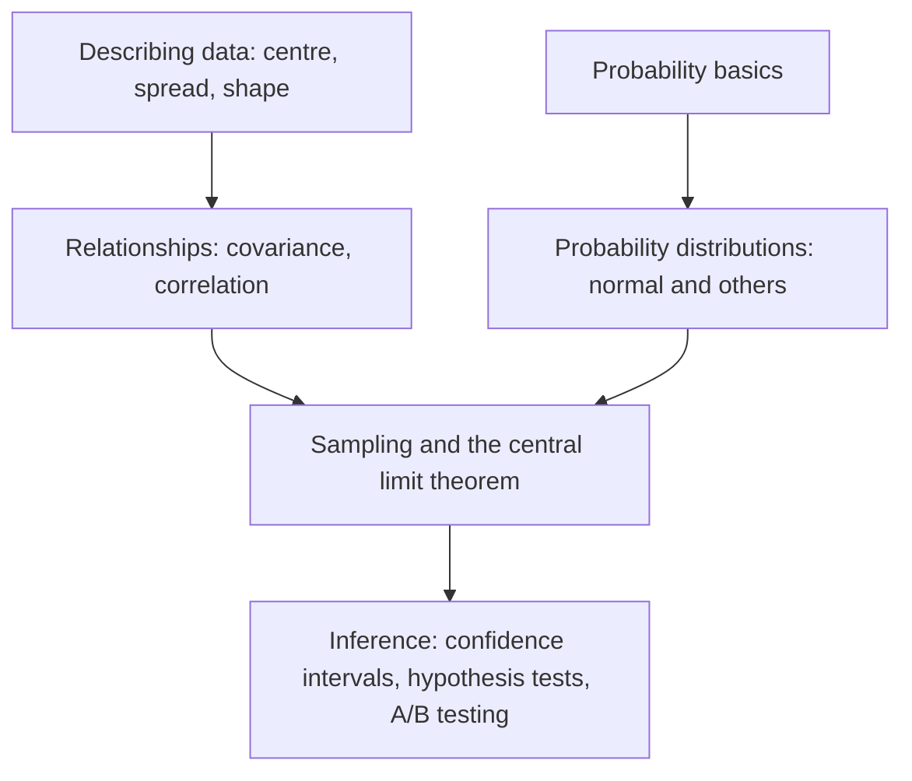

## Why this subject matters

A food-delivery company has two delivery partners. Both have an **average** delivery time of 30 minutes. The manager is happy with both.

Customers are not. Partner A always arrives in 28 to 32 minutes. Partner B sometimes takes 10 minutes and sometimes 50. The average hid the real story: one is reliable, the other is a gamble.

Three questions decide what the manager should do:
- **What is typical?** (centre)
- **How much does it vary?** (spread)
- **How sure can we be?** (probability)

Statistics answers the first two. Probability answers the third. Together they turn a pile of numbers into a decision you can defend. Every data science job, and every machine learning model, is built on them.

## A short story

During the Second World War, American bombers came back from missions full of bullet holes. Most holes were on the wings and the body; very few were on the engines. The obvious plan was to add armour where the holes were.

The statistician Abraham Wald, working with the Statistical Research Group at Columbia University, saw the flaw. The planes being studied were the ones that **came back**. Planes hit in the engines mostly did not return, so their holes never reached the data. The armour belonged where the surviving planes had **no** holes.

This mistake now has a name: **survivorship bias**. The lesson for you: data can be accurate and still mislead, if you forget to ask where it came from and what is missing.

Closer home, P. C. Mahalanobis founded the Indian Statistical Institute in Kolkata in 1931 and designed India's large-scale sample surveys. His birthday, 29 June, is observed as National Statistics Day in India.

## Where it is used today

- **E-commerce and apps:** an app shows two versions of a "Buy now" button to different users and checks whether the difference in sales is real or just luck. This is A/B testing.
- **Banking and loans:** credit scores estimate how likely a borrower is to repay.
- **Weather:** a forecast of "70% chance of rain" is a probability statement.
- **Cricket broadcasts:** live win-probability graphs update after every ball.
- **Medicine:** vaccine and drug trials use hypothesis tests to show a treatment works better than a placebo.
- **Manufacturing:** quality-control charts flag a machine before it produces a batch of faulty parts.
- **Machine learning and AI:** models measure their error with statistics, and a language model chooses its next word from a probability distribution.

## What you will be able to do

After this subject you will be able to:
- Summarise any dataset by its typical value ([[central-tendency]]) and its spread ([[dispersion]], [[quartiles-and-percentiles]]).
- Describe the shape of data: is it lopsided, or does it have extreme values? ([[skewness-and-kurtosis]])
- Measure whether two variables move together, and avoid confusing that with cause and effect ([[covariance]], [[correlation]]).
- Calculate probabilities and use the normal distribution, one of the most common patterns in data.
- Draw conclusions about a whole population from a sample, with a stated level of confidence.
- Test a claim, such as "the new button increased sales", and know how likely you are to be wrong.
- Do all of the above in Python on Google Colab, with real business data.

## Careers that use it

- **Data analyst / business analyst:** summarises data and reports what it means for the business.
- **Data scientist:** builds models and runs experiments; statistics is the core of the job interview.
- **ML engineer:** evaluates models, tunes them, and checks that they keep working on new data.
- **AI researcher:** designs experiments and proves that a new method is genuinely better, not lucky.
- **Actuary and risk analyst:** prices insurance and measures financial risk using probability.
- **Biostatistician:** designs and analyses clinical trials and public-health studies.

## Map of the subject

Applied Business Analytics Unit 1 covers the first two boxes: describing data, then relationships. Unit 2 covers probability, distributions, sampling and inference. Graphs of distributions (histograms, box plots, scatter plots) are taught in the Data Visualization subject and linked from these notes.

## Sources

- James R. Evans, *Business Analytics*, Pearson, Ch. 1 and Ch. 4 (verify)
- Freedman, Pisani & Purves, *Statistics*, 4th ed., Norton, Ch. 1 (verify)
- Mangel & Samaniego, "Abraham Wald's Work on Aircraft Survivability", *Journal of the American Statistical Association*, 79(386), 1984 (verify)
- Indian Statistical Institute, "About ISI", isical.ac.in (verify)
