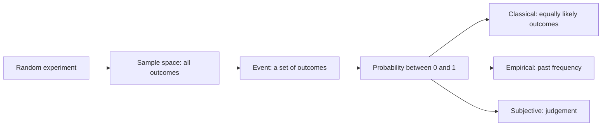

## Why should you care?

At Sahyadri Mart, about 64 of every 100 people who walk in end up buying something. The manager wants to know: if 1,000 people come in on Saturday, how many bills should the counters be ready for? What is the chance that tomorrow is one of the store's best sales days? Should the store stock extra umbrellas when the forecast says "70% chance of rain"?

Every one of these is a question about **uncertainty**. Probability is the language for it. It turns "maybe" and "probably" into numbers you can calculate with, compare and plan around. Every later topic in this unit, from distributions to hypothesis tests, is built on it.

## In one line

Probability is a number between 0 and 1 that measures how likely an event is to happen, where 0 means impossible and 1 means certain.

## Explained

### Q1. What are the basic terms? ⭐

| Term | Meaning | Example |
|---|---|---|
| Random experiment | ==An action whose outcome cannot be predicted with certainty== | A customer enters the store |
| Outcome | ==One possible result== | The customer buys |
| Sample space $S$ | ==The set of all possible outcomes== | {buys, does not buy} |
| Event | ==Any set of outcomes== | "Rolling an even number" = {2, 4, 6} |

Probability is written $P(A)$: the probability of event $A$.

### Q2. What are the three ways to assign a probability? ⭐

- ==**Classical (a priori):** favourable outcomes ÷ total outcomes==, when all outcomes are equally likely. A die: $P(6) = 1/6$.
- ==**Empirical (relative frequency):**== how often the event happened in past data. 64 buyers out of 100 visitors gives $P(\text{buy}) = 0.64$.
- ==**Subjective:** a person's informed judgement==, when there is no data, such as a manager's view that a new product has a 30% chance of success.

Business analytics mostly uses empirical probabilities, estimated from data.

### Q3. What rules must every probability follow?

1. ==$0 \le P(A) \le 1$== for any event $A$.
2. ==The probabilities of all outcomes in the sample space add up to 1==.
3. **Complement rule:** the event "not $A$", written $A'$ or $A^c$, has

$$P(A') = 1 - P(A)$$

==Use the complement when "not A" is easier to count.== If $P(\text{buy}) = 0.64$, then $P(\text{does not buy}) = 0.36$.

### Q4. What kinds of events should I know? ⭐

- ==**Mutually exclusive:** cannot happen together==. A single bill cannot be paid entirely by UPI and entirely by cash.
- ==**Exhaustive:** together they cover the whole sample space==. UPI, cash and card, if those are the only payment methods.
- ==**Equally likely:** each has the same chance==, as with the faces of a fair die.
- ==**Independent:** one happening does not change the chance of the other==. Two separate coin tosses. This idea needs [[conditional-probability]].

### Q5. What is the addition rule? ⭐

The probability that $A$ **or** $B$ (or both) happens:

$$P(A \cup B) = P(A) + P(B) - P(A \cap B)$$

==Subtract the overlap, because it was counted twice.== $A \cap B$ means "both $A$ and $B$".

==For mutually exclusive events the overlap is 0==, so the rule becomes $P(A \cup B) = P(A) + P(B)$.

Example: a card from a deck of 52. $P(\text{king or heart}) = \frac{4}{52} + \frac{13}{52} - \frac{1}{52} = \frac{16}{52}$, because the king of hearts is in both groups.

### Q6. Why does the empirical approach work?

The **law of large numbers**: ==as an experiment is repeated more and more times, the relative frequency of an event settles close to its true probability.==

Toss a fair coin 10 times and you may get 7 heads (70%). Toss it 10,000 times and you will get very close to 50%. This is why data-based probabilities need enough data, and why computer **simulation** can estimate probabilities that are hard to calculate ([[probability-simulation-practical]]).

## Analogy and real-life example

A weather forecast of "70% chance of rain" is an empirical probability: on past days with similar conditions, it rained on about 70 out of 100. It does not mean it will rain for 70% of the day, or over 70% of the city.

Insurance companies live on the law of large numbers. They cannot predict which customer will claim, but across lakhs of policies the claim rate is very stable, so they can price premiums safely.

## Diagram

## Worked example

A store records 200 customers by payment method and bill size (big bill: over ₹500).

| | Big bill | Small bill | Total |
|---|---|---|---|
| UPI | 50 | 70 | 120 |
| Cash | 10 | 40 | 50 |
| Card | 20 | 10 | 30 |
| **Total** | **80** | **120** | **200** |

1. $P(\text{UPI}) = 120/200 = 0.60$; $P(\text{Big}) = 80/200 = 0.40$.
2. $P(\text{UPI} \cap \text{Big}) = 50/200 = 0.25$.
3. Addition rule: $P(\text{UPI} \cup \text{Big}) = 0.60 + 0.40 - 0.25 = 0.75$.
   Check by counting: 120 UPI customers + 30 big-bill customers who did not use UPI = 150, and $150/200 = 0.75$.
4. Complement: $P(\text{not cash}) = 1 - 50/200 = 0.75$.
5. UPI, cash and card are mutually exclusive and exhaustive: $0.60 + 0.25 + 0.15 = 1$.

The same table is used again in [[conditional-probability]].

## Try it

A fair die is rolled once. Find $P(\text{even or greater than 4})$.

Start: $P(\text{even}) = 3/6$, $P(> 4) = 2/6$. Which outcome is in both events?

> [!answer]- Answer
> Only 6 is both even and greater than 4, so $P(\text{both}) = 1/6$. $P(\text{even or} > 4) = 3/6 + 2/6 - 1/6 = 4/6 = 2/3$. Check by listing: {2, 4, 5, 6} is 4 outcomes out of 6.

## Key facts and formulas

> [!important] Key facts
> - $0 \le P(A) \le 1$; $P(S) = 1$.
> - Classical: $P(A) = \frac{\text{favourable outcomes}}{\text{total outcomes}}$ (equally likely outcomes).
> - Empirical: $P(A) = \frac{\text{times A happened}}{\text{number of trials}}$.
> - Complement: $P(A') = 1 - P(A)$.
> - Addition rule: $P(A \cup B) = P(A) + P(B) - P(A \cap B)$.
> - Mutually exclusive: $P(A \cap B) = 0$, so $P(A \cup B) = P(A) + P(B)$.
> - Law of large numbers: relative frequency approaches the true probability as trials increase.

## Common mistakes

> [!warning] Common mistake
> Adding probabilities of events that overlap. $P(\text{UPI}) + P(\text{Big}) = 1.00$ looks like "certain", but the true answer is 0.75: the 50 big UPI bills were counted twice.

> [!warning] Common mistake
> The gambler's fallacy: "the coin showed heads five times, so tails is due". Independent tosses have no memory; the next toss is still 50–50. The law of large numbers works by swamping early streaks, not by correcting them.

> [!warning] Common mistake
> Confusing mutually exclusive with independent. Mutually exclusive events cannot happen together, so if one happens the other's probability becomes 0. That is the strongest possible dependence.

## Think deeper

- **How much data is enough?** If a new store had 8 buyers among its first 10 visitors, would you trust $P(\text{buy}) = 0.8$? What changes with 10,000 visitors?
- **Subjective probabilities in business:** a startup's founders say there is a 60% chance their product succeeds. How could you check whether people who make such claims are well calibrated?
- **Rare events:** a payment gateway fails on 1 transaction in 10,000. A large app makes a crore transactions a day. Is failure "rare" for the app?

## Self-check

> [!quiz] Q1. Which of these cannot be a probability?
> (A) 0
> (B) 0.999
> (C) 1.2
> (D) 1
>
> > [!answer]- Answer: C
> > Every probability lies between 0 and 1 inclusive. 1.2 is impossible.

> [!quiz] Q2. $P(\text{rain tomorrow}) = 0.3$. What is $P(\text{no rain tomorrow})$?
> (A) 0.3
> (B) 0.7
> (C) 1.3
> (D) Cannot tell
>
> > [!answer]- Answer: B
> > Complement rule: $1 - 0.3 = 0.7$.

> [!quiz] Q3. $P(A) = 0.5$, $P(B) = 0.4$ and $P(A \cap B) = 0.2$. What is $P(A \cup B)$?
> (A) 0.9
> (B) 0.7
> (C) 0.2
> (D) 0.1
>
> > [!answer]- Answer: B
> > $0.5 + 0.4 - 0.2 = 0.7$. Option A forgets to subtract the overlap.

> [!quiz] Q4. In past data, 384 of 8,772 store-days were festival days. Which approach gives $P(\text{festival}) \approx 0.044$?
> (A) Classical
> (B) Empirical
> (C) Subjective
> (D) Axiomatic
>
> > [!answer]- Answer: B
> > It is a relative frequency from past data: an empirical probability.

> [!quiz] Q5. A fair coin shows heads 6 times in a row. What is the probability of heads on the 7th toss?
> (A) Less than 0.5, because tails is due
> (B) 0.5
> (C) More than 0.5, because heads is "hot"
> (D) $1/2^7$
>
> > [!answer]- Answer: B
> > Tosses are independent; the coin has no memory. $1/2^7$ is the probability of 7 heads in a row *before* any toss is made.

## Flashcards

What is probability? :: A number from 0 to 1 measuring how likely an event is (0 impossible, 1 certain)
What is a sample space? :: The set of all possible outcomes of a random experiment
What is an event? :: Any set of outcomes from the sample space
Classical probability formula? :: Favourable outcomes ÷ total outcomes (all outcomes equally likely)
What is empirical probability? :: The relative frequency of an event in past data or repeated trials
Complement rule? :: P(not A) = 1 − P(A)
Addition rule? :: P(A or B) = P(A) + P(B) − P(A and B)
Addition rule for mutually exclusive events? :: P(A or B) = P(A) + P(B)
What are mutually exclusive events? :: Events that cannot happen together
What does the law of large numbers say? :: With more trials, the relative frequency of an event gets closer to its true probability
What is the gambler's fallacy? :: Believing that past independent outcomes change the chance of the next one

## Sources

- James R. Evans, *Business Analytics*, 3rd ed., Pearson, 2021, Ch. 5: Probability Distributions and Data Modeling
- Freedman, Pisani & Purves, *Statistics*, 4th ed., Norton, 2007, Ch. 13: What Are the Chances?; Ch. 14: More about Chance
- S. C. Gupta and V. K. Kapoor, *Fundamentals of Mathematical Statistics*, Sultan Chand, chapter "Theory of Probability"
