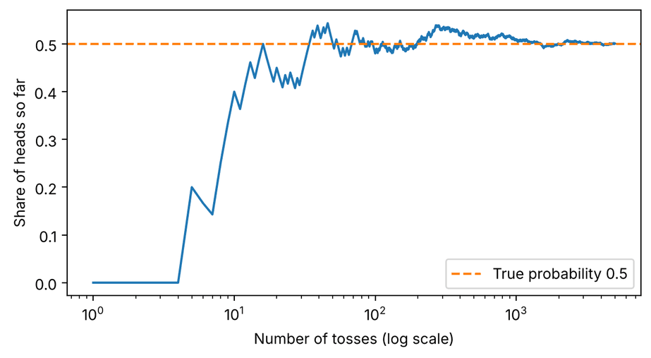

## Aim

To simulate probability experiments (coin tosses, dice rolls and customer visits) using Python, and to see how simulated relative frequencies approach theoretical probabilities.

## Concepts used

- [[probability-basics]]: classical and empirical probability, the law of large numbers.
- [[discrete-distributions]]: the binomial model for the number of buyers.

## Setup (Colab)

[Open in Colab](https://colab.research.google.com/github/Prathameshv07/ai-ds-notes/blob/main/content/assets/notebooks/prob-stats/probability-simulation-practical.ipynb). Nothing to install.

- Steps 1–5 need no data; Step 6 loads the shared sales dataset.
- **Dataset:** Sahyadri Mart daily sales (synthetic; its data card in `content/assets/data/` lists every column). One row = one store on one day.
- The outputs below come from pandas 3.0 and NumPy 2.5; the notebook gives identical numbers on pandas 2.2 and NumPy 2.0 (current Colab).
- Random numbers use `np.random.default_rng(2026)`, a fixed seed, so your results match these exactly when you run the cells in order.

## Code

### Step 1. Set up a random number generator (fixed seed: everyone gets the same numbers)

```python
# Step 1. Set up a random number generator (fixed seed: everyone gets the same numbers)
import numpy as np
import pandas as pd

rng = np.random.default_rng(2026)
print("Ten rolls of a die:", rng.integers(1, 7, size=10))
```

### Step 2. Toss a fair coin n times and find the share of heads

```python
# Step 2. Toss a fair coin n times and find the share of heads
for n in [10, 100, 1_000, 100_000]:
    tosses = rng.integers(0, 2, size=n)          # 1 = heads, 0 = tails
    print(f"n = {n:>7,}: share of heads = {tosses.mean():.4f}")
```

### Step 3. Law of large numbers: the running share of heads settles near 0.5

```python
# Step 3. Law of large numbers: the running share of heads settles near 0.5
import matplotlib.pyplot as plt

tosses = rng.integers(0, 2, size=5_000)
running = tosses.cumsum() / np.arange(1, 5_001)
fig, ax = plt.subplots(figsize=(7, 3.5))
ax.plot(np.arange(1, 5_001), running, color="tab:blue")
ax.axhline(0.5, color="tab:orange", ls="--", label="True probability 0.5")
ax.set_xscale("log")
ax.set_xlabel("Number of tosses (log scale)")
ax.set_ylabel("Share of heads so far")
ax.legend()
plt.show()
print(f"After 10 tosses: {running[9]:.2f} | after 100: {running[99]:.2f} | after 5,000: {running[-1]:.3f}")
```

### Step 4. Roll a die 60,000 times: each face should appear about 1/6 of the time

```python
# Step 4. Roll a die 60,000 times: each face should appear about 1/6 of the time
rolls = rng.integers(1, 7, size=60_000)
freq = pd.Series(rolls).value_counts().sort_index()
print(pd.DataFrame({"count": freq, "share": (freq / len(rolls)).round(4)}).to_string())
print(f"Theory: 1/6 = {1/6:.4f}")
```

### Step 5. Simulate customers: 1,257 visitors a day, each buys with probability 0.64

```python
# Step 5. Simulate customers: 1,257 visitors a day, each buys with probability 0.64
visitors, p_buy = 1257, 0.64
buys = rng.random(visitors) < p_buy              # True if this visitor buys
print("Buyers on one simulated day:", buys.sum(), f"(expected {visitors * p_buy:.0f})")
days = rng.binomial(n=visitors, p=p_buy, size=731)   # 731 simulated days in one line
print(f"Over 731 simulated days: mean buyers {days.mean():.1f}, SD {days.std(ddof=1):.1f}")
```

### Step 6. Compare with the real S05 store: does real conversion vary more than chance alone?

```python
# Step 6. Compare with the real S05 store: does real conversion vary more than chance alone?
url = ("https://raw.githubusercontent.com/Prathameshv07/ai-ds-notes/main/"
       "content/assets/data/sahyadri-mart-sales.csv")
df = pd.read_csv(url, parse_dates=["date"])
s05 = df[df["store_id"] == "S05"]
real_conv = s05["transactions"] / s05["footfall"]
sim_conv = days / visitors
print(f"Real S05 conversion : mean {real_conv.mean():.3f}, SD {real_conv.std():.4f}")
print(f"Simulated conversion: mean {sim_conv.mean():.3f}, SD {sim_conv.std(ddof=1):.4f}")
```

## Output

### Step 1

```output
Ten rolls of a die: [6 2 1 4 3 3 1 3 4 3]
```

### Step 2

```output
n =      10: share of heads = 0.7000
n =     100: share of heads = 0.4600
n =   1,000: share of heads = 0.4850
n = 100,000: share of heads = 0.4995
```

### Step 3



```output
After 10 tosses: 0.40 | after 100: 0.48 | after 5,000: 0.501
```

### Step 4

```output
   count   share
1  10038  0.1673
2  10023  0.1670
3   9999  0.1666
4   9941  0.1657
5   9997  0.1666
6  10002  0.1667
Theory: 1/6 = 0.1667
```

### Step 5

```output
Buyers on one simulated day: 816 (expected 804)
Over 731 simulated days: mean buyers 805.4, SD 16.9
```

### Step 6

```output
Real S05 conversion : mean 0.635, SD 0.0393
Simulated conversion: mean 0.641, SD 0.0134
```

## Explanation

### Steps 1–2: random numbers and coin tosses

- `rng.integers(0, 2, size=n)` gives n random 0s and 1s, each with probability 1/2: a fair coin.
- With 10 tosses the share of heads was 0.70; with 100,000 it was 0.4995.
- ==Small samples can be far from the true probability; large ones are close.==

### Step 3: the law of large numbers

The running share jumps around for the first few dozen tosses, then settles at 0.5. This is the law of large numbers in a picture. The early swings are not "corrected" later; they are simply swamped by thousands of later tosses.

### Step 4: a fair die

Each face appeared between 9,941 and 10,038 times in 60,000 rolls: every share is within 0.001 of $1/6 = 0.1667$. ==Simulation confirms the classical probability.==

### Steps 5–6: simulating customers, and checking against reality

- Each simulated visitor buys if a uniform random number is below 0.64. Over 731 simulated days the mean was 805.4 buyers (theory $np = 804$) with SD 16.9 (theory $\sqrt{np(1-p)} = 17.0$).
- Real S05 conversion has almost the same mean (0.635 vs 0.641) but **three times the spread** (SD 0.039 vs 0.013).
- ==The simple model gets the average right but not the variation.== Real days differ in discounts, crowd mix and weather, so the buying probability itself changes from day to day. Comparing a simulation with real data is how analysts find what a model leaves out.

## Try it

The 17th-century gambler's question: in 4 rolls of a die, what is the probability of at least one six? Simulate 100,000 games and compare with the exact answer $1 - (5/6)^4$.

Start from: `rolls = rng.integers(1, 7, size=(100_000, 4))`, then check each row for a 6.

> [!answer]- Answer
> ```python
> rng = np.random.default_rng(1)
> rolls = rng.integers(1, 7, size=(100_000, 4))          # 100,000 games of 4 rolls each
> at_least_one_six = (rolls == 6).any(axis=1)
> print(f"Simulated: {at_least_one_six.mean():.4f}   exact: {1 - (5/6)**4:.4f}")
> ```
> ```output
> Simulated: 0.5153   exact: 0.5177
> ```
> Slightly better than even: a bet on "at least one six in four rolls" wins about 52% of the time.

## Viva questions

1. What does `np.random.default_rng(2026)` do, and why fix the seed?
2. State the law of large numbers. How does Step 3 show it?
3. With 10 tosses we got 70% heads. Does that mean the coin is biased? Why not?
4. How does `rng.random(n) < 0.64` simulate a customer who buys with probability 0.64?
5. Why does the real conversion rate vary more than the simulated one?
6. Give one business question you could answer by simulation that is hard to answer with a formula.

## Flashcards

How do you simulate a fair coin in NumPy? :: rng.integers(0, 2, size=n)
How do you simulate a die roll in NumPy? :: rng.integers(1, 7, size=n)
How do you simulate an event with probability p? :: rng.random(n) < p
How do you simulate binomial counts directly? :: rng.binomial(n, p, size=k)
Why set a random seed? :: So the same random numbers, and results, can be reproduced

## Sources

- [NumPy documentation: Random Generator](https://numpy.org/doc/stable/reference/random/generator.html)
- Sahyadri Mart sales dataset: data card in `content/assets/data/sahyadri-mart-sales.md` (synthetic, this site)
