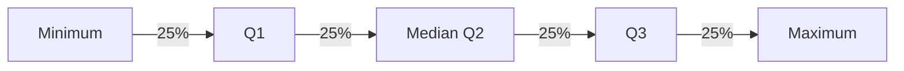

## Why should you care?

Two friends take CAT. One scores 99 percentile, the other 99 marks out of 198. Which one gets the IIM call?

The percentile, and it is not a percentage. "99 percentile" means the candidate did better than 99% of everyone who sat the exam. Marks alone tell you nothing until you know where they sit among others.

Businesses think the same way. A delivery app promises "90% of orders within 35 minutes": that is the 90th percentile. A bank flags transactions above the 99th percentile as unusual. Positions in ordered data answer questions that an average and an SD cannot.

## In one line

Quartiles, deciles and percentiles are values that divide ordered data into 4, 10 and 100 equal parts, and the interquartile range (Q3 − Q1) measures the spread of the middle half of the data.

## Explained

### Q1. What are quartiles, deciles and percentiles?

==All three are **positional averages**== (quantiles): ==values found from the position of data arranged in order==.

| Measure | Divides data into | Values | Example |
|---|---|---|---|
| Quartiles | 4 equal parts | $Q_1, Q_2, Q_3$ | $Q_1$: 25% of values lie below it |
| Deciles | 10 equal parts | $D_1 \dots D_9$ | $D_9$: 90% below |
| Percentiles | 100 equal parts | $P_1 \dots P_{99}$ | $P_{90}$: 90% below |

==The median is the second quartile, the fifth decile and the 50th percentile==: $Q_2 = D_5 = P_{50}$.

So $Q_1 = P_{25}$ and $Q_3 = P_{75}$.

### Q2. How do I find a quartile by hand?

1. ==Arrange== the $n$ values ==in ascending order==.
2. Find the ==**position**==:

$$Q_k \text{ at position } \frac{k(n+1)}{4}, \quad D_k \text{ at } \frac{k(n+1)}{10}, \quad P_k \text{ at } \frac{k(n+1)}{100}$$

3. If the position is a whole number, ==take that value==.
4. If not, ==interpolate==. Position 2.25 means "the 2nd value plus 0.25 of the gap to the 3rd value".

Example: 12, 15, 17, 20, 22 ($n = 5$). $Q_1$ at position $6/4 = 1.5$: $12 + 0.5(15 - 12) = 13.5$.

### Q3. What are the IQR and the quartile deviation?

$$\text{IQR} = Q_3 - Q_1 \qquad \text{QD} = \frac{Q_3 - Q_1}{2} \qquad \text{Coefficient of QD} = \frac{Q_3 - Q_1}{Q_3 + Q_1}$$

- ==The interquartile range is the spread of the middle 50%== of the data.
- ==The **quartile deviation** (semi-interquartile range) is half of it==. ==Its coefficient has no units==, so it compares groups like the CV does ([[dispersion]]).
- Because they ignore the lowest and highest 25%, ==these measures are **robust**==: one extreme value hardly moves them. Use them with the median for skewed data, as you use the SD with the mean for symmetric data.

### Q4. What is the five-number summary?

==Minimum, $Q_1$, median, $Q_3$, maximum==.

==These five numbers show the centre, the spread and the shape== of the data at once. ==They are exactly what a [[distribution-plots|box plot]] draws==: a box from $Q_1$ to $Q_3$, a line at the median, and whiskers towards the extremes.

If the median sits closer to $Q_1$ than to $Q_3$, the upper half is more spread out: ==a sign of right skew== ([[skewness-and-kurtosis]]).

### Q5. How do quartiles detect outliers?

The ==**1.5 × IQR rule**== (Tukey's fences):

$$\text{Lower fence} = Q_1 - 1.5 \times \text{IQR} \qquad \text{Upper fence} = Q_3 + 1.5 \times \text{IQR}$$

==A value below the lower fence or above the upper fence is flagged as a possible outlier.==

=="Flagged" means *check it*, not *delete it*==. A Diwali-day sales spike is a genuine outlier; a revenue of ₹0 on an open day is probably an error.

## Analogy and real-life example

Line up 100 students by height. The student at position 25 is $Q_1$, the one at 50 is the median, the one at 75 is $Q_3$. The IQR is the height range of the middle 50 students.

If the tallest student is replaced by a 7-foot basketball player, the range changes a lot, but the middle 50 students, and so the IQR, do not change at all. That is what "robust" means.

## Diagram

IQR = Q3 − Q1 covers the middle 50%.

## Worked example

Delivery times (minutes) of 11 orders, already in order:
18, 22, 25, 27, 28, 30, 31, 33, 35, 40, 62.

1. $n = 11$. $Q_1$ position $= 12/4 = 3$ → $Q_1 = 25$.
2. Median position $= 12/2 = 6$ → $Q_2 = 30$.
3. $Q_3$ position $= 3 \times 12/4 = 9$ → $Q_3 = 35$.
4. IQR $= 35 - 25 = 10$; QD $= 5$; coefficient of QD $= 10/60 = 0.17$.
5. Fences: lower $= 25 - 15 = 10$; upper $= 35 + 15 = 50$.
6. **62 is above 50**, so it is flagged as an outlier.

Five-number summary: 18, 25, 30, 35, 62. The middle half of orders take 25 to 35 minutes; one order took far longer and is worth investigating (wrong address? rain?).

## Try it

Daily sales (units) on 8 days, ordered: 12, 15, 17, 20, 22, 25, 30, 41. Find $Q_1$, $Q_3$ and the IQR, and check whether 41 is an outlier.

Start: $Q_1$ position $= 9/4 = 2.25$ → $15 + 0.25(17 - 15) = \;?$

> [!answer]- Answer
> $Q_1 = 15.5$. $Q_3$ position $= 27/4 = 6.75$ → $25 + 0.75(30 - 25) = 28.75$. IQR $= 28.75 - 15.5 = 13.25$. Upper fence $= 28.75 + 1.5(13.25) = 48.625$. Since $41 < 48.6$, **41 is not an outlier**: it is high, but within the normal spread.

## Key facts and formulas

> [!important] Key facts
> - Quartiles split ordered data into 4 parts, deciles into 10, percentiles into 100.
> - Positions: $Q_k = \frac{k(n+1)}{4}$, $D_k = \frac{k(n+1)}{10}$, $P_k = \frac{k(n+1)}{100}$; interpolate for fractions.
> - Median $= Q_2 = D_5 = P_{50}$; $Q_1 = P_{25}$; $Q_3 = P_{75}$.
> - IQR $= Q_3 - Q_1$ (middle 50%); QD $= \frac{Q_3 - Q_1}{2}$; coefficient of QD $= \frac{Q_3 - Q_1}{Q_3 + Q_1}$.
> - Five-number summary: min, $Q_1$, median, $Q_3$, max (the box plot).
> - Outlier fences: $Q_1 - 1.5\,\text{IQR}$ and $Q_3 + 1.5\,\text{IQR}$.
> - IQR and QD are robust to extreme values; the range and SD are not.

## Common mistakes

> [!warning] Common mistake
> Confusing percentile with percentage. 85% means 85 marks out of 100; the 85th percentile means scoring higher than 85% of the people. A 60% score can be the 99th percentile in a very tough exam.

> [!warning] Common mistake
> Expecting software to match your hand calculation. There are at least nine accepted methods for quantiles. For the delivery data, the textbook $(n+1)$ method gives $Q_1 = 25$, $Q_3 = 35$; pandas `quantile()` (linear method) gives 26 and 34. Both are correct; state which method you used. The differences shrink for large datasets.

> [!warning] Common mistake
> Deleting every value outside the fences. The rule finds values to *investigate*. In skewed business data (sales, incomes), many genuine values lie beyond the upper fence.

## Think deeper

- **Service promises use percentiles, not means.** Why does a delivery app promise "90% of orders within 35 minutes" rather than "average 25 minutes"? Which promise is harder to game?
- **Where should the "middle" be?** For a very skewed variable such as customer spending, would you summarise with mean ± SD or median and IQR? What would mean − 2 SD look like if it came out negative?
- **Growth charts and salaries:** paediatricians track a child's weight percentile, and HR teams set pay bands by percentiles of market salaries. Why are percentiles natural for "where do I stand among others?" questions?

## Self-check

> [!quiz] Q1. Which of these equals the median?
> (A) $Q_1$
> (B) $D_4$
> (C) $P_{50}$
> (D) $Q_3$
>
> > [!answer]- Answer: C
> > The median splits data in half: 50% below. So median $= Q_2 = D_5 = P_{50}$.

> [!quiz] Q2. For a dataset, $Q_1 = 40$ and $Q_3 = 70$. What is the quartile deviation?
> (A) 30
> (B) 15
> (C) 55
> (D) 0.27
>
> > [!answer]- Answer: B
> > IQR $= 70 - 40 = 30$; QD $= 30/2 = 15$. Option D (0.27) is the coefficient of QD, $30/110$.

> [!quiz] Q3. With $Q_1 = 40$ and $Q_3 = 70$, which value is flagged by the 1.5 × IQR rule?
> (A) 120
> (B) 100
> (C) 0
> (D) 45
>
> > [!answer]- Answer: A
> > IQR $= 30$, so the fences are $40 - 45 = -5$ and $70 + 45 = 115$. Only 120 lies outside them.

> [!quiz] Q4. A student scores 62% in an entrance exam and is at the 97th percentile. What does this mean?
> (A) She answered 97% of questions correctly
> (B) She scored higher than about 97% of candidates
> (C) 97% of candidates scored 62%
> (D) The marks were calculated wrongly
>
> > [!answer]- Answer: B
> > A percentile is a position among other candidates, not a share of marks. In a tough exam, 62% can beat almost everyone.

> [!quiz] Q5. One extremely large value is added to a dataset of 1,000 values. Which measure changes least?
> (A) Range
> (B) Standard deviation
> (C) Mean
> (D) Interquartile range
>
> > [!answer]- Answer: D
> > The IQR depends only on the middle 50% of values, which barely shift. The range, SD and mean all use the extreme value directly.

## Flashcards

What do quartiles do? :: Divide ordered data into four equal parts (Q1, Q2, Q3)
Position of the kth quartile? :: k(n + 1) / 4
Position of the kth percentile? :: k(n + 1) / 100
Median in quartile, decile and percentile terms? :: Q2 = D5 = P50
Formula for the IQR? :: Q3 − Q1 (spread of the middle 50%)
Formula for the quartile deviation? :: (Q3 − Q1) / 2
Formula for the coefficient of quartile deviation? :: (Q3 − Q1) / (Q3 + Q1)
What is the five-number summary? :: Minimum, Q1, median, Q3, maximum
What are the outlier fences? :: Q1 − 1.5 × IQR and Q3 + 1.5 × IQR
Percentile vs percentage? :: Percentile = % of people/values below you; percentage = marks out of 100

## Sources

- James R. Evans, *Business Analytics*, Pearson, Ch. 4 (verify)
- S. C. Gupta and V. K. Kapoor, *Fundamentals of Mathematical Statistics*, Sultan Chand, Ch. 2–3 (verify)
- Hyndman & Fan, "Sample Quantiles in Statistical Packages", *The American Statistician*, 50(4), 1996 (verify)
- pandas documentation: [Series.quantile](https://pandas.pydata.org/docs/reference/api/pandas.Series.quantile.html)
