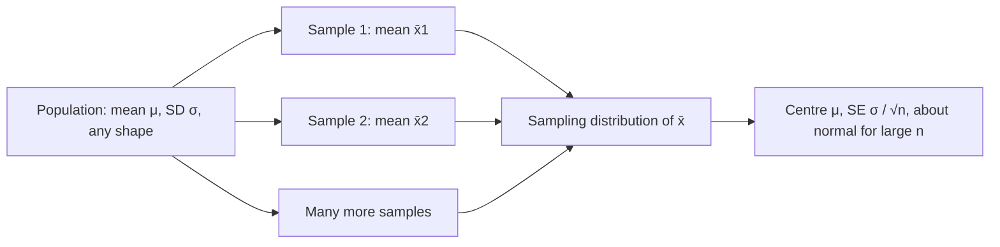

## Why should you care?

Two survey teams each pick 50 random Sahyadri Mart bills. Team A finds an average bill of ₹530; Team B finds ₹575. Neither did anything wrong: different random samples give different averages. So how far can one sample's average be from the truth? Is ₹575 "close enough" to report?

The answer is that sample averages are themselves random, and they follow a predictable pattern. They cluster around the true mean, with a spread that shrinks as the sample grows, and (amazingly) their distribution is nearly normal even when the data are skewed. This result, the **central limit theorem**, is the reason a survey of 1,000 people can describe a whole country, and the foundation of every confidence interval and hypothesis test that follows.

## In one line

The sampling distribution of a statistic is the distribution of its values across all possible samples of the same size; for the sample mean it is centred on μ with standard error $\sigma/\sqrt{n}$, and by the central limit theorem it is approximately normal for large samples.

## Explained

### Q1. What is a sampling distribution?

Imagine taking every possible random sample of size $n$ from a population and computing the sample mean $\bar{x}$ for each. ==The distribution of all those means is the sampling distribution of $\bar{x}$.==

- ==A statistic varies from sample to sample==; a parameter is fixed.
- ==The sampling distribution describes how much a statistic can vary==, so we can judge how far one sample's value may be from the truth.

In practice we take one sample, but theory (or simulation, in [[sampling-distributions-practical]]) tells us what the others would look like.

### Q2. Where is the sampling distribution of the mean centred?

$$E(\bar{x}) = \mu$$

==The sample mean is an **unbiased** estimator of μ==: on average across samples, it hits the population mean exactly. Individual samples miss, sometimes high and sometimes low, but there is no systematic tilt.

### Q3. What is the standard error?

==The standard error (SE) is the standard deviation of a statistic's sampling distribution.== For the mean:

$$SE(\bar{x}) = \frac{\sigma}{\sqrt{n}}$$

- ==It shrinks as the sample grows==, but only with $\sqrt{n}$: ==to halve the SE you need four times the sample.==
- When σ is unknown, estimate it by the sample SD $s$: $SE \approx s/\sqrt{n}$.
- ==SD describes individual values; SE describes sample means.== Individual bills vary a lot; averages of 100 bills vary much less.

### Q4. What does the central limit theorem (CLT) say?

==For a large enough sample, the sampling distribution of $\bar{x}$ is approximately normal, whatever the shape of the population.==

$$\bar{x} \approx N\!\left(\mu, \frac{\sigma^2}{n}\right)$$

- ==Rule of thumb: $n \ge 30$ is usually enough==; strongly skewed populations need more.
- ==If the population itself is normal, $\bar{x}$ is exactly normal for any n.==
- This is why [[normal-distribution]] z-values work for averages of skewed business data such as bills or revenue.

### Q5. What about a sample proportion?

For a proportion $\hat{p}$ (such as the share of visitors who buy), with population proportion $p$:

$$E(\hat{p}) = p \qquad SE(\hat{p}) = \sqrt{\frac{p(1-p)}{n}}$$

==$\hat{p}$ is approximately normal when $np \ge 10$ and $n(1-p) \ge 10$.==

A proportion is just the mean of 0/1 values (1 = buys), so the CLT covers it too.

### Q6. How does the CLT differ from the law of large numbers?

- ==**Law of large numbers:** the sample mean gets **closer** to μ as n grows.== It says where $\bar{x}$ ends up.
- ==**Central limit theorem:** the **shape** of the spread of $\bar{x}$ around μ is normal, with SE $\sigma/\sqrt{n}$.== It says how likely each size of error is.

Together: big samples give averages that are close to the truth, and we can say how close, with a probability.

## Analogy and real-life example

Ask one person to guess the weight of a cow at a village fair, and the guess may be far off. Average the guesses of 500 visitors and the average lands remarkably close to the true weight: individual errors in both directions cancel out. The averages of many such crowds would form a narrow bell curve around the truth. That is the CLT and the shrinking standard error at work.

Real use: an exit poll of a few thousand voters can estimate a party's vote share in a large state to within a few percentage points, because the SE of a proportion depends on the sample size, not the population size.

## Diagram

## Worked example

Suppose individual bill amounts at a store have mean μ = ₹550 and SD σ = ₹300, and are right-skewed. A survey team takes a random sample of $n = 36$ bills.

1. **Centre:** $E(\bar{x}) = 550$.
2. **Standard error:** $SE = 300/\sqrt{36} = 300/6 = 50$.
3. **Shape:** $n = 36 \ge 30$, so by the CLT $\bar{x}$ is approximately normal.
4. **Chance the sample mean exceeds ₹600:** $z = (600 - 550)/50 = 1$, so $P(\bar{x} > 600) = 1 - 0.8413 = 0.159$.
5. **Chance it is within ₹50 of the truth:** $P(500 < \bar{x} < 600) = P(-1 < Z < 1) = 0.683$.
6. **Larger sample, $n = 144$:** $SE = 300/12 = 25$, and $P(\bar{x} > 600) = P(Z > 2) = 0.023$.

**Conclusion:** with 36 bills, the sample average is within ₹50 of the true mean about 68% of the time; quadrupling the sample halves the SE, making a ₹50 miss rare.

## Try it

64% of visitors buy something. In a random sample of 400 visitors, what is the SE of the sample proportion? What is the chance the sample shows fewer than 60% buyers?

Start: $SE = \sqrt{0.64 \times 0.36 / 400} = \sqrt{0.000576} = \;?$

> [!answer]- Answer
> $SE = 0.024$. Check normality: $np = 256 \ge 10$ and $n(1-p) = 144 \ge 10$.
> $z = (0.60 - 0.64)/0.024 = -1.67$, so $P(\hat{p} < 0.60) = \Phi(-1.67) \approx 0.048$.
> About a 5% chance: a sample below 60% would be unusual but not impossible.

## Key facts and formulas

> [!important] Key facts
> - Sampling distribution: the distribution of a statistic over all possible samples of size $n$.
> - $E(\bar{x}) = \mu$: the sample mean is unbiased.
> - Standard error of the mean: $SE = \frac{\sigma}{\sqrt{n}}$ (estimate with $s/\sqrt{n}$); 4 × the sample halves the SE.
> - CLT: for large $n$ (usually $n \ge 30$), $\bar{x} \approx N(\mu, \sigma^2/n)$ whatever the population shape.
> - If the population is normal, $\bar{x}$ is normal for any $n$.
> - Proportion: $E(\hat{p}) = p$, $SE = \sqrt{p(1-p)/n}$; normal if $np \ge 10$ and $n(1-p) \ge 10$.
> - SD = spread of individual values; SE = spread of a statistic.
> - LLN: $\bar{x}$ gets close to μ. CLT: the error of $\bar{x}$ is approximately normal.

## Common mistakes

> [!warning] Common mistake
> Thinking the CLT makes the **data** normal. The bills stay skewed however many you collect. It is the distribution of **sample means** that becomes normal.

> [!warning] Common mistake
> Confusing SD and SE. An SD of ₹300 describes how individual bills vary; the SE of ₹50 describes how the average of 36 bills varies. Using the SD where the SE belongs makes intervals six times too wide.

> [!warning] Common mistake
> Believing a sample must be a large fraction of the population. The SE depends on $n$, not on the population size $N$ (as long as $n$ is a small part of $N$). A sample of 1,000 serves a city or a country equally well.

## Think deeper

- **How large is "large"?** Daily revenue at Sahyadri Mart is mildly skewed; individual bills might be much more skewed. Which needs a bigger $n$ for the CLT to work? Check by simulation in [[sampling-distributions-practical]].
- **Cost versus precision:** each extra survey response costs ₹50. Halving the SE needs four times the responses. When is the extra precision worth it?
- **When the CLT fails:** averages of extremely heavy-tailed data (some insurance claims, viral social-media views) can stay erratic even for large $n$. Why might one huge value dominate an average?

## Self-check

> [!quiz] Q1. The population SD is 40 and the sample size is 64. What is the standard error of the mean?
> (A) 40
> (B) 5
> (C) 0.625
> (D) 2.5
>
> > [!answer]- Answer: B
> > $SE = 40/\sqrt{64} = 40/8 = 5$.

> [!quiz] Q2. What happens to the SE of the mean if the sample size is multiplied by 4?
> (A) It is divided by 4
> (B) It is halved
> (C) It doubles
> (D) It does not change
>
> > [!answer]- Answer: B
> > $SE = \sigma/\sqrt{n}$, and $\sqrt{4} = 2$, so the SE halves.

> [!quiz] Q3. A population is strongly right-skewed. What does the CLT say about sample means of size 100?
> (A) They are also strongly right-skewed
> (B) They are approximately normal
> (C) They are uniform
> (D) Nothing, because the population is not normal
>
> > [!answer]- Answer: B
> > The CLT applies whatever the population's shape, provided $n$ is large enough.

> [!quiz] Q4. What is the mean of the sampling distribution of $\bar{x}$?
> (A) The sample mean
> (B) The population mean μ
> (C) $\mu/\sqrt{n}$
> (D) Zero
>
> > [!answer]- Answer: B
> > $E(\bar{x}) = \mu$: the sample mean is an unbiased estimator.

> [!quiz] Q5. $p = 0.5$ and $n = 100$. What is the SE of $\hat{p}$?
> (A) 0.5
> (B) 0.25
> (C) 0.05
> (D) 0.005
>
> > [!answer]- Answer: C
> > $\sqrt{0.5 \times 0.5/100} = \sqrt{0.0025} = 0.05$.

## Flashcards

What is a sampling distribution? :: The distribution of a statistic over all possible samples of the same size
Mean of the sampling distribution of x̄? :: μ (the sample mean is unbiased)
Standard error of the mean? :: σ / √n
How do you halve the standard error? :: Use four times the sample size
SD vs SE? :: SD: spread of individual values; SE: spread of a statistic across samples
Central limit theorem? :: For large n, the sample mean is approximately normal with mean μ and SE σ/√n, whatever the population shape
Rule of thumb for "large n" in the CLT? :: n ≥ 30 (more for strongly skewed populations)
SE of a sample proportion? :: √(p(1 − p) / n)
When is p̂ approximately normal? :: When np ≥ 10 and n(1 − p) ≥ 10
LLN vs CLT? :: LLN: x̄ gets close to μ; CLT: the distribution of x̄ is approximately normal

## Sources

- James R. Evans, *Business Analytics*, 3rd ed., Pearson, 2021, Ch. 6: Sampling and Estimation
- Freedman, Pisani & Purves, *Statistics*, 4th ed., Norton, 2007, Ch. 17: The Expected Value and Standard Error; Ch. 18: The Normal Approximation for Probability
