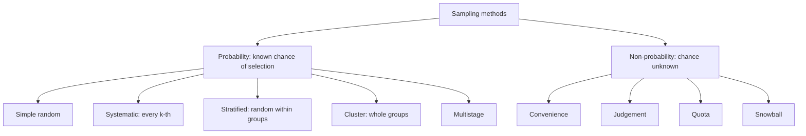

## Why should you care?

Sahyadri Mart has lakhs of customers a month. Management wants to know how satisfied they are. Asking every one of them would take months and cost a fortune; by the time the answers came in, they would be out of date. So the chain will ask a few hundred. But **which** few hundred?

If the staff simply ask whoever is standing near the entrance on a weekday morning, they will mostly hear from retired people and homemakers, and miss office-goers who shop late on weekends. The answer would be precise-looking and wrong. India's National Sample Survey, TV ratings, exit polls and every market-research study face the same problem. How you choose the sample decides whether its answers can be trusted.

## In one line

Sampling is the selection of a part of a population to study so that conclusions can be drawn about the whole, and probability sampling gives every unit a known, non-zero chance of being selected.

## Explained

### Q1. What are the key terms?

| Term | Meaning | Example |
|---|---|---|
| Population | ==The whole group we want to know about== | All Sahyadri Mart customers this month |
| Sample | ==The part we actually study== | 600 surveyed customers |
| Census | ==Studying every unit in the population== | India's Census of population |
| Sampling frame | ==The list from which the sample is drawn== | The loyalty-card database |
| Parameter | ==A number describing the population== (μ, σ, p) | True average satisfaction |
| Statistic | ==A number computed from the sample== ($\bar{x}$, $s$, $\hat{p}$) | Average satisfaction of the 600 |

We use statistics to **estimate** parameters.

### Q2. Why sample instead of taking a census?

- ==**Cost:** far cheaper==.
- ==**Time:** results arrive while they are still useful.==
- ==**Destructive testing:**== testing every light bulb to failure would leave none to sell.
- ==**Accuracy:** a small, well-trained survey team can make fewer recording errors== than a huge one.
- ==**Impossibility:** some populations are infinite or unreachable==, such as all future customers.

### Q3. What are the main probability sampling methods?

- ==**Simple random sampling (SRS):** every possible sample of size n has the same chance==; use random numbers or a lottery.
- ==**Systematic:** pick a random start, then every k-th unit==, where $k = N/n$. Easy for lists and queues.
- ==**Stratified:** split the population into similar groups (strata), then sample randomly within each==. Ensures every group is represented; often more precise.
- ==**Cluster:** randomly choose whole groups (clusters) and study everyone in them==, such as 3 of the 12 stores. Cheap, but less precise if clusters differ.
- ==**Multistage:** combine methods==, such as choose stores, then days, then customers.

### Q4. What are non-probability sampling methods?

- ==**Convenience:** whoever is easiest to reach==.
- ==**Judgement (purposive):** an expert picks "typical" units.==
- ==**Quota:** fill fixed numbers per group, but choose people non-randomly==.
- ==**Snowball:** respondents recruit others==; used for hard-to-reach groups.

They are quick and cheap, but ==selection probabilities are unknown, so sampling error cannot be measured== and bias is likely. Use them for exploration, not for firm conclusions.

### Q5. What kinds of error can a sample have?

- ==**Sampling error:** the chance difference between a statistic and the parameter==, because we saw only part of the population. ==It shrinks as the sample grows== and can be measured ([[sampling-distributions]]).
- ==**Non-sampling error (bias):** errors from how the data were collected==:
  - **selection bias:** the frame or method misses part of the population;
  - **non-response bias:** the people who answer differ from those who do not;
  - **measurement error:** leading questions, wrong recording.

==A bigger sample does not fix bias==: it gives a more precise wrong answer.

## Analogy and real-life example

To check whether a large pot of dal needs salt, a cook stirs it well and tastes one spoonful. Stirring is randomisation: it makes any spoonful represent the whole pot. Tasting only the top layer of an unstirred pot is convenience sampling, and it can mislead badly.

A classic warning: in 1936, the American magazine *Literary Digest* collected over 2 million replies from people drawn mainly from telephone and car-ownership lists, and predicted the wrong winner of the US presidential election. A much smaller but better-designed sample by George Gallup got it right. Size could not cure a biased frame.

## Diagram

## Worked example

Sahyadri Mart wants 600 survey responses. In the sales data, about 58% of bills come from the 5 Supermarkets and 42% from the 7 Express stores.

1. **Stratified (proportional):** strata = store type. Sample $600 \times 0.58 = 348$ Supermarket customers and $600 \times 0.42 = 252$ Express customers, chosen at random within each type.
2. **Systematic within a store:** the Mumbai store issues about 1,400 bills a day and needs 50 responses. $k = 1400/50 = 28$. Pick a random start between 1 and 28, say 17, then survey bills 17, 45, 73, ….
3. **Cluster alternative:** randomly choose 3 stores and survey every customer for one day. Cheaper to run, but if the chosen 3 are all Express stores, Supermarket customers are missed entirely.
4. **What to avoid:** surveying only morning customers at the entrance (convenience) would under-represent working people who shop in the evening.

**Conclusion:** stratifying by store type guarantees both types are represented in the right proportions; systematic selection makes the within-store choice easy and close to random.

## Try it

A bank has 5,000 customers in Pune, 3,000 in Nagpur and 2,000 in Nashik. It wants a stratified sample of 500, allocated in proportion to size. How many from each city?

Start: total $= 10{,}000$, so Pune's share is $5000/10000 = 0.5$.

> [!answer]- Answer
> Pune: $0.5 \times 500 = 250$. Nagpur: $0.3 \times 500 = 150$. Nashik: $0.2 \times 500 = 100$. Total 500.

## Key facts and formulas

> [!important] Key facts
> - Population (whole group) vs sample (part studied); census = studying everyone.
> - Parameter describes the population (μ, σ, p); statistic describes the sample ($\bar{x}$, $s$, $\hat{p}$).
> - Probability methods: simple random, systematic (every $k = N/n$), stratified, cluster, multistage.
> - Non-probability methods: convenience, judgement, quota, snowball.
> - Proportional stratified allocation: $n_h = n \times \frac{N_h}{N}$.
> - Sampling error: random, shrinks as $n$ grows, measurable.
> - Non-sampling error (bias): selection, non-response, measurement; not cured by a larger $n$.

## Common mistakes

> [!warning] Common mistake
> Confusing stratified and cluster sampling. Stratified samples **some units from every** group; cluster samples **all units from some** groups.

> [!warning] Common mistake
> Calling an online poll "random" because anyone could answer. People choose themselves (self-selection), usually those with strong opinions. It is a convenience sample.

> [!warning] Common mistake
> Using systematic sampling on a list with a repeating pattern. If $k = 7$ on a list of daily records, you might pick only Sundays.

## Think deeper

- **Frames in India:** which groups would a survey miss if its frame were smartphone app users? Landline numbers? Who is missing from a loyalty-card database?
- **Non-response:** only 20% of customers answer an SMS survey. Are they likely to be the most satisfied, the least satisfied, or both extremes?
- **Big data is not a census:** a chain's app data covers millions of transactions. Why can it still be a biased sample of all its customers?

## Self-check

> [!quiz] Q1. A survey divides customers by region and randomly samples within every region. Which method is this?
> (A) Cluster
> (B) Stratified
> (C) Systematic
> (D) Quota
>
> > [!answer]- Answer: B
> > Random sampling within every group is stratified sampling. Cluster sampling would take all customers from a few randomly chosen regions.

> [!quiz] Q2. Which of these is a parameter?
> (A) The mean bill of 200 surveyed customers
> (B) The proportion of all customers who use UPI
> (C) The SD of a sample
> (D) A sample median
>
> > [!answer]- Answer: B
> > A parameter describes the whole population. The others are statistics computed from a sample.

> [!quiz] Q3. A list has 2,000 names and we want 100. Using systematic sampling, what is k?
> (A) 100
> (B) 20
> (C) 200
> (D) 2
>
> > [!answer]- Answer: B
> > $k = N/n = 2000/100 = 20$: a random start between 1 and 20, then every 20th name.

> [!quiz] Q4. Which error does NOT decrease when the sample size increases?
> (A) Sampling error
> (B) Non-response bias
> (C) Standard error
> (D) Chance variation
>
> > [!answer]- Answer: B
> > Bias comes from how the sample was chosen or collected; more of the same biased data does not remove it.

> [!quiz] Q5. A researcher interviews shoppers outside one mall on one afternoon. What kind of sample is this?
> (A) Simple random
> (B) Stratified
> (C) Convenience
> (D) Cluster
>
> > [!answer]- Answer: C
> > The shoppers were chosen because they were easy to reach, not by a random process.

## Flashcards

Population vs sample? :: Population: the whole group of interest; sample: the part actually studied
What is a census? :: Studying every unit of the population
Parameter vs statistic? :: Parameter describes the population; statistic is computed from a sample
What is a sampling frame? :: The list from which the sample is drawn
Simple random sampling? :: Every possible sample of size n has the same chance of selection
Systematic sampling? :: Random start, then every k-th unit, with k = N/n
Stratified sampling? :: Split into similar groups (strata) and sample randomly within each
Cluster sampling? :: Randomly choose whole groups and study every unit in them
Four non-probability methods? :: Convenience, judgement, quota, snowball
Sampling error vs bias? :: Sampling error is chance and shrinks with n; bias comes from the method and does not
Proportional stratified allocation formula? :: n_h = n × N_h / N

## Sources

- James R. Evans, *Business Analytics*, 3rd ed., Pearson, 2021, Ch. 6: Sampling and Estimation
- Freedman, Pisani & Purves, *Statistics*, 4th ed., Norton, 2007, Part VI: Sampling (Ch. 19–23)
