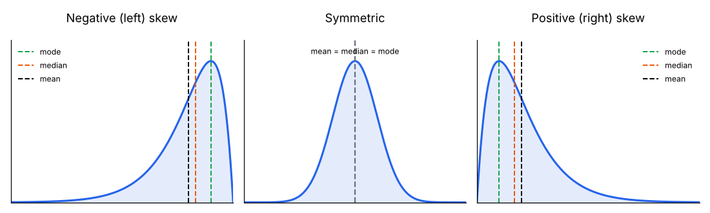
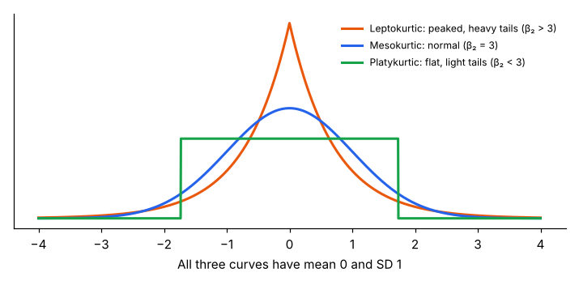
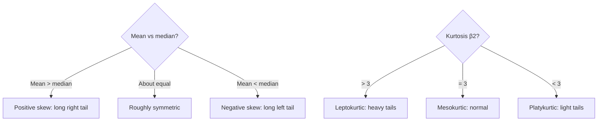

## Why should you care?

Two exam papers both have an average of 50 marks and an SD of 15. Are the two results the same?

Not necessarily. In the hard paper, most students scored 30–45 and a few toppers scored 90+, pulling the average up. In the easy paper, most scored 55–70 and a few who skipped studying scored very low, pulling it down. Same mean, same SD, opposite stories.

Mean and SD describe the centre and spread. **Skewness** describes whether the data lean to one side; **kurtosis** describes how heavy the extremes are. A bank that ignores kurtosis underestimates how often a market crash can happen.

## In one line

Skewness measures the lack of symmetry of a distribution (which side its long tail is on), and kurtosis measures how heavy its tails and how sharp its peak are compared with a normal distribution.

## Explained

### Q1. What is skewness? ⭐

==A distribution is **symmetric** when its left and right halves are mirror images==. Then mean = median = mode.

- ==**Positive (right) skew:** a long tail to the right==; a few very large values. ==In a positively skewed distribution, mean > median > mode.== Examples: incomes, house prices, order values, delivery times.
- ==**Negative (left) skew:** a long tail to the left==; a few very small values. ==Mean < median < mode==. Examples: marks in an easy exam, age at retirement.

==The mean is pulled towards the tail==, the mode stays at the peak, and the median sits between them.

### Q2. How is skewness measured with averages? ⭐

==**Karl Pearson's coefficient** compares the mean with the mode or the median==, in units of SD:

$$Sk_P = \frac{\bar{x} - \text{Mode}}{s} \qquad \text{or} \qquad Sk_P = \frac{3(\bar{x} - \text{Median})}{s}$$

The second form is used when the mode is unclear; it relies on ==the empirical relation Mode ≈ 3 Median − 2 Mean== for moderately skewed data.

==**Bowley's coefficient** uses quartiles== ([[quartiles-and-percentiles]]):

$$Sk_B = \frac{Q_3 + Q_1 - 2Q_2}{Q_3 - Q_1}$$

==It lies between −1 and +1== and ==ignores the outer 25% on each side==.

Sign: ==positive → right skew; zero → symmetric; negative → left skew==.

### Q3. What are moments, and how do they measure shape?

The $r$-th ==**central moment** is the average of the deviations raised to the power $r$==:

$$m_r = \frac{\sum (x_i - \bar{x})^r}{n}$$

- $m_1 = 0$ always; ==$m_2$ is the variance==.
- ==$m_3$: cubing keeps the sign==, so large deviations on one side dominate. This gives the ==**moment coefficient of skewness**==:

$$\gamma_1 = \frac{m_3}{m_2^{3/2}}$$

- ==$m_4$: the fourth power makes extreme values dominate==, which measures the tails (Q4).

Software such as pandas uses moment-based formulas.

### Q4. What is kurtosis? ⭐

$$\beta_2 = \frac{m_4}{m_2^2}$$

==Kurtosis compares the heaviness of a distribution's tails with those of a normal distribution==, for which β₂ = 3.

| Type | $\beta_2$ | Shape |
|---|---|---|
| ==Mesokurtic== | $= 3$ | Normal |
| ==Leptokurtic== | $> 3$ | ==Sharp peak, heavy tails==: more extreme values |
| ==Platykurtic== | $< 3$ | ==Flat top, light tails==: few extreme values |

==**Excess kurtosis**== $= \beta_2 - 3$, so the normal distribution scores 0. Most software reports excess kurtosis.

### Q5. How do I see shape in a graph?

- ==**[[distribution-plots|Histogram]]:** look for the long tail==. Tail on the right → positive skew.
- ==**[[distribution-plots|Box plot]]:** median nearer to $Q_1$== and a longer upper whisker → positive skew; ==many points beyond the whiskers → heavy tails==.

==Always look at a graph before trusting a single shape number.== Two very different shapes can share a skewness value.

## Analogy and real-life example

Think of a see-saw holding the data. The mean is the balance point. When a few heavy children (large values) sit far out on the right, the balance point moves right, away from where most children sit: that is positive skew.

Real example: in most countries, including India, income is strongly right-skewed. Most earners cluster at modest incomes, and a small number earn enormous amounts. This is why the median income is the better "typical" figure.

## Diagram

## Worked example

Delivery times (minutes) of 11 orders: 18, 22, 25, 27, 28, 30, 31, 33, 35, 40, 62.
Summary values: mean $\bar{x} = 351/11 = 31.91$, median $= 30$, sample SD $s = 11.68$, and (from the [[quartiles-and-percentiles]] worked example) $Q_1 = 25$, $Q_3 = 35$.

1. **Pearson:** $Sk_P = 3(31.91 - 30)/11.68 = 5.73/11.68 = 0.49$. Moderate positive skew.
2. **Bowley:** $Sk_B = (35 + 25 - 2 \times 30)/(35 - 25) = 0/10 = 0$. The middle half is perfectly symmetric.

**Why do they disagree?** The skew comes entirely from one late order (62 minutes) in the tail. Pearson's coefficient uses the mean, which feels the tail; Bowley's uses only quartiles, which ignore it. The data have a symmetric body and a long right tail.

## Try it

For the values 2, 3, 4, 5, 11, find $\gamma_1$ and $\beta_2$.

Start: mean $= 5$; deviations $-3, -2, -1, 0, 6$; $m_2 = (9 + 4 + 1 + 0 + 36)/5 = 10$.

> [!answer]- Answer
> Cubes: $-27, -8, -1, 0, 216$ → $m_3 = 180/5 = 36$. Fourth powers: $81, 16, 1, 0, 1296$ → $m_4 = 1394/5 = 278.8$.
>
> $\gamma_1 = 36 / 10^{1.5} = 36/31.62 = 1.14$: clearly **positively skewed** (the value 11).
>
> $\beta_2 = 278.8/10^2 = 2.79$: slightly **platykurtic**. With only five values, the kurtosis estimate is very unreliable.

## Key facts and formulas

> [!important] Key facts
> - Symmetric: mean = median = mode. Positive skew: mean > median > mode. Negative skew: mean < median < mode.
> - Karl Pearson: $Sk_P = \frac{\bar{x} - \text{Mode}}{s} = \frac{3(\bar{x} - \text{Median})}{s}$.
> - Empirical relation: Mode ≈ 3 Median − 2 Mean.
> - Bowley: $Sk_B = \frac{Q_3 + Q_1 - 2Q_2}{Q_3 - Q_1}$, between −1 and +1.
> - Central moment: $m_r = \frac{\sum (x_i - \bar{x})^r}{n}$; $m_1 = 0$, $m_2$ = variance.
> - Moment skewness: $\gamma_1 = \frac{m_3}{m_2^{3/2}}$. Kurtosis: $\beta_2 = \frac{m_4}{m_2^2}$; excess kurtosis $= \beta_2 - 3$.
> - $\beta_2 = 3$ mesokurtic (normal), $> 3$ leptokurtic (heavy tails), $< 3$ platykurtic (light tails).

## Common mistakes

> [!warning] Common mistake
> Naming the skew after the peak. A right-skewed distribution has its peak on the **left**; the name comes from the direction of the long tail.

> [!warning] Common mistake
> Reading pandas `.kurt()` as $\beta_2$. pandas reports **excess** kurtosis (normal = 0), with a small-sample correction. A pandas value of 0.5 means slightly heavier tails than normal, not platykurtic. Its `.skew()` also uses a sample correction, so it differs slightly from $\gamma_1$ for small $n$.

> [!warning] Common mistake
> Thinking kurtosis is only about the peak. It is driven mainly by the **tails**: how often extreme values occur. "Peakedness" is a side effect.

## Think deeper

- **Which average would you report for a skewed variable, and why?** Connect to [[central-tendency]].
- **Mixed groups create shape.** The revenue of a chain mixing small and large stores is right-skewed, but each store's revenue alone may be nearly symmetric. Is the skew a property of sales, or of how we grouped the data?
- **Fat tails in finance:** daily stock-market returns are known to be leptokurtic. If a risk model assumes a normal distribution, will it over- or underestimate the chance of a crash?
- **Transformations:** analysts often take the logarithm of right-skewed data such as revenue. What does a log do to a long right tail?

## Self-check

> [!quiz] Q1. For a distribution, mean = 60, median = 55, mode = 50. What is its shape?
> (A) Symmetric
> (B) Positively skewed
> (C) Negatively skewed
> (D) Cannot tell
>
> > [!answer]- Answer: B
> > Mean > median > mode: the mean is pulled to the right by a long right tail.

> [!quiz] Q2. Mean = 40, median = 42, SD = 6. What is Karl Pearson's coefficient of skewness?
> (A) −1
> (B) −0.33
> (C) 1
> (D) 0.33
>
> > [!answer]- Answer: A
> > $Sk_P = 3(40 - 42)/6 = -6/6 = -1$: negative skew.

> [!quiz] Q3. $Q_1 = 20$, $Q_2 = 30$, $Q_3 = 50$. What is Bowley's coefficient of skewness?
> (A) 0
> (B) 0.33
> (C) −0.33
> (D) 1
>
> > [!answer]- Answer: B
> > $Sk_B = (50 + 20 - 60)/(50 - 20) = 10/30 = 0.33$: the upper quarter is more spread out, so positive skew.

> [!quiz] Q4. A distribution has $\beta_2 = 5.2$. What is it called?
> (A) Mesokurtic
> (B) Platykurtic
> (C) Leptokurtic
> (D) Symmetric
>
> > [!answer]- Answer: C
> > $\beta_2 > 3$ means heavier tails than the normal: leptokurtic. (Kurtosis says nothing about symmetry.)

> [!quiz] Q5. Which moment is used to measure skewness?
> (A) First central moment
> (B) Second central moment
> (C) Third central moment
> (D) Fourth central moment
>
> > [!answer]- Answer: C
> > $m_3$ keeps the sign of deviations, so a longer tail on one side makes it positive or negative. $m_1$ is always 0, $m_2$ is the variance, and $m_4$ measures kurtosis.

## Flashcards

What does skewness measure? :: Lack of symmetry: which side the long tail is on
Order of averages in positive skew? :: Mean > median > mode
Order of averages in negative skew? :: Mean < median < mode
Karl Pearson's coefficient of skewness? :: (Mean − Mode) / SD, or 3(Mean − Median) / SD
Empirical relation between mean, median and mode? :: Mode ≈ 3 Median − 2 Mean
Bowley's coefficient of skewness? :: (Q3 + Q1 − 2Q2) / (Q3 − Q1)
Formula for the rth central moment? :: m_r = Σ(x − x̄)^r / n
Moment coefficient of skewness? :: γ1 = m3 / m2^(3/2)
Formula for kurtosis β2? :: m4 / m2²
β2 of a normal distribution? :: 3 (excess kurtosis 0)
Leptokurtic vs platykurtic? :: Leptokurtic: β2 > 3, heavy tails; platykurtic: β2 < 3, light tails
What does pandas .kurt() report? :: Excess kurtosis (β2 − 3), with a sample correction

## Sources

- James R. Evans, *Business Analytics*, 3rd ed., Pearson, 2021, Ch. 4: Descriptive Statistics
- S. C. Gupta and V. K. Kapoor, *Fundamentals of Mathematical Statistics*, Sultan Chand, Ch. 3: Measures of Dispersion, Skewness and Kurtosis
- NIST/SEMATECH *e-Handbook of Statistical Methods*, Section 1.3.5.11: Measures of Skewness and Kurtosis
- pandas documentation: [Series API reference (skew, kurt)](https://pandas.pydata.org/docs/reference/series.html)
