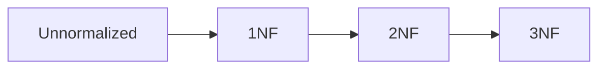

## Why should you care?            <!-- required · U · a real problem first -->
ENGINE TEST FIXTURE, not teaching content. A paragraph with **bold**, *italic*, `inline code`, a link to [[fixture-beta]], a link with display text [[fixture-beta|the beta note]], a section link [[fixture-beta#Explained|beta's Explained section]], and a planned link [[fixture-planned]]. External: [example](https://example.com).

## In one line                      <!-- required · M · the memory anchor -->
Inline maths $x_i^2 + y_{ij}$ and a price of 5 dollars stays plain.

## Explained                        <!-- required · U · Q&A style -->
### Q1. What is the placeholder?
Display maths on its own lines:

$$
\bar{x} = \frac{1}{n}\sum_{i=1}^{n} x_i
$$

### Q2. Why do we need it?
| Column A | Column B | Column C |
|---|---|---|
| 1 | placeholder | $a^2$ |
| 2 | placeholder | text |

### Q3. How does it work?
1. First step
2. Second step
   - nested point

## Diagram                          <!-- U · Mermaid -->


## Worked example                   <!-- U · fully solved -->
```python
# placeholder code
rows = [("A", 1), ("B", 2)]
for name, n in rows:
    print(name, n * 2)
```
```output
A 2
B 4
```
```sql
SELECT name, COUNT(*) FROM t GROUP BY name;
```

## Try it                           <!-- U · half-solved, answer collapsed -->
Placeholder exercise.

> [!answer]- Show the solution
> Placeholder solution with $z = 3$.

## Key facts and formulas           <!-- required · M · feeds flashcards -->
> [!important] Key facts
> - Placeholder fact one.
> - Formula $E = mc^2$.

## Common mistakes                  <!-- R · misconceptions -->
> [!warning] Common mistake
> Placeholder mistake.

> [!tip]
> A tip with no title.

## Think deeper                     <!-- R · trade-offs, "what if", design -->
> [!example]+ An open foldable example
> Placeholder.

## Self-check                       <!-- required · M/U/R · 3–5 questions -->
> [!quiz] Q1. Which normal form removes partial dependency?
> (A) 1NF
> (B) 2NF
> (C) 3NF
> (D) BCNF
>
> > [!answer]- Answer: B
> > Placeholder explanation one.

> [!quiz] Q2. Placeholder question with maths $n^2$?
> (A) one
> (B) two
>
> > [!answer]- Answer: A
> > Placeholder explanation two.

> [!quiz] Q3. A question with no options?
>
> > [!answer]- Answer
> > Placeholder long answer.

## Flashcards                       <!-- required · M -->
What does 2NF remove? :: Partial dependency on a composite key
Placeholder front with $x^2$ :: Placeholder back

## Sources                          <!-- required -->
- Placeholder source, Ch. 1 (verify)
